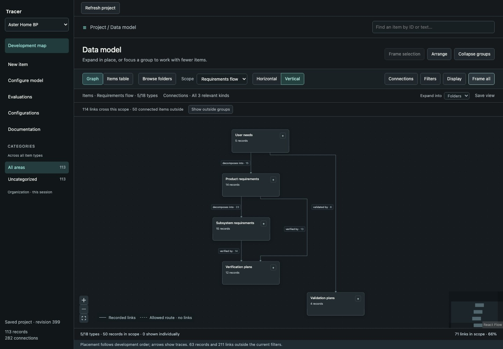
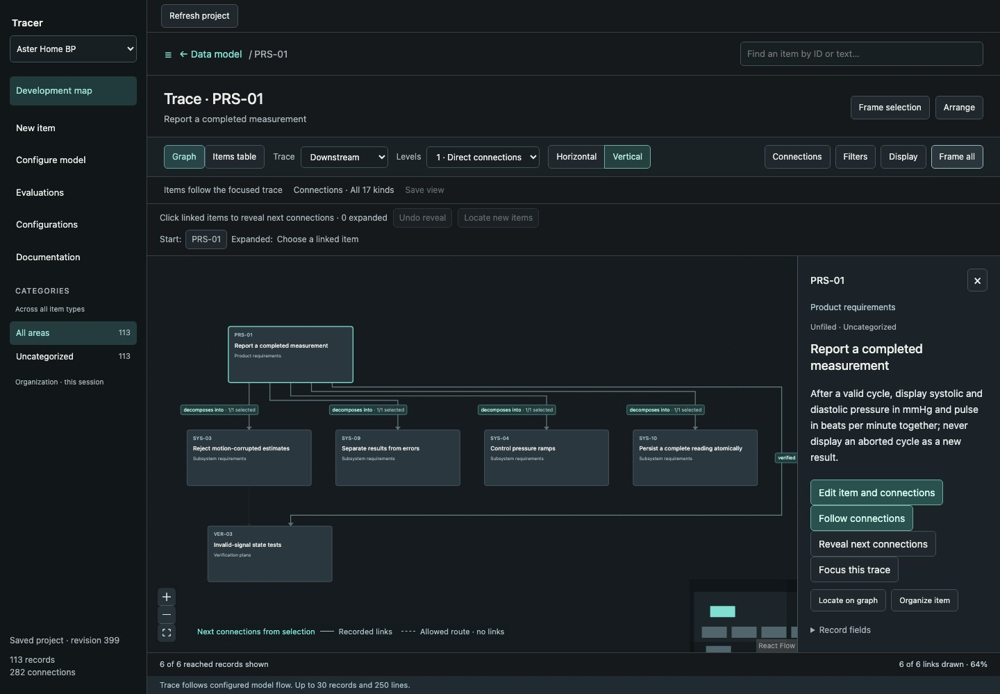

<h1>
  <picture>
    <source media="(prefers-color-scheme: dark)" srcset="ui/public/tracer-wordmark-light.svg" />
    
  </picture>
</h1>

Follow engineering intent through requirements, implementation and evidence—and see what changed.

Tracer is a local-first engineering knowledge and traceability workspace. Define your own record types and relationships, compare sibling responsibilities in aligned traces, inspect captured evidence in context, and save useful working scopes. SQLite stores the project; no account or cloud service is required.

This is a working source preview. It includes a CLI and browser workspace, with explicit limits described below.

## Try it

Use Node.js **24.15+** and npm:

```sh
npm ci
npm run demo
```

Open the printed URL. The project picker switches between **Orbit R1** (a fictional robot vacuum) and **Aster Home BP** (a fictional blood-pressure monitor). Each project has its own SQLite database. Both use the same map-led interface built over the headless core; switching projects never combines their records.

Start at the **Development map**. Expand a type, find an item by ID or text, and follow its recorded connections. **Graph** and **Items table** show the same working scope. The inspector opens item editing and connection authoring; **Evaluations**, **Configurations**, and **Configure model** open retained tasks in the same application. **Return to map** keeps the in-session task draft. The [walkthrough](docs/getting-started.md) explains this flow.



_Actual integrated UI using fictional Aster data; Orbit uses this same interface with its own database._



_The map reads native records and versions from the core, rather than a separate UI fixture._

Each demo launch creates two fresh isolated projects. Edits persist in their printed databases; the terminal prints a command to reopen **both**. Switching projects reloads the session and asks before discarding unsaved drafts and temporary organization. Saved records stay in their respective databases.

For the reviewed Graph / Matrix / History authoring and assessment candidate, run `npm run workbench`. It seeds separate fictional Aster/Gatherline databases and remains isolated from the production map. Its [guide](docs/ux-artifacts/product-identity/README.md) covers setup, regression checks and regenerating desktop/680px screenshots.

## Three realistic examples

| Command                        | Fictional project            | What to explore                                                                               |
| ------------------------------ | ---------------------------- | --------------------------------------------------------------------------------------------- |
| `npm run workspace:integrated` | Orbit R1 robot vacuum        | Shared hardware/software responsibilities, alternatives, build configurations and evaluations |
| `npm run workspace:medical`    | Aster Home BP monitor        | User needs, product requirements, subsystem allocations, risk controls and design V&V         |
| `npm run workspace:technology` | Gatherline offline event app | Product outcomes, stories, architecture, delivery, experiments and operational findings       |

Each includes multiple hierarchy levels, sibling comparisons, shared records, missing evaluations and an actual version change affecting a captured receipt. All project-specific targets and outcomes are fictional. See [example structures and tasks](docs/realistic-examples.md).

For scale exploration, `npm run demo:working` creates 1,000 synthetic items; `npm run demo:large` creates 10,000. `npm run demo:small` exercises local file and Git observations and requires Git. These are separate fixtures, not capacity guarantees.

## Start your own project

```sh
npm start -- --db my-project.sqlite
```

Follow the [worked example](docs/getting-started.md#worked-example-start-a-product-from-an-empty-database) to build a desk-light model from an empty database, add three items, connect them and reopen saved work.

Define types, fields and relationships with **Configure model**, then use **New item** to populate the project. Find records on the map, select one, and choose **Edit item and connections**. Project terms and schemas remain configurable. Evaluation receipts and exact native configurations are available from the same shell.

To open two existing databases in the project picker:

```sh
npm start -- --db orbit/project.sqlite --guide orbit/tasks.json --secondary-db aster/project.sqlite --secondary-guide aster/tasks.json
```

Guides are optional for ordinary projects. Database files must be different; the server only exposes the explicitly configured projects.

To keep a realistic example in a chosen new directory:

```sh
npm run seed -- my-example --size integrated
npm start -- --db my-example/project.sqlite --guide my-example/tasks.json
```

Seeding refuses an existing directory. Omit `--guide` for an ordinary project. Use `--port 4318` if the default port is occupied. Ctrl+C closes the server; reopen the same database to resume work.

## Core contracts and current UI limits

- Native entities and relationships retain versioned history. Writes check captured versions, and failed saves preserve working drafts.
- Evaluation receipts retain explicitly declared input snapshots, including selected historical native revisions. Reviews are separate immutable records.
- Immutable configurations pin selected native member revisions; their receipts keep the evaluated build separate from current drift.
- Optional configuration connection pins preserve explicitly selected topology. Named native baselines reconstruct schema, items and relationships at one complete committed project revision.
- Versioned project coverage expectations evaluate exact structural links against current data or captured baselines through service, CLI and typed local API. The three realistic seeds include example policies; use `coverage list` and `coverage evaluate JSON`. Structural coverage does not imply successful testing or release readiness.
- `impact get JSON` compares selected native context against a named baseline and separately investigates captured-input drift. Native/evidence guards keep pages consistent; no automatic causation or readiness judgment is inferred.
- `working-context get JSON` reads an explicitly authored branch and ordered routes with related receipts, actual captured-input facts and snapshot-bound pages. It requires no baseline; see the [working-context contract](docs/architecture.md#consistent-working-context-read). The mounted UI adapter is follow-up work.
- Queries are bounded or paged and disclose incomplete context. Directed links and shared identities stay explicit.
- Projects use their own terminology; medical-device, software and integrated-product examples use the same core.

The map reads a complete transactional native snapshot, bounded to **10,000 records and 100,000 connections**. It rejects larger projects explicitly instead of displaying a silently incomplete snapshot. Drawing and trace bounds remain disclosed independently. Folder/category edits and map view recipes are currently **session-only**; they do not modify engineering links or claim durable organization. Existing headless saved-view contracts remain available through the API/CLI. There is one application UI; the former map-study launch command delegates to it.

A recorded link does not establish satisfaction. A changed input calls for review; it does not automatically invalidate an engineering result. Schema permissions are not completeness rules or release criteria.

The examples include immutable native configuration captures. Ordinary member links and JSON manifests remain navigation annotations. Captures pin selected records; they do not establish a complete BOM, release readiness or a whole-project baseline. There is no engineering calculation engine, certification evaluator, hosted collaboration or CI/CAD/PLM synchronization. Local file/Git observations are explicit actions.

## Documentation

Start with the [documentation index](docs/README.md). Useful entry points:

Choose **Documentation** in the running application to read the walkthrough, examples and industry guides, then return to the map.

- [First-use walkthrough](docs/getting-started.md)
- [Realistic example structures](docs/realistic-examples.md)
- [Product development across industries](docs/industry-workflows/README.md)
- [CLI, working views and storage contracts](docs/developer-reference.md)
- [Architecture](docs/architecture.md) and [contributing](CONTRIBUTING.md)

The [product vision](docs/user-needs.md#product-vision) describes the broader direction and stable needs. [UX exploration](docs/ux-plan.md) and the [checkpoint](docs/checkpoint.md) distinguish implemented behavior, proposals and historical checks.

## Use the headless core

Import `Tracer` from `@tracer-local/core` and `SQLiteRepository` from `@tracer-local/core/sqlite` to embed the core directly in TypeScript, use JSON CLI commands, or call the typed local HTTP API. Start with the [core API guide](docs/developer-reference.md#use-the-headless-core), including named commands, exact-ID reads, model previews, version guards, paging, structured errors and HTTP session setup. Run `node examples/product-model.ts` for a disposable end-to-end example without the UI. The API currently ships as source in this checkout, with no published npm SDK.

## Development

```sh
npx playwright install chromium
npm run check       # formatting, types, hooks, unit/browser tests and quality
npm test            # focused unit/service/projection checks
npm run build
```

Install Chromium with `npx playwright install chromium` before the first browser check. Linux runners may also need system dependencies; see [contributing](CONTRIBUTING.md).

See the [repository map](CONTRIBUTING.md#repository-map) for source boundaries and the [design study index](docs/ux-artifacts/README.md) for isolated prototypes.

The core and CLI use Node's built-in SQLite; React and Vite support the browser UI. No runtime server framework is required. Commands run from the repository root.

## License

[MIT](LICENSE). Dependencies retain their own licenses.
