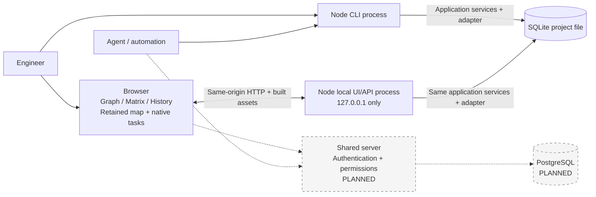
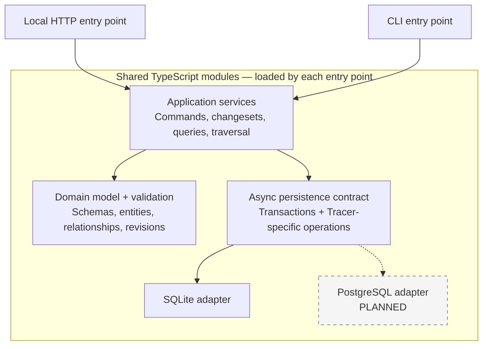
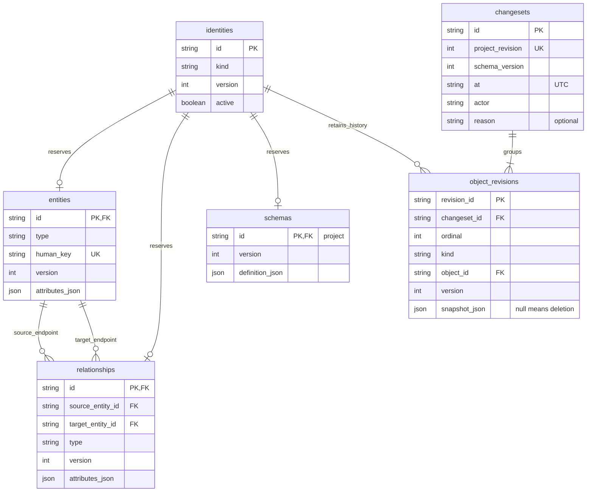
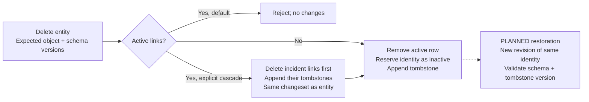
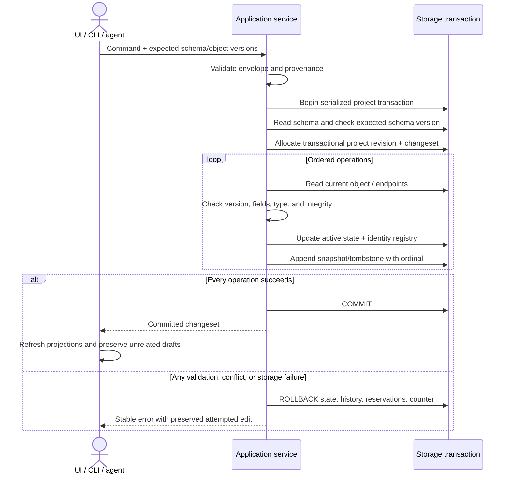
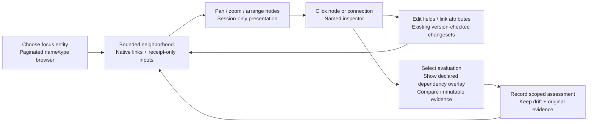
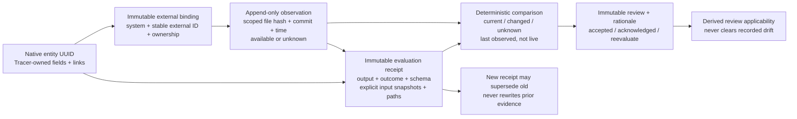
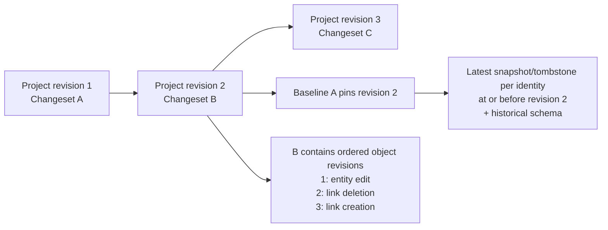

# Tracer architecture

## Shared workbench and retained map over the headless core

The default entry is `ui/main.tsx` → `ui/workbench/app.js`: Graph, Matrix and History share selection, revision, exact link identity and investigation scope. The typed adapter reuses production decoding, transport and mutation control. Studies re-export production owners for fixture/review orchestration and static-export loading; production cannot import studies or historical fixtures.

Project tools keeps visited `NativeTasks` editors mounted across navigation: schema, complete item/link editing, receipts, configurations and documentation. One mutation-controller context guards nested tasks against pending/unknown saves. The retained Development map (`?workspace=map`, `UnifiedApp` → `ui/map/`) loads separately to isolate its global CSS. Both routes use the same native contracts.

The schema task is rendered as a full-viewport Model page instead of a task dialog. The workbench's retained task owner maps `#model` and browser history to that page, makes the underlying graph inert while it is active, and retains the existing schema draft across returns. Other tasks retain their dialogs. `ui/model-page.css` owns page geometry; schema editing, save/conflict handling and native mutations remain with their existing owners. Initial page framing measures the actual model canvas viewport.

### Workbench ownership

| Owner                                                                      | Contract                                                                                                                                                                                                                                                                                                                                                                                                                                      |
| -------------------------------------------------------------------------- | --------------------------------------------------------------------------------------------------------------------------------------------------------------------------------------------------------------------------------------------------------------------------------------------------------------------------------------------------------------------------------------------------------------------------------------------- |
| `workspace-session.ts`                                                     | Typed owner of the loaded workspace snapshot, derived head and revision cache. Snapshot adoption explicitly distinguishes confirmed save, Project tools refresh, pending-save inspection and editor-save inspection. Model projection applies local overlays only at the loaded head; historical reads retain recorded data. Native writes, acknowledgment, read locks, retained drafts and rendering remain with their existing controllers. |
| `workspace-navigation.ts`                                                  | Typed selection, perspective, revision, inspector and investigation-return transitions over the single workspace state. Explicit draft capture, selection cancellation/flush, rendering and focus callbacks preserve effect order. Head, paths and scope are read through current providers; mutation guards and recovery retain their existing owners.                                                                                       |
| `dom-bindings.ts`                                                          | Shared typed direct-listener setup for workbench and inspector DOM. Reset aborts the previous scope; disposal on rerender/page suspension removes detached handlers. Current controls bind once on return. Workspace relationship inspection excludes grid descendants, whose selection/editing belongs to Matrix input. Global keyboard/resize and graph/Matrix gestures retain their owners.                                                |
| `html.ts`                                                                  | Shared literal HTML escaping and monospace identifier markup. Workspace and Matrix rendering use the same encoding for text and quoted attributes.                                                                                                                                                                                                                                                                                            |
| `inspector-renderer.ts`                                                    | Typed artifact/relationship markup reads current model, schema, head and revisions through providers. Read-only render contracts expose no commit path; field support, recorded-route and reachable-trace policies retain their existing owners.                                                                                                                                                                                              |
| `inspector-bindings.ts`                                                    | One abortable listener lifetime for inspector actions, field editing, scope editing, related/route/history navigation and resizing. Rerender and page suspension dispose detached controls; cached-page return binds the current DOM. The workspace retains global actions and keyboard ordering; existing editors retain save/cancel, locks and captured-version ownership.                                                                  |
| `inspector-interactions.ts`, `artifact-draft.ts`, `connection-picker.ts`   | Tab-local inspector reading/caret recovery, editor keyboard/busy feedback, no-op text field composition and retention of other draft fields after a confirmed single-field save. Compatible target suggestions resolve to exact keys; existing workspace mutation and captured-version owners remain authoritative.                                                                                                                           |
| `artifact-editor.ts`, `relationship-scope-editor.ts`, `editing-context.ts` | Strictly typed draft capture, validation, save/cancel and scope editing through a shared command callback. Providers read the current schema/model/head after refresh; confirmed partial saves retain only their own returned version. The workspace retains transaction, pending/unknown-write and reconciliation ownership.                                                                                                                 |
| `authoring-dialogs.ts`, `workspace-dialog.ts`                              | Typed artifact creation and relationship dialogs preserve captured schema, exact endpoint/version guards and duplicate rejection through the existing commit owner. Dialog focus returns to the original control or its rendered action replacement, then workspace search, when native close leaves focus in the body or hidden dialog; deliberate focus elsewhere remains authoritative.                                                    |
| `listbox-navigation.ts`                                                    | Search and compatible-target pickers share active-option, wrapping arrow and Enter handling; composition and modified keys do not execute suggestions. Focus remains in the input.                                                                                                                                                                                                                                                            |
| `workspace.css`, `styles/`                                                 | Ordered base/theme, layout, navigation, inspection, Matrix, controls, trace-grid authoring, narrow-screen overrides, search and editing files. Surviving rules retain their cascade order and media-query boundaries.                                                                                                                                                                                                                         |
| `recovery.ts`                                                              | Versioned local-storage context keyed by the project's first immutable changeset: positions, scope, perspective, revision and investigation. Current scope follows a newer head; historical scope keeps its revision. Invalid/future-head context is ignored. Drafts, comparison tokens and proposals are excluded. An unknown-save marker restores a write pause requiring inspection/acknowledgment. Recovery is browser/origin-local.      |
| `workspace-history.ts`                                                     | Strictly typed history reconstruction/diffs over the adapter's chronological discriminated entity/relationship/schema revisions. Index the preceding snapshot once per changeset; keep entity/link identities separate even when IDs coincide.                                                                                                                                                                                                |
| `matrix-recipes.ts`                                                        | Native chain saved-view dialogs and saves with schema/version guards and the current write guard. Restore clears unrelated investigation/path selection; incoming paths reject without reversing stored direction.                                                                                                                                                                                                                            |
| `graph-geometry.ts`, `graph-layout.ts`                                     | Pure projection, anchored zoom, measured-card fit, scaled dragging and bounded placement; layout measures canvas/inspector and uses one workspace position map for framing, expansion, investigation and historical return.                                                                                                                                                                                                                   |
| `graph-input.ts`, `selection-delay.ts`                                     | One abortable canvas binding with pointer capture, wheel handling and gesture cancellation. Replacement removes node/global listeners and delayed selection; blur/dialogs also cancel. Generation checks invalidate already-queued callbacks; keyboard selection is immediate.                                                                                                                                                                |
| `workspace-events.ts`                                                      | Document keyboard and coalesced resize lifetime. Suspension cancels input/frames; cached-page return installs one lifetime and renders current state; exit disposes it. No mutation replay or native revisions.                                                                                                                                                                                                                               |
| `matrix-editor.ts`, `matrix-renderer.ts`, `matrix-types.ts`                | Strictly typed draft capture/save/cancel, grid/popover markup and cell/row/draft/editor-context contracts. One `createGridEditor` per workspace reads current context for each action; existing proposal and workspace commit owners retain version/schema/endpoint guards and save recovery.                                                                                                                                                 |
| `matrix-input.ts`, `matrix-form-input.ts`, `matrix-selection.ts`           | Abortable grid/range-copy and form/target-picker input; DOM-independent merged-cell navigation, range intersection and exact row paths. Replacement cancels listeners/observer/render; blur cancels refresh; suspension disposes input while retaining drafts. Graph/Matrix share the scheduler with distinct delays.                                                                                                                         |
| `matrix-spans.ts`                                                          | Typed ancestor-span presentation policy used by the Matrix renderer and re-exported by the review `trace-table.mjs` shim. Prefix identities and exact links determine merging; rows and recorded identities remain unchanged.                                                                                                                                                                                                                 |
| `matrix-placement.ts`                                                      | Pure popover placement with scoped observer/anchor lifetime; detached/disposed editors cannot reposition newer ones.                                                                                                                                                                                                                                                                                                                          |
| `matrix-proposal.ts`                                                       | Pure native operations preserving captured endpoint versions, exact link IDs, schema guards, duplicate rejection and atomic create/link. Existing owners handle DOM errors and commit/reconciliation; new-item focus targets the rendered form.                                                                                                                                                                                               |
| `matrix-columns.ts`                                                        | Legal outgoing Matrix relationship/type pairs from schema endpoint constraints, including Any/None. Preserve valid authored steps, prefer explicit forward workflow routes for defaults, stop at terminal types and reconcile following columns only on configuration edits. No native writes or impact inference.                                                                                                                            |

Theme variables belong in `styles/base.css`; runtime dimensions belong to inspector rendering and `graph-layout.ts`. Keep fixes in the owning stylesheet instead of appending overrides to the entry. Source checks reject missing/duplicate imports, unresolved theme references and malformed hex colors.

### Model input validation

New schema writes and previews reject unknown properties at the root, type, field, workflow-route and coverage-policy/population/filter levels with a `validation` error containing the exact property path. Native `id: "project"` and nonnegative integer `version` metadata remain recognized for existing SchemaObject callers; expected-version guards still govern writes. Historical/API response decoding preserves extension properties accepted by older writers so immutable history remains readable. Updating an old model requires explicitly removing unsupported properties. Simple CLI entity/relationship create/update JSON rejects unsupported input properties (including IDs and relationship guards); use the existing named API or changeset operation for those supported capabilities.

### Atomic first-project setup

The existing named `setSchema` command and typed `POST /api/schema` accept optional `initialViews: InitialView[]` only with expected schema version zero. The schema/coverage revision and up to ten named views commit in one repository transaction using the existing saved-view validation, endpoint checks, name/capacity constraints and version guards. An invalid/duplicate view rolls back the schema, native head/history and earlier views. Competing or repeated setup is guarded; it never appends duplicate recipes. No storage migration or new engineering store is needed. Later model edits use the ordinary schema command; recipes remain independently editable presentation metadata.

The Engineering template owns optional acceptance/method/expected-result/subsystem/build fields, four structural policies and three outgoing recipes. Stored schemas remain authoritative; legacy flow suggestions do not silently add these fields or policies. Subsystem/build fields are text references. On empty-project entry without recovered context or an explicit view, the workbench selects the longest saved chain; first-save refresh follows the same rule. Model/create/item dirty reporting clears confirmed forms while other task drafts retain their existing owners.

### Snapshot adoption and refresh

`createWorkspaceSession` exposes the current loaded data/head and derives revision models from a private cache. Every adopted snapshot invalidates that cache, including a replacement at the same head. The controller keeps its rendered model until the existing explicit refresh/render points; projection does not mutate recorded snapshots or adopt newer draft versions.

All four adoption reasons move the viewed revision and event to the loaded head. Only a confirmed save moves assessment to that head. Confirmed save, Project tools refresh and pending-save inspection advance the evidence epoch; editor-save inspection retains it. Project tools refresh alone restores the caller-owned read lock from recovered uncertainty. Successful reads precede adoption; uncertain-save acknowledgment still occurs only after a successful native load. Failed reads retain the prior session snapshot. The existing commit owner distinguishes a failed save from a confirmed save whose refresh failed, retains the proposal and pauses further writes in the latter case. The session performs no IO or mutation reconciliation and introduces no second mutation store.

### Native reads and database selection

`Tracer.getProjectSnapshot()` reads schema, head, entities and links in one transaction. Typed `/api/project-snapshot` accepts no filters and rejects beyond **10,000 records / 100,000 connections**, never returning a partial map as complete. Rendering has separate bounds; larger headless workloads use paged queries.

The server may register two explicit Tracer/repository instances. `/api/projects` lists configured IDs/titles; `X-Tracer-Project` selects an allowlisted instance under existing origin/token guards. Unknown IDs reject; requests cannot supply database paths. Transport identity is fixed per document. Switching confirms unsaved-state disposal and reloads so drafts/delayed responses cannot target another database. Shutdown drains requests before closing repositories.

Failed native reads retain the last map and pause writes. Unknown writes retain proposals for explicit inspection/recovery; modal task returns preserve drafts. Labels normalize optional key/statement presentation without changing stored fields. Native data does not infer fictional medical folder assignments. Development-map organization and recipe saves are session-only; engineering records/evidence/configurations and named Matrix recipes persist.

### Retained map ownership

| Owner                                                                                           | Contract                                                                                                                                                                                                                                                         |
| ----------------------------------------------------------------------------------------------- | ---------------------------------------------------------------------------------------------------------------------------------------------------------------------------------------------------------------------------------------------------------------- |
| `app.tsx`, `use-map-controller.ts`                                                              | Compose typed view, organization, search, saved-view, tool, trace-history and layout owners. Navigation/scope/canvas/inspector/feedback components group presentation; pure policies remain separate.                                                            |
| `graph-elements.tsx`, `map-projection.ts`, `camera.ts`, `graph-interaction.ts`, `edge-route.ts` | Graph elements, projection dispatch, camera, drag/focus and edge routes. Node rendering and label avoidance share manual/self-loop routing.                                                                                                                      |
| `runLayout`                                                                                     | One cancellable calculation/geometry/measurement/camera lifetime. Scope changes/unmount cancel frames and ignore late resolutions/rejections; synchronous failures are reported. Map and chosen-path walker share lifetime with distinct camera policies.        |
| `view-state.ts`                                                                                 | Immutable reducer for 19 presentation fields with atomic patches/functional updates. Snapshot envelopes add geometry/camera; restore selects owned fields. History, views, organization, tools and drafts retain separate owners to prevent recursive snapshots. |
| `edge-presentation.ts`, `flow-geometry.ts`                                                      | Per-scope selection/geometry/incident-link indexes preserving parallel links and counting self-loops once. Shared ELK/incremental/label geometry uses parent-first absolute coordinates. Workflow display direction does not change adjacency.                   |
| `resize-listener.ts`                                                                            | Coalesced scope-owned frames canceled with listeners on replacement/unmount: main map waits two frames, walker one.                                                                                                                                              |
| `label-placement.ts`                                                                            | Separate routing, obstacle and collision policies; stable nearest-first search, at most 160 attempts and right-of-obstacles fallback. Each lookup still scans obstacles.                                                                                         |
| `organization.ts`, `directory-projection.ts`, `study-organization.ts`                           | Directory/area/paging structure, bounded graph/boundary projection and explicitly fictional assignments. Counts use one identity pass, deduplicate repeated area assignments and retain empty authored choices. Structural consumers do not depend on rendering. |

Typed `mapData` owns native scopes. Synthetic scale data and historical medical presets are test fixtures; historical re-exports preserve reference imports. Projection tests live in `test/map/`; older editor/query components mount only in `.fallow/legacy-ui`. The trace lens owns dialog focus/path state while sharing cancellable layout; display controls share declarative `Choice`.

The map renderer and extracted policies use strict TypeScript. Dependency declarations are skipped because ELK's declarations fail strict checking. Hook, coverage and baseline-free Fallow gates are described in [Contributing](../CONTRIBUTING.md).

This document owns implemented contracts and future technical obligations. [UX planning](ux-plan.md) owns selected interactions; [checkpoint](checkpoint.md) owns progress/check evidence. PostgreSQL, restoration and standalone packaging remain planned.

Mermaid flowcharts use solid implemented and dashed planned connections; sequence-diagram dashed arrows are responses. These C4-style module maps do not introduce additional services.

## Separate next-work queues

`Tracer.getNextWork(query?)`, CLI `next-work get` and typed `GET /api/next-work` return five independent queues over one transaction: missing statements, zero qualifying allocation targets, zero qualifying verification-plan targets, confirmed declared-input drift and unresolved reviews. Current schema/coverage policies are authoritative; the Engineering starter's vocabulary supplies compatible defaults. Custom models select explicit type/field/policy roles through the query. Empty choices are unconfigured, not covered. Selection is a read filter, not a new schema field or engineering write.

Application owners exhaust bounded entity, coverage-subject and receipt pages through the existing repository port. Structural checks use complete policy-qualified connections, including direction/population filters. Evidence reuses transaction-local `compareReceiptState`, including scoped fields/links, last recorded observations, unknown state and token-specific review applicability. Explicitly superseded receipts are excluded from current work; immutable payloads remain untouched. Applicable Accepted/Acknowledged decisions resolve review work only; Needs reevaluation and missing/retired decisions remain unresolved. Native/evidence boundaries stay separate.

The response owns complete summary rows with exact versions, explanations and evaluated populations. UI pagination does not truncate counts. Current editor/review reads retain their own guarded authority and mounted drafts. Failed reads never authorize an edit or display false empty results. Queues are read-only; no migration, task store, polling or alternate write path is introduced. The [next-work guide](next-work.md) owns membership, budgets and interface formats.

## Deterministic project export

`Tracer.exportProject()` reads current native objects/schema, all recorded changesets/revisions (including tombstones), all immutable evidence/configurations/baselines and current saved views in one repository transaction. No viewport bounds or public pagination defaults truncate the export. Native `projectRevision` and the evidence append watermark are captured independently; neither claims to version captures or presentation metadata. Embedded receipt, review and pin snapshots remain unchanged, including historical schemas and provenance. Original native history is preserved even when inherited from legacy migration.

The portable versioned `ProjectExport` contract and canonical serializer live in core; application owns paging and budgets. The existing repository port suffices: no migration, staging store, observation or engineering write is added. The typed local read route, CLI and browser download use identical sorted-key UTF-8 JSON with one LF and no newly generated metadata. Evidence/capture arrays preserve their collection append order; payload arrays preserve their recorded meaning. Unknown external availability remains unknown; export never polls external files or recalculates freshness. Full contents, ordering, limits and external-preservation semantics are owned by the [export guide](project-export.md).

Preparation is bounded to 250,000 collection entries and 64 MiB canonical output. Paging accounts for entries/bytes as it proceeds and checks the final complete serialization; over-budget or failed reads reject without a partial response. The browser retains the prepared bytes and displayed native/evidence context until explicit preparation replaces them. Failed preparations clear the downloadable snapshot. This is current-project data portability; selected-baseline review packages and restore are separate scope.

## CSV import planning and commit

`src/core/csv.ts` owns bounded comma-separated parsing with UTF-8 BOM, quoted commas/newlines, doubled quotes and physical line numbers. `csv-import-fields.ts` performs schema-directed conversion without evaluating text. The portable `previewCsvImport` planner resolves exact active keys over a complete supplied `ProjectSnapshot`, registers every proposed record before resolving links, validates mapped fields/endpoints/duplicates and returns restricted explicit-ID create operations. Any issue clears the whole operation array. It does not access storage or allocate history.

`ui/csv-import*` owns file/paste input, mapping, fresh typed snapshot reads, preview paging and tab-local draft state. Inputs/mappings invalidate preview, and a confirmed save clears the draft. The UI sends the captured operations through the existing mutation controller to `/api/changesets`; there is no alternate write route, staging table or storage migration. Native validation and transaction rollback remain authoritative. Each link captures source/target versions and `rejectExisting:true`; schema capture and unique keys protect the rest of the plan. The optional native changeset `expectedProjectRevision` guard is supplied by CSV import and checked inside the transaction before any write. Any intervening native revision rejects this preview, protecting its exact population and resulting-size checks. Existing batch callers may omit this guard. Explicit IDs support existing uncertain-save reconciliation, whose bounded/incomplete disclosures remain applicable to large batches. A failed or uncertain response is never treated as permission to replay.

The public parser/planner exports are available to scripts, followed by an explicitly authorized `applyChangeset`. Limits: 512 KiB, 100 columns, 1,000 data rows, eight optional link mappings, 1,000 combined operations and a serialized HTTP batch under 1,000,000 bytes. The native complete snapshot's existing 10,000-record / 100,000-link bounds also apply; preview rejects imports whose resulting population would cross either limit. Existing-record updates, workbook parsing, general proposal persistence and evidence import are not delivered by this slice.

## Consistent working-context read

`Tracer.getWorkingContext`, `GET /api/working-context?query=JSON` and `working-context get QUERY_JSON` expose one current native/evidence snapshot. The caller supplies a focus and an explicit recipe: an optional membership step and up to four named routes of up to four recorded steps. Every step names its relationship, stored direction and endpoint type. Permission definitions and workflow display paths do not infer a recipe. Omitting membership makes the focus itself the sole row; a declared membership scope with no records returns zero rows.

The response includes full focus/schema, native head, schema version and evidence sequence. Distinct row pages retain every parallel membership link for the selected rows. Route stages report exact distinct-identity totals and separately paged terminal or intermediate records. Each returned identity carries **one deterministic recorded path**, explicitly labelled `one-per-identity`; this is not a count or enumeration of every possible path. Endpoint constraints apply before counting/paging. Missing active endpoints fail the read rather than becoming an empty branch.

Receipts are the deduplicated union of outputs reached by routes marked `receipts`, receipts on the focus/loaded rows themselves, and receipts that actually declare the focus or loaded rows as terminal inputs. This union is scoped to **focus and the loaded row page**, not the entire project. Current-route matches remain separate from captured-input declarations. Full receipt comparison and focused/row input facts reuse the existing captured-input comparison and latest-review applicability owner; an undeclared focus never inherits another input's drift. Immutable outcome, captured output version, review applicability and bounded supersession remain separate facts. Receipt continuation is required before making an absence claim about an unloaded part of the union.

Rows default to 6 (maximum 12), each trace to 3 (maximum 20), and receipts to 5 (maximum 20). All terminal identities from receipt routes participate in discovery, including those outside the displayed trace sample; more than 200 selected output identities requires a narrower scope. More than 200 parallel membership links requires a smaller row page. Receipt comparisons share a 200-declared-input budget per response; a counted receipt that exceeds the remaining budget returns `comparison: null` with `comparisonUnavailable: "input_budget"`, while its identity, captured membership facts and exact-reader entry remain available. This is not an `unknown` comparison. Cardinality limits do not promise fixed byte size or latency.

Each response runs in one repository transaction. Separate row, trace and receipt continuations bind the recipe/focus, page owner and all three revisions; changed data requires restarting the context. Malformed cursor envelopes reject before revision checks. Indexed endpoint/output/dependency selection precedes page limits, and unrelated receipt payloads are not deserialized. These reads append no engineering or evidence history and require no baseline or storage migration.

This slice supplies a typed native/API/CLI contract and two task acceptance specifications. Existing Family/Chain saved definitions are unchanged. A mounted UI adapter, a durable editor for these richer recipes and the overall application redesign remain separate work; draft, selection and named-return state belong to those UI owners, not this projection.

## Model-first configuration boundary

The [model-overview slice](model-overview-slice.md) adds a native type/declaration landing and guided schema draft, not another domain store. The schema task posts the captured expected schema version to the existing schema mutation service. Workspace stays mounted across model navigation/save; sequence-identified type/identity intents reuse its filter and dirty-selection guard. Recorded links use `getRecordedConnections` / `GET /api/model-connections`: one snapshot of an exact relationship-type page (maximum 25) and deduplicated endpoint key/title/type summaries (maximum 50 identity reads), with canonical IDs and explicit guarded inspection. Missing summaries are explicitly unavailable; no census, inferred endpoint types, persistence changes or migration. Omitted constraints permit any configured type; explicit empty arrays permit none. The editor retains attempted JSON text for correction; unknown model properties reject with their path before saving, as described in [model input validation](#model-input-validation).

## Development flow and trace direction

A relationship definition may carry optional `workflow` paths: native source/target types, an explicit forward/reverse display direction, a human flow label and optional feedback marker. Validation checks actual types, permitted endpoints, strict direction values, unique paths and labels; Any and None keep their native meanings. This is versioned schema JSON, not a new lifecycle engine or storage migration. Existing recorded links keep their exact source/target identities.

Development flow uses only those authored paths. Trace connections shows the native permission direction. The starter model shows Intent → Requirement → Design → Test, with a separate Requirement → Test acceptance-criteria input. Tests evaluate a design/implementation against requirements; a requirement-to-test link alone does not establish the article under test or a passing result. Fresh realistic examples explicitly define their own flows. Recognizable legacy examples receive a reviewable draft proposal in Configure; nothing is automatically saved or rewritten.

Configure defaults to Visual and offers Text/Advanced JSON over one captured draft and one Save model action. Type ports propose named rules; the properties pane edits fields, constraints and workflow paths. Invalid JSON remains intact and blocks Visual/Save until repaired. Arrangement, pan and zoom are in-session presentation state, not saved engineering definitions. The readonly Model opens at 100% with its whole topology mounted. Focus navigates within the retained map; Inputs and outputs is an explicit scope change, and Fit is a secondary locator. Returning from a definition preserves the camera. No execution, stage gates or release completeness policy is inferred.

## Exact configuration and native revision reading

`GET /api/configuration?id` returns one immutable native capture by identity without reconstructing it from a catalogue page or current objects. The selected configuration reader exposes every captured member beside one complete pinned statement/schema. The result's configuration action restores the same retained review owner and its original return context. Failed refreshes retain known same-identity captures and selected pins while pausing affected writes. Review judgment starts unselected; a rationale alone cannot submit a default acceptance.

`GET /api/native-pin?id&version` returns an exact historical native entity, its schema and revision provenance through the existing `pinEntity` transaction. It rejects duplicate/extra parameters, nonpositive/unsafe versions, missing/deleted revisions and external identities. Reading creates no configuration, receipt or engineering history. This permits historical authoring field choices to use the revision's schema instead of current definitions.

An input declaration may supply optional `expectedPathVersions` aligned with its ordered `path`. The receipt transaction validates the complete guard and checks every selected link version before appending evidence. A changed connection conflicts without creating a receipt; omitted guards preserve existing caller behavior. Exact revision/configuration inputs remain direct and reject live path guards. Captured evidence stores the actual immutable link snapshots, not authoring guard values.

Evaluation authoring reads schema and current choices together through the bounded `/api/work` projection. One mounted draft owner captures chosen output/current-input entity and schema snapshots. Refresh preserves them; drift requires explicit adoption, while failed/pending reads pause recording. Stable declaration IDs retain each editor through selection, Add/Remove and Return. Field checkboxes use the actual selected current or pinned schema; Selected fields shows full values once, and Whole item shows its complete primary statement. Mode/basis changes visibly reconcile incompatible choices. Paths are built from paged actual outgoing connections; refresh verifies the final exact-ID history snapshot only when its complete history fits 1,000 revisions per link. Exceeding that bound pauses verification rather than assuming a latest version. Atomic path guards still apply at submission.

The Work library is a compact native Key/Title/Type/Revision table in API page order, without type-group collapsibles. Keyless titles appear once. One keyboard row action and full-row pointer selection reuse guarded native selection; Return retains the selected-row reference. Its container query switches to stacked rows for a narrow library pane even on a desktop viewport. Paging, search/type scope and empty/failed-read distinctions remain native.

## Bounded multilevel graph reads

`GraphQuery.depth` optionally requests 1–6 ordinary-connection levels in both directions. A cycle-safe breadth-first read deduplicates identities and preserves each recorded arrow. Explicit depth allows at most 200 nodes / 600 connections; each incident read remains at most 200 links. Without depth the existing manual neighborhood keeps its 60-node / 200-link contract. Manual expansions remain bounded and validate discovery order. Overflow rejects the whole read; it never silently truncates. A returned `trace.frontier` identifies unexpanded ordinary-link boundary nodes, which may be leaves, rather than a proven count of missing work.

Current receipts add their real input identities as provenance without recursively following them through ordinary depth. Existing 50-evaluation / 200-declared-input bounds remain. Historical graphs use native snapshots only; two-revision comparison bounds apply to the union and boundary metadata describes the target snapshot. No current evidence is reconstructed historically. Depth changes frame the root at readable scale when a full fit would be too small; Overview and Center selection offer explicit navigation choices. The SVG viewBox tracks the actual viewport. Context connections remain present at lower emphasis; selected/hovered/focused edges reveal their labels, with All labels for the complete set. Receipt edges name their captured input version, and nodes show the read native version. Opening an inspector adapts translation to its viewport while retaining zoom and arranged positions. Reads never allocate engineering revisions.

## Architectural obligations from the product vision

**Status:** enduring constraints and future proof obligations from the initial brief. Implemented contracts elsewhere remain authoritative.

- **Canonical primitives:** stable engineering/resource identities, typed directed relationships with optional reference qualification, configurable schemas, immutable native revisions and observed source states, explicit evaluation inputs/results/reviews and reproducible baselines. Keys are labels. Hierarchies, cycles, shared children and cross-domain links share one model. Structural validation, completeness and approval policy are separate.
- **Shared boundary:** browser, CLI, automation and future interfaces share commands, validation, transactions, history and concurrency. Views/layouts/exports are projections. Public API and SQLite adapter have separate entry points.
- **Persistence ports:** keep SQLite out of domain/application logic. PostgreSQL requires shared success/rejection/rollback/identity/history/baseline/concurrency tests. Use Tracer-specific repository operations and transactional migrations rather than a generic database wrapper.
- **Progressive deployment:** local work needs no external service/authentication. Future shared use needs authenticated human/agent provenance, application authorization, roles, concurrency, shared schemas/baselines and change notifications. It does not justify distributed infrastructure now.
- **Reproducibility:** native state, revisions and provenance commit atomically, including links/deletion. Baselines reconstruct membership/topology without database copies. Semantic diffs and stable-ID textual exports complement database authority. Full export, whole-baseline diff, selective restoration and general proposal review remain future work.
- **Agent parity:** expose schema discovery, traversal, guarded batches, coverage, impact and history through the same services. CLI/API exist; MCP is future work. Proposals should validate, show semantic differences and revalidate atomically. Human review follows project policy; authorized direct changes need no invented approval step.
- **Configuration:** express vocabulary/workflow through supported schemas, constraints, templates and views. Display flow, permissions, completeness and execution evidence remain distinct. Executable rules, approval automation and hosted integrations remain candidates.

The TypeScript modular monolith, React UI, explicit SQLite adapter and MIT license are selected. Other-language clients can use CLI/API; Rust or another backend needs measured value. Avoid speculative packages, ORM/plugin frameworks or parallel domain engines. Package naming (`@tracer-local/core`) must preserve clear contracts and avoid distribution collisions.

### Primitive contracts for extension

**Owner-selected foundation direction, 2026-10-25:** extend the existing modular monolith through these contracts. Domain examples specialize vocabulary and views; they do not introduce another identity, history, citation or conclusion store. These are preservation contracts, not a claim that every named concept is an independent primitive. The [reducibility audit](#primitive-reducibility-audit) classifies their roles.

| Contract                                        | Meaning that extensions must preserve                                                                                                                                           | Owning boundary                                       |
| ----------------------------------------------- | ------------------------------------------------------------------------------------------------------------------------------------------------------------------------------- | ----------------------------------------------------- |
| Engineering identity and resource capability    | UUID identity survives renaming and supported promotion. A document/excerpt does not acquire an engineering lifecycle merely because it is referenced.                          | `core/model.ts`, `core/references.ts`                 |
| Typed relationship and qualified reference      | A semantic directed link has identity/history. Optional reference role, declared scope and current/pinned selection qualify that same link.                                     | Native relationship validation and reference commands |
| Captured native state and observed source state | Native revision, external locator, content hash and passage relevance describe different facts. A metadata observation does not retain external bytes.                          | History, observation and reference queries            |
| Evaluation and applicability judgment           | Receipts retain exact declared inputs/output/outcome/provenance. Reviews target comparisons; ordinary reachability and endpoint context create no implicit evidence dependency. | Evidence capture/comparison/review services           |
| Reproducible context                            | Configurations and baselines select identified recorded states and topology; views project them without becoming another source of engineering truth.                           | Configuration/baseline services and presentation      |

A repeated assessment can retain one managed conclusion identity while declaring each distinct test activity, its conditions, the article revision, procedure, acceptance criteria and supporting observations as inputs. Supersession requires the same output identity; a new test-run record is not implicitly a replacement for another run. The original outcome remains immutable. Comparison freshness and a reviewer’s judgment are independent: accepting explained drift does not clear it, and unavailable observations remain unknown. The executable workflow in `test/requirement-evidence-cycle.test.ts` exercises these distinctions without prescribing universal project record types.

Operations and projections govern these objects without becoming universal engineering record types. Commands own trusted provenance, captured guards, atomic changes and recoverable successful outcomes. Typed, bounded queries own completeness, cursors and unknown/changed meanings. New interfaces use those same commands/queries; new adapters implement the application-owned port and run the same behavioral contract.

A new primitive needs a concrete engineering task that cannot be expressed clearly with these meanings. Configuration, a qualified relationship, a field or a view should be assessed before adding identity/lifecycle burden. Passing technical checks establishes only the stated candidate/scope; it does not establish user validation, standards conformity or arbitrary-scale readiness.

### Primitive reducibility audit

**Owner-prioritized audit, 2026-10-26:** finish the primitive review before designing the next application layer. Passing regressions establishes behavior, not an optimal ontology. “Has a TypeScript type,” “has an ID” and “has a table/API” are not sufficient reasons to call a concept a foundational primitive. A shared table is likewise not proof of shared meaning. This audit establishes the smallest supported conceptual foundation for the assessed contracts, not mathematical minimality or suitability for every future workflow.

The structural foundation consists of typed entity and directed relationship identities, schema-governed values/permissions, identified native states and atomic immutable history. Append-only capture is a shared persistence/lifecycle mechanism for external bindings, observations, execution receipts and applicability judgments. Commands, guarded transactions and bounded queries govern that foundation; they are not engineering objects users must classify.

| Concept                               | Independent identity/lifecycle?                                                            | Reduction and disposition                                                                                                                                                                                                                                                                  |
| ------------------------------------- | ------------------------------------------------------------------------------------------ | ------------------------------------------------------------------------------------------------------------------------------------------------------------------------------------------------------------------------------------------------------------------------------------------ |
| Managed record / entity               | Stable identity, mutable current definition, immutable native versions.                    | Structural object contract. Requirements, components, plans and decisions specialize it through project schemas.                                                                                                                                                                           |
| Directed relationship                 | Stable link identity, guarded endpoints, mutable definition and immutable versions.        | Retain the structural link contract. Encoding an edge as an entity is possible, but preserving endpoint integrity, direction, parallel links and traversal reintroduces the same edge contract. Fields/endpoint pairs alone lose independent link identity.                                |
| Schema, native revision and changeset | Versioned permissions; exact immutable object states and atomic commit boundaries.         | Governing structures and state/history mechanisms. An arbitrary JSON schema field or timestamp alone does not enforce validation, reconstruct state or establish an atomic boundary.                                                                                                       |
| Resource                              | Uses the entity UUID and native versions; can be resource-only or managed.                 | Entity capability, already reduced. Stable provider/source uniqueness and relocation are additional guarded semantics, not a second document identity. No mandatory universal Source/Evidence record type.                                                                                 |
| External binding and locator          | Binding uses its entity UUID; location can change through later observations.              | Identity capability plus address value. Legacy immutable bindings remain compatible with resource capability. A path/hash/title is not a substitute for stable identity. No bulk identity consolidation follows from this classification.                                                  |
| Contextual reference                  | Uses one relationship UUID and native history.                                             | Relationship specialization, already reduced. Role, selector, explanation and selected state qualify the link. An excerpt does not need its own entity; independent uses retain independent link IDs.                                                                                      |
| Selector and state selection          | Values within a use, without independent managed lifecycle.                                | Qualified values: section/quote/symbol, current selection or exact native/observed pin. Preserve unsupported data and uncertainty rather than inventing a new record or silently resolving it.                                                                                             |
| External observation                  | Identified immutable fact about a source check, distinct from an entity's native revision. | Specialized append-only capture protocol. Availability/hash/locator/time cannot be inferred from native annotations. It records an observation, not engineering acceptance or retained bytes.                                                                                              |
| Execution evaluation / receipt        | Identified immutable outcome with exact declared inputs/output/provenance.                 | Specialized evidence-capture protocol, not a mandatory managed engineering record type. A normal record can describe an outcome, but equivalent execution semantics require exact capture, input scopes, guards and immutable provenance.                                                  |
| Applicability review                  | Identified immutable judgment of a particular receipt comparison.                          | Specialized assessment/evidence protocol, **not an additional foundational primitive**. Retain the typed review operation because it enforces comparison freshness, unknown handling and applicability. Its current payload/API is a specialization boundary, not proof of irreducibility. |
| Configuration and baseline            | Immutable named captures with different selection/completeness guarantees.                 | Native-history capture services: configuration selects exact members, possibly mixed versions; baseline identifies a complete native commit/schema/topology. Both build on native history. Neither is another engineering identity system or external document archive.                    |
| Saved view and derived projection     | View recipe has editable presentation identity/version; projection is a read result.       | Presentation configuration and bounded derived data. A saved Matrix recipe does not pin engineering states; a query result is not recorded engineering truth.                                                                                                                              |

#### Reduction test and alternatives

For each concept, identify: (1) what identity must survive; (2) which state can change and which fact must remain immutable; (3) the exact guarantees, including rejection/recovery; (4) an encoding using existing structures; and (5) the service/index/query rules needed to preserve its meaning. A reduction succeeds only when it preserves required observable behavior and history. Arbitrary JSON can encode all these shapes; that alone proves neither behavioral equivalence nor a simpler design. Reject a proposed simplification when it only moves the same mandatory rules into ungoverned conventions.

The review/evaluation overlap has three concrete alternatives:

| Alternative                                                                                                                | What it preserves or loses                                                                                                                                                                                                                                                                            | Audit decision                                                                                                                                                                                                                                                                                 |
| -------------------------------------------------------------------------------------------------------------------------- | ----------------------------------------------------------------------------------------------------------------------------------------------------------------------------------------------------------------------------------------------------------------------------------------------------- | ---------------------------------------------------------------------------------------------------------------------------------------------------------------------------------------------------------------------------------------------------------------------------------------------- |
| A normal record or receipt whose outcome says “accepted”                                                                   | Preserves authored text. Does not by itself target a receipt comparison, reject a stale review, forbid acceptance of unresolved inputs or compute review applicability.                                                                                                                               | Not behaviorally equivalent. Tests confirm no review is inferred from that text. Version-pinning a normal record can preserve its bytes, but the omitted review service rules still have to be supplied.                                                                                       |
| One generalized immutable assessment with a typed subject (`entity state` or `receipt comparison`), typed basis and result | Can conceptually express both execution and applicability judgments. A review maps its receipt/token to the subject, captured comparison to the basis, decision/rationale to the result, and retains identity/actor/time. Equivalent commands still need specialized capture and applicability rules. | Valid conceptual reduction: review is an assessment specialization. A new generalized public API or wire/storage migration is not established or required by this mapping. The existing Receipt API only captures native/content/relationship inputs; it cannot directly replace Review today. |
| Existing typed receipts and reviews over shared append-only storage and transaction/comparison services                    | Preserves explicit payloads and different validation rules without a second immutable-storage mechanism. Current query/comparison owners already share review applicability.                                                                                                                          | Retain this implementation for the assessed scope. Remove the misleading peer-primitive classification. Further code unification needs a demonstrated duplication/extension problem and executable parity, not just fewer type names.                                                          |

The dedicated review operation and the immutable original execution remain distinct facts even when both are understood as assessments. A judgment about applicability must not overwrite an execution outcome. Unknown acceptance rejection is the current specialized review contract, not a universal law for every future assessment type. No universal approval stages or decision enumeration is imposed on ordinary project records by this audit.

`test/primitive-reducibility.test.ts` provides positive entity/link specialization checks and negative substitution checks: resource promotion preserves UUID/reference/history and declared external input meaning; separate passages retain separate relationship IDs; generic “accepted” records/outcomes create no review; stale/unknown reviews reject without writes; observation/receipt/review share immutable storage while source change retires review applicability; selected configurations, full baselines and live recipes retain different scope. Existing reference, evidence, history and repository suites cover the underlying guards and recovery. These checks establish the stated behavior on the existing implementation; they do not claim an unimplemented generalized assessment API is equivalent.

The detailed inventory, alternative analysis, candidate hashes and execution scope belong in `projects/tracer/primitive-reducibility-audit.json`. The register owns work selection/completion; this section owns the architectural classification. Subsequent application-model work must use these boundaries rather than treating every application concept as another primitive.

### Primitive guarantee ownership and executable checks

**Hardening, 2026-10-26:** the following maps retained audit guarantees to implementation responsibility and executable evidence. A mapped check proves only its stated scope; the suite is registered against SQLite today, not a claim that another backend has passed. Compilation checks enforce trusted typed boundaries, while public request decoding/service validation continue to handle untrusted data. Owner paths below are relative to `src/`. Named portable checks below live in [repository-evidence-contract.ts](../test/repository-evidence-contract.ts) and are registered through [repository-contract.ts](../test/repository-contract.ts).

| Retained guarantee                                                                                               | Owner                                                                                                                                                            | Executable evidence                                                                                                                                                                             |
| ---------------------------------------------------------------------------------------------------------------- | ---------------------------------------------------------------------------------------------------------------------------------------------------------------- | ----------------------------------------------------------------------------------------------------------------------------------------------------------------------------------------------- |
| Schema permissions, typed values and atomic rejection                                                            | `application/native-validation.ts`, `application/service.ts`                                                                                                     | `requirement-schema.test.ts`, `requirement-relationships.test.ts`                                                                                                                               |
| Stable entity/resource identity, exact external binding and promotion                                            | `application/reference-command.ts`, `persistence/sqlite.ts`, `persistence/migrations.ts`                                                                         | `reference-primitives.test.ts`; `primitive-reducibility.test.ts` specialization check                                                                                                           |
| Independent directed/parallel link identity and qualified reference history                                      | `application/native-validation.ts`, `application/reference-command.ts`, `application/service.ts`                                                                 | `requirement-relationships.test.ts`, `reference-primitives.test.ts`; portable exact-capture check                                                                                               |
| Kind/payload correlation and kind-specific reads                                                                 | `core/evidence.ts` (`EvidenceByKind`, `EvidenceAppend`) and repository/service signatures                                                                        | Compiler probes in `architecture-constraints.test.ts`: matching reads/appends compile; wrong payloads, uncorrelated union arguments and false read-type claims reject                           |
| Immutable captures, duplicate kind/ID conflict, caller-owned values cannot mutate stored evidence                | `application/ports/repository.ts`, `persistence/sqlite.ts`, `persistence/migrations.ts`                                                                          | Portable check “evidence kind/subject reads own immutable payloads and duplicate captures never replace,” including reopen                                                                      |
| Invocation-time append payload capture                                                                           | `application/ports/repository.ts`, `persistence/sqlite.ts`                                                                                                       | Portable paging/latest check mutates an append input before awaiting its promise and verifies the original captured bytes                                                                       |
| Exact native/content/relationship state and schema persist independently of current edits/deletion               | `application/receipt-capture.ts`, `application/receipt-inputs.ts`, `application/relationship-inputs.ts`, `application/native-pins.ts` and repository persistence | Portable check “exact entity/link/resource captures and native selections survive edits, deletion, schema changes and reopen”                                                                   |
| Native state/history, captures, dependency indexes and command outcomes are one rollback/commit boundary         | `application/ports/repository.ts`, `persistence/sqlite.ts`, `persistence/impact.ts`                                                                              | Portable check “native state, captures, dependency indexes and command outcomes roll back and commit together”: staged reads, rejected prefix, index cleanup, identity reuse and durable reopen |
| Relevant input scope changes review applicability; unrelated fields and equivalent observations do not           | `application/receipt-comparison.ts`, `application/evidence.ts`                                                                                                   | Portable review-applicability check; `evidence.test.ts` and `requirement-evidence-cycle.test.ts`                                                                                                |
| Stale review and unknown acceptance reject without writes; accepted drift does not rewrite outcome               | `application/evidence.ts`, `application/ports/repository.ts`                                                                                                     | Portable review-applicability check: original capture/decision retained, changed/unknown flags separate, review persists after reopen                                                           |
| Observation reads happen outside repository callbacks                                                            | `application/evidence.ts` observer/append boundary                                                                                                               | Portable fixture observer acquires an independent repository read; nested transaction rejection would fail the fixture if invoked inside a callback                                             |
| Kind/subject filtering precedes page limits, continuation exhausts the selected scope, latest means append order | `application/ports/repository.ts`, `persistence/sqlite.ts`, `persistence/impact.ts`                                                                              | Portable paging/latest check interleaves subjects and uses a backdated final append; `evidence-indexed-reads.test.ts` and `impact-storage.test.ts` additionally assert SQLite index plans       |
| Selected/mixed-version configuration versus complete native commit baseline                                      | `application/configurations.ts`, `application/baselines.ts`, native history                                                                                      | Portable exact-capture check plus `configurations.test.ts`, `baselines.test.ts` and primitive reduction scope check                                                                             |
| Selectors/pins retain declared meaning; observed bytes and passage relevance remain separate                     | `application/native-validation.ts`, `application/reference-query.ts`, `application/evidence.ts`                                                                  | `reference-primitives.test.ts`, `resource-evidence.test.ts`, `primitive-reducibility.test.ts`                                                                                                   |
| Explicit supersession preserves the old outcome and requires the same output identity                            | `application/evidence.ts`                                                                                                                                        | `requirement-evidence-cycle.test.ts`, `changeset-outcomes.test.ts`                                                                                                                              |
| Transaction lifetime, guard competition, command recovery, failure usability and shutdown ownership              | `application/ports/repository.ts`, `persistence/transaction-queue.ts`, `interfaces/local-server.ts`                                                              | Base `repository-contract.ts`, `changeset-outcomes.test.ts`, `local-server.test.ts`                                                                                                             |
| Views/projections do not become another engineering history or hide exceeded scope                               | `application/graph.ts`, `application/impact.ts`, `application/saved-views.ts`, `core/presentation.ts`                                                            | `saved-views.test.ts`, `graph.test.ts`, `impact.test.ts`, `native-query-contract.test.ts`                                                                                                       |

The five portable capture checks run automatically with the thirteen base repository checks. Factories provide a fresh project, `reopen()` for that same persisted project and cleanup of the last opened instance. The capture suite uses a deterministic observer rather than a local file/Git implementation and contains no SQL, driver or filesystem calls. Physical trigger/index-plan checks remain useful SQLite-specific evidence but are not substitutes for the portable behavior suite. Passing these checks is necessary evidence for a new adapter, not sufficient authenticated-team or deployment certification.

`StoredByKind` is the corresponding native kind map: `Kind` and `Stored` derive from it, and repository `get` / `getAt` infer entity, relationship or schema results from the requested kind. SQLite owns decoding; application callers no longer assert a native type after literal-kind reads. Current and historical absence still return `undefined`. Compiler probes reject wrong-kind result claims and invented kinds. Existing adapter implementations must satisfy this stronger typed port, without changing stored/wire values. `projectSchema(tx, expectedVersion?)` owns active-schema lookup and the existing optional version guard for native and evaluation commands; the facade no longer wraps `expectVersion` with an identical private method.

`EvidenceAppend` is a discriminated tuple union, preserving the existing `(kind, subject, payload)` call shape while rejecting unrelated kind/payload unions. Generic `getEvidence`, `evidence`, `latestEvidence` and the evidence service's `list` derive payloads from the selected kind. The HTTP contract re-exports the same core kind map so its existing import path remains compatible without another declaration. Application services and export/query owners use those inferred types instead of asserting receipt/review/observation types after reads. SQLite owns the typed JSON-deserialization boundary; HTTP validation remains unchanged. No wire fields, stored payloads, physical format or reference/evaluation semantics change.

### Engineering application model

**Implemented local application model, 2026-10-27 (WORK-023).** The application model composes the audited structural contracts, capabilities and capture protocols into guarded engineering operations. It is not a list of screens or a universal engineering lifecycle. Existing services already implement much of this layer; the composition gap below motivated the explicit evaluation command.

| Responsibility                   | Existing owner and contract                                                                                                                                                | Project-defined meaning                                                                                                                                                                      |
| -------------------------------- | -------------------------------------------------------------------------------------------------------------------------------------------------------------------------- | -------------------------------------------------------------------------------------------------------------------------------------------------------------------------------------------- |
| Establish and revise a model     | Schema/native commands validate types, fields, permissions, captured versions and atomic history.                                                                          | Vocabulary, direction, allowed connections and coverage expectations; no mandatory requirement/test types.                                                                                   |
| Author connected information     | Guarded native changesets and reference commands preserve identity and explicit source/state qualification.                                                                | Which objects need independent management and why material is used.                                                                                                                          |
| Capture a conclusion             | Evidence capture freezes declared native/content/link inputs, output, outcome, schema and trusted provenance.                                                              | Criteria, article, method, activity/conditions and supporting material are explicit roles chosen for the task. The tool does not infer execution from a plan or calculate engineering truth. |
| Judge applicability              | Comparison/review services distinguish outcome, freshness, uncertainty and token-scoped judgment.                                                                          | Engineering rationale and the applicability decision; record status fields are project conventions, not automatically promoted.                                                              |
| Retain reproducible context      | Configurations select exact native members; baselines retain complete committed native state.                                                                              | Which selection or milestone matters. Neither archives external bytes nor establishes release readiness.                                                                                     |
| Explain gaps and possible impact | Coverage, next-work, graph and impact queries qualify population, direction, scope, bounds/cursors and failure.                                                            | Structural expectations are configurable policy. A structural gap, failed execution and unresolved review remain different obligations.                                                      |
| Exchange and present             | Import/export and saved-view services reuse native validation/history and expose their completeness/recovery limits. UI, CLI and agents call shared application contracts. | Presentation recipes, external locators and authored engineering vocabulary; they do not create parallel facts.                                                                              |

Application commands have three phases: prepare/snapshot caller intent and any external observations; validate and commit a bounded operation in one repository transaction; return the exact committed result or disclose uncertainty for explicit recovery. External file/Git IO stays outside the transaction. Reads explain their context and never allocate engineering history. Domain/application remain platform-independent; adapters own persistence/isolation and hosts own trusted provenance, project selection and transport.

#### Demonstrated composition gap

A disposable probe (`output/application-model/composition-probe.json`) creates a native assessment output through `applyChangeset`, then attempts an invalid receipt capture. Capture rejects with `not_found`, but the native creation remains committed and native command lookup contains no receipt. Nesting the public capture service inside a repository callback rejects with `storage`. This is correct behavior for the existing separate commands, not an atomic application operation. The portable mixed native/evidence contract proves the repository can support a single boundary without another engineering primitive.

The implemented composition kernel now separates invocation-time receipt preparation (`application/receipt-capture.ts`) from transaction-local capture and reuses shared evidence value guards (`application/evidence-validation.ts`). The existing public evidence service delegates to those handlers and retains its own transaction. `assessment-composition.test.ts` proves post-proposal capture and complete rollback/identity reuse through this kernel. The public evaluation command now composes these handlers with native validation and durable outcome recovery in one transaction.

#### Atomic evaluation command

`tracer.evaluations.commit` and `tracer.evaluations.getOutcome` provide one application-service composition, with additive typed HTTP/client and CLI access. The command accepts a required command ID, expected schema version, optional expected native head, zero to 1,000 existing native operations and one explicit receipt declaration. New records referenced by that declaration use caller-provided UUIDs; no temporary identity model is introduced. Existing schemas, roles and native/reference/evidence validators keep their meanings.

The result identifies the command, optional native changeset/result and immutable receipt. Zero native operations capture against existing records without fabricating a native revision. A nonempty native proposal and its receipt commit together; any invalid native edit, endpoint, capture declaration, pin or guard rejects the entire operation. The command never silently observes external content, executes a test, marks a requirement verified or supplies undeclared dependencies.

This operation records an execution/analysis receipt alongside project updates. It does not implement the generalized assessment representation considered in the primitive audit, merge reviews into receipts or introduce a universal approval workflow.

Successful intent/result storage is operational recovery data, not a project engineering record. Evaluation command identity is project- and command-family-scoped, with a separate lookup from existing native changeset recovery. Exact repeat returns the original result before current-state guards, including after later edits/deletion/model changes. Changed operations, receipt declarations, guards or trusted provenance under that identity conflict. Rejections reserve no successful command ID; a null lookup does not prove an in-flight write failed. No automatic retry follows from a lost response.

A separate immutable evaluation-command ledger supports recovery because receipt-only execution has no native changeset and existing native command result shapes must remain compatible. Reuse the repository's atomic/immutable mechanisms, not a new engineering store or universal command bus. Physical format **11** adds `evaluation_commands` with immutable triggers and a receipt foreign key. Migration from supported formats 1–10 preserves existing native/evidence/command data; SQLite backup includes operational recovery while recorded-project JSON continues to exclude command ledgers. The additive `atomic-evaluation-commands` capability advertises the operation on HTTP contract 2. `POST /api/evaluation-commands` and `GET /api/evaluation-outcome` share service validation with CLI `evaluation commit` / `evaluation outcome`. Typed client response decoding correlates command identity and native/receipt schema and provenance. Writes require the existing local session and trusted host provenance; unknown responses do not cause retries.

| Alternative                                                                     | Finding                                                                                                                             | Decision                                                                                          |
| ------------------------------------------------------------------------------- | ----------------------------------------------------------------------------------------------------------------------------------- | ------------------------------------------------------------------------------------------------- |
| Chain existing public services                                                  | Probe demonstrates partial native state and a recovery result lacking the receipt; nesting is prohibited.                           | Insufficient for this application operation. Keep separate APIs for intentional separate actions. |
| Add receipt results to native changeset operations                              | Couples receipt-only recording to native commit allocation and changes existing native result/decoder assumptions.                  | Preserve native command semantics and choose an explicit application composition.                 |
| Transaction-local native/capture handlers plus a recoverable assessment command | Can use the existing primitive/transaction guarantees while retaining separate native/evidence history and compatible legacy calls. | Implemented; exercised through portable contracts and two headless domain fixtures.               |

REQ-031 / VER-031 own criterion-level delivery and execution in the register. Executable proof covers atomic success/rejection and recovery, receipt-only history, migration/reopen/old-interface preservation, shared headless HTTP/CLI behavior and two materially different configured domains. Engineering verification and research-analysis fixtures retain different vocabulary/relationships while using the same command. Existing bounded coverage/impact queries separate structural completeness, captured result, changed/unknown state and review applicability. A passing example must not be generalized to every industry or user workflow.

`evaluations.ts` owns call-time snapshots, exact intent/provenance identity, guards, transaction composition and recovery. `service.ts` shares transaction-local native batches with the existing native API; `receipt-capture.ts` shares exact capture validation with the evidence API. Adapters own atomic persistence, not engineering interpretation. Three portable evaluation contracts augment the thirteen base and five capture checks (21 total). `evaluation-command.test.ts` covers input ownership, invalid proposals and competing connections; `evaluation-interfaces.test.ts` covers lost responses/restart, malformed transport and separate CLI processes; `evaluation-migration.test.ts` verifies every preexisting table row; `evaluation-model.test.ts` proves engineering and research semantics, explicit supersession, bounded coverage/impact, stale/unknown review rejection and reopen. The candidate-specific verification report records execution and limits.

The operation bounds native proposals to 1,000 operations and uses existing receipt declaration limits (100), field/value guards and HTTP body limits. Outcome lookup reads one exact command, not a project scan. Coverage and impact retain their existing explicit population/page/work bounds and cursor invalidation. These bounds do not establish arbitrary-scale latency or concurrency targets. No new UI authoring form, external-byte archive, passage resolver, generic assessment engine, authenticated collaboration or second backend is delivered by this slice.

### Reusable application foundation and scoped change assessment

**Owner-selected build-out, 2026-10-27; implemented and locally verified, 2026-10-28.** WORK-025 continues from the committed primitive/application baseline, rather than reopening the primitive taxonomy. The intended deliverable is a reusable application layer plus a complete scoped change assessment, not a sequence of UI screens. Existing schema, native history, captures, recovery and bounded impact services retain their meanings.

The application layer owns validated operations, state transitions, cross-record consistency, derived obligations and effective completion. Project models own engineering vocabulary, role bindings, permitted relationships, authored policies and the interpretation of criteria. UI/CLI/agents call the same services; a displayed status string or graph connection does not establish a controlled conclusion. No generic rules engine or additional structural primitive is selected.

The selected modeling direction is to reuse ordinary versioned native records for independently managed application concepts and pin the project-model definition used to interpret them. A change assessment needs its own identity and revision history; a resource excerpt does not acquire that lifecycle. Project-model bindings must be validated against their governing schema, and an existing assessment must not silently adopt edited model semantics. The two-domain constructive storage probe (`output/application-foundation/model-storage-probe.json`) confirms that ordinary native model records, JSON role bindings and exact native pins retain the selected definition through edits, deletion and reopen, using different field/type/relationship names. This representation is selected over a new structural primitive or physical store. Production descriptor resolution now validates the selected definition and its original/current schema bindings through the read service below. Headless lifecycle/closure commands now build on this representation; the shared UI projects these contracts, and the actual Tracer source assessment now demonstrates controlled completion/reopen with preserved history. The earlier prototype assertions establish storage representation only.

A scoped assessment must retain purpose, baseline, root, direction, selected relationship kinds, depth, observed native/evidence revisions, exact candidate population and why each candidate was included. Discovery candidates retain their native traversal or captured-use bases; a manual candidate-extension operation is outside this selected implementation. Paging, frontier boundaries, unknown material and exceeded work budgets must remain visible. A page summary cannot establish whole-assessment completeness.

Each candidate needs an explicit disposition, rationale, outstanding actions and supporting basis. A justified no-action decision, investigation, required revision and verification reassessment remain different obligations. Closure must validate the complete declared population and configured exception policy, and atomically retain an immutable conclusion with exact inputs. An ordinary field edited to say closed is insufficient proof of effective completion. Historical closure remains a statement about its recorded inputs; later changes may retire current applicability without rewriting the conclusion or silently relaxing requirements. No assessment closure implies release approval or engineering truth.

The first real case is the source change to `src/application/evaluations.ts` needed for evidence-dependent command guarding. Tracer already has a reusable resource identity, observations and immutable verification receipts capturing this file. Observe the actual changed bytes, identify affected captured results, record candidate-specific dispositions and track remaining work. Preserve those historical reports/results; do not manufacture a requirement change solely to create a demonstration. A second project model must exercise materially different terminology and field/relationship bindings through the same operations.

#### Pinned application-model resolution

**Implemented read service, 2026-10-27:** `core/application-model.ts` owns the specific `change_assessment` contract, its fixed semantic roles, bounded descriptor parser and authoritative field-kind map. `application/application-models.ts` owns exact native resolution and schema compatibility. No expression language, new structural identity or physical model store is introduced. `changeAssessmentSchema` produces a fresh schema fragment for the bound record types and membership relationship; callers explicitly merge it with their project under normal schema guards and must not silently overwrite existing definitions.

A selection is `{entityId, version, field}`: the exact native record version and a schema-declared JSON field containing the definition. The native record may have any project-defined classification. The descriptor binds assessment title/state/model/scope/closure fields, disposition title/candidate/decision/rationale/actions fields, a directed membership relationship, project-specific open/closed and decision values, and an explicit unknown-state policy. Role types/fields and state/decision aliases must be distinct where their meanings would collide. The single field-kind map drives descriptor checking, schema-fragment creation and compatibility checking.

Resolution validates the definition against the schema that governed its exact native revision, then reports compatibility with the current schema separately. It never substitutes the latest profile revision. Current source version/deletion is disclosed; an explicit historical selection still resolves after edit, deletion and reopen. Native annotations remain the definition even when the carrier also has an external resource capability; resolution performs no observer IO. Current missing/wrong field types, incompatible membership permissions, reference-qualified membership or required membership metadata prevent write compatibility. Additional required record fields are returned for authoring rather than ignored. Compatibility is a structural application check, not authorization or a controlled assessment conclusion.

Descriptor names/values are bounded to 200 characters, definition JSON to 64 KiB and the serialized resolution to 128 KiB. Each bound record/membership type permits inspection of at most 1,000 fields, with at most 50 additional required fields per record role. Metadata that cannot be returned completely is `null` with compatibility issues, rather than a truncated required-field list. Original-definition violations reject; current-schema incompatibility is returned explicitly. The operation reads one exact historical model and its governing schema through existing native-pin storage, with current schema/source/counters in the same repository transaction; it does not scan project records or establish arbitrary-size storage/latency guarantees.

`tracer.applicationModels.resolve`, GET `/api/application-model?entityId=...&version=...&field=...` and CLI `application-model resolve JSON` share the service. The additive `pinned-application-models` feature advertises the read contract. Typed response decoding correlates the selected identity/version/field, native source version, schema ordering, compatibility issues and required-field completeness. Resolution allocates no native revision, evidence or command outcome.

`projects/tracer/change-assessment-model.json` is the Tracer project's installation template. The installed native record owns the selected project configuration; editing that template does not mutate the project or reinterpret an existing native model pin. Production tests use different engineering/research record, field, relationship, state and decision names. These checks establish descriptor resolution, not completed assessment operations.

Resolution alone establishes no lifecycle guarantees. The opening operation below records the initial model pin and selected scope with original-intent recovery. Subsequent operations must validate that model selection against assessment genesis, retain prior candidate obligations when discovery changes, account explicitly for their own generated receipts and require a validated immutable closure proof rather than a closed status string. Per-disposition assessed basis and whole-scope population completeness must remain distinct. Controlled reads, refresh, dispositions and closure below enforce these contracts; full product delivery remains tracked under REQ-033.

#### Evidence-dependent proposal guards

The disposable characterization in `output/application-foundation/evidence-guard-probe.json` reads a native head and evidence watermark, appends an observation without a native revision, and successfully commits an existing native-head-guarded evaluation. This is valid for explicit input capture; older observations are not intrinsically invalid. It is insufficient when a derived application proposal depends on catalogue completeness or review state from the earlier evidence snapshot.

REQ-032 adds optional `expectedEvidenceRevision` to evaluation commands. The service validates a nonnegative safe integer against the transaction's committed evidence watermark after exact-success recovery and before native/capture writes. Drift conflicts atomically; invalid values reject; no success identity is reserved. An exact repeat of a prior success remains recoverable despite later evidence changes. Omission preserves the old contract, and the original intent serialization for omitted fields must remain identical. The additive HTTP capability `evidence-revision-guards` lets callers require support before relying on it. This uses the existing watermark/transaction/ledger, with no physical migration or inferred dependencies.

REQ-033 covers the larger configurable application-model and change-assessment behavior. Its descriptor validation, bounded population/capture budgets, lifecycle operations and shared UI now have candidate-specific technical verification and a completed real source-assessment proof. The guard alone never establishes that larger result.

#### Opening a model-bound change assessment

**Implemented application operation:** `changeAssessments.open` creates one ordinary assessment record and an immutable execution receipt in a single guarded transaction. The caller supplies a stable command ID, unused assessment identity, title, purpose, exact model pin, selected impact query, additional project fields and mandatory schema/native/evidence guards. The model pin is retained in the first native revision; configured fields and open-state vocabulary come from that exact definition. Additional fields cannot overwrite application-controlled fields and still pass ordinary native schema validation. Opening establishes no disposition, applicability judgment or completion claim.

The shared internal `EvaluationExecutor` owns successful-outcome recovery, concurrency guards, native batch execution, receipt capture and outcome append. Existing raw evaluation intent bytes remain `{input, provenance}`. Assessment opening adds a fixed operation discriminator to the original application request; it does not persist generated operations as the user's intent. Exact-success lookup runs before live guards or scope/model resolution. A repeated request therefore returns its original identities and payload after native/evidence drift, deletion or reopen. Different intent/provenance under that ID conflicts. This is one fixed native-plus-receipt composition protocol, not a generic command bus, new ledger or automatic retry mechanism.

Scope discovery reuses transaction-local impact queries, including before/after reachability, a baseline, direction, selected relationship types and depth. It exhausts receipt pages before writing. The persisted scope retains the purpose, normalized query, original native/evidence/schema/baseline revisions, exact native and receipt candidate identities, native versions/removal, observed-state IDs, matching declaration scope and receipt comparison basis. Receipt references inside this JSON are application data, not inferred generic receipt dependencies. The opening receipt explicitly captures the pinned model; its captured output preserves the scope record itself. Original native history and immutable evidence retain the referenced material.

Completeness means the selected traversal was exhausted within its declared depth/types, not that all engineering consequences were discovered. Before/after frontier paths remain visible. Scope is limited to 25 total candidates and 64 KiB; receipt discovery examines at most 25 rows, one receipt per page, with existing native traversal and captured-input limits still enforced. Oversized discovery rejects atomically rather than freezing a partial page. Scope explicitly excludes receipts whose output is this assessment, preventing its own operation receipts from recursively creating obligations; the repository excludes that one output identity before receipt pagination. This exclusion does not hide other assessments' results.

Core, POST `/api/change-assessments/open` and CLI `assessment open JSON` share this operation; the additive `change-assessment-opening` capability advertises this limited lifecycle slice. Existing evaluation outcome lookup recovers success, including after a lost HTTP response. Shared assessment authoring uses that lookup for mutation reconciliation. Controlled reads and refresh are described below. Headless dispositions/actions, validated closure and current applicability use the contracts below. Raw edits to these ordinary records do not establish those guarantees.

#### Controlled assessment reads and scope refresh

`changeAssessments.get({assessmentId, openingCommandId})` resolves an existing assessment through its original successful application command. It validates that the command is an assessment opening, targets this identity and matches the first native revision exactly. The selected historical model comes from that original request. Current model/scope/state/closure fields must match the latest controlled command's captured output; raw edits to those fields, a copied receipt outcome or a raw evaluation masquerading as an opening cannot establish application state. Authored titles and other project fields remain ordinary native data and are preserved by refresh.

New openings and refreshes retain `scope.control = {commandId, openingCommandId}`. Old openings without this additive metadata resolve through the explicitly selected opening command and retain their original successful payload. Reads use direct journal/native-pin lookups rather than scanning receipt history. The compact view reports the current record version, model compatibility/context, opening and controlling receipt identities, controlling native version and recorded scope. It is bounded to 256 KiB and does not return arbitrary additional project fields. The original model remains readable after current-schema incompatibility; incompatible schemas block new writes.

`changeAssessments.refresh` requires that selection, a new command ID, exact schema/native/evidence/assessment guards and rationale. It reuses the original purpose and normalized traversal query. Newly discovered candidates update their recorded basis; missing prior candidates remain obligations with their earlier basis in `scope.retained`. Repeated refreshes preserve that retained basis until rediscovery, rather than pretending it was observed again. Stable existing candidate order is retained and new candidates append. The combined population must still fit 25 candidates and 64 KiB. Overflow rejects the entire operation; refresh never silently narrows an assessment or deletes obligations.

Refresh atomically updates the assessment, captures its previous native scope and pinned model in an execution receipt, and stores the exact original application request for recovery. Its previous-scope input deliberately differs from the new output. Generic receipt drift for that historical input is not proof that the current controlled scope is invalid. Scope completeness, candidate input drift, execution outcome, dispositions and effective engineering completion remain independent meanings. The repository excludes own-output receipts before pagination; up to 25 returned non-own receipts may be examined, and the guard rejects before fetching row 26. This prevents controlled operation history from exhausting its own assessment while preserving the bound on returned discovery rows. It does not establish constant SQL latency for arbitrary history.

GET `/api/change-assessment`, POST `/api/change-assessments/refresh` and CLI `assessment get JSON` / `assessment refresh JSON` share these contracts. `change-assessment-scope-refresh` advertises support. Response validation checks selection/control/model/context correlation and bounded scope structure. A lost response is reconciled through existing evaluation outcome lookup; no automatic retry or new storage namespace is introduced. The headless lifecycle below builds on this contract. The shared UI projects these services, with full local acceptance and the actual source-case evidence recorded in the development register.

#### Candidate judgments, actions and supporting basis

`changeAssessments.setDisposition` creates or updates an ordinary configured judgment record and its directed membership link, and updates the assessment's controlled registry in the same transaction. Each candidate has at most one registered judgment; each judgment has exactly one owning assessment. Controlled reads correlate registry, membership, original application command and captured native fields. Raw judgment edits or extra membership links reject rather than becoming trusted application state. Authored titles and other project fields remain ordinary native data.

The request pins the current candidate digest as well as schema/native/evidence/assessment/judgment versions. The server captures exact native versions, observation IDs and known native absences. A semantic SHA-256 fingerprint tracks the selected candidate facts; it excludes unrelated global counters, observation timestamps and repeated observation identities with unchanged bytes. Receipt candidates retain their selected content declarations and path/direct links: a path match does not adopt an out-of-scope terminal's content. Unknown external content remains unknown; a known native deletion is recorded as an absence at the captured native head.

Supporting selections have explicit `historical` or `current` meaning. Historical support records what was known then; current support additionally requires that the selected state is still supported by current recorded facts. A historical receipt is evidence of its immutable recorded result, not an assertion that its old inputs remain current. Current receipt support captures current declared dependency versions/observations and rejects superseded results. These selections qualify the basis of a judgment; ordinary contextual references continue to own reusable citation roles, selectors and explanations. There is no second citation ontology or automatic dependency inference from JSON.

Decisions distinguish no action, revision, reverification, investigation and explicit unknown acknowledgment using the pinned model's aliases. Required action kinds must be present. Action identities/kinds cannot disappear on updates. Done actions require a resolution and known support including current support; reverification additionally requires a current receipt explicitly declaring the candidate or an appropriate same/superseding result. Naming a candidate only as output is insufficient. A native-only check cannot resolve unavailable external bytes. A known replacement verification may account for an old unknown receipt while preserving its original uncertainty. Unknown acknowledgment requires the selected model's explicit policy; action waiver additionally requires `allowActionWaiver:true`, absent by default. Neither exception follows from a no-action label.

`analyze` returns the complete recorded candidate population, current fingerprints, judgment summaries and independent obligation states: undisposed, open actions, stale basis, unknown or accounted. It rediscovers the selected traversal to distinguish current, changed and unknown discovery. Added or newly missing population requires explicit refresh. Oversized discovery reports uncertainty rather than pretending a partial population is complete. The detail read returns one fully captured judgment separately from this compact analysis.

Budgets are 25 candidates/64 KiB scope, 256 KiB analysis, five local actions, ten supporting selections per use and twenty aggregate uses per proposal. Mutation proposals are limited to 32 KiB, captured judgment content to 48 KiB and detail views to 64 KiB. Captured basis permits 80 explicit input/link/absence facts and 16 KiB declaration metadata; a fingerprint's serialized fact is bounded to 1 MiB. Supersession-chain verification is bounded to 25 links. These are explicit local work/payload limits, not arbitrary-scale latency or provider guarantees.

#### Controlled completion, current applicability and reopening

`close` requires a compatible pinned model, current discovery and every candidate accounted for under that model's policies. It writes the configured closed state plus a versioned closure certificate retaining the exact population fingerprints, judgment versions/digests, membership versions and original command identity. Its immutable receipt captures the prior assessment, pinned model, judgments and membership. Exact supporting states live in the captured judgments; generic receipts do not infer transitive dependencies from their JSON. The shared executor checks postconditions after native writes and before receipt/outcome persistence: a judgment or closure that makes its own required current basis stale rolls back entirely.

`get` returns controlled recorded state; `analyze` determines effective completion independently. Later candidate, support, population or model-compatibility changes can yield `needs_reassessment` while the historical closure and original receipt remain unchanged. Prior-state inputs in operation receipts deliberately differ from their outputs; generic receipt drift does not itself invalidate application completion. No passing outcome, release approval or engineering truth is inferred from graph coverage, a closed string or a receipt's text.

`reopen` requires a controlled closed assessment, compatible model and rationale. It retains the prior completion command in scope history and clears the current certificate through an atomic operation. It does not require current engineering facts to fit analysis budgets merely to begin reassessment. All mutations use exact original-intent recovery before current guards; no implicit retry is introduced.

Core, GET `/api/assessment-analysis`, GET `/api/assessment-disposition`, POST `/api/change-assessments/disposition`, `/close`, `/reopen` and the corresponding CLI operations share these services. Features `change-assessment-dispositions` and `change-assessment-closure` advertise the additive contracts. Cross-domain headless tests exercise different role names, controlled transitions, lost-response recovery, stale/unknown/support cases and immutable historical outcomes. They are technical evidence, distinct from human validation. The real-project/UI completion report separately records the full local acceptance proof.

#### Shared assessment authoring and discovery

The shared workspace exposes **Project tools → Change assessments** through `NativeTasks`; the retained Development map uses the same task. `ui/assessments/` owns bounded catalogue hints, opening/judgment drafts, supporting-material selection and presentation of server analysis. Record/schema snapshots provide labels and candidate model/scope hints, never proof of engineering meaning. Application-model resolution, controlled opening and candidate analysis remain server-owned. Catalogue search displays at most 50 assessment/record choices with matching counts; evidence and baseline choices use explicit 25-row pages. Each assessment still returns its complete population within the existing 25-candidate bound.

`changeAssessments.locate(assessmentId)` reads the first output receipt and reverse-resolves its successful command through the repository's existing unique receipt index. It then runs the common genesis/model/control checks. This makes existing and legacy metadata-free openings discoverable without asking users for command IDs. The additive repository read `evaluationCommandForReceipt` retains transaction ownership and reopen semantics; it introduces no physical format change. A copied scope or ordinary raw evaluation cannot substitute for a genuine opening. Typed HTTP/CLI expose the same operation and validate returned opening/control correlation.

Opening explicitly prepares a native/schema/evidence context and retains a stable assessment/command identity. Conflicts preserve authored intent and require deliberate adoption. Judgment drafts retain their candidate digest and assessment/disposition/context versions across refreshed reads. Server-derived obligations, discovery and effective completion determine displayed work; a local closed string cannot establish completion. Historical/current supporting selections and stable action identities are authored through the same guarded application operations. Extra required project fields use existing typed controls.

The existing mutation controller owns saves and unknown-outcome pauses across tasks. Assessment recovery reuses exact evaluation-command lookup, inspection and explicit acknowledgment; no retry loop or second mutation ledger is added. Returning to the map retains mounted drafts; changing candidate/assessment asks before discarding, while reload retains saved records only. Failed reads retain context and pause writes. UI availability checks express server-provided readiness and policies; lifecycle rules, evidence validity and closure certificates remain in application services.

### Shared API and headless clients

`src/interfaces/api/` owns endpoint definitions grouped into native, analysis, evidence and session capabilities. Each definition colocates its query or input schema, response decoder and typed service binding. `api-contract.ts` derives public path/request/response types from these definitions; there are no parallel hand-maintained route/type/decoder tables. Request types infer required and optional fields from their schemas. Read response decoders are checked against the bound service result; write bindings are checked against their response decoder. `api-models.ts` retains shared recorded-data decoders, including compatible historical extensions.

`api/query.ts` owns encoding and structural validation together: required/optional fields, enum choices, unknown/duplicate rejection, exact-resource rules, canonical safe-integer syntax and structured JSON queries. Blank, fractional, exponent, hexadecimal, padded and unsafe integer values reject before service dispatch. The existing JSON impact arrays, structured working-context envelope and graph CSV expansion format remain unchanged. Query errors identify their field where applicable. Application services retain business bounds, scope, schema/version guards and transaction ownership.

`src/client.ts` is the separate `@tracer-local/core/client` entry point. It has no UI or Node dependency. Each instance captures server/project/header configuration, privately owns its local session token, snapshots read queries before dispatch and supports injected fetch plus per-request cancellation. Browser adapters delegate to this client while retaining the existing mutation controller and immutable per-document project identity. Dependency checks prevent UI components from bypassing those adapters through a direct client import.

`api-endpoints.ts` assembles the definitions and supplies typed client codecs and server dispatch independently of sockets/assets. `local-server.ts` retains body limits, security/session checks, project resolution, static assets, error/status mapping and request draining. `startHeadlessServer` (`@tracer-local/core/server`) runs the same boundary without static assets; `npm run serve:api -- --db PATH` needs no frontend build. Trusted process configuration supplies provenance; HTTP inputs cannot supply actors. Schema/session query parameters and unsupported mutation properties reject rather than being ignored.

No transport retries are implicit. Server conflicts retain structured details; unconfirmed/cancelled/malformed write responses remain `outcome_unknown`, and consumers inspect before replaying. The browser's write lock remains its own responsibility; headless callers manage their recovery flow. All hosts currently remain loopback-only. Authentication, organizational authorization and backend parity are separate future work.

### Requirement-to-verification capability — selected specification

**Owner-selected goal, 2026-10-28; specification and gap analysis, not delivered behavior.** The next application capability establishes which requirement criteria were exercised, with which method and exact inputs, and why recorded results support a current scoped verification judgment. The [bounded specification](../projects/tracer/requirement-verification-specification.json) owns the selected acceptance, operation boundaries, proof obligations and unresolved implementation details. The register owns delivery selection/status. Existing change-assessment completion is not verification of this new capability.

Reuse native identities/history, ordinary configured types/relationships, contextual references, observations, exact receipt capture/comparison/review and the atomic evaluation executor. A test report is a resource; an execution is an independently identifiable activity with conditions and criterion results; its immutable receipt preserves the actual basis. No extra evidence store, structural primitive, universal approval lifecycle or test runner is selected. Tracer records executions performed by people/tools; it does not infer a passing result from report text or execute arbitrary uploaded commands.

The missing application contracts are an explicit criterion population, method-to-criterion coverage, typed execution results, controlled result selection and explainable current verification status. Existing `Receipt.outcome` is intentionally free text; existing plan `criterionScope` and requirement `verificationStatus` are project-authored values. Generic receipt acceptance means a scoped applicability judgment, not that a criterion passed. Existing Next work verification coverage means a plan is linked, not that it ran successfully. These contracts retain their meanings.

#### Pinned verification model and native basis reads

The first implemented boundary is read-only: `verification.resolveModel({entityId, version, field})` and typed GET `/api/verification-model` / CLI `verification resolve-model JSON` validate a `requirement_verification` version-1 descriptor. The `verification-models` feature advertises this read contract only. Definition validation checks distinct requirement/method/case/execution bindings, native string/JSON field kinds, acceptance source fields, relationship permissions, state/result vocabulary and an explicit assessed-design-change policy. Original-schema validity and current-schema writability are separate. Native model history survives profile edits/deletion; external carriers supply native annotations only and do not cause observation IO. Complete additional-required-field metadata is bounded to 50 fields per role; overflow makes compatibility unavailable for writing. Existing requirement-to-method links may have required project metadata; automatically owned case/execution membership may not.

`verification.prepareBasis` / CLI `verification prepare-basis JSON` validates an explicit requirement revision, criterion text ranges and exact method/relationship versions in one read transaction. Text offsets are JavaScript UTF-16 offsets with an exact quote check. Ranges cannot overlap or escape the configured acceptance fields, and a complete declaration must account for every non-whitespace character in all those fields. Partial declarations stay partial even if they happen to cover all text. Unassigned criteria remain explicit. Methods must belong to the selected requirement through the configured relationship and may refer only to the declared criteria. Preparation retains old selected revisions after later edits, with current read clocks; it is not a current-applicability judgment, saved case, execution or verified conclusion. HTTP basis authoring will use the bounded mutation-body contract when controlled case opening is implemented; no large JSON-in-URL basis API is introduced.

The [Tracer model template](../projects/tracer/requirement-verification-model.json) proposes project bindings; a deliberately installed native version governs actual interpretation. The schema helper returns a fresh installation proposal, never an implicit project upgrade. Shared model-resolution metadata/clocks serve both application capabilities, while each capability retains its own semantic validator. Controlled case/execution/selection/conclusion operations, verification UI and the complete acceptance proof remain pending.

#### Controlled verification opening and execution capture

`verification.open` now atomically creates a case and its owned requirement membership, captures the exact model/requirement/method/link basis and journals the original application intent. Core, POST `/api/verifications/open` and CLI `verification open JSON` use the same operation. Mandatory schema/native/evidence guards and explicit stable case/membership/command identities prevent silent rebasing or duplicate creation. Additional project fields cannot replace controlled fields. `get`/`locate` validate native genesis against the opening's captured output, controlling command/native case output, pinned model, unchanged basis and owned membership. Raw JSON, an authored closed status or a generic evaluation cannot establish controlled verification ownership. Title/project annotations remain independently authorable.

`verification.recordExecution`, POST `/api/verifications/execute` and CLI `verification record-execution JSON` atomically create an independently identifiable execution, owned case membership and retained registry entry, plus an immutable receipt and recovery outcome. Every criterion assigned to the selected method needs one explicit `passed`, `failed`, `blocked` or `not_run` result with actual observations and rationale. These are shared semantic keys; configured outcome vocabulary supplies domain labels. Conditions and supporting native/content/direct-relationship inputs are explicit. Recording never selects a favorable result, hides an earlier failure or establishes verified status. The case remains open with no selection/conclusion.

`source.kind = "performed"` records an attested activity. `source.kind = "prior_receipt"` requires an original receipt and interpretation rationale; it must explicitly capture native requirement/method semantic inputs matching the selected case basis. This is a new typed attestation of a prior activity, not a newly executed test or automatic parsing of a prose PASS. Original receipt identity, recording time, actor, outcome and actual captured revisions remain unchanged. The new receipt captures the interpretation model/basis and original output identity; its input comparison does not replace comparison of the original activity's inputs. Execution detail exposes separate bounded record/source comparisons and supersession counts. Source drift or unknown availability can coexist with an unchanged typed historical outcome. Current applicability/selection/conclusion remains a separate pending contract.

Case/execution reads use direct registered command/native lookups and the existing reverse receipt index, not global receipt-history scans. Removed execution outputs/memberships retain inspectable original results with explicit current availability; altered controlled result data rejects. Bounds are 100 registered executions, 20 additional supporting input uses, 128 KiB command/execution data, 64 KiB scope/registry, 256 KiB views, 512 KiB command responses and 1 MiB original source receipts, with existing stricter capture limits still applying. Oversized results roll back before success publication. The shared evaluation executor also supports transaction-local completion assertions after receipt/outcome insertion, so a failed controlled read/postcondition rolls back native changes, evidence, dependency indexes and recovery journal together. Existing commands without these internal assertions/budgets and all prior intent bytes retain their meanings. Operation discriminators now belong to the common application-command contract instead of depending on one assessment capability.

Features `verification-cases` and `verification-executions` advertise only this controlled opening/capture/read slice. Typed HTTP/CLI and shared mutation recovery reuse existing outcome inspection; no implicit retry or new ledger is introduced. Result accounting/selection, immutable conclusions, basis revision/reassessment and the shared verification authoring UI remain required before full REQ-034 acceptance.

#### Representation and ownership

A verification case is an ordinary independently managed native record holding the selected requirement basis, complete or explicitly partial criterion population, pinned model/methods and controlled result-selection/conclusion data. It is an application concept, not a new core object kind. Criteria have stable local identities within that basis and do not need separate records. Plans retain their native identities and versions. Executions use ordinary native records for activity identity/conditions/typed per-criterion results, committed with an immutable receipt through the existing executor. Existing raw receipts remain usable supporting evidence; they do not acquire typed execution authority through an outcome string or copied JSON.

Project configuration binds requirement/plan/case/execution types, semantic fields, allowed relationships and supported outcome vocabulary. Shared services own descriptor validation, criterion/method consistency, controlled genesis, exact capture, result selection and status derivation. The shared executor must accept application-operation identities without depending on a single capability's types; it retains identical serialization for existing commands. Configuration is bounded declarative data, not an expression language. Schema installation is deliberate, separately guarded and preserves old records; reopening never upgrades a project implicitly.

For existing prose acceptance, the selected representation uses explicit criterion IDs and native text ranges/quotes against named acceptance fields, pinned to an exact requirement version. No automatic numbered-prose parser establishes engineering scope. A complete declaration must account for every non-whitespace character in the selected acceptance fields, with disjoint validated ranges; a deliberately partial declaration stays partial. One criterion may cover the entire acceptance field if that is the intended verification unit. This proves declared source coverage, not that the requirement itself is adequate. Requirement statement/acceptance fields declared by the model remain required semantic inputs; an unrelated annotation edit is not a changed acceptance criterion.

Each criterion has explicit method assignments; all assigned methods are required in the initial profile. Every execution names an exact selected method and gives each assigned criterion a typed `passed`, `failed`, `blocked` or `not_run` result, actual observations and rationale. Missing criteria cannot be silently treated as passes. Requirements/design inputs, method/expected results, conditions and supporting material retain explicit selected native/content/relationship facets. External bytes remain unretained under the existing contract; unknown availability cannot establish current verification.

#### Selection, completion and reassessment

Recording an execution preserves what happened; it does not silently choose a favorable result. A guarded selection operation names the executions used for each criterion/method obligation and accounts explicitly for other controlled executions, including contradictory failures. New unassessed execution evidence prevents current completion until reconciled. Ordering is recorded application history, not timestamp sorting or a search for the latest passing report. Supersession never rewrites an old result or applies to an unrelated requirement/method/criterion basis. Rationale, comparison guards and exact selection facts are captured atomically.

Analysis exposes coverage, executed outcome, input drift/unknowns, applicability and effective scoped verification separately. A full verified conclusion requires complete declared source coverage, every assigned obligation passed and applicable, all competing executions accounted for, and exact current governing criteria/methods. Partial, failed, blocked, unexecuted, uncertain and reassessment states retain their different reasons. A manually edited status, forged case payload or generic accepted review cannot establish this conclusion. Requirement detail displays the selected case's scope; multiple cases are enumerated explicitly rather than silently merged into universal readiness. Authored legacy status remains a separate annotation.

An immutable conclusion pins population, methods, selected executions and assessed input state. Later drift preserves historical outcome/conclusion and retires current applicability. Changed acceptance or method semantics require explicit basis revision and new execution for the affected obligations; unrelated annotations do not. Changed design/supporting inputs require reassessment, with existing explicit applicability review usable only where the criteria/method basis is unchanged and no material is unknown. Reopening/revising a case preserves its prior conclusion and criterion mappings; it is a new guarded application operation. No result implies release approval, user validation or regulatory conformity.

#### Bounds, proof and delivery

The initial profile is one selected requirement per case, up to 25 criteria, ten methods, 100 criterion/method assignments and 100 controlled executions. Definitions are at most 64 KiB, case scope 64 KiB, command payload 128 KiB and analysis 256 KiB, subject to stricter existing capture limits. Every collection read either exhausts its declared bounded population or reports/refuses incompleteness; a displayed page cannot establish verified status. Execution history remains inspectable with explicit paging. These are engineering budgets pending workload measurement, not arbitrary-scale guarantees.

Verification must cover two configured vocabularies through actual core/HTTP/CLI operations, invalid/partial/stale/unknown/contradictory/superseded states, lost responses, exact recovery, schema/model changes, history and export/backup preservation. The shared workspace projects these services and retains drafts/recovery. A fresh-agent task assesses comprehension separately from representative-human validation. A real currently unverified Tracer requirement must have a genuine executed failure, justified correction, passing verification and later reassessment; manufactured failures or weakened acceptance do not satisfy that proof. The specification/register retain exact proof-case selection and unexecuted obligations.

### Application-owned repository port

`src/application/ports/repository.ts` owns the asynchronous `Repository` and `Transaction` contracts. Application services consume this port; persistence adapters implement it. Ports may depend only on core types, and adapters may import ports only as types. The dependency gate enforces these directions, including negative fixtures that reject application-to-adapter and port-to-service dependencies. Root package exports for `Repository` and `Transaction` remain unchanged.

The transaction contract requires consistent reads including the transaction's own writes, atomic native state/history/revision allocation, guarded concurrency, complete rollback and handles that expire when the callback ends. Callers await operations, use the active transaction handle inside callbacks, avoid external IO and drain work before closing. Same-repository nested calls reject rather than waiting behind their own callback. Independent callers remain valid under the adapter’s isolation rules; SQLite serializes callbacks. Completed asynchronous contexts cannot keep a later transaction locked. Adapters do not silently replay callbacks.

`test/repository-contract.ts` registers the adapter-independent behavior suite through a fresh-project factory with adapter-owned cleanup and an explicit reopen operation. It automatically registers `repository-evidence-contract.ts` and `repository-evaluation-contract.ts` for the same provider. SQLite runs it in `test/sqlite-repository-contract.test.ts`: rollback and identity reuse after rollback, transaction lifetime, competing expected-version writes with immutable history, failed-batch atomicity and missing-endpoint rejection. `src/persistence/transaction-queue.ts` owns SQLite callback scheduling and asynchronous context detection. A same-repository nested call rejects with a `storage` error before enqueueing; an uncaught error rolls back the outer callback normally. The queue advances after success or failure, and transaction-handle expiry remains owned by the SQLite transaction. Closing a drained repository disables its async context and later operations reject with `storage` before callbacks run, without exposing driver-specific closed-handle errors. The queue also checks closure before starting queued work; callers still own draining pending operations before close. Node async context machinery stays inside persistence, while the application port states only behavior. Shared regressions cover nested-call rollback, independent callers arriving during an active callback later work originating from a completed context, and typed rejection after close.

This is preparation, not backend parity proof: cross-connection snapshot/concurrency, pagination, deletion/identity permanence, evidence and baseline parity still need broader shared coverage before another adapter is supported. SQLite remains the only implementation; deployment and storage format are unchanged.

### Risks that require evidence

Scalability must be demonstrated against a named workload and task, including failure behavior. Prefer indexed/paged query owners and explicit budgets over loading the complete graph into every view. Preserve logical transaction/command semantics when introducing another provider; callback replay is not a substitute for durable command recovery.

Current SQLite operations still serialize on each repository and use `BEGIN IMMEDIATE`, including reads. The nested-call guard prevents a programming-error deadlock; it does not remove cross-connection lock contention or establish multi-user throughput. Any future read-isolation/backend change needs concurrent snapshot/guard tests and measured task latency. Keep team hosting, authenticated authorization, retained document bytes and additional providers scoped separately from this local foundation.

Investigate schema flexibility, history growth, traversal/baseline cost, SQLite portability assumptions, divergent view state, noisy exports and batch reviewability. Benchmark small and large connected workloads against task-derived targets. Verify clean install, backup/move/reopen and distribution before portability claims; compare semantic equality deliberately.

## 1. Where Tracer runs

**One codebase, not one mandatory process.** The CLI loads services directly in its own process; the browser reaches them through the local HTTP entry point. Each local database represents one project. No account, cloud, or external database server is required.

| Decision                      | Why / boundary                                                                                                                          |
| ----------------------------- | --------------------------------------------------------------------------------------------------------------------------------------- |
| TypeScript modular monolith   | Fast product iteration, shared contracts; no ORM, microservices, plugin framework, or multi-package workspace                           |
| Node 24.15+ / `node:sqlite`   | Built-in SQLite; [release-candidate stability](https://nodejs.org/download/release/latest-v24.x/docs/api/sqlite.html), not fully stable |
| React / Vite                  | UI only; not dependencies of domain/application logic                                                                                   |
| Explicit storage adapters     | PostgreSQL parity must be demonstrated, not assumed                                                                                     |
| Rust later only with evidence | Preserve public contracts/storage semantics; do not build a language-neutral framework now                                              |

`DatabaseSync` **blocks the event loop** even behind promises. The adapter owns execution/connection strategy; workers are an option after measurement. Native packaging must be tested on clean macOS, Windows, and Linux installations before distribution claims. A future Python SDK should use supported commands/API, not direct writes.

## 2. One mutation owner, multiple views

These arrows are **module dependencies**, not inter-process calls. Core/application code has no Node imports, frontend dependencies, or HTTP framework; ID generation is an injectable capability, defaulting to Web Crypto.

For direct integration, start with the [headless core API guide](developer-reference.md#use-the-headless-core) and the runnable [product-model example](../examples/product-model.ts). They cover source imports, repository lifetime, guarded writes, queries and local HTTP access.

The package exposes the portable application surface through `src/index.ts` (`@tracer-local/core`) and the Node SQLite adapter separately through `@tracer-local/core/sqlite`. Named native commands and existing positional calls converge on the same changeset implementation. Resource-specific query types constrain the public service/wire contracts; the internal aggregate query type remains for storage/projection compatibility. Exact-ID readers reject missing/deleted active objects. Schema preview reuses native validators in one read-only transaction and does not reserve a future save or migrate records. Optional structured error details cross CLI/HTTP boundaries without replacing established error codes.

`Tracer` remains the public compatibility facade and native command owner. `NativeQueries` owns the bounded graph/table/matrix/working-set/connection projection implementations; independent family/chain engines remain their existing owners. Shared native query support centralizes schema reads, object-filter/page validation and the existing whole-record collector. Public async versus synchronous validation, error precedence/defaults and one-transaction snapshot boundaries remain unchanged; historical Graph still excludes current evidence. Public return contracts stay explicit on the facade, while the internal projection owner infers implementation results checked against those contracts.

HTTP projection/resource reader tables parse only the selected route and enforce exact parameters. Schema/session/assets retain ignored-query behavior; saved-view/demo reject filters; native revisions require their exact two parameters. Persistence shares page assembly/decoding while SQL owners retain filters, order, limit+1 and cursor protocols. Mutation/security/lifecycle behavior and storage format are unchanged.

### Call-time request ownership

Public application payloads and query/options objects are detached at entry, before validation, queueing or any await. Commands, schema definitions, expected guards, field/path/member arrays, saved-view identity and query scopes therefore use one call-time data value throughout their transaction. Mutating the caller's object after invocation cannot rewrite that intent or bypass validated operation/page limits. This is a request ownership guarantee, distinct from the database snapshot/concurrency guard: a valid captured guard can still conflict when earlier queued work changes the database.

The pure `snapshotInput` utility copies ordinary plain/null-prototype objects and dense ordinary arrays, preserves shared aliases, own keys, insertion order, negative zero and optional undefined properties, and detaches all nested references. It inspects own descriptors without evaluating accessors, rejects cycles/symbol keys/custom prototypes/non-data values/nonfinite numbers/unpaired Unicode, and bounds nesting to 256 levels with a validation error. Existing domain JSON validators still determine where undefined is forbidden in stored fields/schema; capturing a query's optional undefined property does not remove it or silently bypass unknown-key validation. Supported normal inputs retain existing public synchronous versus rejected-Promise guards. Invalid Graph numeric parameters remain rejected promises; missing comparison target remains a synchronous guard, checked through own data descriptors.

Provenance selects its own enumerable data `actor` and optional `reason`, without invoking getters or inheriting actor values; unrelated extra properties remain ignored. Primitive labels are detached before queueing. An external observer receives a separate locator copy, and its returned data is copied before validation/persistence. A provider cannot mutate the recorded locator through its argument or later alter provider-owned nested metadata in a queued observation. These are data ownership guarantees, not authentication or a sandbox for arbitrary provider code.

Evidence comparison retrieves every matching superseding ID through the existing expression index in append sequence, preserving the full public result instead of truncating to impact's sample. Graph external context retrieves the latest observation through the subject index. Subject-scoped evidence pages use a specialized indexed predicate before the sequence cursor/limit; absent/nullish internal subject retains catalogue behavior and empty-string subject retains exact scope. The remaining full-payload receipt/observation collector is removed. Work still scales with actual matching IDs and request payload sizes; no constant-byte/time claim or new physical format follows.

Coverage/impact cursors validate their complete versioned envelopes, primitive types and revision ranges before interpreting scope or staleness. Malformed cursors are validation failures, including combined stale explicit guards. Valid current cursors detect changed native/evidence context before a removed current-only type/policy lookup. Existing cursor encodings and page bounds remain compatible; no new cursor protocol or clock is introduced.

**Invariant:** a matrix click, graph edge, document reference, CLI command, and agent action must resolve to the same application semantics. Views are projections, never alternative domain stores. Saved layouts/filters may be separate presentation metadata.

## 3. Current data versus permanent history

Structural properties are relational columns; configurable attributes and complete historical snapshots are JSON. Diagram types describe values: SQLite stores JSON as TEXT and the registry flag as INTEGER.

- **Identity:** lowercase UUIDs for entities/links; reservation survives deletion. Human keys are optional, project-wide unique among active entities, case-sensitive/binary, and reusable after deletion. Links never use display keys.
- **Versioning:** object versions advance independently. One committed changeset has one ordered project revision and 1+ object revisions with deterministic ordinals. Storage uniqueness covers `(changeset_id, ordinal)` and `(object_id, version)`. UTC timestamps use ISO 8601 milliseconds and `Z`; actor/reason belong to the changeset. This is an audit trail, not tamper-proof storage against administrators.
- **Schema:** declared types/fields only; string, number, boolean, JSON, and required-field checks. Optional endpoint-type constraints; omitted constraints permit any declared entity type. Duplicate links are allowed. Workflow/completeness policies are distinct from structural validation; no executable rule language.
- **Integrity:** endpoint foreign keys restrict deletion; indexes cover type/source/target queries. Schema semantics are application validation, not hardcoded domain rules or JSON-specific SQL.

### API discovery and compatibility

`GET /api/capabilities` exposes the `tracer-http` contract version independently of schema/storage/package versions. `describeApi()` derives the operation inventory and feature tags from the same endpoint registry used by dispatch. Current feature promises are `changeset-command-recovery`, `native-resources`, `qualified-references` and `relationship-evaluation-inputs`. Changeset operation/command-ID limits come from core constants used by application guards; the request-body bound is shared with HTTP enforcement. Discovery requires no model or repository transaction and retains ordinary origin/project/cache protections. It reports API support, not backend parity or user permissions.

Contract 2 permits additive operations/features/response fields; incompatible wire or behavioral changes require another contract version. Resource-only identities and qualified evaluation inputs require the current contract; contract-1 clients must upgrade or renegotiate. Discovery decoding accepts future versions and feature names so the client can report `incompatible_api` explicitly. Invalid responses remain failed reads. Clients may configure `require` or explicitly call `checkCompatibility` to verify identity, exact supported contract version, features, operations and minimum limits. A configured client checks before obtaining its session. Pending/failed checks block new writes, and monotonically ordered checks prevent stale completion from restoring readiness. Explicit checks also enforce captured configured requirements. Existing clients remain opt-in; server guards stay authoritative. No automatic retry, per-write negotiation or cancellation of in-flight writes is introduced.

Query codec helpers expose structural field names, requiredness and encoding; write helpers expose accepted JSON keys alongside their decoders. `renderApiReference()` uses these definitions and discovery metadata to generate `docs/api-reference.md`; the unit suite rejects drift. This is a deterministic request index, with nested types still derived from endpoint definitions and semantic contracts in their owning guides. The [developer reference](developer-reference.md#discover-capabilities-and-check-compatibility) owns the usage and failure guidance.

### Durable changeset commands

`ChangesetInput.commandId` optionally identifies a project-scoped native command. `Tracer.applyChangeset` snapshots input/provenance, validates the ID and compares a canonical JSON intent containing schema/head guards, ordered operations and trusted provenance. The repository transaction reads a prior outcome before current-state guards: matching intent returns the original `ChangesetResult`; differing intent conflicts at `commandId`. Result types live in core and remain publicly re-exported through application commands. HTTP derives both the changeset request and `GET /api/changeset-outcome?commandId=...` from the shared endpoint definitions; CLI exposes `changeset outcome COMMAND_ID`.

The application-owned transaction port supplies `getChangesetCommand` and `appendChangesetCommand`. Outcomes commit atomically with identities, native state/history and project revision; failure leaves neither a reservation nor partial writes. Adapters must serialize or reject competing identities without replaying callbacks. SQLite physical format 9 adds an immutable `changeset_commands` table with a primary command ID, unique changeset foreign key, canonical intent and original result JSON. Appends require the active transaction's changeset; transaction handles expire normally. The migration preserves existing native state/history and initializes no prior command outcomes. A competing connection may receive `busy`; explicitly repeating the same command is safe.

Outcomes survive restart, subsequent schema/native edits and deletion; lookup returns the original result rather than rebuilding it from current objects. Missing lookup is `null`, meaning no success was visible in that snapshot, including when another command is still in flight. IDs have no expiry or cleanup in this slice. The operational ledger is excluded from the portable project export; a database backup preserves it. No-ID calls and other write types retain their existing behavior. There is no automatic retry, failure ledger, new authentication or outcome-based UI save path. The [developer reference](developer-reference.md#recover-an-identified-changeset) owns caller recovery examples and exact comparison rules.

### Deletion does not erase identity or history

Deleted objects leave the active-state tables. Restoration must not silently resurrect separately deleted links; restoring a link requires active endpoints. Cascade uses the incident set under the project lock; separately reviewed link removals carry explicit link versions. Endpoint/type/field edits are validated, version-checked mutations.

## 4. What happens when you edit

Guard failures can exit before writes; a failure at any transaction step takes the rollback path.

- `applyChangeset` accepts **1–1000 ordered operations**. Single-object commands use the same path; create operations may provide unused UUIDs to connect new objects in a batch.
- Schema replacement is a **separate changeset**: check its expected version, then validate all live objects before committing. It serializes with data writes. Mixed schema/data migrations are not implemented.
- Every data changeset checks the **schema version observed by its caller**, inside the transaction. Historical changesets retain their applicable schema version and schema snapshots.
- Project ordering uses a transactionally updated counter, not timestamps or nontransactional PostgreSQL sequences. Future notifications publish only after commit.

| Failure                                          | Contract                                                            |
| ------------------------------------------------ | ------------------------------------------------------------------- |
| Invalid input / constraints                      | `validation`                                                        |
| Object version, identity, or human-key collision | `conflict` — refresh/review                                         |
| Stale schema                                     | `schema_conflict` — refresh/review                                  |
| Missing object / dangling link                   | `not_found` / `referential_integrity`                               |
| Adapter failure                                  | `busy`, `storage`, `unsupported_storage`; no driver messages escape |
| CLI parsing                                      | `usage`; JSON `{error,message}` on stderr, nonzero exit             |

Failures are rejected promises. Competing SQLite connections may return `busy` after a bounded timeout; retry the **whole command**, not part of a batch. No automatic replay.

## 5. Shared queries and editing semantics

| Projection       | Shared semantics / current bounds                                                                                                                                             |
| ---------------- | ----------------------------------------------------------------------------------------------------------------------------------------------------------------------------- |
| Schema           | `getSchema`; discover valid types, fields, and links                                                                                                                          |
| Entities / links | Exact filters combined with AND; binary ID order; exclusive `after`; default 100, max 1000                                                                                    |
| History          | Project revision then ordinal; `revision:ordinal` cursor                                                                                                                      |
| Table            | Schema + entity page in one transaction; UI shows 50; filter is page-local                                                                                                    |
| Matrix           | Schema + axes + links in one transaction; default 20, max 25 per axis; max 1000 links or explicit overflow                                                                    |
| Missing links    | Check **all active targets of the selected type**, including off-page columns                                                                                                 |
| Traversal        | Indexed, cycle-safe BFS; forward/reverse/both, type/depth filters; minimum hop depth; root excluded; stable link-ID tie order; 10,000-result default/max cap, overflow errors |

Entity filters: `type`, `key`, literal substring `search` over keys and text values. Link filters: `type`, `source`, `target`, `incident` (either endpoint). Each page is consistent; separate requests do **not** pin a snapshot under concurrent edits. No generic query language or recursive-query optimizer is proposed.

The historical query harness saves inline rows with Enter, discards with Escape, bulk-edits selected rows atomically, and toggles matrix cells with click/Tab/Space. Duplicate cell links are removed together. Drafts keep their original object/schema versions; conflicts retain attempted values for deliberate comparison/retry. No optimistic copy is authoritative. Spatial layout persistence, undo and a general query language are absent; family scopes and chain recipes can be saved as presentation metadata; the graph has a read-only native revision timeline and bounded two-revision comparison.

### Connected workspace and styling — working candidate

This section describes the retained Studio/query harness; the production workbench is described above.

Project home is the default entry for existing projects; explicit item URLs enter their connected workspace, and schema-free projects enter Project model setup. The optional `view` URL parameter retains a selected application section through reload. Starter schemas are optional templates, not hardcoded entity semantics. Project, All items, Evaluations and Configurations form primary navigation; Project model is secondary, with general Graph/Table/Matrix and the item editor in an always-visible Working views group. All opened views stay mounted to preserve drafts. Home reads real type counts, saved recipes and optional normalized guide metadata, without inferring roots or activity.

The local server can receive explicitly supplied, normalized example metadata through `GET /api/demo-guide`; ordinary projects return null. Home guide tasks and prepared traces use the same guarded family selection and chain queries as other navigation, with optional explicit trace columns. They do not create onboarding records; reusable project views use the separate presentation store below. The server stops accepting connections before closing unused browser preconnections; actual requests drain before database shutdown.

Reference-led presentation separates project browsing, scoped work and optional inspection. Grouped item rows, contribution lanes, aligned coverage and continuous reading use the bounded family snapshot. Graph starts with that loaded scope, then offers explicit depth 1–6 through a separate snapshot-consistent graph read. Table/Graph retain the same root, selected identity and inspector draft. A deeper selection uses its successful graph snapshot for captured native editing; a pending/failed read or a selection outside the new scope pauses writes. Native arrows are never reversed to imply development order. Actual evaluation-input edges retain their receipt identity and select the evaluated output for evidence inspection. SVG markers use instance-specific identities so hidden general and family canvases cannot reference one another's markers. Coverage columns derive explicit endpoint permissions, show at most twelve with omission disclosure, and distinguish absent loaded links from incomplete incident reads. A sticky identity column preserves the obligation during local horizontal scrolling. Optional browser/detail regions retain their draft owners while hidden. Local and full-item editing share one captured draft through ObjectEditor/ObjectFields. MappingDialog uses one captured draft hook for both directions, a side picker, complete endpoint statements and a bounded candidate-context read. No relationship name becomes an inferred hierarchy, mandatory coverage rule or evidence result.

`getFamily` / `GET /api/family` reads the schema, root, an explicitly selected incoming/outgoing relationship page, distinct members, incident connections and project revision in one repository transaction. Bounds: 1–20 membership edges (UI 12), at most 200 incident links across distinct members, and full per-member incident counts. Membership cursors page edges, not a distinct project-wide family census. Shared nodes group by identity; omission is explicit, never a missing-link verdict. Inspector selections outside the loaded context retain drafts but pause writes. History inspection reads actual stored revisions in separate bounded requests.

Relationship creation supports optional captured source/target versions and caller-requested duplicate-pair rejection, validated inside the same write transaction. The new workspace uses both; ordinary domain relationships can still be duplicated intentionally, and older callers remain compatible. These command preconditions are not persisted fields or a storage migration. The earlier Work picker still has only its original schema/pair-read guards. A failed transport after a mutation is an unknown outcome, not proof of rollback; the UI retains the attempt and asks for inspection before deliberate retry.

**Styling decision:** retain the existing custom CSS system for this slice; do not introduce Tailwind alongside it. `ui/style.css` owns shared theme/control tokens, while `ui/workspace.css` owns scoped layout and workspace presentation without repeated theme-color literals. Edit theme tokens for palette/spacing changes, component styles for layout, and React components for behavior. Browser, context lanes/groups, inspector, candidate picker, dialogs and cursor navigation have focused boundaries. Existing advanced-view-specific styling remains; this is not a completed whole-app design-system migration. Reconsider a styling dependency only against a demonstrated editing/maintenance problem, not fashion. Verification and unresolved static quality findings are recorded in the checkpoint.

### Project-owned presentation views

`Tracer.savedViews` owns save/list/delete through the same repository transaction boundary, exposed at `GET/POST /api/saved-views` and `POST /api/saved-views/remove`. Loopback Host/Origin/session guards also apply to these writes. Core presentation shapes and validation live in `src/core/presentation.ts`; application validation reuses the chain endpoint contract. Physical format **4** adds `workspace_views` in the same SQLite file. Upgrade from formats 1–3 is transactional and leaves native records, revisions, counters and immutable evidence unchanged. Earlier implementations that only accept format 3 cannot reopen a format-4 file.

Views have an independent ID, exact case-sensitive unique name, mutable version and definition. Create checks expected version 0; updates and deletion check the captured metadata version. Save also checks the current logical schema version, active family root and declared column/path endpoints. Up to 50 views are supported. Names use 1–80 characters, identifiers/search at most 200, family columns at most six and chain columns at most eight. No page cursor, item draft, receipt, historical boundary or release judgment is saved. Metadata does not allocate an engineering changeset and has no immutable-history claim.

Opening a family view uses guarded native selection before applying its layout/columns. Cancelling preserves the previous scope and native draft. A failed metadata proposal remains visible; a changed saved version requires explicit adoption. An unknown write outcome blocks retries until the catalogue is read successfully and the user inspects the named result. Removed records or changed schemas can invalidate a retained view; they do not block engineering model changes. Choose a current working scope and update the view to repair it.

The Trace projection aligns complete loaded sibling statements with selected directed relationship/type columns. It shares the same family snapshot, link matcher and native statement component with broader Coverage. Sharing counts refer only to distinct loaded family items connected through that column. Complete empty incident reads say no recorded link; partial reads disclose unloaded context. Detail selection stays in the family; descent/return restores its columns. Inline evaluation inspection pages five immutable receipts for the selected output and compares captured/current native statements through existing evidence queries. Comparison reads are current, separate from the family snapshot; review and capture remain in Evidence.

### Scoped Work journey — implemented

Work is a supporting view under Tools. `getWorkingSet` / `GET /api/work` reads schema, a bounded entity page, matching total and populated-type counts in one transaction. Filters combine literal text search, exact typed text-field value, and missing compatible outgoing relationship to a selected target type. Scope totals ignore the cursor; pages retain binary ID order. `getConnections` / `GET /api/connections` returns labeled incident links, a total and a cursor (default 25, maximum 50), not an expanded graph. No storage migration or domain-specific persisted field is added.

A focused snapshot remains mounted across result changes. Item drafts capture object/schema versions; connection drafts capture schema and explicitly reconcile compatible meanings/targets when discarded to adopt a newer schema. Target search is server-side and paginated at 20. A current-pair lookup blocks accidental duplicate creation in this UI, not duplicate links in the domain or races across clients. Read failures pause editing. Accepted selection focuses the detail heading and reveals stacked layouts; a heading-level shortcut reveals dense context without traversing the creation form. Working views load on first activation and then retain drafts; hidden Graph reads are deferred.

The working and large seeds exercise synthetic 1,000/5,000/10 and 10,000/100,000/30 item/link/type workloads, respectively. Counts and scripted task timings are verification evidence, not human usability or capacity claims. See the [checkpoint](checkpoint.md).

### Relationship-column Table — implemented

`getChain` / `GET /api/chain` projects a configured relationship/type sequence with optional incoming/outgoing direction per step (omitted means outgoing for existing callers) in one repository transaction, using existing native queries and identity lookup. The path projection still uses native queries; saved recipes are separate presentation metadata. At most 20 roots, eight columns, 300 full paths and 1,000 examined links; overflow errors, not partial branch results. Columns bound cycles. Missing intermediate children produce explicit null cells; duplicate links retain separate path identities.

Column controls are expandable, and their headings retain stored arrow direction. The renderer spans only matching path prefixes, so shared children remain separate occurrences of the same identity under each parent. Selecting a child retains the clicked parent context; Show siblings filters that column's family, counting distinct sibling identities in the loaded root page. Details reuse WorkItem's captured-version editing/connection creation and dense pagination. Shared selection adopts indexed item snapshots; dirty details defer navigation. Relationship columns and Editable rows stay mounted across layout changes and schema refreshes. Row drafts now explicitly display stale schema and require Escape to adopt newer guards.

This is a thin interaction slice, not complete operation parity across all views. Receipt creation/review, native deletion, relationship-attribute management and branch bulk operations are not yet all exposed directly in every detail panel. Existing native/evidence safety semantics remain unchanged.

### Historical graph query harness — implemented tests

Graph is an advanced dark-first neighborhood workspace; Work/Table/Matrix/Evidence share selection with shared primary entity selection (separate from bulk selection). Indexed predecessor anchors reveal off-page selections in Table/Matrix; unsaved table drafts defer navigation rather than being discarded. `getGraph` / `GET /api/graph` reads schema, reached entities, incident native links, external bindings/last observations and evaluation comparisons in one repository transaction. The projection starts at a root and allows up to 20 ordered expansions of discovered nodes. Receipt-declared inputs appear even without native links; deleted inputs remain explanations rather than editable live nodes. Bounds: 60 nodes, 200 ordinary links, 50 evaluations, 200 declared inputs; overflow is explicit.

SVG renders a dependency-free canvas with pointer dragging, bounded zoom and unbounded panning, fit-to-view and keyboard navigation/movement. Positions/camera are ephemeral UI state; they never mutate entity revisions. Layout resets on focus change/reload. Ordinary arrows and selected-evaluation dependency overlays are visually distinct; displaying every receipt overlay simultaneously is deliberately avoided. Badges/counts use visible evaluations and exclude superseded receipts from current impact summaries—not a whole-project impact claim.

Historical graphs reconstruct the latest native object snapshot at or before a complete committed changeset, including tombstones, relinks and the schema as of that boundary. SQLite historical endpoint expression indexes narrow incident candidates; newer revisions (including tombstones and moved endpoints) invalidate older candidates. No full-project replay, persisted caches or new storage format is required. `GET /api/timeline?before=N` pages revision windows of at most 200; `GET /api/graph?rootId=ID&atRevision=N&compareRevision=M` returns an optional bounded native comparison. Comparison checks both native snapshots for each union object, so entering/leaving a neighborhood is not misclassified as object creation/deletion. Union bounds remain 60 nodes / 200 native links. A root absent at a boundary returns an informative empty graph.

Evidence sequence order is independent of native project revisions. Historical/comparison graph projections have empty evidence collections and no freshness statuses; a separate read-only inspector shows native snapshots only. Pending or failed temporal reads cannot flash live evidence. Every UI mutation is disabled while history is selected; supporting tabs are explicitly current-data views, not historical reconstructions. This is a UI safety constraint, not a lock on other processes or the HTTP API. Session node positions survive disappearance/reappearance within a focus, and the camera stays fixed across time; switching focus/reloading resets layout.

The inspector reuses typed field controls and changeset commands, and calls existing observation/review services. Native drafts retain their object/schema versions through refresh; selection changes require explicit discard. Assessment drafts pin scoped comparison tokens and require deliberate adoption of refreshed inputs after relevant drift. A failed graph read retains the previous view/drafts, visibly pauses edits/assessments, and does not silently show stale data as current. No collaboration, persistent layout, connector, graph library or diagram designer is added.

**Future historical queries:** the same query semantics must accept a selected committed project revision/baseline and its historical schema. A state selector belongs to query context, not view-specific rules. Current queries support current state only.

## Native resources and contextual references — implemented local slice

2026-10-24, WORK-014: a local vertical slice implements the identity/reference/evaluation distinctions in the specification below. It uses the shared native commands, SQLite transaction/history owner, HTTP/CLI boundary and workbench task owner. The [developer guide](developer-reference.md#local-resources-and-contextual-references) owns usage. The earlier specification heading is retained for historical source links; providers, content retention and automatic passage analysis beyond this slice remain future work.

`Entity.resource` is an optional core descriptor `{label, source?:{system:"file"|"git", externalId}}`. Resource-only objects use the reserved wire discriminator `type:"@resource"` in the existing entity identity/revision stream; it is not a schema type authors define. Managed records may carry the same capability. A guarded `entity.update` can promote a resource-only identity to a configured type, retaining the UUID/descriptor/history and revalidating every incident relationship. Configured fields still validate; the internal resource-only field bag accepts ordinary JSON. Source identity is immutable; label/annotation changes are ordinary native revisions.

Reference families opt in through `RelationshipDefinition.reference`; resource-only endpoint participation requires explicit `resourceSource`/`resourceTarget` permissions. Existing type lists, unrestricted/empty permissions and ordinary relationship semantics retain their meanings. `Relationship.reference` contains contextual role, explanation, optional typed selector and `{mode:"current"}` or a pinned observation ID/native revision. Native resource pins are revision selectors; externally owned content pins require an available hash-bearing observation of that exact resource. Unsupported selectors survive editing/export and report passage unknown. This slice does not parse passages or reanchor them.

`reference.create` is one guarded changeset operation. It selects a captured target/version or resolves a supplied resource descriptor, creates/reuses the native identity and creates the qualified native relationship atomically. `sourceVersion` guards the source. Exact provider/source identity reuses an active resource; conflicting/deleted ownership rejects. A permanent resource-identity registry is derived from native source assignments and complements existing immutable external bindings. Removing an object cannot release its assigned source identity. Similar labels, locations or hashes are not automatic merge rules. The browser creates opaque local identities and offers existing resources for deliberate reuse; it does not infer logical identity from a pasted path. Observations carry mutable file/Git locators.

The workbench inspector exposes References and supporting material, also reachable through Project tools for the selected record. The retained task authors role/section label/explanation and configured relationship fields, observes a local file, edits/pins the saved reference and records an evaluation with explicit output, subject, content state and optional additional native inputs. Guards and retained drafts prevent silent adoption; identified reference changesets recover through the existing durable command mechanism. A successful receipt is acknowledged separately from native refresh. No status is automatically marked verified or approved.

Receipts add optional `relationshipInputs`, declared directly as current guarded or exact historical native relationship snapshots. Captures retain governing schema/provenance and endpoint context without inventing an output-to-input path or implicitly depending on endpoint content. Optional input `role` describes this usage; `facet:"native"` explicitly selects native annotations even on externally owned objects, while observed content uses an observation ID. Explicitly scoped uses can coexist for one resource. New captures disclose native-history versus external-content-not-retained. Relationship comparisons contribute to drift, unknown state, review tokens and indexed impact discovery; object-scope summaries aggregate multiple declared facets rather than hiding a later changed use. Legacy receipts are not rewritten or given inferred dependencies.

`Tracer.getReference(id)` / GET `/api/reference?id=…` discloses selected/latest observations, native version, last-observed availability, source drift, retention and passage uncertainty. A current reference follows last-observed state; a pin is unchanged by a later observation. A missing current observation can be unknown while a previously selected observation remains identified. Whole-file changes do not establish passage or semantic impact. Evaluations preserve their original outcomes; applicability remains a separate judgment.

Physical format **10** adds nullable current resource/reference JSON and permanent source ownership, preserving existing native snapshots, immutable evidence, baselines, configurations, saved views and durable command results. Formats 1–9 migrate transactionally; older builds reject the upgraded format on reopen. Stop older running processes before adopting the new build. HTTP contract **2** explicitly renegotiates the resource-only endpoint/schema assumption; capabilities advertise `native-resources`, `qualified-references` and `relationship-evaluation-inputs`. Existing projects remain readable with the new client; contract-1 clients must upgrade/renegotiate rather than assume unchanged semantics. No external content bytes are retained or fetched automatically.

## Reference primitives — specified, not implemented

**Historical specification, 2026-10-23, WORK-013:** owner-authorized primitive specification following UR-64. The [local implementation above](#native-resources-and-contextual-references--implemented-local-slice) now realizes the bounded slice; remaining providers/retention/richer selectors remain future scope. This section owns proposed core contracts; [UX planning](ux-plan.md#contextual-references-and-resource-state) owns authoring and presentation. Existing runtime contracts below remain unchanged. Storage/wire names and a migration must be reviewed with the first selected implementation slice. No conformance or representative-user validation of this proposal is claimed.

### Characterized problem and chosen boundary

A disposable application-API probe exercised native records/relationships, file observations and immutable receipts. [The analysis](../projects/tracer/reference-primitive-analysis.json) records method, source hashes, findings and limits. Current primitives already support several differently scoped links to one typed record and an opaque external ID observed at a new location. The missing capabilities are resource-only identity without a configured engineering type, validated reference/state semantics and independent relationship capture in evaluations. External-content declarations currently exclude native annotation-field scopes. Whole-file comparison cannot establish passage drift. These are implementation characterizations, not tests of this proposed contract.

The live project has twelve source records pointing at `docs/user-needs.md`, many representing independently captured claims/sections. `ART-CARD-RENDERER` and `ART-COMP-WORKSPACE` both point at `ui/workbench/app.js`, while only one identity can own its file binding. These patterns expose the difference between resource identity, scoped use and a historical claim. They do not justify automatic deduplication or deleting source records.

### Standards-informed acceptance boundary

The [standards applicability policy](development-flow.md#standards-applicability-and-conformance) separates conceptual design input from normative conformance. REQ-028 must preserve a selector's declared kind, source identity and selected state, retaining unsupported selector data while reporting unresolved scope rather than silently broadening it. This borrows the source/selector/state distinction from Web Annotation without requiring a W3C serialization or immediate implementation of every selector type. REQ-029 must retain explicitly declared usage roles with captured input states; a role qualifies that use, not the resource globally. These are independently testable native behaviors, not a PROV conformance claim.

Before freezing a public interchange contract, document how identities, type/attributes, directed relationships and scoped references map to a chosen external format, plus unsupported/lost semantics. ReqIF is a candidate target; neither the current JSON export nor this primitive specification implements it. Do not assume full native history, reference qualifications or evaluation captures can round-trip through an unreviewed standard profile. ISO 29148 scope informed the review questions; full normative clause coverage remains unassessed. The applicability inventory records these limits rather than inventing clause obligations from public summaries.

### 1. One native object identity, optional resource capability

Retain the entity identity namespace and revision stream for record/resource endpoints. Extend a native object to carry a resource descriptor without requiring a project-defined engineering type. A resource-only object has a stable UUID, minimal label and descriptor; a managed engineering record has its configured type/fields and can carry the same resource capability. At least one of managed type or resource descriptor is required. Existing typed entities retain their exact meaning. This is one identity infrastructure, not an unrelated resource graph or mandatory universal Source/Document type.

Promotion adds a managed classification/fields to the same UUID through one guarded native revision; existing references, observations and history remain attached. A type change must still validate all affected links and required fields atomically. Promotion does not infer approval, lifecycle or satisfaction. Label/locator/annotation edits are native history, not new external content states.

The resource descriptor distinguishes native content from an externally owned source identity. External identity is provider namespace plus stable external ID; locator observations may change. Existing opaque Git/file IDs remain valid. A pasted URL/path creates a provisional resource unless exact known identity can be resolved; hash/title/path similarity never silently merges identities. Equal hashes can mean distinct resources. Adding an exact identity already owned by another UUID conflicts and offers explicit reuse; concurrent resolve/create is atomic and returns the canonical identity or a conflict, never duplicate bindings. Existing immutable bindings stay immutable; moving a source can add a locator observation without changing its source ID. No automatic filesystem rename detection, provider integration or content fetching is implied.

Resource-only participation requires explicit schema permission. Existing record-type endpoint lists, absent/unrestricted constraints and empty/none constraints preserve their meanings for existing data; old schemas do not silently permit resource-only endpoints. The schema extension must express resource-capable targets explicitly and support managed records carrying that capability. Ordinary entity listing can distinguish managed and resource-only objects; Graph, Matrix, export, history and deletion resolve the same identities. Resource descriptors must not hide content from export/history or bypass ordinary removal/tombstone behavior.

### 2. Reference as a qualified native relationship

A schema can designate a relationship family as reference-capable, with explicit source permission and a resource-capable target. Native source → target is the referencing object → resource. Existing semantic relationship families remain ordinary relationships unless explicitly designated. The reference qualification is validated core data in the native relationship snapshot, separate from project-defined fields; it is not a second link ID/store and not an unvalidated JSON convention. Existing source/artifact links are not implicitly converted.

The qualification contains a nonempty contextual role, optional explanation, optional selector and a current/pinned state selection. Definition, support and background are starter roles, not a hardcoded universal engineering ontology. Project-defined domain relationship names and fields remain available; role does not imply authority, truth or execution. Human section labels are allowed initially but must be marked unresolved for machine comparison. Supported selectors can later include fragment and quote/context forms; unsupported or ambiguous selectors remain inspectable and resolve as unknown rather than silently broadening to the whole source.

Multiple references to the same resource are valid, including multiple passages from the same source on the same record. Each has its own native identity and revision. Exact command retries reuse the existing durable command identity; generic reject-existing-by-endpoint behavior cannot suppress distinct scoped references. Updating role, selector, explanation or selected state uses relationship/schema/endpoint guards and appends native history. Current/pinned is chosen per reference, never globally per resource. Cancelled/failed/uncertain create-and-reference uses the shared atomic guarded command; it must not leave orphan resource wrappers or replay a write blindly.

### 3. Select content state explicitly; do not conflate capture and freshness

A current reference follows the latest observed/recorded source state, disclosed with observation time and availability. No automatic refresh is implied. A pinned reference selects an immutable identified native revision or external observation for the same resource. Arbitrary display revision labels are not sufficient pins. Pinning requires an available identified state when selected; later access loss does not erase that selection. Retargeting creates a new relationship revision; it never rewrites prior captures.

Reuse native revision snapshots and append-only external observations as state selectors. Do not add a generic capture record merely to wrap their existing IDs. Native record/annotation state, external content state and selected passage are distinct input facets. A resource descriptor can link these facets without pretending a file observation captured native interpretation fields. Content retention is separately disclosed as retained, externally retrievable or unavailable/unknown. A recorded hash identifies observed bytes but does not retain them. Initial local-file support may identify a state without providing old bytes; it must not claim fully reproducible content recovery.

Source drift, reference-definition drift, passage drift and result applicability are separate outputs. A newer observed revision does not change a pinned reference; compare the selected state with a separately requested current observation to identify possible review. No new observation means last-observed knowledge, not proof of freshness. Whole-file drift with unresolved passage scope yields passage unknown. Missing access, deleted native subject and selector ambiguity remain explicit; known changes and unknowns can coexist. Unchanged selected text does not establish unchanged engineering meaning. Reanchoring cannot rewrite a pinned selection without deliberate acceptance and native history.

### 4. Evaluations capture objects, relationships and content independently

Keep immutable receipts and reviews. Extend declared inputs to select a native relationship snapshot directly, using the same current-version guard or exact historical revision semantics as native objects. It need not lie on a path from the output. Preserve the existing forward-path feature for deliberately declared reachability; never invent a reverse/path link to make a reference capturable. The relationship snapshot retains qualification, native direction, endpoints and governing schema. Capture also retains endpoint identities/selected versions as context without inferring their entire content as dependencies.

An evaluation explicitly declares which requirement/criteria, product candidate, check definition, conditions, reference relationship and resource content facets were used. Capturing a relationship does not implicitly capture or refresh its resource; the caller must declare the used state. Several inputs may involve the same resource with distinct scopes/states or native/external facets, identified unambiguously in comparisons. Native annotations and observed content can both be declared rather than being mutually exclusive. A direct relationship dependency compares against the selected native snapshot and discovers removal/change; a deliberately historical pin remains a historical input, with current applicability reported separately. Extend dependency lookup/export/baselines consistently, preserving legacy receipts and their comparison behavior.

Reference creation alone declares no evaluation dependency. Resource drift, edited reference meaning or changed current criteria can identify potential reassessment only for explicitly captured scope. A passing outcome is never generated by a citation or a covered structural row. The original outcome remains unchanged for its captured inputs. A local review records applicability reasoning; it is not automatically organizational approval. Existing receipts are not rewritten to infer new inputs.

### 5. Three worked contracts and acceptance cases

**Authoritative specification:** REQ-PWR references one resource identity for customer specification C, section 4.2, role definition, explanation of the 20 W limit and a pinned observed/native state. Another requirement can cite a different passage of that same resource. A move retains identity; revision D does not retarget C. If only the complete document hash changed, report source changed and passage unknown. Reopen/export retains resource identity, both native reference IDs and their individual scopes/pins. SharePoint resolution is a future provider exercise, not an initial connector requirement.

**Interview support:** two need records cite separate passages of one transcript using distinct native relationship IDs, role support and independent interpretation. Neither passage requires an excerpt record or a managed document type. A reference may follow current observed content during discovery. Edited, removed or repeated quoted text resolves as changed or unknown/ambiguous according to available evidence, never an automatic new match presented as the original. Promoting the transcript to a managed record preserves its UUID and both references. Original source-claim records may still be independently managed where their interpretation/history matters.

**Verification report:** a simulated evaluation captures REQ-PWR/criteria, product revision B, check revision, stated conditions, report observation and the exact reference relationship used. A separately created requirement → report reference stays an ordinary reference until deliberately declared in the evaluation. The evaluation output may be a verification-result subject; it need not be the source of that reference. Editing the cited scope later is detectable without a fake output → requirement → report path. The captured outcome remains unchanged. Unknown report availability is distinct from result failure and from current-design applicability. Conditions/criteria/check/product versions cannot be replaced with the report's title alone.

Additional implementation acceptance must cover same-source concurrent reuse, concurrent reference edits, two passages on one endpoint pair, rejected permissions/invalid pins, identity promotion, source relocation, deleted subject/resource/link, unknown observation, history/export round-trip preservation, baseline/configuration reads, old-schema behavior and durable retry/uncertain-save recovery. These are specified checks, not executed verification of new behavior.

### 6. Adoption and bounded first slice

First implement a vertical local-only task: add an existing/local resource reference to a managed record; create/reuse a resource-only identity atomically; choose role/scope/explanation and current/pinned state; reopen and inspect the exact relationship/resource history; capture that relationship and its content state in one simulated evaluation. This exercises all core distinctions without building rich document ingestion. SharePoint/web providers, blob retention, automatic passage comparison/reanchoring, AI discovery and broad project migration remain separate slices. Existing authored Type/Graph/Matrix behavior must remain valid for old projects.

Before implementation, settle wire names, schema capability syntax, storage/API version negotiation and migration with exact acceptance against these contracts. The migration must preserve every existing UUID, native revision, receipt, observation, external binding and legacy comparison. Source records containing captured claims remain records; offer deliberate mapping to shared resources and qualified references rather than collapsing them. Legacy path-based bindings require explicit mapping to stable source IDs/aliases where appropriate; no guessed merge and no historical rewrite. Initial rollout can coexist with existing source/artifact conventions.

The register owns candidate requirement/verification/work status. Specification completion is not product implementation. This contract defines the next implementation boundary; its primitive extensions require candidate-specific checks and representative-user comprehension tasks before verification/validation claims.

## Offline provenance — implemented vertical slice

`Tracer.evidence` owns these commands, sharing the async transaction contract and SQLite adapter with native editing. The only source capability is an injected observation function; the Node entry points supply bounded local Git/file reads. No connector framework, polling, networking or source writes.

- External identity bindings are immutable and unique by `(system, externalId)` within the project. Their ID is the annotated native entity UUID; paths live only in observations. Tracer annotations/relationships remain native versions independent of externally owned content.
- Git observation resolves a local ref to an immutable commit and hashes one committed blob. Unrelated commits do not change scoped freshness or expire an accepted review. Local files use SHA-256; missing, unreadable, oversize or unresolved inputs are unknown. Latest means committed observation sequence, not wall-clock timestamp.
- Receipts capture the output, outcome, historical schema, exact native input snapshots, explicit external observation IDs, and any declared forward relationship path. Reference links never imply dependencies. Default native scope is the entire revision; named field scopes compare presence and values, not unselected annotations.
- Comparison returns per-input reasons, concrete recorded/current versions, hashes/commits/times, dependency paths and affected receipt UUID. `hasChanged` and `hasUnknown` remain independent; aggregate unknown takes precedence without hiding known drift.
- Review writes recompare under the transaction lock against the supplied scoped token. A review preserves the full compared snapshot. Relevant changes retire its applicability; irrelevant changes do not. Acceptance is disallowed for unknown inputs and never changes the receipt. Supersession is a new receipt reference, independent of freshness/review.
- Physical format 3 adds one indexed append-only evidence table with immutable JSON payloads, unique identities and update/delete triggers. Evidence sequence order is separate from native project-revision order; native history APIs remain native history, evidence list APIs expose the new records. The application validates cross-record references; this is not tamper-proof storage against an administrator.

The Evidence UI presents the same workflow as CLI commands, including unknown states and preserved reviews. Its evidence lists explicitly reject overflow above 1000 records; above 1000 native entities, creation/binding pickers are disabled while existing receipts remain reviewable. Review drafts pin receipt and comparison token; relevant refreshed inputs require explicit adoption, and receipt changes require draft discard. CLI queries remain paginated. See the [offline walkthrough](developer-reference.md#offline-evaluation-workflow) and `examples/research-receipt.ts`.

## 6. Reproducible native baselines — implemented

A baseline boundary is a **complete committed changeset**, never an ordinal inside it. `Tracer.baselines.capture({id?,name,expectedProjectRevision,projectRevision?}, provenance)` validates the observed head and resolves an actual target changeset plus its final schema in one transaction. The optional target defaults to the expected head; zero, future revisions, missing legacy revision gaps and targets without a schema reject. Capture appends immutable metadata without allocating a native revision. Metadata includes the exact target revision/changeset/schema, the head observed at capture, actor/reason and timestamp. Names may repeat; identity distinguishes captures.

An optional stable caller `id` enables idempotent retries: the same normalized name, target, expected head and provenance return the original capture even after later commits; a different intent under that identity conflicts. Generated identities are not deduplicated and must not be automatically retried after an unknown outcome. `get(id)` reads exactly one capture; `list({after,limit})` pages metadata using canonical sequence cursors (default 25, maximum 100).

`contents({baselineId,kind,after?,limit?})` returns `{baseline,schema,objects:{items,nextAfter?}}` for one requested native kind, entity or relationship. Historical SQL selects each identity’s latest revision at the complete boundary, excludes tombstones before the page limit, and never joins current endpoints. Multiple edits to one identity in a commit resolve to its final version. Stable binary identity order supports bounded pages (default 100, maximum 1000); versioned contents cursors are bound to the baseline identity and kind and must be passed back unchanged. The historical revision index supports kind/identity/version selection. Later edits, relinks, deletes and schema changes cannot change these pages. No full-state replay or in-memory project census is required.

The shared CLI exposes `baseline capture/get/list/contents`; typed HTTP routes are POST/GET `/api/baselines`, GET `/api/baseline?id`, and GET `/api/baseline-contents`. Unknown/duplicate query fields reject; existing mutation session/origin guards apply. Response decoders and uncertain-write reconciliation include the new contract. Evidence, observations, configurations and saved views have independent histories and are not reconstructed by a native baseline. No named-baseline Graph/Table UI, export/diff/restoration, readiness policy or history retention/compaction is added. History required for reconstruction is retained.

### Project-authored structural coverage — implemented

Optional `Schema.coverageExpectations` is the single policy authority, versioned with the native schema and captured by baselines. It is separate from relationship permissions: missing coverage does not prevent ordinary native writes. Up to 100 authored rules have stable IDs (1–80 characters), readable names (1–120 characters), a subject population, native relationship type/direction, related population and positive safe-integer `minimumDistinctTargets`. Population filters optionally compare one declared primitive field against an exact string, number or boolean. No JSON/null predicates, implicit coercion, relationship-field predicates or executable expressions are supported. Missing fields fail the population filter. Text equality is binary and case-sensitive; literal field keys are bound values, never JSON-path fragments.

`Tracer.coverage.set({expectations,expectedSchemaVersion}, provenance)` replaces the complete policy map in one guarded native schema changeset. `{}` clears it. The dedicated setter preserves all structural definitions and validates the resulting schema without scanning engineering records. A full `setSchema` replacement must carry policies it intends to retain; omitting the optional map removes it. Existing policy filters and endpoint directions must remain valid when definitions change. Both Visual and Text editing preserve these root definitions in their shared draft; a dedicated coverage authoring UI is not implemented.

`list({baselineId?})` returns definitions with exact revision/schema context. `evaluate({expectationId,baselineId?,expectedProjectRevision?,after?,limit?})` returns that same context, the authored definition, a subject page and a **page-only** summary. Current evaluation resolves one transaction snapshot; baseline evaluation uses its captured schema and final native snapshots exclusively. A baseline without that rule returns `not_found`, never today's policy. Incoming rules count native sources connected to each native target; display workflow direction never changes the rule. Parallel connections count once per distinct related identity, while `matchingRelationships` separately reports all qualifying connections. Shared targets and permitted self-loops retain their native identity.

Results explain `covered`, `missing` or `unknown`. Exact counts are independent of graph/display limits. Up to three distinct target samples per subject each include one representative native connection; `samplesComplete` discloses omissions. Unresolvable native endpoints produce null exact counts and an explicit unknown reason. SQL/read failures remain errors. Structural links alone do not establish successful execution, validity, freshness, safety, certification or readiness. An empty subject page is not project approval.

Subject keyset pages default to 25, maximum 100. Opaque versioned cursors bind expectation, project revision, schema version and baseline identity. A native change between current pages returns `conflict` before policy lookup, requiring a restart even if the rule was removed; wrong expectation/baseline scope rejects validation. `expectedProjectRevision` is an optional positive current-state guard and rejects alongside `baselineId`. Policy changes themselves advance native head/schema. Reads allocate no history.

The SQLite owner selects at most one subject page, then aggregates its complete incident population in one SQL batch. Application result cardinality is bounded to 100 subjects/300 samples (record bounds, not byte bounds); SQL work remains proportional to relevant degree/history and may use SQLite temporary storage. Historical eligibility selects final revisions before population/connection filters and never joins live endpoints. Endpoint covering indexes and revision indexes support scoped lookup; query-plan tests guard against global relationship scans and historical native-view materialization. `DatabaseSync` still blocks; this does not establish multi-user/server capacity or constant-time historical evaluation. Physical format 7 adds endpoint indexes and prevents older format-6-only builds from opening schema policy they could silently discard. Migration does not rewrite native history.

### Scoped change-impact investigation — implemented

`Tracer.getChangeImpact({baselineId,rootId,direction,relationshipTypes,depth?,expectedProjectRevision?,after?,limit?})` compares a named baseline with the current native head. Root is an entity identity; direction is explicitly incoming/outgoing/both in native stored arrows, independent of workflow display direction. Up to twelve distinct relationship types are required; an empty array deliberately investigates only the root. A chosen type must exist in at least one snapshot. Depth defaults to 2 and accepts 1–6. This query is an investigation of recorded context and captured dependencies, not an inference of technical causation or release readiness.

The native query traverses before/current independently, filters direction/type before the incident limit, deduplicates identities and terminates cycles/self-loops. Each reached item has one deterministic shortest selected path; all selected connections in expanded scope remain, without enumerating every possible path. `frontierIds` are reached but deliberately unexpanded at the depth boundary, not proof of additional edges or missing data. Both snapshots are resolved for every union identity: moving an unchanged object out of the selected neighborhood does not call it deleted. A removed current root is valid when it existed at the baseline; absence at both boundaries returns `not_found`. Missing native connection endpoints return `referential_integrity` rather than fabricating a complete trace. Schema snapshots accompany both contexts.

Fixed limits are 200 union entities, 600 union relationships and 200 selected incident connections per expanded node. Overflow returns an explicit validation error asking the caller to narrow types/depth; no silently truncated trace or completeness verdict is returned. Native context is bounded rather than independently paged. Evaluation pages default 10, maximum 25 and reject more than 200 total captured inputs in a page before comparisons; reducing the page limit permits dense declarations. These bounds constrain record cardinality, not bytes or constant-time SQL work.

Receipt discovery uses a derived reverse lookup over captured terminal input identities and captured dependency link identities. It does not index intermediate path endpoints as input content or index outputs as dependencies. Evaluations can therefore be found outside the ordinary native neighborhood, including historical/configuration-pinned and removed inputs, without a JavaScript project/receipt census. Receipt JSON remains authoritative. The page describes **current evidence compared with its own captures**, not evidence reconstructed at the baseline; drift can predate that baseline.

Each evaluation includes the full existing `ComparedState` and a separate selected scope. `scope.inputIds` names matching input declarations, including a terminal outside native scope when a selected captured path link matched. Only content of selected input entities and changes to selected captured links contribute scoped flags; an unselected terminal, unrelated input or unselected path-link change is retained in the full comparison but excluded from scoped drift. Existing declared-field, observation hash/unknown, exact historical/configuration pin and deleted-input semantics are reused by the shared receipt-comparison owner. `hasChanged` and `hasUnknown` remain independent. Current incident rows use the canonical native relationship decoder, preserving qualified references just as historical snapshots do. Supersession is disclosed as an exact count and at most three deterministic IDs; superseded receipts remain discoverable. Summaries are explicitly page-only, based on selected drift. No evidence, review or native history is written.

One transaction reads the baseline/schema, native head/schema, selected snapshots, evidence watermark and comparisons. Opaque versioned evaluation cursors bind baseline/root/direction/sorted relationship types/depth, native project/schema revision and evidence sequence. Any native or evidence append between pages conflicts and requires restart; observation/review/receipt appends advance the evidence guard even when native head is unchanged. Page size may change between continuations. `expectedProjectRevision` optionally guards the initial native context; existing comparison tokens still guard subsequent review commands.

Physical format 8 transactionally adds `receipt_dependencies` and an indexed supersession projection. It backfills immutable receipts without rewriting their JSON/history and updates dependency rows in the same transaction as new receipt appends. Older format-7-only builds cannot reopen a database and silently append unindexed receipts. Current and historical native endpoint indexes, dependency-key probes, evidence sequence/subject indexes and the supersession expression index support scoped reads. SQL deduplication/sorting still grows with relevant history and matching receipts; the synchronous SQLite driver still blocks. No concurrency/capacity guarantee or PostgreSQL parity is established.

The CLI exposes `impact get JSON`; GET `/api/impact` exposes the typed read contract, with `relationshipTypes` JSON-encoded as a string array. Unknown/duplicate/malformed queries reject; stale contexts 409, missing roots/baselines 404, invalid bounds/types 400. Production UI remains separate: a future investigation surface can render this contract without deriving meaning from graph reachability.

Reviewable proposals will use existing command inputs and expected versions, validate without commit, show semantic diffs, then revalidate the whole batch at commit. General saved/selective proposal workflows remain planned. CSV import has a bounded create-only preview over the existing guarded changeset route.

<strong>Logical-state comparison and readable diffs — planned implementation</strong>

This future logical-state comparison format is separate from the implemented [recorded-project export](project-export.md), which retains original audit/evidence provenance and uses compact canonical JSON with one final LF. Canonical comparison bytes and readable diffs will describe the same logical state as separate formats. The database remains authoritative.

| Concern            | Rule                                                                                                             |
| ------------------ | ---------------------------------------------------------------------------------------------------------------- |
| Canonical standard | Future logical-state comparison targets [RFC 8785 JCS](https://www.rfc-editor.org/rfc/rfc8785)                   |
| Numbers            | Finite IEEE-754 JSON values; ECMAScript formatting; negative zero becomes zero                                   |
| Keys               | Recursive UTF-16 code-unit order, including integer-like names; do not rely on object enumeration                |
| Arrays / Unicode   | Preserve array order; no Unicode normalization; reject unpaired surrogates                                       |
| Invalid values     | Reject undefined, NaN/infinities, sparse arrays, cycles, non-JSON objects, and implicit coercions                |
| Missing vs null    | Remain distinct                                                                                                  |
| Envelope           | Format version, schema, entities, relationships; object arrays sorted by stable ID                               |
| Canonical bytes    | UTF-8, no BOM or trailing newline                                                                                |
| Readable text      | Same value/key rules; two-space indentation, LF, exactly one final newline                                       |
| Metadata           | Logical-state export excludes volatile export timestamps/audit metadata; history export preserves UTC provenance |
| Canonical equality | Identical normalized serialized values                                                                           |
| Semantic equality  | Equivalent under declared field semantics; not permanently tied to byte equality                                 |

MVP arrays are ordered, so reordering is meaningful. Future sets/reference collections must explicitly declare unordered semantics. General serializer standards-conformance fixtures, readable diffs and unordered fields remain planned. Current export has determinism/byte-parity fixtures; unchanged native record/model writes already suppress no-op revisions.

## 7. Operational boundaries

| Area                  | Current guarantee / remaining proof                                                                                                                                                                                                       |
| --------------------- | ----------------------------------------------------------------------------------------------------------------------------------------------------------------------------------------------------------------------------------------- |
| Local HTTP            | Exact Host/Origin, fetch-site, JSON content type, per-process mutation token, confined assets, restrictive CSP; trusted local processes, **not authentication**                                                                           |
| Organizational server | Planned PostgreSQL, authenticated actor identity, project permissions; clients cannot supply trusted identities                                                                                                                           |
| Physical migrations   | Storage format **11**, independent of user-schema versions; transactional format-1–10 migrations preserve existing history/evidence/command outcomes and add immutable evaluation recovery; unknown formats reject and failure rolls back |
| Backups               | Back up a closed database or use SQLite-aware backup tooling; copying only a live WAL main file is unsafe                                                                                                                                 |
| Adapter lifetime      | Serialize one repository's transactions; close only after pending work completes; read/write lock tuning deferred                                                                                                                         |
| PostgreSQL proof      | Same contracts, project-counter lock, conditional updates, relational constraints/indexes, JSONB; shared success/failure/concurrency tests still required                                                                                 |
| Performance           | `npm run benchmark`: 10,000 entities / 100,000 links; measurements guide optimization, not arbitrary gates                                                                                                                                |

Cross-adapter tests must include uniqueness, rollback, concurrent edits, schema/data races, deletion/restoration, revision ordering, and baseline reconstruction when available.

## 8. Future technical candidates — not the active discovery backlog

The [status page](checkpoint.md) records current implementation and verification; the [UX plan](ux-plan.md) records design direction. The inventory below describes future engineering candidates, not delivered capabilities.

| Done                                                                                                                                                                                  | Future candidates                                                                                                                 | Still undecided                          |
| ------------------------------------------------------------------------------------------------------------------------------------------------------------------------------------- | --------------------------------------------------------------------------------------------------------------------------------- | ---------------------------------------- |
| Core, SQLite, CLI, native baselines, configuration topology pins, schema-aware changesets, graph/table/matrix/evidence, offline receipts/reviews, MIT, browser tests, Fallow/Prettier | PostgreSQL parity; baseline export/whole-project diffs/restoration; possible document/agent interfaces, subject to task selection | Desktop packaging, multi-project tenancy |

Prioritize **working interactions**, not completed isolated layers. Packaging needs clean-machine validation; enterprise readiness must not compromise local simplicity. Keep schema evolution explicit and domain vocabulary configurable. No permissions, reviewable proposals, standalone packaging, or PostgreSQL readiness is claimed yet.

### Immutable native configurations and historical receipt inputs

A configuration is an immutable capture of an explicitly selected set of native entity revisions, associated with a current build/release/other subject record. It is independent of mutable presentation views, project-defined type names and ordinary membership links. `Tracer.configurations.capture/get/list` owns the application contract. The HTTP interface exposes guarded `POST /api/configurations` and paged `GET /api/configurations?subject=ID&after=SEQUENCE&limit=N`.

A capture requires a trimmed 1–80 character name, an active subject and its expected current version, and 1–100 distinct members declared as `{ entityId, version }`. Member versions are exact selectors, including older revisions of identities subsequently removed. The repository resolves them through indexed native history; a missing revision, deletion tombstone, wrong kind or external-bound member fails the whole transaction. User-provided snapshots are never trusted. Each member stores its actual entity snapshot, revision UUID, changeset UUID, project revision and the schema snapshot governing that revision. Different members may come from different native/schema revisions. The subject snapshot is retained independently. Capture does not mutate native history or freeze current editing. Display names may repeat; UUID and capture time distinguish captures.

| Receipt input mode   | Declaration                                           | Capture meaning                                                                                                                         |
| -------------------- | ----------------------------------------------------- | --------------------------------------------------------------------------------------------------------------------------------------- |
| Current              | `entityId`, optional `expectedVersion`                | Active current input; version is a concurrency guard. Existing external observations and forward dependency paths remain supported.     |
| Historical native    | `entityId`, `revision`                                | Exact historical version resolved from native history, with its historical schema. No current guard, observation or nonempty live path. |
| Configuration native | Receipt `configurationId`; declared member `entityId` | That member's immutable selected version, with no overriding revision/current guard, observation or nonempty live path.                 |

A configuration-backed receipt may declare a subset of its members; every declared input must belong to that capture. This is an explicit evaluated scope, not evidence that all members were evaluated. Its output remains active/current and retains the existing output version guard and current schema. Optional native field scopes validate against each selected input's schema. Standalone historical and current declarations may coexist within one receipt. Externally owned artifact contents continue to require explicit immutable observations; native pins do not substitute for Git/file content hashes.

Receipt snapshots retain the selected configuration identity/name/subject and exact member pin provenance. Current comparison and review tokens keep their existing semantics: captured inputs versus today's native records or latest explicit observations. An intentionally selected older version can therefore be `changed` immediately; a subsequently removed current input is `unknown`. Neither alters the selected configuration, recorded outcome or captured inputs. These states do not establish technical invalidity or build readiness. Reviews still apply to the scoped current comparison; no automatic configuration approval or historical review policy is introduced.

Physical format **5** adds an indexed append-only `configurations` table, with update/delete-blocking triggers and an independent sequence. Migration from supported formats 1–4 is transactional and leaves existing evidence, native history and saved views unchanged. Earlier implementations accepting only formats through 4 cannot reopen format 5. As with evidence, application validation and SQLite triggers do not make the file tamper-proof against an administrator.

Configuration capture optionally accepts `relationships:[{relationshipId,version}]`, up to 200 distinct exact native link revisions. Each pin stores the actual relationship snapshot, governing schema and revision/changeset/project provenance. Both endpoints must belong to the selected native member identities and satisfy that relationship revision's endpoint-type constraints. Missing/tombstone/wrong-kind revisions, duplicate selections and incomplete endpoints reject atomically before append. Current relinks or deletions do not change the selected historical link. Omission preserves the legacy members-only shape; an explicit empty array records no selected connections. These are deliberately selected mixed revisions, not a claim that they coexisted at a single commit. Link capture neither establishes a complete BOM nor automatically declares evaluation dependencies; configuration-backed receipts still explicitly select entity members and current comparison remains scoped to those declarations. CLI and typed HTTP decoding preserve the same optional pins.

Physical format **6** adds immutable baseline metadata and the historical paging index without rewriting configurations, evidence, saved views or native history. Migration from supported formats 1–5 is transactional; earlier format-5-only builds cannot reopen the upgraded file. Existing closed-database/SQLite-aware backup guidance still applies.

Workspace lazily pages captures for the inspected subject (five per page). Evidence pages the project catalogue (25 per page), allows member version selection from paged native history (100 revisions per page), and offers configuration-backed or individually selected receipt inputs. The capture draft retains exact members and subject version through conflicts/refresh. A missing/failed configuration API read disables pin selection/capture and pauses historical/configuration receipt writes, preventing an older server from silently treating a new revision selector as current. An unknown capture transport outcome pauses retries; a successful catalogue read and explicit inspection acknowledgement are required to continue. UI creation pickers use active identities within the existing 1,000-item limit; the application supports exact historical pins for removed identities. Drafts do not survive page reload. Optional explicit relationship pins now preserve a selected topology; named consistent native baselines are a separate contract above. Captures do not seal a BOM, compute completeness/readiness, establish physical compatibility, or provide baseline exports.

### Project studio presentation

Current composition is recorded in [UX planning](ux-plan.md#shared-workspace). The following describes the retained Studio harness. Visual tokens remain in `ui/style.css`; shell/home/working geometry is in `ui/studio.css`. Project model now uses a visual workflow diagram (`ui/model-flow.ts`, `ui/model-map.tsx`). Its overview displays every configured type with representative declared routes: a selected input route per type and a route for every explicitly constrained relationship family. The displayed/total explicit route count discloses that projection. Type focus shows its complete explicitly declared incoming/outgoing neighborhood with one identity per type, including bidirectional neighbors and self loops. Connection selection isolates that relationship; source/target alternatives and Any/None constraints remain exact in detail. Omitted constraints are not expanded into invented diagram pairs. Declaration order supplies layout only, never required lifecycle stages; return-path styling describes geometry, not a regulatory feedback policy. The original constellation geometry remains a tested utility rather than the application presentation. Type fields and recorded item connections remain disclosures.

Visual linking selects a source and target type and opens a named new-relationship proposal. `ModelLinkComposer` captures the schema snapshot/version at that moment and saves through the existing guarded schema command; it adds one new relationship definition with empty fields. Duplicate names require guided model editing, and failed/conflicting proposals remain mounted across refresh/navigation. This changes permissions; it does not create item links. Record inspection uses the existing bounded connection page. No migration or new engineering store is introduced. A process with explicit stage order, gates or opposite data-flow/dependency directions still needs project-owned process presentation; a type-permission diagram does not establish those semantics.

`FamilyView.layout` also accepts `graph`; it persists in the existing presentation store with its root, meaning, direction and columns. No native/evidence/history format changes are introduced. The graph is a presentation of the current family, not a pinned graph baseline. Evaluation results are real receipt summaries; clicking one opens the existing comparison/review owner. Creation and observation are disclosed without unmounting their draft owners. Configurations reuses the existing paged catalogue and immutable capture commands.

## Historical Studio harness task ownership

The following describes retained test-harness navigation and task behavior. The production entry point uses the shared workbench described above; these are not additional shipped demo interfaces. Shared native editing, evidence, configuration and documentation components continue to be exercised here as contract regressions.

Work reading uses one retained inspector and presentation-only focus state in `useWorkspaceReader`. A ResizeObserver measures the Work surface; widths below 920px support a focused selected-item reader. Return restores scope scroll and the originating control, falling back to the scope heading when that control is unavailable. Selection/discard guards run before reader activation. Captured-result navigation returns acceptance before pausing the current reader.

Table/Reading compact only exact primary fields already rendered for the selected loaded member. Root items, shared targets and fields outside that surface remain fully readable. Statement/title rendering preserves structured and scalar values. Returning from editing hides and disables the captured form without replacing its values or base; loaded read values remain distinct from the retained draft. Resume restores that same draft, and existing stale-read/version guards continue to govern writes.

Project, Work, Evaluations, Configurations and Model are the primary navigation areas. Existing direct editor/graph/trace/matrix controllers retain compatible URLs and are reached through local query tools. Visited native panels remain mounted while hidden, so switching areas does not replace captured draft owners.

Documentation is a lazy secondary destination outside the project-read boundary, available through navigation or `?view=docs` even when the schema is unavailable. Eleven curated Markdown guides are bundled from their owning files. React Markdown and GFM render prose/tables; HTML is skipped. Relative links resolve only against the curated topic/source map, with internal topic/anchor Return and in-session scroll retention. External citations open separately with `noopener noreferrer`; supporting Markdown sources are explicit build assets, not arbitrary server filesystem reads. Topic navigation becomes a visible select at narrow widths. Native draft owners stay mounted.

Mermaid renders static curated workflow blocks lazily with strict security and the existing restrictive CSP. Scoped external CSS supplies diagram styling without relaxing CSP for generated embedded styles; readable 100% scrolling and explicit Fit remain separate. Runtime dependencies are pinned to React Markdown 10.1.0, remark-gfm 4.0.1 and Mermaid 12.2.0; type-fest 4.41.0 supplies Mermaid's published type dependency and typed JSON configuration.

Query tools occupy secondary project navigation rather than a second toolbar above each scope. Work uses one visible directed Family scope selector and compact always-visible comparison-column choices; it omits duplicate permitted-scope controls and empty pagination. Saved-view selection and the explicit Save view action remain visible; that action opens the retained name/update/recovery settings rather than placing the whole library behind a disclosure. Contextual creation belongs to the inspected item, avoiding an ambiguous action beside a different starting-scope title.

Family scope now selects a native relationship/direction pair atomically in one control. Option values preserve the complete relationship name; an empty relationship means the starting item, independently of inspector selection. Starting-item inspection is the header identity action. Loaded membership counts remain separate from Graph's ordinary-connection depth. Narrow representation/comparison choices use local horizontal toolbar scrolling; active representation changes/resizing reveal that button without scrolling the document. Saved work appears before prepared examples on Project home when present; their current-record definitions and guarded Open owner are unchanged.

Model reading exposes bounded Fit/zoom/100% controls through the existing ModelMap scale, sharing fit bounds with the draft canvas and making no native revisions. The fitted panorama is an orientation surface; selecting a type opens readable inputs/outputs. Configure retains its selected definition and named Return across Visual/Text, while Advanced JSON is an explicit whole-schema task. Invalid JSON still blocks unsafe mode/Return transitions. Endpoint choices use a responsive grid in stable declaration order, preserving native Any/Selected/None constraints.

The application owns one retained captured-result review stage. Work receipt activation passes the exact receipt ID, selected declared input, contextual subject and origin return label. `GET /api/receipt?receiptId=…` reads one immutable receipt directly; it does not depend on a currently active output and rejects absent, empty or additional query fields. Different receipt selection confirms discarding a dirty review draft; only an affirmative discard advances the review owner's discard revision. Reads, failed comparisons and uncertain writes retain their existing boundaries.

Contextual creation captures source, schema and sibling context. The entity is created first; a separate Mapping proposal uses captured endpoint/schema versions and rejects an existing pair. Cancel leaves the entity unlinked. A preselected newly created target is checked through an exact native family read rather than requiring a picker search. Checking current availability does not silently adopt a newer endpoint version. Returning to scope hides the retained creation/edit stage; it does not re-root the family or replace its draft. The selected-item inspector also reads up to ten actual recorded connections with a total count, making shared relationships inspectable independently of the bounded family representation.

Recorded endpoint navigation selects the exact native endpoint through the existing dirty-selection guard while retaining starting scope and representation. A separate exact `/api/connections` entity/schema snapshot establishes selected-item editing authority, including items outside the loaded family; pending/failed authority reads pause writes. This does not add that endpoint to family membership or counts. Creation may use that same ready selected authority. Primary-field suppression requires the rendered family member's version to match the selected read. Explicit relationship exploration and history return reveal the resulting scope on narrow layouts instead of leaving the focused reader over it.
