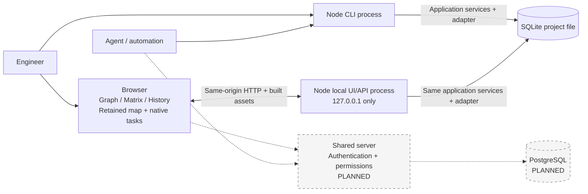
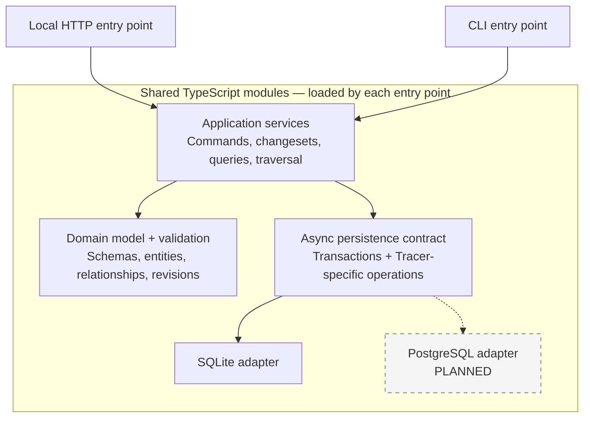
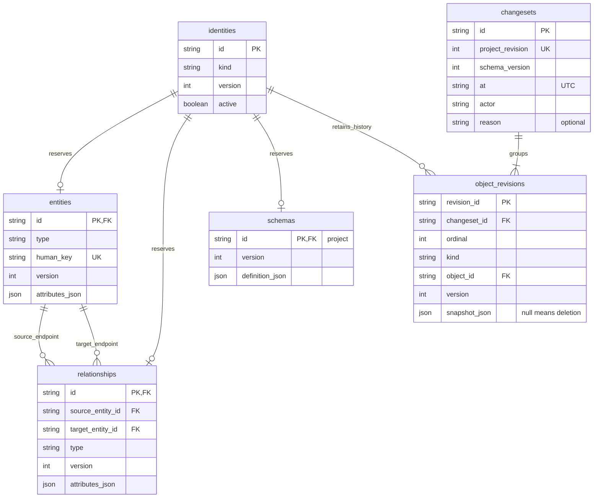
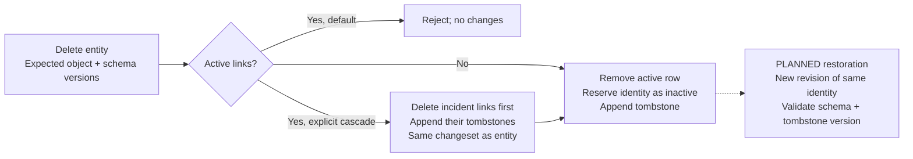
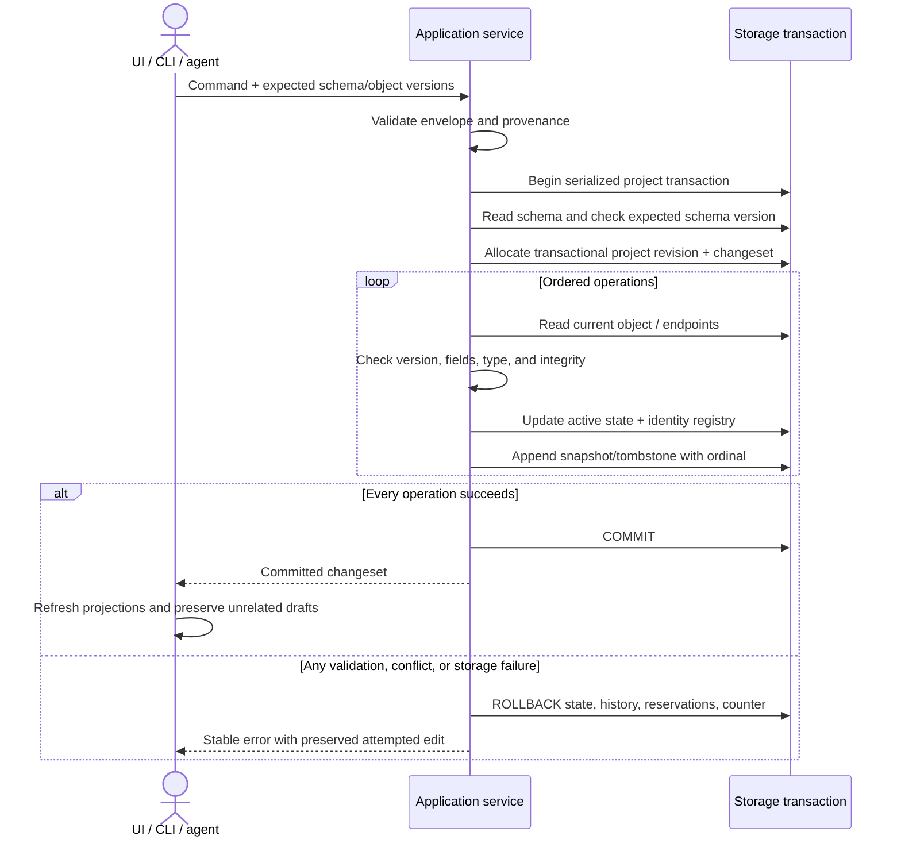
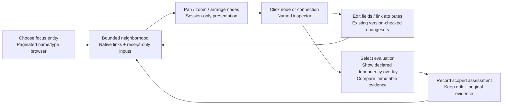
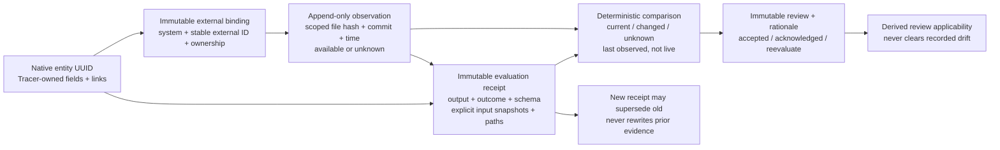
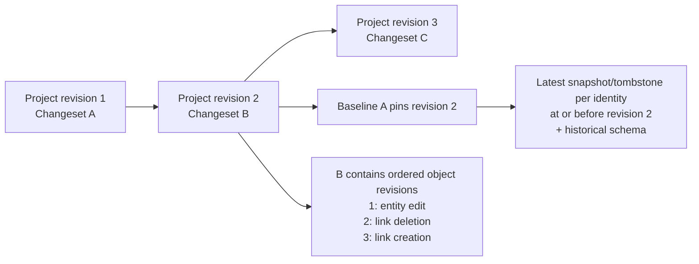

# Tracer architecture

## Shared workbench and retained map over the headless core

The default entry is `ui/main.tsx` → `ui/workbench/app.js`: Graph, Matrix and History share selection, revision, exact link identity and investigation scope. The typed adapter reuses production decoding, transport and mutation control. Studies re-export production owners for fixture/review orchestration and static-export loading; production cannot import studies or historical fixtures.

Project tools keeps visited `NativeTasks` editors mounted across navigation: schema, complete item/link editing, receipts, configurations and documentation. One mutation-controller context guards nested tasks against pending/unknown saves. The retained Development map (`?workspace=map`, `UnifiedApp` → `ui/map/`) loads separately to isolate its global CSS. Both routes use the same native contracts.

### Workbench ownership

| Owner                                                                      | Contract                                                                                                                                                                                                                                                                                                                                                                                                                                      |
| -------------------------------------------------------------------------- | --------------------------------------------------------------------------------------------------------------------------------------------------------------------------------------------------------------------------------------------------------------------------------------------------------------------------------------------------------------------------------------------------------------------------------------------- |
| `workspace-session.ts`                                                     | Typed owner of the loaded workspace snapshot, derived head and revision cache. Snapshot adoption explicitly distinguishes confirmed save, Project tools refresh, pending-save inspection and editor-save inspection. Model projection applies local overlays only at the loaded head; historical reads retain recorded data. Native writes, acknowledgment, read locks, retained drafts and rendering remain with their existing controllers. |
| `workspace-navigation.ts`                                                  | Typed selection, perspective, revision, inspector and investigation-return transitions over the single workspace state. Explicit draft capture, selection cancellation/flush, rendering and focus callbacks preserve effect order. Head, paths and scope are read through current providers; mutation guards and recovery retain their existing owners.                                                                                       |
| `dom-bindings.ts`                                                          | Shared typed direct-listener setup for workbench and inspector DOM. Reset aborts the previous scope; disposal on rerender/page suspension removes detached handlers. Current controls bind once on return. Workspace relationship inspection excludes grid descendants, whose selection/editing belongs to Matrix input. Global keyboard/resize and graph/Matrix gestures retain their owners.                                                |
| `html.ts`                                                                  | Shared literal HTML escaping and monospace identifier markup. Workspace and Matrix rendering use the same encoding for text and quoted attributes.                                                                                                                                                                                                                                                                                            |
| `inspector-renderer.ts`                                                    | Typed artifact/relationship markup reads current model, schema, head and revisions through providers. Read-only render contracts expose no commit path; field support, recorded-route and reachable-trace policies retain their existing owners.                                                                                                                                                                                              |
| `inspector-bindings.ts`                                                    | One abortable listener lifetime for inspector actions, field editing, scope editing, related/route/history navigation and resizing. Rerender and page suspension dispose detached controls; cached-page return binds the current DOM. The workspace retains global actions and keyboard ordering; existing editors retain save/cancel, locks and captured-version ownership.                                                                  |
| `inspector-interactions.ts`, `artifact-draft.ts`, `connection-picker.ts`   | Tab-local inspector reading/caret recovery, editor keyboard/busy feedback, no-op text field composition and retention of other draft fields after a confirmed single-field save. Compatible target suggestions resolve to exact keys; existing workspace mutation and captured-version owners remain authoritative.                                                                                                                           |
| `artifact-editor.ts`, `relationship-scope-editor.ts`, `editing-context.ts` | Strictly typed draft capture, validation, save/cancel and scope editing through a shared command callback. Providers read the current schema/model/head after refresh; confirmed partial saves retain only their own returned version. The workspace retains transaction, pending/unknown-write and reconciliation ownership.                                                                                                                 |
| `authoring-dialogs.ts`, `workspace-dialog.ts`                              | Typed artifact creation and relationship dialogs preserve captured schema, exact endpoint/version guards and duplicate rejection through the existing commit owner. Dialog focus returns to the original control or its rendered action replacement, then workspace search, when native close leaves focus in the body or hidden dialog; deliberate focus elsewhere remains authoritative.                                                    |
| `listbox-navigation.ts`                                                    | Search and compatible-target pickers share active-option, wrapping arrow and Enter handling; composition and modified keys do not execute suggestions. Focus remains in the input.                                                                                                                                                                                                                                                            |
| `workspace.css`, `styles/`                                                 | Ordered base/theme, layout, navigation, inspection, Matrix, controls, trace-grid authoring, narrow-screen overrides, search and editing files. Surviving rules retain their cascade order and media-query boundaries.                                                                                                                                                                                                                         |
| `recovery.ts`                                                              | Versioned local-storage context keyed by the project's first immutable changeset: positions, scope, perspective, revision and investigation. Current scope follows a newer head; historical scope keeps its revision. Invalid/future-head context is ignored. Drafts, comparison tokens and proposals are excluded. An unknown-save marker restores a write pause requiring inspection/acknowledgment. Recovery is browser/origin-local.      |
| `workspace-history.ts`                                                     | Strictly typed history reconstruction/diffs over the adapter's chronological discriminated entity/relationship/schema revisions. Index the preceding snapshot once per changeset; keep entity/link identities separate even when IDs coincide.                                                                                                                                                                                                |
| `matrix-recipes.ts`                                                        | Native chain saved-view dialogs and saves with schema/version guards and the current write guard. Restore clears unrelated investigation/path selection; incoming paths reject without reversing stored direction.                                                                                                                                                                                                                            |
| `graph-geometry.ts`, `graph-layout.ts`                                     | Pure projection, anchored zoom, measured-card fit, scaled dragging and bounded placement; layout measures canvas/inspector and uses one workspace position map for framing, expansion, investigation and historical return.                                                                                                                                                                                                                   |
| `graph-input.ts`, `selection-delay.ts`                                     | One abortable canvas binding with pointer capture, wheel handling and gesture cancellation. Replacement removes node/global listeners and delayed selection; blur/dialogs also cancel. Generation checks invalidate already-queued callbacks; keyboard selection is immediate.                                                                                                                                                                |
| `workspace-events.ts`                                                      | Document keyboard and coalesced resize lifetime. Suspension cancels input/frames; cached-page return installs one lifetime and renders current state; exit disposes it. No mutation replay or native revisions.                                                                                                                                                                                                                               |
| `matrix-editor.ts`, `matrix-renderer.ts`, `matrix-types.ts`                | Strictly typed draft capture/save/cancel, grid/popover markup and cell/row/draft/editor-context contracts. One `createGridEditor` per workspace reads current context for each action; existing proposal and workspace commit owners retain version/schema/endpoint guards and save recovery.                                                                                                                                                 |
| `matrix-input.ts`, `matrix-form-input.ts`, `matrix-selection.ts`           | Abortable grid/range-copy and form/target-picker input; DOM-independent merged-cell navigation, range intersection and exact row paths. Replacement cancels listeners/observer/render; blur cancels refresh; suspension disposes input while retaining drafts. Graph/Matrix share the scheduler with distinct delays.                                                                                                                         |
| `matrix-spans.ts`                                                          | Typed ancestor-span presentation policy used by the Matrix renderer and re-exported by the review `trace-table.mjs` shim. Prefix identities and exact links determine merging; rows and recorded identities remain unchanged.                                                                                                                                                                                                                 |
| `matrix-placement.ts`                                                      | Pure popover placement with scoped observer/anchor lifetime; detached/disposed editors cannot reposition newer ones.                                                                                                                                                                                                                                                                                                                          |
| `matrix-proposal.ts`                                                       | Pure native operations preserving captured endpoint versions, exact link IDs, schema guards, duplicate rejection and atomic create/link. Existing owners handle DOM errors and commit/reconciliation; new-item focus targets the rendered form.                                                                                                                                                                                               |
| `matrix-columns.ts`                                                        | Legal outgoing Matrix relationship/type pairs from schema endpoint constraints, including Any/None. Preserve valid authored steps, prefer explicit forward workflow routes for defaults, stop at terminal types and reconcile following columns only on configuration edits. No native writes or impact inference.                                                                                                                            |

Theme variables belong in `styles/base.css`; runtime dimensions belong to inspector rendering and `graph-layout.ts`. Keep fixes in the owning stylesheet instead of appending overrides to the entry. Source checks reject missing/duplicate imports, unresolved theme references and malformed hex colors.

### Model input validation

New schema writes and previews reject unknown properties at the root, type, field, workflow-route and coverage-policy/population/filter levels with a `validation` error containing the exact property path. Native `id: "project"` and nonnegative integer `version` metadata remain recognized for existing SchemaObject callers; expected-version guards still govern writes. Historical/API response decoding preserves extension properties accepted by older writers so immutable history remains readable. Updating an old model requires explicitly removing unsupported properties. Simple CLI entity/relationship create/update JSON rejects unsupported input properties (including IDs and relationship guards); use the existing named API or changeset operation for those supported capabilities.

### Atomic first-project setup

The existing named `setSchema` command and typed `POST /api/schema` accept optional `initialViews: InitialView[]` only with expected schema version zero. The schema/coverage revision and up to ten named views commit in one repository transaction using the existing saved-view validation, endpoint checks, name/capacity constraints and version guards. An invalid/duplicate view rolls back the schema, native head/history and earlier views. Competing or repeated setup is guarded; it never appends duplicate recipes. No storage migration or new engineering store is needed. Later model edits use the ordinary schema command; recipes remain independently editable presentation metadata.

The Engineering template owns optional acceptance/method/expected-result/subsystem/build fields, four structural policies and three outgoing recipes. Stored schemas remain authoritative; legacy flow suggestions do not silently add these fields or policies. Subsystem/build fields are text references. On empty-project entry without recovered context or an explicit view, the workbench selects the longest saved chain; first-save refresh follows the same rule. Model/create/item dirty reporting clears confirmed forms while other task drafts retain their existing owners.

### Snapshot adoption and refresh

`createWorkspaceSession` exposes the current loaded data/head and derives revision models from a private cache. Every adopted snapshot invalidates that cache, including a replacement at the same head. The controller keeps its rendered model until the existing explicit refresh/render points; projection does not mutate recorded snapshots or adopt newer draft versions.

All four adoption reasons move the viewed revision and event to the loaded head. Only a confirmed save moves assessment to that head. Confirmed save, Project tools refresh and pending-save inspection advance the evidence epoch; editor-save inspection retains it. Project tools refresh alone restores the caller-owned read lock from recovered uncertainty. Successful reads precede adoption; uncertain-save acknowledgment still occurs only after a successful native load. Failed reads retain the prior session snapshot. The existing commit owner distinguishes a failed save from a confirmed save whose refresh failed, retains the proposal and pauses further writes in the latter case. The session performs no IO or mutation reconciliation and introduces no second mutation store.

### Native reads and database selection

`Tracer.getProjectSnapshot()` reads schema, head, entities and links in one transaction. Typed `/api/project-snapshot` accepts no filters and rejects beyond **10,000 records / 100,000 connections**, never returning a partial map as complete. Rendering has separate bounds; larger headless workloads use paged queries.

The server may register two explicit Tracer/repository instances. `/api/projects` lists configured IDs/titles; `X-Tracer-Project` selects an allowlisted instance under existing origin/token guards. Unknown IDs reject; requests cannot supply database paths. Transport identity is fixed per document. Switching confirms unsaved-state disposal and reloads so drafts/delayed responses cannot target another database. Shutdown drains requests before closing repositories.

Failed native reads retain the last map and pause writes. Unknown writes retain proposals for explicit inspection/recovery; modal task returns preserve drafts. Labels normalize optional key/statement presentation without changing stored fields. Native data does not infer fictional medical folder assignments. Development-map organization and recipe saves are session-only; engineering records/evidence/configurations and named Matrix recipes persist.

### Retained map ownership

| Owner                                                                                           | Contract                                                                                                                                                                                                                                                         |
| ----------------------------------------------------------------------------------------------- | ---------------------------------------------------------------------------------------------------------------------------------------------------------------------------------------------------------------------------------------------------------------- |
| `app.tsx`, `use-map-controller.ts`                                                              | Compose typed view, organization, search, saved-view, tool, trace-history and layout owners. Navigation/scope/canvas/inspector/feedback components group presentation; pure policies remain separate.                                                            |
| `graph-elements.tsx`, `map-projection.ts`, `camera.ts`, `graph-interaction.ts`, `edge-route.ts` | Graph elements, projection dispatch, camera, drag/focus and edge routes. Node rendering and label avoidance share manual/self-loop routing.                                                                                                                      |
| `runLayout`                                                                                     | One cancellable calculation/geometry/measurement/camera lifetime. Scope changes/unmount cancel frames and ignore late resolutions/rejections; synchronous failures are reported. Map and chosen-path walker share lifetime with distinct camera policies.        |
| `view-state.ts`                                                                                 | Immutable reducer for 19 presentation fields with atomic patches/functional updates. Snapshot envelopes add geometry/camera; restore selects owned fields. History, views, organization, tools and drafts retain separate owners to prevent recursive snapshots. |
| `edge-presentation.ts`, `flow-geometry.ts`                                                      | Per-scope selection/geometry/incident-link indexes preserving parallel links and counting self-loops once. Shared ELK/incremental/label geometry uses parent-first absolute coordinates. Workflow display direction does not change adjacency.                   |
| `resize-listener.ts`                                                                            | Coalesced scope-owned frames canceled with listeners on replacement/unmount: main map waits two frames, walker one.                                                                                                                                              |
| `label-placement.ts`                                                                            | Separate routing, obstacle and collision policies; stable nearest-first search, at most 160 attempts and right-of-obstacles fallback. Each lookup still scans obstacles.                                                                                         |
| `organization.ts`, `directory-projection.ts`, `study-organization.ts`                           | Directory/area/paging structure, bounded graph/boundary projection and explicitly fictional assignments. Counts use one identity pass, deduplicate repeated area assignments and retain empty authored choices. Structural consumers do not depend on rendering. |

Typed `mapData` owns native scopes. Synthetic scale data and historical medical presets are test fixtures; historical re-exports preserve reference imports. Projection tests live in `test/map/`; older editor/query components mount only in `.fallow/legacy-ui`. The trace lens owns dialog focus/path state while sharing cancellable layout; display controls share declarative `Choice`.

The map renderer and extracted policies use strict TypeScript. Dependency declarations are skipped because ELK's declarations fail strict checking. Hook, coverage and baseline-free Fallow gates are described in [Contributing](../CONTRIBUTING.md).

This document owns implemented contracts and future technical obligations. [UX planning](ux-plan.md) owns selected interactions; [checkpoint](checkpoint.md) owns progress/check evidence. PostgreSQL, restoration and standalone packaging remain planned.

Mermaid flowcharts use solid implemented and dashed planned connections; sequence-diagram dashed arrows are responses. These C4-style module maps do not introduce additional services.

## Separate next-work queues

`Tracer.getNextWork(query?)`, CLI `next-work get` and typed `GET /api/next-work` return five independent queues over one transaction: missing statements, zero qualifying allocation targets, zero qualifying verification-plan targets, confirmed declared-input drift and unresolved reviews. Current schema/coverage policies are authoritative; the Engineering starter's vocabulary supplies compatible defaults. Custom models select explicit type/field/policy roles through the query. Empty choices are unconfigured, not covered. Selection is a read filter, not a new schema field or engineering write.

Application owners exhaust bounded entity, coverage-subject and receipt pages through the existing repository port. Structural checks use complete policy-qualified connections, including direction/population filters. Evidence reuses transaction-local `compareReceiptState`, including scoped fields/links, last recorded observations, unknown state and token-specific review applicability. Explicitly superseded receipts are excluded from current work; immutable payloads remain untouched. Applicable Accepted/Acknowledged decisions resolve review work only; Needs reevaluation and missing/retired decisions remain unresolved. Native/evidence boundaries stay separate.

The response owns complete summary rows with exact versions, explanations and evaluated populations. UI pagination does not truncate counts. Current editor/review reads retain their own guarded authority and mounted drafts. Failed reads never authorize an edit or display false empty results. Queues are read-only; no migration, task store, polling or alternate write path is introduced. The [next-work guide](next-work.md) owns membership, budgets and interface formats.

## Deterministic project export

`Tracer.exportProject()` reads current native objects/schema, all recorded changesets/revisions (including tombstones), all immutable evidence/configurations/baselines and current saved views in one repository transaction. No viewport bounds or public pagination defaults truncate the export. Native `projectRevision` and the evidence append watermark are captured independently; neither claims to version captures or presentation metadata. Embedded receipt, review and pin snapshots remain unchanged, including historical schemas and provenance. Original native history is preserved even when inherited from legacy migration.

The portable versioned `ProjectExport` contract and canonical serializer live in core; application owns paging and budgets. The existing repository port suffices: no migration, staging store, observation or engineering write is added. The typed local read route, CLI and browser download use identical sorted-key UTF-8 JSON with one LF and no newly generated metadata. Evidence/capture arrays preserve their collection append order; payload arrays preserve their recorded meaning. Unknown external availability remains unknown; export never polls external files or recalculates freshness. Full contents, ordering, limits and external-preservation semantics are owned by the [export guide](project-export.md).

Preparation is bounded to 250,000 collection entries and 64 MiB canonical output. Paging accounts for entries/bytes as it proceeds and checks the final complete serialization; over-budget or failed reads reject without a partial response. The browser retains the prepared bytes and displayed native/evidence context until explicit preparation replaces them. Failed preparations clear the downloadable snapshot. This is current-project data portability; selected-baseline review packages and restore are separate scope.

## CSV import planning and commit

`src/core/csv.ts` owns bounded comma-separated parsing with UTF-8 BOM, quoted commas/newlines, doubled quotes and physical line numbers. `csv-import-fields.ts` performs schema-directed conversion without evaluating text. The portable `previewCsvImport` planner resolves exact active keys over a complete supplied `ProjectSnapshot`, registers every proposed record before resolving links, validates mapped fields/endpoints/duplicates and returns restricted explicit-ID create operations. Any issue clears the whole operation array. It does not access storage or allocate history.

`ui/csv-import*` owns file/paste input, mapping, fresh typed snapshot reads, preview paging and tab-local draft state. Inputs/mappings invalidate preview, and a confirmed save clears the draft. The UI sends the captured operations through the existing mutation controller to `/api/changesets`; there is no alternate write route, staging table or storage migration. Native validation and transaction rollback remain authoritative. Each link captures source/target versions and `rejectExisting:true`; schema capture and unique keys protect the rest of the plan. The optional native changeset `expectedProjectRevision` guard is supplied by CSV import and checked inside the transaction before any write. Any intervening native revision rejects this preview, protecting its exact population and resulting-size checks. Existing batch callers may omit this guard. Explicit IDs support existing uncertain-save reconciliation, whose bounded/incomplete disclosures remain applicable to large batches. A failed or uncertain response is never treated as permission to replay.

The public parser/planner exports are available to scripts, followed by an explicitly authorized `applyChangeset`. Limits: 512 KiB, 100 columns, 1,000 data rows, eight optional link mappings, 1,000 combined operations and a serialized HTTP batch under 1,000,000 bytes. The native complete snapshot's existing 10,000-record / 100,000-link bounds also apply; preview rejects imports whose resulting population would cross either limit. Existing-record updates, workbook parsing, general proposal persistence and evidence import are not delivered by this slice.

## Consistent working-context read

`Tracer.getWorkingContext`, `GET /api/working-context?query=JSON` and `working-context get QUERY_JSON` expose one current native/evidence snapshot. The caller supplies a focus and an explicit recipe: an optional membership step and up to four named routes of up to four recorded steps. Every step names its relationship, stored direction and endpoint type. Permission definitions and workflow display paths do not infer a recipe. Omitting membership makes the focus itself the sole row; a declared membership scope with no records returns zero rows.

The response includes full focus/schema, native head, schema version and evidence sequence. Distinct row pages retain every parallel membership link for the selected rows. Route stages report exact distinct-identity totals and separately paged terminal or intermediate records. Each returned identity carries **one deterministic recorded path**, explicitly labelled `one-per-identity`; this is not a count or enumeration of every possible path. Endpoint constraints apply before counting/paging. Missing active endpoints fail the read rather than becoming an empty branch.

Receipts are the deduplicated union of outputs reached by routes marked `receipts`, receipts on the focus/loaded rows themselves, and receipts that actually declare the focus or loaded rows as terminal inputs. This union is scoped to **focus and the loaded row page**, not the entire project. Current-route matches remain separate from captured-input declarations. Full receipt comparison and focused/row input facts reuse the existing captured-input comparison and latest-review applicability owner; an undeclared focus never inherits another input's drift. Immutable outcome, captured output version, review applicability and bounded supersession remain separate facts. Receipt continuation is required before making an absence claim about an unloaded part of the union.

Rows default to 6 (maximum 12), each trace to 3 (maximum 20), and receipts to 5 (maximum 20). All terminal identities from receipt routes participate in discovery, including those outside the displayed trace sample; more than 200 selected output identities requires a narrower scope. More than 200 parallel membership links requires a smaller row page. Receipt comparisons share a 200-declared-input budget per response; a counted receipt that exceeds the remaining budget returns `comparison: null` with `comparisonUnavailable: "input_budget"`, while its identity, captured membership facts and exact-reader entry remain available. This is not an `unknown` comparison. Cardinality limits do not promise fixed byte size or latency.

Each response runs in one repository transaction. Separate row, trace and receipt continuations bind the recipe/focus, page owner and all three revisions; changed data requires restarting the context. Malformed cursor envelopes reject before revision checks. Indexed endpoint/output/dependency selection precedes page limits, and unrelated receipt payloads are not deserialized. These reads append no engineering or evidence history and require no baseline or storage migration.

This slice supplies a typed native/API/CLI contract and two task acceptance specifications. Existing Family/Chain saved definitions are unchanged. A mounted UI adapter, a durable editor for these richer recipes and the overall application redesign remain separate work; draft, selection and named-return state belong to those UI owners, not this projection.

## Model-first configuration boundary

The [model-overview slice](model-overview-slice.md) adds a native type/declaration landing and guided schema draft, not another domain store. The schema task posts the captured expected schema version to the existing schema mutation service. Workspace stays mounted across model navigation/save; sequence-identified type/identity intents reuse its filter and dirty-selection guard. Recorded links use `getRecordedConnections` / `GET /api/model-connections`: one snapshot of an exact relationship-type page (maximum 25) and deduplicated endpoint key/title/type summaries (maximum 50 identity reads), with canonical IDs and explicit guarded inspection. Missing summaries are explicitly unavailable; no census, inferred endpoint types, persistence changes or migration. Omitted constraints permit any configured type; explicit empty arrays permit none. The editor retains attempted JSON text for correction; unknown model properties reject with their path before saving, as described in [model input validation](#model-input-validation).

## Development flow and trace direction

A relationship definition may carry optional `workflow` paths: native source/target types, an explicit forward/reverse display direction, a human flow label and optional feedback marker. Validation checks actual types, permitted endpoints, strict direction values, unique paths and labels; Any and None keep their native meanings. This is versioned schema JSON, not a new lifecycle engine or storage migration. Existing recorded links keep their exact source/target identities.

Development flow uses only those authored paths. Trace connections shows the native permission direction. The starter model shows Intent → Requirement → Design → Test, with a separate Requirement → Test acceptance-criteria input. Tests evaluate a design/implementation against requirements; a requirement-to-test link alone does not establish the article under test or a passing result. Fresh realistic examples explicitly define their own flows. Recognizable legacy examples receive a reviewable draft proposal in Configure; nothing is automatically saved or rewritten.

Configure defaults to Visual and offers Text/Advanced JSON over one captured draft and one Save model action. Type ports propose named rules; the properties pane edits fields, constraints and workflow paths. Invalid JSON remains intact and blocks Visual/Save until repaired. Arrangement, pan and zoom are in-session presentation state, not saved engineering definitions. The readonly Model opens at 100% with its whole topology mounted. Focus navigates within the retained map; Inputs and outputs is an explicit scope change, and Fit is a secondary locator. Returning from a definition preserves the camera. No execution, stage gates or release completeness policy is inferred.

## Exact configuration and native revision reading

`GET /api/configuration?id` returns one immutable native capture by identity without reconstructing it from a catalogue page or current objects. The selected configuration reader exposes every captured member beside one complete pinned statement/schema. The result's configuration action restores the same retained review owner and its original return context. Failed refreshes retain known same-identity captures and selected pins while pausing affected writes. Review judgment starts unselected; a rationale alone cannot submit a default acceptance.

`GET /api/native-pin?id&version` returns an exact historical native entity, its schema and revision provenance through the existing `pinEntity` transaction. It rejects duplicate/extra parameters, nonpositive/unsafe versions, missing/deleted revisions and external identities. Reading creates no configuration, receipt or engineering history. This permits historical authoring field choices to use the revision's schema instead of current definitions.

An input declaration may supply optional `expectedPathVersions` aligned with its ordered `path`. The receipt transaction validates the complete guard and checks every selected link version before appending evidence. A changed connection conflicts without creating a receipt; omitted guards preserve existing caller behavior. Exact revision/configuration inputs remain direct and reject live path guards. Captured evidence stores the actual immutable link snapshots, not authoring guard values.

Evaluation authoring reads schema and current choices together through the bounded `/api/work` projection. One mounted draft owner captures chosen output/current-input entity and schema snapshots. Refresh preserves them; drift requires explicit adoption, while failed/pending reads pause recording. Stable declaration IDs retain each editor through selection, Add/Remove and Return. Field checkboxes use the actual selected current or pinned schema; Selected fields shows full values once, and Whole item shows its complete primary statement. Mode/basis changes visibly reconcile incompatible choices. Paths are built from paged actual outgoing connections; refresh verifies the final exact-ID history snapshot only when its complete history fits 1,000 revisions per link. Exceeding that bound pauses verification rather than assuming a latest version. Atomic path guards still apply at submission.

The Work library is a compact native Key/Title/Type/Revision table in API page order, without type-group collapsibles. Keyless titles appear once. One keyboard row action and full-row pointer selection reuse guarded native selection; Return retains the selected-row reference. Its container query switches to stacked rows for a narrow library pane even on a desktop viewport. Paging, search/type scope and empty/failed-read distinctions remain native.

## Bounded multilevel graph reads

`GraphQuery.depth` optionally requests 1–6 ordinary-connection levels in both directions. A cycle-safe breadth-first read deduplicates identities and preserves each recorded arrow. Explicit depth allows at most 200 nodes / 600 connections; each incident read remains at most 200 links. Without depth the existing manual neighborhood keeps its 60-node / 200-link contract. Manual expansions remain bounded and validate discovery order. Overflow rejects the whole read; it never silently truncates. A returned `trace.frontier` identifies unexpanded ordinary-link boundary nodes, which may be leaves, rather than a proven count of missing work.

Current receipts add their real input identities as provenance without recursively following them through ordinary depth. Existing 50-evaluation / 200-declared-input bounds remain. Historical graphs use native snapshots only; two-revision comparison bounds apply to the union and boundary metadata describes the target snapshot. No current evidence is reconstructed historically. Depth changes frame the root at readable scale when a full fit would be too small; Overview and Center selection offer explicit navigation choices. The SVG viewBox tracks the actual viewport. Context connections remain present at lower emphasis; selected/hovered/focused edges reveal their labels, with All labels for the complete set. Receipt edges name their captured input version, and nodes show the read native version. Opening an inspector adapts translation to its viewport while retaining zoom and arranged positions. Reads never allocate engineering revisions.

## Architectural obligations from the product vision

**Status:** enduring constraints and future proof obligations from the initial brief. Implemented contracts elsewhere remain authoritative.

- **Canonical primitives:** stable entities, first-class directed links, configurable schemas, immutable revisions/provenance and reproducible baselines. Keys are labels. Hierarchies, cycles, shared children and cross-domain links share one model. Structural validation, completeness and approval policy are separate.
- **Shared boundary:** browser, CLI, automation and future interfaces share commands, validation, transactions, history and concurrency. Views/layouts/exports are projections. Public API and SQLite adapter have separate entry points.
- **Persistence ports:** keep SQLite out of domain/application logic. PostgreSQL requires shared success/rejection/rollback/identity/history/baseline/concurrency tests. Use Tracer-specific repository operations and transactional migrations rather than a generic database wrapper.
- **Progressive deployment:** local work needs no external service/authentication. Future shared use needs authenticated human/agent provenance, application authorization, roles, concurrency, shared schemas/baselines and change notifications. It does not justify distributed infrastructure now.
- **Reproducibility:** native state, revisions and provenance commit atomically, including links/deletion. Baselines reconstruct membership/topology without database copies. Semantic diffs and stable-ID textual exports complement database authority. Full export, whole-baseline diff, selective restoration and general proposal review remain future work.
- **Agent parity:** expose schema discovery, traversal, guarded batches, coverage, impact and history through the same services. CLI/API exist; MCP is future work. Proposals should validate, show semantic differences and revalidate atomically. Human review follows project policy; authorized direct changes need no invented approval step.
- **Configuration:** express vocabulary/workflow through supported schemas, constraints, templates and views. Display flow, permissions, completeness and execution evidence remain distinct. Executable rules, approval automation and hosted integrations remain candidates.

The TypeScript modular monolith, React UI, explicit SQLite adapter and MIT license are selected. Other-language clients can use CLI/API; Rust or another backend needs measured value. Avoid speculative packages, ORM/plugin frameworks or parallel domain engines. Package naming (`@tracer-local/core`) must preserve clear contracts and avoid distribution collisions.

### Risks that require evidence

Investigate schema flexibility, history growth, traversal/baseline cost, SQLite portability assumptions, divergent view state, noisy exports and batch reviewability. Benchmark small and large connected workloads against task-derived targets. Verify clean install, backup/move/reopen and distribution before portability claims; compare semantic equality deliberately.

## 1. Where Tracer runs

**One codebase, not one mandatory process.** The CLI loads services directly in its own process; the browser reaches them through the local HTTP entry point. Each local database represents one project. No account, cloud, or external database server is required.

| Decision                      | Why / boundary                                                                                                                          |
| ----------------------------- | --------------------------------------------------------------------------------------------------------------------------------------- |
| TypeScript modular monolith   | Fast product iteration, shared contracts; no ORM, microservices, plugin framework, or multi-package workspace                           |
| Node 24.15+ / `node:sqlite`   | Built-in SQLite; [release-candidate stability](https://nodejs.org/download/release/latest-v24.x/docs/api/sqlite.html), not fully stable |
| React / Vite                  | UI only; not dependencies of domain/application logic                                                                                   |
| Explicit storage adapters     | PostgreSQL parity must be demonstrated, not assumed                                                                                     |
| Rust later only with evidence | Preserve public contracts/storage semantics; do not build a language-neutral framework now                                              |

`DatabaseSync` **blocks the event loop** even behind promises. The adapter owns execution/connection strategy; workers are an option after measurement. Native packaging must be tested on clean macOS, Windows, and Linux installations before distribution claims. A future Python SDK should use supported commands/API, not direct writes.

## 2. One mutation owner, multiple views

These arrows are **module dependencies**, not inter-process calls. Core/application code has no Node imports, frontend dependencies, or HTTP framework; ID generation is an injectable capability, defaulting to Web Crypto.

For direct integration, start with the [headless core API guide](developer-reference.md#use-the-headless-core) and the runnable [product-model example](../examples/product-model.ts). They cover source imports, repository lifetime, guarded writes, queries and local HTTP access.

The package exposes the portable application surface through `src/index.ts` (`@tracer-local/core`) and the Node SQLite adapter separately through `@tracer-local/core/sqlite`. Named native commands and existing positional calls converge on the same changeset implementation. Resource-specific query types constrain the public service/wire contracts; the internal aggregate query type remains for storage/projection compatibility. Exact-ID readers reject missing/deleted active objects. Schema preview reuses native validators in one read-only transaction and does not reserve a future save or migrate records. Optional structured error details cross CLI/HTTP boundaries without replacing established error codes.

`Tracer` remains the public compatibility facade and native command owner. `NativeQueries` owns the bounded graph/table/matrix/working-set/connection projection implementations; independent family/chain engines remain their existing owners. Shared native query support centralizes schema reads, object-filter/page validation and the existing whole-record collector. Public async versus synchronous validation, error precedence/defaults and one-transaction snapshot boundaries remain unchanged; historical Graph still excludes current evidence. Public return contracts stay explicit on the facade, while the internal projection owner infers implementation results checked against those contracts.

HTTP projection/resource reader tables parse only the selected route and enforce exact parameters. Schema/session/assets retain ignored-query behavior; saved-view/demo reject filters; native revisions require their exact two parameters. Persistence shares page assembly/decoding while SQL owners retain filters, order, limit+1 and cursor protocols. Mutation/security/lifecycle behavior and storage format are unchanged.

### Call-time request ownership

Public application payloads and query/options objects are detached at entry, before validation, queueing or any await. Commands, schema definitions, expected guards, field/path/member arrays, saved-view identity and query scopes therefore use one call-time data value throughout their transaction. Mutating the caller's object after invocation cannot rewrite that intent or bypass validated operation/page limits. This is a request ownership guarantee, distinct from the database snapshot/concurrency guard: a valid captured guard can still conflict when earlier queued work changes the database.

The pure `snapshotInput` utility copies ordinary plain/null-prototype objects and dense ordinary arrays, preserves shared aliases, own keys, insertion order, negative zero and optional undefined properties, and detaches all nested references. It inspects own descriptors without evaluating accessors, rejects cycles/symbol keys/custom prototypes/non-data values/nonfinite numbers/unpaired Unicode, and bounds nesting to 256 levels with a validation error. Existing domain JSON validators still determine where undefined is forbidden in stored fields/schema; capturing a query's optional undefined property does not remove it or silently bypass unknown-key validation. Supported normal inputs retain existing public synchronous versus rejected-Promise guards. Invalid Graph numeric parameters remain rejected promises; missing comparison target remains a synchronous guard, checked through own data descriptors.

Provenance selects its own enumerable data `actor` and optional `reason`, without invoking getters or inheriting actor values; unrelated extra properties remain ignored. Primitive labels are detached before queueing. An external observer receives a separate locator copy, and its returned data is copied before validation/persistence. A provider cannot mutate the recorded locator through its argument or later alter provider-owned nested metadata in a queued observation. These are data ownership guarantees, not authentication or a sandbox for arbitrary provider code.

Evidence comparison retrieves every matching superseding ID through the existing expression index in append sequence, preserving the full public result instead of truncating to impact's sample. Graph external context retrieves the latest observation through the subject index. Subject-scoped evidence pages use a specialized indexed predicate before the sequence cursor/limit; absent/nullish internal subject retains catalogue behavior and empty-string subject retains exact scope. The remaining full-payload receipt/observation collector is removed. Work still scales with actual matching IDs and request payload sizes; no constant-byte/time claim or new physical format follows.

Coverage/impact cursors validate their complete versioned envelopes, primitive types and revision ranges before interpreting scope or staleness. Malformed cursors are validation failures, including combined stale explicit guards. Valid current cursors detect changed native/evidence context before a removed current-only type/policy lookup. Existing cursor encodings and page bounds remain compatible; no new cursor protocol or clock is introduced.

**Invariant:** a matrix click, graph edge, document reference, CLI command, and agent action must resolve to the same application semantics. Views are projections, never alternative domain stores. Saved layouts/filters may be separate presentation metadata.

## 3. Current data versus permanent history

Structural properties are relational columns; configurable attributes and complete historical snapshots are JSON. Diagram types describe values: SQLite stores JSON as TEXT and the registry flag as INTEGER.

- **Identity:** lowercase UUIDs for entities/links; reservation survives deletion. Human keys are optional, project-wide unique among active entities, case-sensitive/binary, and reusable after deletion. Links never use display keys.
- **Versioning:** object versions advance independently. One committed changeset has one ordered project revision and 1+ object revisions with deterministic ordinals. Storage uniqueness covers `(changeset_id, ordinal)` and `(object_id, version)`. UTC timestamps use ISO 8601 milliseconds and `Z`; actor/reason belong to the changeset. This is an audit trail, not tamper-proof storage against administrators.
- **Schema:** declared types/fields only; string, number, boolean, JSON, and required-field checks. Optional endpoint-type constraints; omitted constraints permit any declared entity type. Duplicate links are allowed. Workflow/completeness policies are distinct from structural validation; no executable rule language.
- **Integrity:** endpoint foreign keys restrict deletion; indexes cover type/source/target queries. Schema semantics are application validation, not hardcoded domain rules or JSON-specific SQL.

### Deletion does not erase identity or history

Deleted objects leave the active-state tables. Restoration must not silently resurrect separately deleted links; restoring a link requires active endpoints. Cascade uses the incident set under the project lock; separately reviewed link removals carry explicit link versions. Endpoint/type/field edits are validated, version-checked mutations.

## 4. What happens when you edit

Guard failures can exit before writes; a failure at any transaction step takes the rollback path.

- `applyChangeset` accepts **1–1000 ordered operations**. Single-object commands use the same path; create operations may provide unused UUIDs to connect new objects in a batch.
- Schema replacement is a **separate changeset**: check its expected version, then validate all live objects before committing. It serializes with data writes. Mixed schema/data migrations are not implemented.
- Every data changeset checks the **schema version observed by its caller**, inside the transaction. Historical changesets retain their applicable schema version and schema snapshots.
- Project ordering uses a transactionally updated counter, not timestamps or nontransactional PostgreSQL sequences. Future notifications publish only after commit.

| Failure                                          | Contract                                                            |
| ------------------------------------------------ | ------------------------------------------------------------------- |
| Invalid input / constraints                      | `validation`                                                        |
| Object version, identity, or human-key collision | `conflict` — refresh/review                                         |
| Stale schema                                     | `schema_conflict` — refresh/review                                  |
| Missing object / dangling link                   | `not_found` / `referential_integrity`                               |
| Adapter failure                                  | `busy`, `storage`, `unsupported_storage`; no driver messages escape |
| CLI parsing                                      | `usage`; JSON `{error,message}` on stderr, nonzero exit             |

Failures are rejected promises. Competing SQLite connections may return `busy` after a bounded timeout; retry the **whole command**, not part of a batch. No automatic replay.

## 5. Shared queries and editing semantics

| Projection       | Shared semantics / current bounds                                                                                                                                             |
| ---------------- | ----------------------------------------------------------------------------------------------------------------------------------------------------------------------------- |
| Schema           | `getSchema`; discover valid types, fields, and links                                                                                                                          |
| Entities / links | Exact filters combined with AND; binary ID order; exclusive `after`; default 100, max 1000                                                                                    |
| History          | Project revision then ordinal; `revision:ordinal` cursor                                                                                                                      |
| Table            | Schema + entity page in one transaction; UI shows 50; filter is page-local                                                                                                    |
| Matrix           | Schema + axes + links in one transaction; default 20, max 25 per axis; max 1000 links or explicit overflow                                                                    |
| Missing links    | Check **all active targets of the selected type**, including off-page columns                                                                                                 |
| Traversal        | Indexed, cycle-safe BFS; forward/reverse/both, type/depth filters; minimum hop depth; root excluded; stable link-ID tie order; 10,000-result default/max cap, overflow errors |

Entity filters: `type`, `key`, literal substring `search` over keys and text values. Link filters: `type`, `source`, `target`, `incident` (either endpoint). Each page is consistent; separate requests do **not** pin a snapshot under concurrent edits. No generic query language or recursive-query optimizer is proposed.

The historical query harness saves inline rows with Enter, discards with Escape, bulk-edits selected rows atomically, and toggles matrix cells with click/Tab/Space. Duplicate cell links are removed together. Drafts keep their original object/schema versions; conflicts retain attempted values for deliberate comparison/retry. No optimistic copy is authoritative. Spatial layout persistence, undo and a general query language are absent; family scopes and chain recipes can be saved as presentation metadata; the graph has a read-only native revision timeline and bounded two-revision comparison.

### Connected workspace and styling — working candidate

This section describes the retained Studio/query harness; the production workbench is described above.

Project home is the default entry for existing projects; explicit item URLs enter their connected workspace, and schema-free projects enter Project model setup. The optional `view` URL parameter retains a selected application section through reload. Starter schemas are optional templates, not hardcoded entity semantics. Project, All items, Evaluations and Configurations form primary navigation; Project model is secondary, with general Graph/Table/Matrix and the item editor in an always-visible Working views group. All opened views stay mounted to preserve drafts. Home reads real type counts, saved recipes and optional normalized guide metadata, without inferring roots or activity.

The local server can receive explicitly supplied, normalized example metadata through `GET /api/demo-guide`; ordinary projects return null. Home guide tasks and prepared traces use the same guarded family selection and chain queries as other navigation, with optional explicit trace columns. They do not create onboarding records; reusable project views use the separate presentation store below. The server stops accepting connections before closing unused browser preconnections; actual requests drain before database shutdown.

Reference-led presentation separates project browsing, scoped work and optional inspection. Grouped item rows, contribution lanes, aligned coverage and continuous reading use the bounded family snapshot. Graph starts with that loaded scope, then offers explicit depth 1–6 through a separate snapshot-consistent graph read. Table/Graph retain the same root, selected identity and inspector draft. A deeper selection uses its successful graph snapshot for captured native editing; a pending/failed read or a selection outside the new scope pauses writes. Native arrows are never reversed to imply development order. Actual evaluation-input edges retain their receipt identity and select the evaluated output for evidence inspection. SVG markers use instance-specific identities so hidden general and family canvases cannot reference one another's markers. Coverage columns derive explicit endpoint permissions, show at most twelve with omission disclosure, and distinguish absent loaded links from incomplete incident reads. A sticky identity column preserves the obligation during local horizontal scrolling. Optional browser/detail regions retain their draft owners while hidden. Local and full-item editing share one captured draft through ObjectEditor/ObjectFields. MappingDialog uses one captured draft hook for both directions, a side picker, complete endpoint statements and a bounded candidate-context read. No relationship name becomes an inferred hierarchy, mandatory coverage rule or evidence result.

`getFamily` / `GET /api/family` reads the schema, root, an explicitly selected incoming/outgoing relationship page, distinct members, incident connections and project revision in one repository transaction. Bounds: 1–20 membership edges (UI 12), at most 200 incident links across distinct members, and full per-member incident counts. Membership cursors page edges, not a distinct project-wide family census. Shared nodes group by identity; omission is explicit, never a missing-link verdict. Inspector selections outside the loaded context retain drafts but pause writes. History inspection reads actual stored revisions in separate bounded requests.

Relationship creation supports optional captured source/target versions and caller-requested duplicate-pair rejection, validated inside the same write transaction. The new workspace uses both; ordinary domain relationships can still be duplicated intentionally, and older callers remain compatible. These command preconditions are not persisted fields or a storage migration. The earlier Work picker still has only its original schema/pair-read guards. A failed transport after a mutation is an unknown outcome, not proof of rollback; the UI retains the attempt and asks for inspection before deliberate retry.

**Styling decision:** retain the existing custom CSS system for this slice; do not introduce Tailwind alongside it. `ui/style.css` owns shared theme/control tokens, while `ui/workspace.css` owns scoped layout and workspace presentation without repeated theme-color literals. Edit theme tokens for palette/spacing changes, component styles for layout, and React components for behavior. Browser, context lanes/groups, inspector, candidate picker, dialogs and cursor navigation have focused boundaries. Existing advanced-view-specific styling remains; this is not a completed whole-app design-system migration. Reconsider a styling dependency only against a demonstrated editing/maintenance problem, not fashion. Verification and unresolved static quality findings are recorded in the checkpoint.

### Project-owned presentation views

`Tracer.savedViews` owns save/list/delete through the same repository transaction boundary, exposed at `GET/POST /api/saved-views` and `POST /api/saved-views/remove`. Loopback Host/Origin/session guards also apply to these writes. Core presentation shapes and validation live in `src/core/presentation.ts`; application validation reuses the chain endpoint contract. Physical format **4** adds `workspace_views` in the same SQLite file. Upgrade from formats 1–3 is transactional and leaves native records, revisions, counters and immutable evidence unchanged. Earlier implementations that only accept format 3 cannot reopen a format-4 file.

Views have an independent ID, exact case-sensitive unique name, mutable version and definition. Create checks expected version 0; updates and deletion check the captured metadata version. Save also checks the current logical schema version, active family root and declared column/path endpoints. Up to 50 views are supported. Names use 1–80 characters, identifiers/search at most 200, family columns at most six and chain columns at most eight. No page cursor, item draft, receipt, historical boundary or release judgment is saved. Metadata does not allocate an engineering changeset and has no immutable-history claim.

Opening a family view uses guarded native selection before applying its layout/columns. Cancelling preserves the previous scope and native draft. A failed metadata proposal remains visible; a changed saved version requires explicit adoption. An unknown write outcome blocks retries until the catalogue is read successfully and the user inspects the named result. Removed records or changed schemas can invalidate a retained view; they do not block engineering model changes. Choose a current working scope and update the view to repair it.

The Trace projection aligns complete loaded sibling statements with selected directed relationship/type columns. It shares the same family snapshot, link matcher and native statement component with broader Coverage. Sharing counts refer only to distinct loaded family items connected through that column. Complete empty incident reads say no recorded link; partial reads disclose unloaded context. Detail selection stays in the family; descent/return restores its columns. Inline evaluation inspection pages five immutable receipts for the selected output and compares captured/current native statements through existing evidence queries. Comparison reads are current, separate from the family snapshot; review and capture remain in Evidence.

### Scoped Work journey — implemented

Work is a supporting view under Tools. `getWorkingSet` / `GET /api/work` reads schema, a bounded entity page, matching total and populated-type counts in one transaction. Filters combine literal text search, exact typed text-field value, and missing compatible outgoing relationship to a selected target type. Scope totals ignore the cursor; pages retain binary ID order. `getConnections` / `GET /api/connections` returns labeled incident links, a total and a cursor (default 25, maximum 50), not an expanded graph. No storage migration or domain-specific persisted field is added.

A focused snapshot remains mounted across result changes. Item drafts capture object/schema versions; connection drafts capture schema and explicitly reconcile compatible meanings/targets when discarded to adopt a newer schema. Target search is server-side and paginated at 20. A current-pair lookup blocks accidental duplicate creation in this UI, not duplicate links in the domain or races across clients. Read failures pause editing. Accepted selection focuses the detail heading and reveals stacked layouts; a heading-level shortcut reveals dense context without traversing the creation form. Working views load on first activation and then retain drafts; hidden Graph reads are deferred.

The working and large seeds exercise synthetic 1,000/5,000/10 and 10,000/100,000/30 item/link/type workloads, respectively. Counts and scripted task timings are verification evidence, not human usability or capacity claims. See the [checkpoint](checkpoint.md).

### Relationship-column Table — implemented

`getChain` / `GET /api/chain` projects a configured relationship/type sequence with optional incoming/outgoing direction per step (omitted means outgoing for existing callers) in one repository transaction, using existing native queries and identity lookup. The path projection still uses native queries; saved recipes are separate presentation metadata. At most 20 roots, eight columns, 300 full paths and 1,000 examined links; overflow errors, not partial branch results. Columns bound cycles. Missing intermediate children produce explicit null cells; duplicate links retain separate path identities.

Column controls are expandable, and their headings retain stored arrow direction. The renderer spans only matching path prefixes, so shared children remain separate occurrences of the same identity under each parent. Selecting a child retains the clicked parent context; Show siblings filters that column's family, counting distinct sibling identities in the loaded root page. Details reuse WorkItem's captured-version editing/connection creation and dense pagination. Shared selection adopts indexed item snapshots; dirty details defer navigation. Relationship columns and Editable rows stay mounted across layout changes and schema refreshes. Row drafts now explicitly display stale schema and require Escape to adopt newer guards.

This is a thin interaction slice, not complete operation parity across all views. Receipt creation/review, native deletion, relationship-attribute management and branch bulk operations are not yet all exposed directly in every detail panel. Existing native/evidence safety semantics remain unchanged.

### Historical graph query harness — implemented tests

Graph is an advanced dark-first neighborhood workspace; Work/Table/Matrix/Evidence share selection with shared primary entity selection (separate from bulk selection). Indexed predecessor anchors reveal off-page selections in Table/Matrix; unsaved table drafts defer navigation rather than being discarded. `getGraph` / `GET /api/graph` reads schema, reached entities, incident native links, external bindings/last observations and evaluation comparisons in one repository transaction. The projection starts at a root and allows up to 20 ordered expansions of discovered nodes. Receipt-declared inputs appear even without native links; deleted inputs remain explanations rather than editable live nodes. Bounds: 60 nodes, 200 ordinary links, 50 evaluations, 200 declared inputs; overflow is explicit.

SVG renders a dependency-free canvas with pointer dragging, bounded zoom and unbounded panning, fit-to-view and keyboard navigation/movement. Positions/camera are ephemeral UI state; they never mutate entity revisions. Layout resets on focus change/reload. Ordinary arrows and selected-evaluation dependency overlays are visually distinct; displaying every receipt overlay simultaneously is deliberately avoided. Badges/counts use visible evaluations and exclude superseded receipts from current impact summaries—not a whole-project impact claim.

Historical graphs reconstruct the latest native object snapshot at or before a complete committed changeset, including tombstones, relinks and the schema as of that boundary. SQLite historical endpoint expression indexes narrow incident candidates; newer revisions (including tombstones and moved endpoints) invalidate older candidates. No full-project replay, persisted caches or new storage format is required. `GET /api/timeline?before=N` pages revision windows of at most 200; `GET /api/graph?rootId=ID&atRevision=N&compareRevision=M` returns an optional bounded native comparison. Comparison checks both native snapshots for each union object, so entering/leaving a neighborhood is not misclassified as object creation/deletion. Union bounds remain 60 nodes / 200 native links. A root absent at a boundary returns an informative empty graph.

Evidence sequence order is independent of native project revisions. Historical/comparison graph projections have empty evidence collections and no freshness statuses; a separate read-only inspector shows native snapshots only. Pending or failed temporal reads cannot flash live evidence. Every UI mutation is disabled while history is selected; supporting tabs are explicitly current-data views, not historical reconstructions. This is a UI safety constraint, not a lock on other processes or the HTTP API. Session node positions survive disappearance/reappearance within a focus, and the camera stays fixed across time; switching focus/reloading resets layout.

The inspector reuses typed field controls and changeset commands, and calls existing observation/review services. Native drafts retain their object/schema versions through refresh; selection changes require explicit discard. Assessment drafts pin scoped comparison tokens and require deliberate adoption of refreshed inputs after relevant drift. A failed graph read retains the previous view/drafts, visibly pauses edits/assessments, and does not silently show stale data as current. No collaboration, persistent layout, connector, graph library or diagram designer is added.

**Future historical queries:** the same query semantics must accept a selected committed project revision/baseline and its historical schema. A state selector belongs to query context, not view-specific rules. Current queries support current state only.

## Offline provenance — implemented vertical slice

`Tracer.evidence` owns these commands, sharing the async transaction contract and SQLite adapter with native editing. The only source capability is an injected observation function; the Node entry points supply bounded local Git/file reads. No connector framework, polling, networking or source writes.

- External identity bindings are immutable and unique by `(system, externalId)` within the project. Their ID is the annotated native entity UUID; paths live only in observations. Tracer annotations/relationships remain native versions independent of externally owned content.
- Git observation resolves a local ref to an immutable commit and hashes one committed blob. Unrelated commits do not change scoped freshness or expire an accepted review. Local files use SHA-256; missing, unreadable, oversize or unresolved inputs are unknown. Latest means committed observation sequence, not wall-clock timestamp.
- Receipts capture the output, outcome, historical schema, exact native input snapshots, explicit external observation IDs, and any declared forward relationship path. Reference links never imply dependencies. Default native scope is the entire revision; named field scopes compare presence and values, not unselected annotations.
- Comparison returns per-input reasons, concrete recorded/current versions, hashes/commits/times, dependency paths and affected receipt UUID. `hasChanged` and `hasUnknown` remain independent; aggregate unknown takes precedence without hiding known drift.
- Review writes recompare under the transaction lock against the supplied scoped token. A review preserves the full compared snapshot. Relevant changes retire its applicability; irrelevant changes do not. Acceptance is disallowed for unknown inputs and never changes the receipt. Supersession is a new receipt reference, independent of freshness/review.
- Physical format 3 adds one indexed append-only evidence table with immutable JSON payloads, unique identities and update/delete triggers. Evidence sequence order is separate from native project-revision order; native history APIs remain native history, evidence list APIs expose the new records. The application validates cross-record references; this is not tamper-proof storage against an administrator.

The Evidence UI presents the same workflow as CLI commands, including unknown states and preserved reviews. Its evidence lists explicitly reject overflow above 1000 records; above 1000 native entities, creation/binding pickers are disabled while existing receipts remain reviewable. Review drafts pin receipt and comparison token; relevant refreshed inputs require explicit adoption, and receipt changes require draft discard. CLI queries remain paginated. See the [offline walkthrough](developer-reference.md#offline-evaluation-workflow) and `examples/research-receipt.ts`.

## 6. Reproducible native baselines — implemented

A baseline boundary is a **complete committed changeset**, never an ordinal inside it. `Tracer.baselines.capture({id?,name,expectedProjectRevision,projectRevision?}, provenance)` validates the observed head and resolves an actual target changeset plus its final schema in one transaction. The optional target defaults to the expected head; zero, future revisions, missing legacy revision gaps and targets without a schema reject. Capture appends immutable metadata without allocating a native revision. Metadata includes the exact target revision/changeset/schema, the head observed at capture, actor/reason and timestamp. Names may repeat; identity distinguishes captures.

An optional stable caller `id` enables idempotent retries: the same normalized name, target, expected head and provenance return the original capture even after later commits; a different intent under that identity conflicts. Generated identities are not deduplicated and must not be automatically retried after an unknown outcome. `get(id)` reads exactly one capture; `list({after,limit})` pages metadata using canonical sequence cursors (default 25, maximum 100).

`contents({baselineId,kind,after?,limit?})` returns `{baseline,schema,objects:{items,nextAfter?}}` for one requested native kind, entity or relationship. Historical SQL selects each identity’s latest revision at the complete boundary, excludes tombstones before the page limit, and never joins current endpoints. Multiple edits to one identity in a commit resolve to its final version. Stable binary identity order supports bounded pages (default 100, maximum 1000); versioned contents cursors are bound to the baseline identity and kind and must be passed back unchanged. The historical revision index supports kind/identity/version selection. Later edits, relinks, deletes and schema changes cannot change these pages. No full-state replay or in-memory project census is required.

The shared CLI exposes `baseline capture/get/list/contents`; typed HTTP routes are POST/GET `/api/baselines`, GET `/api/baseline?id`, and GET `/api/baseline-contents`. Unknown/duplicate query fields reject; existing mutation session/origin guards apply. Response decoders and uncertain-write reconciliation include the new contract. Evidence, observations, configurations and saved views have independent histories and are not reconstructed by a native baseline. No named-baseline Graph/Table UI, export/diff/restoration, readiness policy or history retention/compaction is added. History required for reconstruction is retained.

### Project-authored structural coverage — implemented

Optional `Schema.coverageExpectations` is the single policy authority, versioned with the native schema and captured by baselines. It is separate from relationship permissions: missing coverage does not prevent ordinary native writes. Up to 100 authored rules have stable IDs (1–80 characters), readable names (1–120 characters), a subject population, native relationship type/direction, related population and positive safe-integer `minimumDistinctTargets`. Population filters optionally compare one declared primitive field against an exact string, number or boolean. No JSON/null predicates, implicit coercion, relationship-field predicates or executable expressions are supported. Missing fields fail the population filter. Text equality is binary and case-sensitive; literal field keys are bound values, never JSON-path fragments.

`Tracer.coverage.set({expectations,expectedSchemaVersion}, provenance)` replaces the complete policy map in one guarded native schema changeset. `{}` clears it. The dedicated setter preserves all structural definitions and validates the resulting schema without scanning engineering records. A full `setSchema` replacement must carry policies it intends to retain; omitting the optional map removes it. Existing policy filters and endpoint directions must remain valid when definitions change. Both Visual and Text editing preserve these root definitions in their shared draft; a dedicated coverage authoring UI is not implemented.

`list({baselineId?})` returns definitions with exact revision/schema context. `evaluate({expectationId,baselineId?,expectedProjectRevision?,after?,limit?})` returns that same context, the authored definition, a subject page and a **page-only** summary. Current evaluation resolves one transaction snapshot; baseline evaluation uses its captured schema and final native snapshots exclusively. A baseline without that rule returns `not_found`, never today's policy. Incoming rules count native sources connected to each native target; display workflow direction never changes the rule. Parallel connections count once per distinct related identity, while `matchingRelationships` separately reports all qualifying connections. Shared targets and permitted self-loops retain their native identity.

Results explain `covered`, `missing` or `unknown`. Exact counts are independent of graph/display limits. Up to three distinct target samples per subject each include one representative native connection; `samplesComplete` discloses omissions. Unresolvable native endpoints produce null exact counts and an explicit unknown reason. SQL/read failures remain errors. Structural links alone do not establish successful execution, validity, freshness, safety, certification or readiness. An empty subject page is not project approval.

Subject keyset pages default to 25, maximum 100. Opaque versioned cursors bind expectation, project revision, schema version and baseline identity. A native change between current pages returns `conflict` before policy lookup, requiring a restart even if the rule was removed; wrong expectation/baseline scope rejects validation. `expectedProjectRevision` is an optional positive current-state guard and rejects alongside `baselineId`. Policy changes themselves advance native head/schema. Reads allocate no history.

The SQLite owner selects at most one subject page, then aggregates its complete incident population in one SQL batch. Application result cardinality is bounded to 100 subjects/300 samples (record bounds, not byte bounds); SQL work remains proportional to relevant degree/history and may use SQLite temporary storage. Historical eligibility selects final revisions before population/connection filters and never joins live endpoints. Endpoint covering indexes and revision indexes support scoped lookup; query-plan tests guard against global relationship scans and historical native-view materialization. `DatabaseSync` still blocks; this does not establish multi-user/server capacity or constant-time historical evaluation. Physical format 7 adds endpoint indexes and prevents older format-6-only builds from opening schema policy they could silently discard. Migration does not rewrite native history.

### Scoped change-impact investigation — implemented

`Tracer.getChangeImpact({baselineId,rootId,direction,relationshipTypes,depth?,expectedProjectRevision?,after?,limit?})` compares a named baseline with the current native head. Root is an entity identity; direction is explicitly incoming/outgoing/both in native stored arrows, independent of workflow display direction. Up to twelve distinct relationship types are required; an empty array deliberately investigates only the root. A chosen type must exist in at least one snapshot. Depth defaults to 2 and accepts 1–6. This query is an investigation of recorded context and captured dependencies, not an inference of technical causation or release readiness.

The native query traverses before/current independently, filters direction/type before the incident limit, deduplicates identities and terminates cycles/self-loops. Each reached item has one deterministic shortest selected path; all selected connections in expanded scope remain, without enumerating every possible path. `frontierIds` are reached but deliberately unexpanded at the depth boundary, not proof of additional edges or missing data. Both snapshots are resolved for every union identity: moving an unchanged object out of the selected neighborhood does not call it deleted. A removed current root is valid when it existed at the baseline; absence at both boundaries returns `not_found`. Missing native connection endpoints return `referential_integrity` rather than fabricating a complete trace. Schema snapshots accompany both contexts.

Fixed limits are 200 union entities, 600 union relationships and 200 selected incident connections per expanded node. Overflow returns an explicit validation error asking the caller to narrow types/depth; no silently truncated trace or completeness verdict is returned. Native context is bounded rather than independently paged. Evaluation pages default 10, maximum 25 and reject more than 200 total captured inputs in a page before comparisons; reducing the page limit permits dense declarations. These bounds constrain record cardinality, not bytes or constant-time SQL work.

Receipt discovery uses a derived reverse lookup over captured terminal input identities and captured dependency link identities. It does not index intermediate path endpoints as input content or index outputs as dependencies. Evaluations can therefore be found outside the ordinary native neighborhood, including historical/configuration-pinned and removed inputs, without a JavaScript project/receipt census. Receipt JSON remains authoritative. The page describes **current evidence compared with its own captures**, not evidence reconstructed at the baseline; drift can predate that baseline.

Each evaluation includes the full existing `ComparedState` and a separate selected scope. `scope.inputIds` names matching input declarations, including a terminal outside native scope when a selected captured path link matched. Only content of selected input entities and changes to selected captured links contribute scoped flags; an unselected terminal, unrelated input or unselected path-link change is retained in the full comparison but excluded from scoped drift. Existing declared-field, observation hash/unknown, exact historical/configuration pin and deleted-input semantics are reused by the shared receipt-comparison owner. `hasChanged` and `hasUnknown` remain independent. Supersession is disclosed as an exact count and at most three deterministic IDs; superseded receipts remain discoverable. Summaries are explicitly page-only, based on selected drift. No evidence, review or native history is written.

One transaction reads the baseline/schema, native head/schema, selected snapshots, evidence watermark and comparisons. Opaque versioned evaluation cursors bind baseline/root/direction/sorted relationship types/depth, native project/schema revision and evidence sequence. Any native or evidence append between pages conflicts and requires restart; observation/review/receipt appends advance the evidence guard even when native head is unchanged. Page size may change between continuations. `expectedProjectRevision` optionally guards the initial native context; existing comparison tokens still guard subsequent review commands.

Physical format 8 transactionally adds `receipt_dependencies` and an indexed supersession projection. It backfills immutable receipts without rewriting their JSON/history and updates dependency rows in the same transaction as new receipt appends. Older format-7-only builds cannot reopen a database and silently append unindexed receipts. Current and historical native endpoint indexes, dependency-key probes, evidence sequence/subject indexes and the supersession expression index support scoped reads. SQL deduplication/sorting still grows with relevant history and matching receipts; the synchronous SQLite driver still blocks. No concurrency/capacity guarantee or PostgreSQL parity is established.

The CLI exposes `impact get JSON`; GET `/api/impact` exposes the typed read contract, with `relationshipTypes` JSON-encoded as a string array. Unknown/duplicate/malformed queries reject; stale contexts 409, missing roots/baselines 404, invalid bounds/types 400. Production UI remains separate: a future investigation surface can render this contract without deriving meaning from graph reachability.

Reviewable proposals will use existing command inputs and expected versions, validate without commit, show semantic diffs, then revalidate the whole batch at commit. General saved/selective proposal workflows remain planned. CSV import has a bounded create-only preview over the existing guarded changeset route.

<strong>Logical-state comparison and readable diffs — planned implementation</strong>

This future logical-state comparison format is separate from the implemented [recorded-project export](project-export.md), which retains original audit/evidence provenance and uses compact canonical JSON with one final LF. Canonical comparison bytes and readable diffs will describe the same logical state as separate formats. The database remains authoritative.

| Concern            | Rule                                                                                                             |
| ------------------ | ---------------------------------------------------------------------------------------------------------------- |
| Canonical standard | Future logical-state comparison targets [RFC 8785 JCS](https://www.rfc-editor.org/rfc/rfc8785)                   |
| Numbers            | Finite IEEE-754 JSON values; ECMAScript formatting; negative zero becomes zero                                   |
| Keys               | Recursive UTF-16 code-unit order, including integer-like names; do not rely on object enumeration                |
| Arrays / Unicode   | Preserve array order; no Unicode normalization; reject unpaired surrogates                                       |
| Invalid values     | Reject undefined, NaN/infinities, sparse arrays, cycles, non-JSON objects, and implicit coercions                |
| Missing vs null    | Remain distinct                                                                                                  |
| Envelope           | Format version, schema, entities, relationships; object arrays sorted by stable ID                               |
| Canonical bytes    | UTF-8, no BOM or trailing newline                                                                                |
| Readable text      | Same value/key rules; two-space indentation, LF, exactly one final newline                                       |
| Metadata           | Logical-state export excludes volatile export timestamps/audit metadata; history export preserves UTC provenance |
| Canonical equality | Identical normalized serialized values                                                                           |
| Semantic equality  | Equivalent under declared field semantics; not permanently tied to byte equality                                 |

MVP arrays are ordered, so reordering is meaningful. Future sets/reference collections must explicitly declare unordered semantics. General serializer standards-conformance fixtures, readable diffs and unordered fields remain planned. Current export has determinism/byte-parity fixtures; unchanged native record/model writes already suppress no-op revisions.

## 7. Operational boundaries

| Area                  | Current guarantee / remaining proof                                                                                                                                                                                                                                                                             |
| --------------------- | --------------------------------------------------------------------------------------------------------------------------------------------------------------------------------------------------------------------------------------------------------------------------------------------------------------- |
| Local HTTP            | Exact Host/Origin, fetch-site, JSON content type, per-process mutation token, confined assets, restrictive CSP; trusted local processes, **not authentication**                                                                                                                                                 |
| Organizational server | Planned PostgreSQL, authenticated actor identity, project permissions; clients cannot supply trusted identities                                                                                                                                                                                                 |
| Physical migrations   | Storage format **8**, independent of user-schema versions; transactional format-1–7 migrations preserve native snapshots/provenance, evidence, saved views, configurations and baselines and add derived receipt dependencies/supersession indexing; unknown formats reject; failure leaves prior format intact |
| Backups               | Back up a closed database or use SQLite-aware backup tooling; copying only a live WAL main file is unsafe                                                                                                                                                                                                       |
| Adapter lifetime      | Serialize one repository's transactions; close only after pending work completes; read/write lock tuning deferred                                                                                                                                                                                               |
| PostgreSQL proof      | Same contracts, project-counter lock, conditional updates, relational constraints/indexes, JSONB; shared success/failure/concurrency tests still required                                                                                                                                                       |
| Performance           | `npm run benchmark`: 10,000 entities / 100,000 links; measurements guide optimization, not arbitrary gates                                                                                                                                                                                                      |

Cross-adapter tests must include uniqueness, rollback, concurrent edits, schema/data races, deletion/restoration, revision ordering, and baseline reconstruction when available.

## 8. Future technical candidates — not the active discovery backlog

The [status page](checkpoint.md) records current implementation and verification; the [UX plan](ux-plan.md) records design direction. The inventory below describes future engineering candidates, not delivered capabilities.

| Done                                                                                                                                                                                  | Future candidates                                                                                                                 | Still undecided                          |
| ------------------------------------------------------------------------------------------------------------------------------------------------------------------------------------- | --------------------------------------------------------------------------------------------------------------------------------- | ---------------------------------------- |
| Core, SQLite, CLI, native baselines, configuration topology pins, schema-aware changesets, graph/table/matrix/evidence, offline receipts/reviews, MIT, browser tests, Fallow/Prettier | PostgreSQL parity; baseline export/whole-project diffs/restoration; possible document/agent interfaces, subject to task selection | Desktop packaging, multi-project tenancy |

Prioritize **working interactions**, not completed isolated layers. Packaging needs clean-machine validation; enterprise readiness must not compromise local simplicity. Keep schema evolution explicit and domain vocabulary configurable. No permissions, reviewable proposals, standalone packaging, or PostgreSQL readiness is claimed yet.

### Immutable native configurations and historical receipt inputs

A configuration is an immutable capture of an explicitly selected set of native entity revisions, associated with a current build/release/other subject record. It is independent of mutable presentation views, project-defined type names and ordinary membership links. `Tracer.configurations.capture/get/list` owns the application contract. The HTTP interface exposes guarded `POST /api/configurations` and paged `GET /api/configurations?subject=ID&after=SEQUENCE&limit=N`.

A capture requires a trimmed 1–80 character name, an active subject and its expected current version, and 1–100 distinct members declared as `{ entityId, version }`. Member versions are exact selectors, including older revisions of identities subsequently removed. The repository resolves them through indexed native history; a missing revision, deletion tombstone, wrong kind or external-bound member fails the whole transaction. User-provided snapshots are never trusted. Each member stores its actual entity snapshot, revision UUID, changeset UUID, project revision and the schema snapshot governing that revision. Different members may come from different native/schema revisions. The subject snapshot is retained independently. Capture does not mutate native history or freeze current editing. Display names may repeat; UUID and capture time distinguish captures.

| Receipt input mode   | Declaration                                           | Capture meaning                                                                                                                         |
| -------------------- | ----------------------------------------------------- | --------------------------------------------------------------------------------------------------------------------------------------- |
| Current              | `entityId`, optional `expectedVersion`                | Active current input; version is a concurrency guard. Existing external observations and forward dependency paths remain supported.     |
| Historical native    | `entityId`, `revision`                                | Exact historical version resolved from native history, with its historical schema. No current guard, observation or nonempty live path. |
| Configuration native | Receipt `configurationId`; declared member `entityId` | That member's immutable selected version, with no overriding revision/current guard, observation or nonempty live path.                 |

A configuration-backed receipt may declare a subset of its members; every declared input must belong to that capture. This is an explicit evaluated scope, not evidence that all members were evaluated. Its output remains active/current and retains the existing output version guard and current schema. Optional native field scopes validate against each selected input's schema. Standalone historical and current declarations may coexist within one receipt. Externally owned artifact contents continue to require explicit immutable observations; native pins do not substitute for Git/file content hashes.

Receipt snapshots retain the selected configuration identity/name/subject and exact member pin provenance. Current comparison and review tokens keep their existing semantics: captured inputs versus today's native records or latest explicit observations. An intentionally selected older version can therefore be `changed` immediately; a subsequently removed current input is `unknown`. Neither alters the selected configuration, recorded outcome or captured inputs. These states do not establish technical invalidity or build readiness. Reviews still apply to the scoped current comparison; no automatic configuration approval or historical review policy is introduced.

Physical format **5** adds an indexed append-only `configurations` table, with update/delete-blocking triggers and an independent sequence. Migration from supported formats 1–4 is transactional and leaves existing evidence, native history and saved views unchanged. Earlier implementations accepting only formats through 4 cannot reopen format 5. As with evidence, application validation and SQLite triggers do not make the file tamper-proof against an administrator.

Configuration capture optionally accepts `relationships:[{relationshipId,version}]`, up to 200 distinct exact native link revisions. Each pin stores the actual relationship snapshot, governing schema and revision/changeset/project provenance. Both endpoints must belong to the selected native member identities and satisfy that relationship revision's endpoint-type constraints. Missing/tombstone/wrong-kind revisions, duplicate selections and incomplete endpoints reject atomically before append. Current relinks or deletions do not change the selected historical link. Omission preserves the legacy members-only shape; an explicit empty array records no selected connections. These are deliberately selected mixed revisions, not a claim that they coexisted at a single commit. Link capture neither establishes a complete BOM nor automatically declares evaluation dependencies; configuration-backed receipts still explicitly select entity members and current comparison remains scoped to those declarations. CLI and typed HTTP decoding preserve the same optional pins.

Physical format **6** adds immutable baseline metadata and the historical paging index without rewriting configurations, evidence, saved views or native history. Migration from supported formats 1–5 is transactional; earlier format-5-only builds cannot reopen the upgraded file. Existing closed-database/SQLite-aware backup guidance still applies.

Workspace lazily pages captures for the inspected subject (five per page). Evidence pages the project catalogue (25 per page), allows member version selection from paged native history (100 revisions per page), and offers configuration-backed or individually selected receipt inputs. The capture draft retains exact members and subject version through conflicts/refresh. A missing/failed configuration API read disables pin selection/capture and pauses historical/configuration receipt writes, preventing an older server from silently treating a new revision selector as current. An unknown capture transport outcome pauses retries; a successful catalogue read and explicit inspection acknowledgement are required to continue. UI creation pickers use active identities within the existing 1,000-item limit; the application supports exact historical pins for removed identities. Drafts do not survive page reload. Optional explicit relationship pins now preserve a selected topology; named consistent native baselines are a separate contract above. Captures do not seal a BOM, compute completeness/readiness, establish physical compatibility, or provide baseline exports.

### Project studio presentation

Current composition is recorded in [UX planning](ux-plan.md#shared-workspace). The following describes the retained Studio harness. Visual tokens remain in `ui/style.css`; shell/home/working geometry is in `ui/studio.css`. Project model now uses a visual workflow diagram (`ui/model-flow.ts`, `ui/model-map.tsx`). Its overview displays every configured type with representative declared routes: a selected input route per type and a route for every explicitly constrained relationship family. The displayed/total explicit route count discloses that projection. Type focus shows its complete explicitly declared incoming/outgoing neighborhood with one identity per type, including bidirectional neighbors and self loops. Connection selection isolates that relationship; source/target alternatives and Any/None constraints remain exact in detail. Omitted constraints are not expanded into invented diagram pairs. Declaration order supplies layout only, never required lifecycle stages; return-path styling describes geometry, not a regulatory feedback policy. The original constellation geometry remains a tested utility rather than the application presentation. Type fields and recorded item connections remain disclosures.

Visual linking selects a source and target type and opens a named new-relationship proposal. `ModelLinkComposer` captures the schema snapshot/version at that moment and saves through the existing guarded schema command; it adds one new relationship definition with empty fields. Duplicate names require guided model editing, and failed/conflicting proposals remain mounted across refresh/navigation. This changes permissions; it does not create item links. Record inspection uses the existing bounded connection page. No migration or new engineering store is introduced. A process with explicit stage order, gates or opposite data-flow/dependency directions still needs project-owned process presentation; a type-permission diagram does not establish those semantics.

`FamilyView.layout` also accepts `graph`; it persists in the existing presentation store with its root, meaning, direction and columns. No native/evidence/history format changes are introduced. The graph is a presentation of the current family, not a pinned graph baseline. Evaluation results are real receipt summaries; clicking one opens the existing comparison/review owner. Creation and observation are disclosed without unmounting their draft owners. Configurations reuses the existing paged catalogue and immutable capture commands.

## Historical Studio harness task ownership

The following describes retained test-harness navigation and task behavior. The production entry point uses the shared workbench described above; these are not additional shipped demo interfaces. Shared native editing, evidence, configuration and documentation components continue to be exercised here as contract regressions.

Work reading uses one retained inspector and presentation-only focus state in `useWorkspaceReader`. A ResizeObserver measures the Work surface; widths below 920px support a focused selected-item reader. Return restores scope scroll and the originating control, falling back to the scope heading when that control is unavailable. Selection/discard guards run before reader activation. Captured-result navigation returns acceptance before pausing the current reader.

Table/Reading compact only exact primary fields already rendered for the selected loaded member. Root items, shared targets and fields outside that surface remain fully readable. Statement/title rendering preserves structured and scalar values. Returning from editing hides and disables the captured form without replacing its values or base; loaded read values remain distinct from the retained draft. Resume restores that same draft, and existing stale-read/version guards continue to govern writes.

Project, Work, Evaluations, Configurations and Model are the primary navigation areas. Existing direct editor/graph/trace/matrix controllers retain compatible URLs and are reached through local query tools. Visited native panels remain mounted while hidden, so switching areas does not replace captured draft owners.

Documentation is a lazy secondary destination outside the project-read boundary, available through navigation or `?view=docs` even when the schema is unavailable. Eleven curated Markdown guides are bundled from their owning files. React Markdown and GFM render prose/tables; HTML is skipped. Relative links resolve only against the curated topic/source map, with internal topic/anchor Return and in-session scroll retention. External citations open separately with `noopener noreferrer`; supporting Markdown sources are explicit build assets, not arbitrary server filesystem reads. Topic navigation becomes a visible select at narrow widths. Native draft owners stay mounted.

Mermaid renders static curated workflow blocks lazily with strict security and the existing restrictive CSP. Scoped external CSS supplies diagram styling without relaxing CSP for generated embedded styles; readable 100% scrolling and explicit Fit remain separate. Runtime dependencies are pinned to React Markdown 10.1.0, remark-gfm 4.0.1 and Mermaid 12.2.0; type-fest 4.41.0 supplies Mermaid's published type dependency and typed JSON configuration.

Query tools occupy secondary project navigation rather than a second toolbar above each scope. Work uses one visible directed Family scope selector and compact always-visible comparison-column choices; it omits duplicate permitted-scope controls and empty pagination. Saved-view selection and the explicit Save view action remain visible; that action opens the retained name/update/recovery settings rather than placing the whole library behind a disclosure. Contextual creation belongs to the inspected item, avoiding an ambiguous action beside a different starting-scope title.

Family scope now selects a native relationship/direction pair atomically in one control. Option values preserve the complete relationship name; an empty relationship means the starting item, independently of inspector selection. Starting-item inspection is the header identity action. Loaded membership counts remain separate from Graph's ordinary-connection depth. Narrow representation/comparison choices use local horizontal toolbar scrolling; active representation changes/resizing reveal that button without scrolling the document. Saved work appears before prepared examples on Project home when present; their current-record definitions and guarded Open owner are unchanged.

Model reading exposes bounded Fit/zoom/100% controls through the existing ModelMap scale, sharing fit bounds with the draft canvas and making no native revisions. The fitted panorama is an orientation surface; selecting a type opens readable inputs/outputs. Configure retains its selected definition and named Return across Visual/Text, while Advanced JSON is an explicit whole-schema task. Invalid JSON still blocks unsafe mode/Return transitions. Endpoint choices use a responsive grid in stable declaration order, preserving native Any/Selected/None constraints.

The application owns one retained captured-result review stage. Work receipt activation passes the exact receipt ID, selected declared input, contextual subject and origin return label. `GET /api/receipt?receiptId=…` reads one immutable receipt directly; it does not depend on a currently active output and rejects absent, empty or additional query fields. Different receipt selection confirms discarding a dirty review draft; only an affirmative discard advances the review owner's discard revision. Reads, failed comparisons and uncertain writes retain their existing boundaries.

Contextual creation captures source, schema and sibling context. The entity is created first; a separate Mapping proposal uses captured endpoint/schema versions and rejects an existing pair. Cancel leaves the entity unlinked. A preselected newly created target is checked through an exact native family read rather than requiring a picker search. Checking current availability does not silently adopt a newer endpoint version. Returning to scope hides the retained creation/edit stage; it does not re-root the family or replace its draft. The selected-item inspector also reads up to ten actual recorded connections with a total count, making shared relationships inspectable independently of the bounded family representation.

Recorded endpoint navigation selects the exact native endpoint through the existing dirty-selection guard while retaining starting scope and representation. A separate exact `/api/connections` entity/schema snapshot establishes selected-item editing authority, including items outside the loaded family; pending/failed authority reads pause writes. This does not add that endpoint to family membership or counts. Creation may use that same ready selected authority. Primary-field suppression requires the rendered family member's version to match the selected read. Explicit relationship exploration and history return reveal the resulting scope on narrow layouts instead of leaving the focused reader over it.
