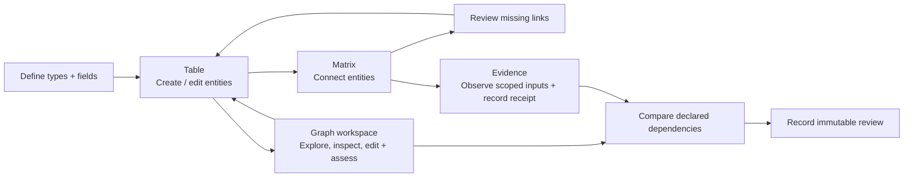

# Tracer developer reference

**UI integration:** all examples now enter the shared development map in `ui/map/`. Use the [current walkthrough](getting-started.md) for browser navigation. Earlier Studio and standalone query-view names below describe retained contracts/components and historical workflows; they are not separate product/demo interfaces. The CLI/API behavior remains available over the same core.

Commands below run from the repository root. For first use, start with the [README](../README.md) and [guided walkthrough](getting-started.md). This reference covers the shared UI, CLI, transactions, queries and persistence contracts, with historical query-controller notes labeled separately.

## Shared browser workspace

```sh
npm start -- --db project.sqlite
```

Open the printed local URL (default `http://127.0.0.1:4317`). Every example uses the same **Development map**, with **Graph** and **Items table** representations of its working scope. Expand types, search for a record, inspect its recorded connections, and open **Edit item and connections** to change native data. **New item**, **Configure model**, **Evaluations**, **Configurations** and **Documentation** open retained tasks. **Return to map** restores the map while retaining the task's in-session draft. The [walkthrough](getting-started.md) covers the current interface.

The map reads one transactional native snapshot, limited to 10,000 records and 100,000 connections. Larger snapshots fail explicitly. Rendering and trace limits are disclosed separately. Folder/category organization, undo and map recipes are session presentation state; they do not change engineering relationships and reset on reload. Durable native records, receipts, configurations and headless saved views remain database-owned.

The server binds to `127.0.0.1`. Use the exact printed URL; `--port NUMBER` changes the port. This is a trusted local interface without organizational authentication. The project picker exposes only the configured databases, and switching projects reloads the session after confirming loss of temporary organization and unsaved drafts.

## Use the headless core

The public application entry point is [src/index.ts](../src/index.ts), exposed as `@tracer-local/core`. It exports the typed `Tracer` facade, public contracts and `TracerError`. The SQLite adapter is exposed separately as `@tracer-local/core/sqlite` so importing the portable API does not load Node SQLite. It supports direct use without React, Vite or an HTTP server. `src/core/` contains domain types and validation; instantiate `Tracer` with a repository to run transactions and queries. The UI, CLI and local HTTP adapter call these same services.

The package export paths are the supported import surface; internal source paths may move. These are currently source-based exports for Node.js 24.15+ in this checkout or a local workspace dependency. The root package remains private: a published npm SDK, compiled distribution and generated OpenAPI documentation are not provided. Existing positional service calls remain supported; named command objects are recommended for new integrations.

### Choose an entry point

| Caller                             | Entry point                           | When to use it                                                                 |
| ---------------------------------- | ------------------------------------- | ------------------------------------------------------------------------------ |
| TypeScript/Node application        | `Tracer` + `SQLiteRepository`         | Embed the core in a script or application; no server needed                    |
| Shell, agent or another language   | `node src/interfaces/cli.ts`          | JSON commands with process exit codes; see [CLI quick start](#cli-quick-start) |
| Local browser or local HTTP client | Local server + `ReadApi` / `WriteApi` | Use the running application process and its configured databases               |

### Create and connect records directly

Run the complete [product-model example](../examples/product-model.ts) from the repository root:

```sh
node examples/product-model.ts
```

It creates the [worked product model](getting-started.md#worked-example-start-a-product-from-an-empty-database), three records and two links, updates a requirement, verifies rejection of a stale edit, reads a trace, closes/reopens the database and checks the saved result. It uses a temporary directory and removes that database on completion; it does not create your persistent browser project.

To embed the same API, the following TypeScript can be saved as `core-quickstart.ts` at the repository root and run with `node core-quickstart.ts`. Choose a new database filename before running; this setup expects a new project and will conflict if the schema already exists.

```ts
import { Tracer } from "@tracer-local/core";
import { SQLiteRepository } from "@tracer-local/core/sqlite";
import { productModel } from "./examples/product-model-schema.ts";

const repository = new SQLiteRepository("desk-light-api.sqlite");
try {
  const tracer = new Tracer(repository);
  const provenance = { actor: "my-application", reason: "Create product model" };
  const schema = await tracer.setSchema({ schema: productModel, expectedVersion: 0, provenance });
  const context = { expectedSchemaVersion: schema.version, provenance };
  const product = await tracer.createEntity({
    type: "product",
    key: "PROD-001",
    fields: { title: "Desk light" },
    ...context,
  });
  const requirement = await tracer.createEntity({
    type: "requirement",
    key: "REQ-001",
    fields: { title: "Adjustable brightness", statement: "The user can adjust brightness." },
    ...context,
  });
  await tracer.createRelationship({
    type: "has_requirement",
    source: product.id,
    target: requirement.id,
    fields: {},
    expectedEndpoints: { sourceVersion: product.version, targetVersion: requirement.version },
    rejectExisting: true,
    ...context,
  });
  const outgoing = await tracer.queryRelationships({ source: product.id, limit: 25 });
  console.log(outgoing.items);
} finally {
  repository.close();
}
```

Open the resulting file in the shared UI with `npm start -- --db desk-light-api.sqlite`. That short snippet creates two items and one link; the complete executable example also adds the component, tests a stale edit and checks persistence.

One SQLite repository represents one project. Its parent directory must exist. Reuse the repository/service for that project's lifetime, await outstanding operations before closing it, and close it in `finally`. The adapter serializes its transactions; SQLite's synchronous driver still blocks the Node event loop. For an alternate backend, implement the [Repository contract](../src/persistence/contracts.ts) and verify its transaction/history semantics; SQLite is the implemented adapter.

### API map

| Task                                               | Service entry point                                                                                         | Contract/source                                                                                                 |
| -------------------------------------------------- | ----------------------------------------------------------------------------------------------------------- | --------------------------------------------------------------------------------------------------------------- |
| Read or replace model                              | `getSchema()`, `setSchema({schema, expectedVersion, provenance})`                                           | [Schema, fields and versions](../src/core/model.ts)                                                             |
| Create/edit/remove records                         | `getEntity(id)`, `createEntity`, `updateEntity`, `replaceEntityFields`, `removeEntity`                      | [Command inputs](../src/application/commands.ts)                                                                |
| Create/edit/remove links                           | `getRelationship(id)`, `createRelationship`, `updateRelationship`, `removeRelationship`                     | [Command inputs](../src/application/commands.ts)                                                                |
| Atomic multi-record write                          | `applyChangeset({expectedSchemaVersion, operations, provenance})`                                           | [Atomic changesets](#atomic-changesets)                                                                         |
| Paged raw records/links                            | `queryEntities(query)`, `queryRelationships(query)`                                                         | `EntityQuery`, `RelationshipQuery`, `Page<T>` in [model.ts](../src/core/model.ts)                               |
| Bounded views and traces                           | `getWorkingSet`, `getTable`, `getGraph`, `getMatrix`, `getFamily`, `getChain`, `getConnections`, `traverse` | [View contracts](../src/application/views.ts), [service signatures](../src/application/service.ts)              |
| Complete native map snapshot                       | `getProjectSnapshot()`                                                                                      | [Snapshot contract](../src/core/project-snapshot.ts); explicit 10,000-item / 100,000-link bound                 |
| History and exact native versions                  | `history`, `changesets`, `timeline`, `getNativePin`                                                         | [Queries and history](#queries-and-automation) and [service signatures](../src/application/service.ts)          |
| External inputs, receipts, comparisons and reviews | `tracer.evidence`                                                                                           | [Offline evaluation workflow](#offline-evaluation-workflow), [evidence service](../src/application/evidence.ts) |
| Selected immutable captures                        | `tracer.configurations`                                                                                     | [Configurations](#native-configuration-capture), [service](../src/application/configurations.ts)                |
| Native baselines                                   | `tracer.baselines`                                                                                          | [Baseline API](../src/application/baselines.ts)                                                                 |
| Structural expectations                            | `tracer.coverage`                                                                                           | [Coverage contract](#project-defined-structural-coverage)                                                       |
| Change investigation / authored context            | `getChangeImpact`, `getWorkingContext`                                                                      | [Impact](../src/core/impact.ts), [working context](#working-context-query)                                      |
| Persisted headless view definitions                | `tracer.savedViews`                                                                                         | [Saved-view service](../src/application/saved-views.ts); separate from session-only map recipes                 |

Use the linked signatures for full parameter/result types. UUIDs identify native objects; optional keys are human labels. Fields are JSON values checked against the project's declared string, number, boolean or JSON definitions. Relationship source/target arrays constrain permitted types: an omitted array allows any declared type; `[]` allows none. Optional `workflow` paths control presentation and do not reverse stored endpoints.

### Versions, errors and paging

`getSchema()` returns `undefined` for a new direct-service project. Initial `setSchema` expects version `0`; later calls use the actual version returned by `getSchema()`. Schema replacement validates all live records and relationships. It does not rename or backfill existing data.

Native writes require the captured schema version. Edits/removals also require the captured object's version. Named commands put these guards alongside the intended values. `updateEntity({id, expectedVersion, expectedSchemaVersion, fields, provenance})` replaces the entire fields object: spread the captured fields if keeping existing values. `replaceEntityFields` is an explicit name for this same replacement behavior. No partial-merge/patch behavior is inferred. Both return the new object/version; legacy positional calls keep their existing behavior. `applyChangeset` commits 1–1000 ordered operations atomically; a failed operation rolls back the entire batch. Remove incident links first or explicitly request the entity command's cascade behavior.

Use `try`/`catch` around awaited service calls. `TracerError`, exported from `@tracer-local/core`, carries a stable `code`: `validation`, `conflict`, `schema_conflict`, `not_found`, `referential_integrity`, `busy`, `storage`, `unsupported_storage` or `usage`. Errors can also carry `details`: object `kind`/`id`, `expectedVersion`/`actualVersion`, or a validation `path` such as `["fields", "title"]`. These details are optional and are preserved in CLI/HTTP error JSON and the browser's `ApiError`; clients should inspect the code/details rather than parse message text. Preserve attempted values on conflicts, reread deliberately, and let the caller decide whether to adopt/retry. Retry a `busy` result as a complete command. Do not silently replace expected versions with current ones. Local `actor`/`reason` values record provenance; they do not authenticate a user.

Paged record queries return `{items, nextAfter?}`. Consume all required pages with the same filters and pass the opaque `nextAfter` as `after`; an absent cursor ends the result. Specialized projections have their own bounds and, where applicable, revision-bound cursors. A page or bounded trace is not the whole project. Calls capture payloads at invocation, but database version checks still apply when the transaction executes.

### Retry and read contracts

`getEntity(id)` and `getRelationship(id)` return one current active object or reject with `not_found`; they do not return deleted records or historical versions. Use history/native-pin/baseline APIs for historical reads. `EntityQuery` permits type/key/search and paging; `RelationshipQuery` permits type/source/target/incident and paging. `WorkingSetQuery` owns the richer field/gap filters. Unexpected filters still fail validation at runtime, even when callers bypass TypeScript.

For a create that might lose its response, generate and retain a lowercase UUID before calling `createEntity({...input, id, expectedSchemaVersion, provenance})` or `createRelationship({...input, id, ...})`. After an uncertain result, use the exact-ID getter and history to compare what was actually saved. Reusing an existing ID conflicts rather than creating another record or silently treating different input as a successful replay. A missing current record is not proof that a previous creation never committed: it may have been deleted; consult its history before deciding what to do next. Identities cannot be reused after deletion.

Relationship commands may include `expectedEndpoints:{sourceVersion,targetVersion}` and `rejectExisting:true`; both are checked atomically with creation. Duplicate endpoint/type links remain permitted when that explicit policy is omitted. These conveniences use the existing batch-operation path; failed guards roll back the whole transaction. There is no general idempotency-key ledger or automatic write retry.

### Preview a model change

Call `previewSchema({schema: proposedSchema, expectedVersion: capturedSchema.version, limit: 100})` before saving. The read-only transaction returns current schema/project revisions, added/removed/changed definitions, counts of checked entities/relationships, bounded `issues`, `totalIssues`, `truncated` and `valid`. The issue limit defaults to 100, with a maximum of 1000; the scan still checks all active records. Each incompatible record contributes its first validation failure, not every possible field failure. Malformed definitions, stale schema versions and storage failures reject instead of producing a successful report.

A preview allocates no revisions and migrates no data. It can identify required fields, deleted types and endpoint rules incompatible with current records; it does not assess engineering completeness. A valid result is not a reservation: data/schema may change afterward, and `setSchema` always checks again inside its own transaction.

Equivalent CLI commands:

```sh
node src/interfaces/cli.ts --db project.sqlite schema preview '{"schema":{"entityTypes":{},"relationshipTypes":{}},"expectedVersion":1,"limit":25}'
node src/interfaces/cli.ts --db project.sqlite entity get ENTITY_UUID
node src/interfaces/cli.ts --db project.sqlite relationship get RELATIONSHIP_UUID
```

The empty proposed schema above illustrates checking removal of the current model; it only previews and never saves it. Use your complete proposed schema for a real change. Preview and exact getters are exposed through the service/CLI; a dedicated preview UI/HTTP route is not implemented. Existing HTTP query/mutation routes retain their contracts.

### Local HTTP API

The authoritative typed wire contract is [ReadApi / WriteApi](../src/interfaces/api-contract.ts). The browser's [api.ts](../ui/api.ts) and [HTTP transport](../ui/http-transport.ts) are adapters over it. Successful responses are the declared JSON objects directly. Errors are `{error, message, details?}` with a non-success HTTP status; clients must check the status.

Start a persistent project with `npm start -- --db desk-light.sqlite` and use its exact printed origin. GET `/api/session` returns `{token}`. POST requires `Content-Type: application/json`, `Origin` equal to the server's printed origin and `X-Tracer-Token` from that session. `X-Tracer-Project` selects a configured project ID (`default` if omitted; GET `/api/projects` lists choices). It never accepts a filesystem path as the project ID. These same-origin controls are local protections, not organizational authentication or a hosted API.

Core endpoints:

| Method/path                               | Request                               | Result                                      |
| ----------------------------------------- | ------------------------------------- | ------------------------------------------- |
| GET `/api/schema`                         | No query                              | `SchemaObject` or `null` for a new database |
| POST `/api/schema`                        | `{schema, expectedVersion}`           | Saved `SchemaObject`                        |
| GET `/api/entities`, `/api/relationships` | `ObjectQuery` as URL query parameters | `{items, nextAfter?}`                       |
| POST `/api/changesets`                    | `{expectedSchemaVersion, operations}` | `{changeset, results}`                      |
| GET `/api/project-snapshot`               | No query                              | Bounded transactional native snapshot       |

For example, after saving the tutorial model, this JavaScript runs in the application's browser console and creates one component in the selected project:

```js
const project = new URLSearchParams(location.search).get("project") ?? "default";
const headers = { "X-Tracer-Project": project };
const sessionResponse = await fetch("/api/session", { headers });
if (!sessionResponse.ok) throw new Error(await sessionResponse.text());
const { token } = await sessionResponse.json();
const schemaResponse = await fetch("/api/schema", { headers });
if (!schemaResponse.ok) throw new Error(await schemaResponse.text());
const schema = await schemaResponse.json();
if (!schema) throw new Error("Save the product model first.");
const response = await fetch("/api/changesets", {
  method: "POST",
  headers: { ...headers, "Content-Type": "application/json", "X-Tracer-Token": token },
  body: JSON.stringify({
    expectedSchemaVersion: schema.version,
    operations: [
      {
        op: "entity.create",
        input: { type: "component", fields: { title: "API-created module" } },
      },
    ],
  }),
});
if (!response.ok) throw new Error(await response.text());
console.log(await response.json());
```

The browser supplies its same-origin `Origin` header for this POST; a Node/other-language HTTP client must provide it explicitly. Refresh the map to load an externally created item. A connection failure after a write can leave the outcome unknown: inspect saved state before resending. Validation/usage normally return 400, missing records/routes 404, version conflicts 409 and busy/storage errors 503; session/origin failures return 403. Unexpected server errors return 500. See [the server adapter](../src/interfaces/local-server.ts) for the exact route/status behavior.

## Historical query controllers

The following details document retained CLI/API semantics and components exercised by the test-only harness in `test/legacy-ui/`. Their navigation, keyboard controls and drawing limits describe that harness. They do not describe additional interfaces shipped with the application.

### Earlier working views

The retained Studio harness has five primary areas: Project, Work, Evaluations, Configurations and Model. Work owns the item library and scoped Graph/Table/Trace/Reading/Matrix representations. Direct editor, Graph query, Trace query and Matrix query are visible secondary query tools with their native controllers. Empty projects offer starter structures; Model supports Visual/Text configuration over one captured schema draft.



**Direct editor** retains the supporting scoped-query controller. Search keys and text values across all pages, browse counted types, scope an exact text-field value, and optionally find items missing a compatible outgoing relationship. Coverage counts ordinary connections only. Click a field to edit; open Connect an existing item when needed. Inspect an item, edit its fields, search for an existing compatible target, or page/filter its incident connections without loading a giant graph. Result filtering does not discard focused drafts; selecting another item requires explicit discard. Read failures pause edits. Query views and Evaluations load when first opened and retain drafts when revisited.

**Graph query** is a bounded neighborhood workspace. Starting-item and native-history controls are visible query tools. Pan the canvas by dragging its background, scroll or use +/− to zoom, and drag nodes to arrange them. **Fit view** brings the visible neighborhood back into frame. Click a node to open the inspector and reveal nearby **Expand selected node** / **Focus selected node** actions. Optional help explains keyboard controls. **Trace query** keeps parent/search and ordered relationship-column controls visible, using a local scrolling strip when needed; incoming steps never reverse stored links.

Solid arrows are ordinary relationships; their names alone do not propagate freshness. Purple dashed arrows appear when you select an evaluation and represent its explicitly declared inputs. Current/changed/unknown badges and review counts are scoped to the visible evaluations—not a project-wide dashboard. Click an evaluation’s inspector entry to read named dependency paths, inspect concrete versions, and record **Evidence still applies**, **Reevaluate**, or **Acknowledge only** with rationale. Accepted reviews leave drift visible. External nodes offer **Observe local source again** using their last locator; initial bindings and new receipts still use Evidence.

Node fields and connection attributes save through the same version-checked changesets as Table/Matrix. Unsaved inspector drafts require explicit discard before selection changes; refresh keeps their original version checks. Assessment drafts also pin compared inputs: relevant drift requires explicitly adopting the refreshed comparison. Failed graph reads retain the previous view/drafts and pause editing. Technical IDs and source versions are tucked into details.

Keyboard: Tab to nodes/connections and Enter/Space to inspect; arrow keys move a focused node. Focus the canvas itself for arrow-key panning and +/− zoom. Touch supports dragging. Node positions and camera state are local session presentation only; switching focus or reloading resets layout, and moving nodes never creates domain revisions. No collaboration or diagram designer is implied.

Manual Graph reads are bounded to 60 nodes, 200 ordinary connections and at most 20 explicit expansions. Configurable depth follows 1–6 ordinary connection levels with a 200-node / 600-connection bound. Both retain 50-evaluation / 200-declared-input bounds and reject overflow rather than silently hiding data. Receipt-only inputs are included even without ordinary links. Deleted inputs remain explained in evidence rather than becoming editable ghost nodes. Root browsing is paginated at 50 entities, with page-local name/title filtering.

**Shared selection:** selecting a graph node or a Table/Matrix **Focus** button highlights the same entity across views. Supporting views reveal off-page selections using indexed ID anchors, not a first-page fallback. Table drafts defer navigation until saved/discarded; bulk-selection checkboxes remain independent.

**Native timeline:** choose **Native revision**, scrub the loaded revision window, or load **Earlier revisions**. **Compare from** compares two complete committed changesets in a bounded neighborhood, with added/removed/modified/unchanged native objects and before/after snapshots. Relinked edges show both routes. Node positions (including temporarily absent nodes) and camera remain stable for the same focus. Historical graphs include their native schema, never receipts, observations, reviews or current freshness. Every UI mutation is disabled until **Return to current**; Work/Table/Matrix/Evidence explicitly remain current-data supporting views. Reads allocate no revisions. The focus browser lists current entities, not a whole historical project.

**Table:** The default **Relationship columns** layout follows configurable incoming or outgoing relationships between working levels, left to right (up to eight columns). Parents span their branching rows; a shared child appears under each parent without duplicating its identity. Missing children remain explicit gaps. Click any item to edit its fields, connect an existing child or browse incident links using the same detail editor as Work. **Show siblings** narrows to the clicked parent/column relationship; **Show all chains** restores the wider table without discarding drafts. Sibling counts cover the current root page, not a project-wide family census.

Search parents across pages, select each column's meaning/target type, and add/remove columns. Root pages contain 20 items; chains reject overflow above 300 paths or 1,000 examined links rather than silently hiding branches. **Reset columns to current schema** recovers a configuration after schema changes. Views show current data and respect the global historical mutation lock.

**Editable rows** remains available within Table for creation and bulk editing; switching layouts preserves drafts. Enter saves a row; Escape discards its draft and explicitly adopts current object/schema values. Selected-row bulk edits commit atomically. **Matrix:** click or Tab + Space toggles links. Gap badges include off-page targets. Successful edits refresh all views.

Conflicts never overwrite silently: attempted edits stay visible, and **Refresh current data** exposes the current row state for review. Escape adopts current values; retry explicitly. For typed links with required attributes, fill the matrix's JSON attributes control before creating a link.

The table shows 50 entities per page with page-local filtering; the matrix shows 20 per axis. This prototype has no undo, restoration or whole-project historical table/matrix. Saved family/chain scopes persist; supporting controller layouts remain in-session. It binds only to `127.0.0.1`; use the exact printed URL, not a hostname alias. `--port NUMBER` changes the port. This is a trusted-local-user interface, not an authenticated organizational server.

## Offline evaluation workflow

Open **Evaluations** after creating your native requirement, artifact and output entities and links. Bind each artifact to a stable external ID (`git` or `file`, external ownership), then explicitly observe its local content. Create a receipt with an outcome and declared native/entity or external/observation inputs. Change an input, record a new observation for external sources, and compare the affected receipt. Record an accepted, acknowledged or needs-reevaluation decision with rationale.

- Git reads **one committed file**, resolving a local ref to a commit; uncommitted working-tree edits are not observed. Local files use SHA-256. Paths are locators, not identity.
- **Only declared inputs propagate review.** References/mentions alone do not. Native inputs default to exact entity revisions; optional field scopes ignore unrelated annotations. An explicit forward relationship path also pins those link snapshots.
- Comparison means **last observed**, not “verified live now.” Both observation times, hashes/commits, native versions, dependency paths and the affected receipt are retained/displayed. Observe explicitly to establish a newer source state; there is no background sync.
- Freshness (`current/changed/unknown`) and review applicability are separate. Acceptance never clears drift. Unknown recorded input states are never backfilled; acceptance is blocked while unknowns remain. A relevant later change retires the applicability of an earlier review, without modifying it.
- New evaluations may explicitly supersede a prior receipt for the same output. The old receipt remains readable and comparable.
- Evidence lists support up to 1000 records, with explicit overflow errors. Above 1000 native entities, creation/binding pickers are explicitly disabled; existing receipt comparison and review remain available. Large-project evidence creation still requires the CLI. Work is paginated separately. CLI evidence queries are paginated. Observations are bounded to 16 MiB and Git reads to five seconds; unresolved states are unknown, never guessed. Git must support `--no-lazy-fetch`; older Git fails safely to unknown instead of fetching missing objects.

Run the non-requirements example: `node examples/research-receipt.ts`. It records a research conclusion supported by a dataset and analysis script, changes the dataset, explains the dependency and requests reevaluation—entirely offline in a cleaned-up fixture.

<details>
<summary>Same evidence commands through the CLI</summary>

Use existing entity UUIDs (any schema/domain). Replace placeholders with returned IDs:

```sh
npm run tracer -- --db project.sqlite external bind '{"entityId":"ARTIFACT_UUID","system":"git","externalId":"module-03","ownership":"external"}'
npm run tracer -- --db project.sqlite observation record '{"entityId":"ARTIFACT_UUID","locator":{"system":"git","repository":"/absolute/local/repo","path":"src/motor.ts","ref":"HEAD"}}'
npm run tracer -- --db project.sqlite receipt record '{"outputId":"OUTPUT_UUID","outcome":"PASS","inputs":[{"entityId":"REQ_UUID","expectedVersion":1},{"entityId":"ARTIFACT_UUID","observationId":"OBSERVATION_UUID"}]}'
npm run tracer -- --db project.sqlite receipt compare RECEIPT_UUID
npm run tracer -- --db project.sqlite evidence list receipt '{"limit":100}'
npm run tracer -- --db project.sqlite evidence list review '{"subject":"RECEIPT_UUID"}'
```

For local files, bind `system:"file"` and use `locator:{system:"file",path:"/absolute/report.txt"}`. Native input `fields:["title"]` declares a field scope; `path:["LINK_UUID",...]` declares a forward dependency path from output to input. Optional `expectedVersion` / `expectedOutputVersion` prevent capture after a concurrent native edit; omitted versions capture current state atomically. The UI supplies displayed versions.

`review record` takes `{receiptId,decision:"accepted"|"acknowledged"|"needs_reevaluation",rationale,expectedComparison}`. Copy the `token` string returned by comparison into `expectedComparison`; relevant intervening changes reject the review with `conflict`. Tokens describe declared dependency state, excluding unrelated commits, timestamps, annotations and unselected fields. The review itself retains the exact full comparison snapshot.

All these commands call `tracer.evidence`, using the same transactional repository as native editing. Evidence queries use `subject` (entity UUID for identity/observations/receipts; receipt UUID for reviews), sequence cursors and the existing page envelope. No network, source write-back, connector framework or AI is involved.

</details>

## Development tools

```sh
npm run format          # Prettier writes source/config/docs formatting
npm run format:check    # Prettier check only
npm run quality         # Fallow dead code, dependency/cycle hygiene, duplication, health
npm run quality:health  # Detailed complexity/maintainability report
npm run check           # Formatting, types, hooks, unit/browser tests and Fallow
npx playwright install chromium
npm run test:ui         # Build and run real Chromium interaction tests
```

Fallow has explicit runtime, UI, example, and test entry points. Dead-code/dependency/cycle findings retain error severity; complexity/estimated-coverage gates also enforce the established thresholds. No baseline or broad source exclusion hides them. Prettier covers authored source/configuration/docs and excludes generated build/test/cache output. No Git hooks were installed.

<details>
<summary><strong>CLI examples and data contracts</strong></summary>

## CLI quick start

```sh
node src/interfaces/cli.ts --db project.sqlite schema set '{"entityTypes":{"requirement":{"fields":{"title":{"type":"string","required":true}}},"test":{"fields":{"title":{"type":"string","required":true}}}},"relationshipTypes":{"verified_by":{"source":["requirement"],"target":["test"],"fields":{}}}}' 0
node src/interfaces/cli.ts --db project.sqlite schema get
node src/interfaces/cli.ts --db project.sqlite --schema-version 1 entity create '{"type":"requirement","key":"REQ-001","fields":{"title":"Authenticate users"}}'
node src/interfaces/cli.ts --db project.sqlite --schema-version 1 entity create '{"type":"test","key":"TEST-001","fields":{"title":"Reject invalid credentials"}}'
```

Replace the placeholder UUIDs below with returned IDs:

```sh
node src/interfaces/cli.ts --db project.sqlite --schema-version 1 --actor engineer --reason 'Add coverage' relationship create '{"type":"verified_by","source":"REQUIREMENT_UUID","target":"TEST_UUID","fields":{}}'
node src/interfaces/cli.ts --db project.sqlite trace REQUIREMENT_UUID forward
node src/interfaces/cli.ts --db project.sqlite trace TEST_UUID reverse
node src/interfaces/cli.ts --db project.sqlite --schema-version 1 entity update REQUIREMENT_UUID 1 '{"fields":{"title":"Authenticate every user"}}'
node src/interfaces/cli.ts --db project.sqlite history '{"kind":"entity","id":"REQUIREMENT_UUID"}'
node src/interfaces/cli.ts --db project.sqlite changeset list
node src/interfaces/cli.ts --db project.sqlite relationship list '{"source":"REQUIREMENT_UUID","limit":100}'
node src/interfaces/cli.ts --db project.sqlite --schema-version 1 relationship remove RELATIONSHIP_UUID 1
```

All individual data writes require `--schema-version` from the schema you observed; no automatic refresh silently bypasses stale-schema protection. Existing-object edits also require its object version. Updates replace all fields; entity type/key remain unchanged unless a new key is supplied. Relationship updates explicitly provide type, endpoints, and fields.

Keys are unique across active project entities, case-sensitive. Lowercase UUID identity is permanent, even after deletion. Entity removal rejects active links unless the optional `cascade` argument is explicitly supplied; cascade records every incident link and entity tombstone together.

## Atomic changesets

Single-object commands use the same changeset path as batches:

```sh
node src/interfaces/cli.ts --db project.sqlite --actor agent changeset apply '{"expectedSchemaVersion":1,"operations":[{"op":"entity.update","id":"REQUIREMENT_UUID","expectedVersion":2,"input":{"fields":{"title":"Reviewed title"}}},{"op":"relationship.create","input":{"type":"verified_by","source":"REQUIREMENT_UUID","target":"TEST_UUID","fields":{}}}]}'
```

Either every ordered operation commits or none do. Each changeset has one project revision, UTC timestamp, actor, and optional reason; its object revisions have independent object versions, revision UUIDs, and within-changeset ordinals. Create operations may provide unused lowercase UUIDs so a batch can connect newly created entities. Batches accept 1–1000 operations. Schema replacement is a separate version-checked changeset and checks all live data; mixed schema/data migration batches are deferred.

## Queries and automation

Object/history queries return `{items, nextAfter?}`. Pass `nextAfter` as `after` for the next page. Default page limit is 100, maximum 1000. Entity filters are exact `type`/`key`, plus literal case-insensitive substring `search` across keys and text attribute values; relationship filters are exact `type`/`source`/`target`/`incident`. Filters combine with AND. Object order is binary stable ID; history order is project revision then ordinal. Each page is consistent, but separate page requests do not pin a historical snapshot. Traversal supports direction, type, depth, and a programmatic result cap; exceeding the cap errors rather than truncating silently.

Options precede the command. Commands emit JSON; errors emit `{error,message}` on stderr and exit nonzero. Local actors are provenance labels, not authenticated credentials. Stable codes include `validation`, `conflict`, `schema_conflict`, `not_found`, `referential_integrity`, `busy`, `storage`, `unsupported_storage`, and CLI `usage`. Review conflicts; retry a complete busy command, never part of a batch. Node warnings, if emitted, also use stderr.

## Working-context query

The native service `tracer.getWorkingContext(query)` reads one current native/evidence snapshot. The local API accepts exactly one URL-encoded JSON parameter at `GET /api/working-context?query=...`; the typed browser transport serializes it. CLI parity:

```sh
node src/interfaces/cli.ts --db project.sqlite working-context get '{"focusId":"REQUIREMENT_UUID","recipe":{"routes":[{"key":"verification","label":"Verification","steps":[{"relationshipType":"verified_by","direction":"outgoing","type":"test"}],"receipts":true}]}}'
```

Use the project's actual names and permitted endpoints. Omitted `recipe.members` makes the focus the sole row. To read a branch, supply `members:{relationshipType,direction,type}`. Routes are explicit presentation scope, not inferred engineering implications. Empty routes are valid; a zero-step named route refers to the row itself.

`rows.page`, each `traces[].page` and `receipts.page` have independent cursors. Pass a row cursor as top-level `after`, a trace cursor as `trace:{rowId,routeKey,stage,after,limit}`, or a receipt cursor as `receipts:{after,limit}`. Preserve the exact focus/recipe and relevant loaded row page. Stage is one-based; omit it for the terminal stage, or use zero for an empty self route. `stageCounts` counts distinct identities at each stage. Each endpoint includes one deterministic path, not every path to it.

Receipt totals cover the focus and loaded rows, including all selected receipt-route terminals and actual captured dependencies. A route match does not imply that its row or focus was declared by the receipt. Full comparison, focused input facts, immutable outcome and review applicability remain separate. `comparisonUnavailable:"input_budget"` means the comparison was not loaded; it is neither current nor unknown. Use the exact receipt reader for full inspection and the existing comparison token to guard a review.

The [architecture contract](architecture.md#consistent-working-context-read) lists limits and revision guards. Any native/schema/evidence append invalidates continuation; refresh and restart rather than combining snapshots. Existing saved Family/Chain views and their UI remain unchanged; this command does not persist a richer recipe or create task/draft/navigation state.

## Saved working views

Work and Trace query expose **Saved view** and **Save view…** for current-data scope recipes in the project database; Project home lists saved scopes. The [architecture contract](architecture.md#project-owned-presentation-views) covers limits, version guards, migration and recovery. This mutable metadata is separate from native engineering history and immutable evidence. The CLI exposes `saved-view save/list/remove`; the local UI/API share `Tracer.savedViews`.

## Direct application input ownership

For library/headless callers, commands and queries capture their payload at invocation. Subsequent edits to the original object do not change submitted fields, selected paths, expected guards, names or query scopes. Database guards still compare that captured intent against actual execution-time state; queued writes can cause an ordinary conflict. HTTP/CLI use the same application boundary.

Use ordinary data objects and dense arrays. Optional undefined query properties remain present; stored fields/schema still obey their JSON validators. Accessors, cycles, symbol keys, custom prototypes, functions/bigints/nonfinite numbers and unpaired Unicode reject with validation errors; nesting is bounded to 256 levels. Provenance requires own enumerable data actor/reason properties; getters are not invoked and unrelated metadata is ignored. Observer locator arguments and returned data are separately copied before use. This does not change local actors into authenticated identities.

Malformed coverage/impact continuation envelopes reject validation before stale-context checks, including a stale explicit native guard. A valid stale continuation still returns conflict/restart before resolving a removed rule or current-only relationship type. Existing page bounds/encodings and successful response shapes remain unchanged.

## Storage and migration

Entity identity/type/key/version and link endpoints/type/version are relational columns with uniqueness, foreign keys, and indexes. Configurable attributes and immutable historical snapshots use JSON. A permanent identity registry prevents accidental reuse. Foreign keys prohibit dangling active links independently of service validation.

Physical database format **8** is separate from a project's user-defined schema version. Existing format-1 prototype databases migrate transactionally on open: each old object mutation becomes one changeset with preserved snapshots and provenance. Format 2 upgrades by adding an append-only evidence table (identity bindings, observations, receipts and reviews), with update/delete-blocking triggers and independent sequence ordering. Format 3 upgrades by adding the mutable project presentation catalogue described above. Format 4 upgrades by adding immutable native configuration captures. Format 5 upgrades by adding immutable native baseline metadata and a historical paging index. Native revisions are unchanged; evidence, configurations, baselines and saved views do not pretend to be native changesets. Format 6 upgrades add covering endpoint indexes for structural coverage; coverage policy lives in versioned schema JSON. Format 7 upgrades add an indexed derived lookup over captured receipt dependencies and supersession. Existing receipt JSON remains authoritative; the migration preserves native/evidence history. Builds accepting only formats through 7 cannot reopen an upgraded format 8 file. Unknown formats fail; failed migrations roll back. **Back up a closed database before migration**, or use SQLite-aware backup tooling; copying only a live WAL-mode main file is unsafe.

The adapter serializes one repository's transactions. Competing connections can return `busy`; returning promises does not make SQLite driver work nonblocking. Close repositories only after outstanding work completes.

</details>

## Performance and next slices

```sh
npm run benchmark
```

This disposable workload creates 10,000 entities and 100,000 links, measures ingestion, entity/incident pages, a depth-2 traversal, and file size, then cleans up. Results are observations on one machine, not portable guarantees or arbitrary release gates. See [verification checkpoint](../docs/checkpoint.md).

Historical neighborhood graphs, exact historical receipt inputs and named native baselines are implemented. Whole-project exports/diffs, baseline-backed working-view selection, restoration/undo, a readiness policy engine, authenticated collaboration, PostgreSQL and standalone packaging remain future capabilities. See [the capability audit](../docs/industry-workspace-slice.md#gaps-exposed-by-the-tasks) for the distinctions between stored annotations and guaranteed semantics.

See the repository README for the current distribution and license status.

## Native configuration capture

Use `tracer.configurations.capture({name, subjectId, expectedSubjectVersion, members: [{entityId, version}]}, provenance)` for an immutable selected input set. `get(id)` resolves a capture; `list({subject, after, limit})` pages up to 100. The local API exposes GET/POST `/api/configurations`; the CLI exposes `configuration capture JSON`, `configuration get ID` and `configuration list [QUERY_JSON]`. Optional `relationships:[{relationshipId,version}]` captures up to 200 exact native links with both endpoints in the selected member set. Each pin retains its historical schema/provenance. Omitted links remain members-only; an explicit empty array records no selected links. Mixed pins preserve selected topology, not necessarily a single consistent project state. They do not automatically become evaluation dependencies.

For a standalone historical receipt input, use `{entityId, revision: 1}` instead of `expectedVersion`. For a build-backed receipt, supply `configurationId` and declare member identities without overriding versions. Both modes preserve actual historical schemas/revision provenance. Current comparison still reports drift against today's records. See the [architecture contract](architecture.md#immutable-native-configurations-and-historical-receipt-inputs) for bounds, exclusive selectors and limits.

## Headless engineering tasks

Run `node src/interfaces/cli.ts --help` for the complete grammar. Direct Node invocation emits one JSON result on stdout; command errors emit one `{error,message}` JSON record on stderr with exit 1. Help prints text and does not open a database. Use `npm run --silent tracer -- ...` if invoking through npm in an automation. Individual native writes retain `--schema-version`; capture/review commands use their own explicit guards and shared service validation. `--actor` and optional `--reason` provide local provenance, not authenticated identity.

Existing headless tasks now include exact captures/revisions/receipts, saved-view management and bounded projections:

| Task                                                     | Commands                                                                                                                                                            |
| -------------------------------------------------------- | ------------------------------------------------------------------------------------------------------------------------------------------------------------------- |
| Capture selected hardware/software and topology          | `configuration capture JSON`, `configuration get ID`, `configuration list [QUERY_JSON]`                                                                             |
| Read exact historical native input                       | `native-pin get ID VERSION`                                                                                                                                         |
| Read an immutable result independently of current output | `receipt get ID`                                                                                                                                                    |
| Reuse current working scopes                             | `saved-view save JSON`, `saved-view list`, `saved-view remove ID VERSION`                                                                                           |
| Query scoped engineering records                         | `graph get JSON`, `family get JSON`, `chain get JSON`, `connections get JSON`, `model-connections get JSON`, `work get [JSON]`, `table get JSON`, `matrix get JSON` |
| Inspect committed history                                | `timeline get [BEFORE_REVISION]`, existing `history` and `trace` commands                                                                                           |
| Reproduce one committed native project state             | `baseline capture JSON`, `baseline get ID`, `baseline list [QUERY_JSON]`, `baseline contents JSON`                                                                  |

These commands call the same application services as HTTP and the UI; there is no separate CLI interpretation of engineering relationships. Projection-specific limits and failure semantics remain. Passing a relationship query does not establish physical implementation, impact or readiness.

### Capture and read a reproducible baseline

First inspect `timeline get` and use its actual `head` as `expectedProjectRevision`. The following number 42 is illustrative; replace it with that observed head. A target `projectRevision` may select an earlier actual committed boundary.

```sh
node src/interfaces/cli.ts --db project.sqlite timeline get
node src/interfaces/cli.ts --db project.sqlite --actor engineer baseline capture '{"id":"design-review-1","name":"Design review 1","expectedProjectRevision":42}'
node src/interfaces/cli.ts --db project.sqlite baseline get design-review-1
node src/interfaces/cli.ts --db project.sqlite baseline contents '{"baselineId":"design-review-1","kind":"entity","limit":100}'
node src/interfaces/cli.ts --db project.sqlite baseline contents '{"baselineId":"design-review-1","kind":"relationship","limit":100}'
```

Capture returns immutable metadata. Contents return `{baseline,schema,objects:{items,nextAfter?}}`, resolving final snapshots at the complete native commit. Continue each kind with its exact `objects.nextAfter`; cursors are versioned and bound to the baseline ID and kind. Later writes do not change its pages. Catalogue `baseline list` uses a separate sequence cursor and default 25/max100 records; contents default 100/max1000 objects. No full-state export, current engineering write, automatic evidence reconstruction or readiness judgment occurs.

A supplied stable capture ID supports safe retries after a lost response. Repeat the same normalized name, target, original expected head, actor and reason; it returns the original capture even after the live head advances. Reusing the identity for a different intent returns `conflict`. Names may repeat and do not deduplicate requests. When omitting an ID, inspect the catalogue after an uncertain outcome rather than blindly retrying. A baseline pins one consistent native project revision; a configuration may intentionally select member/link revisions that never coexisted at one revision.

Typed HTTP equivalents are POST/GET `/api/baselines`, GET `/api/baseline?id=...` and GET `/api/baseline-contents?baselineId=...&kind=entity|relationship&limit=...&after=...`. Writes use the existing local session token, JSON content-type and same-origin checks. Invalid/unknown/duplicate fields reject; validation is 400, stale guards/reused-ID conflicts 409, missing identities/boundaries 404. The local server is not an authenticated organizational API.

## Project-defined structural coverage

The three realistic seeds include three explicit fictional policies each. `coverage list` discovers the project-specific IDs and definitions; no industry semantics are inferred from names. For example, in the medical seed:

```sh
node src/interfaces/cli.ts --db project.sqlite coverage list
node src/interfaces/cli.ts --db project.sqlite coverage evaluate '{"expectationId":"product-verification","limit":25}'
node src/interfaces/cli.ts --db project.sqlite coverage evaluate '{"expectationId":"product-verification","baselineId":"design-review-1","limit":25}'
```

A baseline must already contain the definition being evaluated. Its captured rules/data are authoritative; later policies are not retrofitted. Set a complete policy map with a guarded native schema update:

```sh
node src/interfaces/cli.ts --db project.sqlite --actor engineer coverage set '{"expectedSchemaVersion":1,"expectations":{"product-verification":{"name":"Product requirements have verification definitions","subject":{"type":"product_requirement"},"relationshipType":"verified_by","direction":"outgoing","related":{"type":"verification_protocol"},"minimumDistinctTargets":1}}}'
```

This **replaces all expectations**, increments schema/native head and retains structural definitions. Use the actual schema version from `schema get`; `{}` deliberately clears the map. Whole-schema replacement likewise must include policies it intends to retain. A subject or related population may add `filter:{field:"status",equals:"approved"}` if the declared field is a string; numbers/booleans require matching native types. This checks an authored record value, not approval evidence.

Evaluation returns `{context,expectationId,expectation,rows:{items,nextAfter?},summary}`. Every row has the native subject, distinct qualifying target count, matching connection count, up to three target/connection samples, `samplesComplete`, unresolved count, state and reason. Parallel links do not multiply targets. Missing links mean `missing`; unresolved native endpoints mean `unknown` with null exact counts. These are structural verdicts only. The summary's `scope:"page"` does not represent a whole-project total.

Continue with the exact `rows.nextAfter` and unchanged expectation/baseline scope; default 25, maximum 100 subjects. Current native edits invalidate continuation with `conflict`; restart from the first page. Optional current-only `expectedProjectRevision` rejects a stale initial read and cannot be combined with a baseline. Reads preserve engineering history.

Service methods are `tracer.coverage.set/list/evaluate`. Typed local HTTP equivalents are POST/GET `/api/coverage-expectations` and GET `/api/coverage?expectationId=...&baselineId=...&after=...&limit=...&expectedProjectRevision=...` (choose baseline or current guard). Existing same-origin session mutation controls apply. Unknown/duplicate parameters reject, stale guards return 409, absent rules/baselines 404 and invalid definitions 400. These routes are headless capabilities; the existing Workspace Coverage screen still shows relationship permissions/loaded links rather than this policy evaluator.

## Investigate a recorded change

First capture a native baseline (or choose an existing one), make a deliberate version-guarded native revision, then inspect a selected native scope:

```sh
node src/interfaces/cli.ts --db project.sqlite impact get '{"baselineId":"design-review-1","rootId":"ENTITY_UUID","direction":"incoming","relationshipTypes":["depends_on"],"depth":2,"limit":10}'
```

Use the project's actual relationship names. Incoming follows native sources into the current node; outgoing follows native targets. `both` follows either stored endpoint. Workflow display arrows do not change these meanings. `relationshipTypes:[]` investigates only the root's captures; one to twelve distinct names selects native traces. Names must be declared in the baseline or current schema. Root is an entity identity, including a removed current entity that existed at the baseline. There is no implicit 'all relationships' default.

The result contains `context` (baseline, both native schemas, current native/evidence revisions), normalized `scope`, native before/after deltas and reachability, `evaluations:{items,nextAfter?}`, and a page-only summary. Each reached identity has one deterministic shortest selected path; shared/parallel connections retain their actual identities. The before/current neighborhoods are traversed separately. A record that moved outside one neighborhood can still exist unchanged; snapshots resolve both sides before classifying it as added/removed/modified/unchanged. `frontierIds` means reached but unexpanded at the chosen depth, not proof of extra edges or missing work.

Native depth defaults to 2, accepts 1–6, and the union is bounded to 200 entities/600 connections with 200 selected incident links per expanded node. Overflow explicitly rejects and asks you to narrow the selected context. Missing native endpoints are integrity errors. Evaluation pages default 10, maximum 25 and permit at most 200 total captured inputs per page; reduce `limit` for dense captures. No whole-project completeness or readiness claim follows from a small/empty evaluation page.

Evaluations are discovered by actual captured input identities and captured path links, including direct historical/configuration pins. Their outputs may be outside the native graph. Each result includes a full capture-versus-current input comparison and a separate selected scope. `scope.inputIds` identifies matching declarations, including a terminal outside the graph if its captured link matched. Only selected entity content and selected captured links affect scoped flags. An unselected terminal, unrelated input or unselected path link may make the full comparison changed while scoped state stays current. Both `hasChanged` and `hasUnknown` are preserved; supersession is an exact count plus up to three IDs. Use `receipt compare ID` for the full review token and existing guarded review command.

The native baseline does not contain evidence. These evaluations use current evidence and each receipt's own captures; drift can predate the baseline. The query does not establish that a particular native change caused every observed drift, invalidate a design, create a review or perform reevaluation.

Continue with exact `evaluations.nextAfter` and the same baseline/root/direction/type-set/depth. Page size may change. Any native write or evidence append—including observation/review writes without a native revision—invalidates continuation with `conflict`; restart from the first page. Optional `expectedProjectRevision` guards the initial native head. The query reads all context in one transaction and creates no engineering/evidence history.

The service is `tracer.getChangeImpact(query)`. Typed local HTTP is GET `/api/impact?baselineId=...&rootId=...&direction=incoming&relationshipTypes=%5B%22depends_on%22%5D&depth=2&limit=10`; encode relationship types as a JSON string array using `URLSearchParams`, and include opaque `after` unchanged when continuing. Unknown/duplicate parameters reject; malformed/bounds/type errors 400, stale contexts 409 and missing baseline/root 404. No dedicated production investigation UI is implemented yet.
