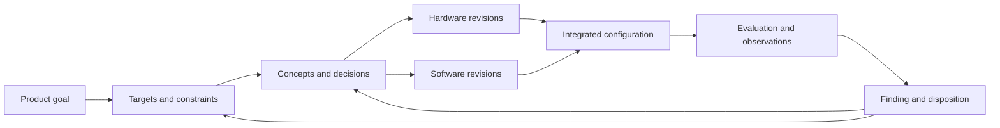

# Public product development practices at Apple Tesla and SpaceX

[Product development across industries](README.md)

Apple, Tesla and SpaceX provide public examples of engineering across physical products, software and testing. The examples below describe particular published practices. They do not reveal each company's complete internal workflow or establish that one management method explains its speed or effectiveness.

## Apple

Apple's public SMT(PCBA) DFM Engineer role references prototype, EVT, DVT and PVT builds through mass-production ramp, along with manufacturability, process requirements and cross-functional work. This confirms the build terminology in that role; it does not specify Apple's full lifecycle or every build's exit criteria. [Apple engineering role 200673824](https://jobs.apple.com/en-us/details/200673824/smt-pcba-dfm-engineer). The [hardware guide](hardware-and-integrated-products.md#prototype-and-manufacturing-progression) explains representative stage questions; expansions using “validation” or “verification” vary by source and program.

Apple's June 2024 report describes longevity considerations influencing decisions before the first prototype. Its reliability process runs throughout development, explores potential failures early and uses findings to change materials, parts or designs. Tests reproduce usage stressors, and evolving customer-use patterns influence subsequent testing. The report also connects longevity with manufacturing, repair and ongoing software support. [Apple Longevity by Design, pages 3–6](https://www.apple.com/environment/pdf/Longevity_by_Design-June_2024-Apple.pdf).

For Tracer exploration, this suggests connections among an intended experience, a design choice, an anticipated failure, an evaluation and the resulting revision. A seal that improves resistance to liquid ingress can also affect assembly and repair; the rationale and tradeoff deserve a place alongside the physical part structure. This is an illustrative modeling interpretation, not a disclosed Apple schema.

## Tesla

A public System Validation Engineer posting describes a team evaluating software-driven vehicle requirements before new hardware/software releases or product introductions, developing automated test infrastructure and improving firmware and hardware from results. This is evidence about the described team, not Tesla's complete internal development process. [Tesla engineering role 266975](https://www.tesla.com/pl_PL/careers/search/job/system-validation-engineer-autonomous-driving-systems-vehicle-software-266975).

Tesla's 2021 Crash Lab presentation describes using fleet data to reproduce real-world crash scenarios and inform vehicle engineering. The public example connects operation, a laboratory scenario and a design question. It does not by itself establish the company's broader development lifecycle or independently prove comparative safety. [Tesla Crash Lab presentation](https://www.youtube.com/watch?v=9KR2N_Q8ep8).

An illustrative Tracer model could connect a field observation to a reproduced scenario, configuration, evaluation finding and design change. Physical crash behavior, sensing and software responses can require related investigations. Evidence should identify which combination was considered, rather than attaching an undifferentiated result to an entire vehicle family.

The [automotive guide](automotive.md) covers industry APQP, production quality tools and functional-safety references separately. These sources do not establish that Tesla implements traditional automotive paperwork or stage gates identically.

## SpaceX

In the 2021 Starbase interview, Musk describes an ordered approach: question requirements, remove unnecessary parts or processes, simplify the remaining design, accelerate iteration and automate. He emphasizes understanding the system so that a local improvement does not overlook a larger opportunity. [Everyday Astronaut firsthand interview](https://everydayastronaut.com/starbase-tour-and-interview-with-elon-musk/).

The same interview distinguishes experimental Starship development from crewed Dragon and describes different tolerances for failure. This is important context for interpreting rapid iteration: the development article, intended operation and consequence of failure affect what can be learned through a particular test. [Starbase interview](https://everydayastronaut.com/starbase-tour-and-interview-with-elon-musk/).

For Tracer exploration, a requirement should retain its purpose and origin. A proposed deletion should connect to the functions, interfaces and risks that depended on it. A prototype test should connect to the configuration, objective, observations and next decision. These are modeling implications inferred from the interview, not evidence that SpaceX uses Tracer's entities or workflow.

## Shared modeling lessons

The synthesis for Tracer is to preserve both engineering structure and the loop of learning:

This diagram is an illustrative synthesis. It allows a finding to change a design, a target or an assumption. Physical containment, software dependencies and assurance traces remain separate relationships connected to that loop.

A useful example should therefore include a reason for a target, competing choices, a shared interface, a known build configuration, a limited result and a decision made from it. It should also include an unresolved question or a changed input so that the user can investigate uncertainty. The [integrated-products guide](hardware-and-integrated-products.md) applies this idea to a fictional robotic vacuum; the [aerospace guide](aerospace.md) adds program-specific assurance structure.
