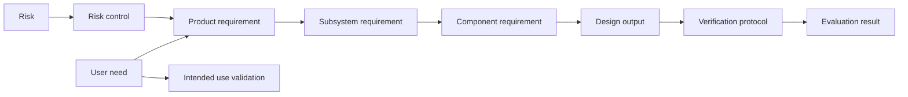

# Medical device product development

[Product development across industries](README.md)

Medical-device development organizes engineering around intended use and documented assurance. In the United States, FDA's Quality Management System Regulation became effective on February 2, 2026 and incorporates ISO 13485:2016. The familiar DHF label refers to design history; current design-and-development file terminology should be considered when discussing the applicable framework. [FDA QMSR overview](https://www.fda.gov/medical-devices/postmarket-requirements-devices/quality-management-system-regulation-qmsr), [FDA design-and-development training](https://www.fda.gov/media/189041/download).

## Workflow and working artifacts

The following summary follows FDA's design-and-development training. Activities can lead to earlier inputs being revised; this is not a once-through sequence. [FDA training, pages 13–31](https://www.fda.gov/media/189041/download).

| Activity        | Working artifacts and purpose                                                        |
| --------------- | ------------------------------------------------------------------------------------ |
| Plan            | Development stages, responsibilities, traceability methods and risk-management work. |
| Define inputs   | Functional, performance, usability and safety requirements related to intended use.  |
| Produce outputs | Designs and specifications that meet inputs and support manufacturing or servicing.  |
| Review          | Findings, unresolved actions and decisions at appropriate development stages.        |
| Verify          | Methods, acceptance criteria and results addressing whether outputs meet inputs.     |
| Validate        | Evidence that representative product meets intended-use requirements.                |
| Transfer        | Controlled handoff of outputs suitable for manufacturing.                            |
| Change          | Impact assessment, appropriate evaluation and approval before implementation.        |

Verification and validation address different questions. For example, measuring cuff geometry does not establish that intended users can apply the cuff successfully. Human-factors work considers the users, environment and device interactions involved in use. [FDA human-factors guidance](https://www.fda.gov/regulatory-information/search-fda-guidance-documents/applying-human-factors-and-usability-engineering-medical-devices).

## Illustrative trace model

This is a project model for explanation. Documents may use PRS, system specification or other names, and the number of allocation levels depends on the product. Verification can connect directly to requirements at several levels. Risk controls and shared designs create additional traces across the hierarchy.

In the fictional [Aster Home BP seed](../realistic-examples.md#medical-aster-home-bp), one release valve contributes to Stop, overpressure response and release on power loss. A proposed flow change connects to pneumatic design, measurement behavior and several evaluations. The change remains unresolved even where ordinary mapping links exist.

## Coordination questions for Tracer

An engineer reviewing that change needs the affected allocations, their siblings, the shared valve design, the versions evaluated and the limits of each result. A reviewer also needs to distinguish a planned validation study from an executed evaluation. An input receipt can expose a version change; deciding whether the change requires new work remains an engineering judgment.

The medical seed is a selected subset for exploring those interactions. Its numeric targets and simulated results do not establish clinical performance, a complete quality system or regulatory approval.
