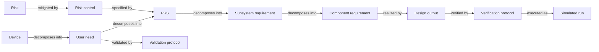

# Realistic example projects

All examples now use the shared native map UI. Launch `npm run demo` to open Orbit and Aster as separate databases in the same project picker. Search the IDs below from **Find an item**, then use Graph/Items table and contextual task panels. Earlier prepared Studio task URLs remain seed metadata; they no longer launch a separate UI. See the [current walkthrough](getting-started.md).

**Status:** owner-requested illustrative datasets for exploring hierarchy, siblings, shared dependencies and change consequences. Workflow sources ground the organization; project details, people, thresholds, artifact paths, incidents and results are fictional. These are not observed customer artifacts or validated product specifications.

The [industry workflow guides](industry-workflows/README.md) explain the broader development contexts, including integrated hardware/software products, aerospace and selected public company practices. This walkthrough owns the three delivered seeds. The [engineering workspace slice](industry-workspace-slice.md) distinguishes represented records, guaranteed semantics and proposed UI work; aerospace remains a documented comparison direction.

`npm run demo` opens Orbit by default. Run `npm run workspace:medical`, `npm run workspace:technology` or `npm run workspace:integrated`; add `-- --port 4320` or another free port if a server is already running. The printed URL opens the first family directly. Every launch creates a fresh isolated database. Resume using the printed `--db` and `--guide` command. For persistent directories, use `npm run seed -- NEW_DIRECTORY --size medical|technology|integrated`. Existing directories are refused.

Each fixture includes `GUIDE.md` and `tasks.json`. The latter holds family task URLs, canonical key/UUID mappings, receipt IDs, sources and an eight-column chain query. Medical/software examples have eight tasks; Orbit has seven. Task URLs use the current local origin, so the same database can be resumed on another port. In **Project**, the **Explore the example** cards open prepared family scopes in **Work**. The three shared-record tasks include aligned connection columns; **Multi-level traces** opens the prepared eight-column path. Selected items expose **Recorded evaluations** for opening exact results and returning to the retained family. **Saved view** and **Save view** retain a family or trace; saved scopes appear on Project home.

To build a different multi-level path, use **Trace query**: its visible **Parent type**, search and relationship-column controls define the actual ordered directions/types. The column strip scrolls locally when needed. Shared items remain the same identity wherever they appear; empty downstream cells remain visible. **Graph query** provides configurable neighborhood depth, a different question from the ordered trace. **Model** shows authored development flow; **Configure model** shares one draft between Visual and Text. **Configurations** captures and reads exact member revisions; **Evaluations** records outcomes and compares their declared inputs.

For a separately seeded directory, attach the guide explicitly with `npm start -- --db NEW_DIRECTORY/project.sqlite --guide NEW_DIRECTORY/tasks.json`. Ordinary projects have no prepared example guide.

## Authored structural coverage policies

New seeds include three versioned example expectations each. They are fictional project policy, not a standard-mandated checklist. `tasks.json.coverageExpectations` lists their IDs; `coverage list` returns the exact definitions and context. The current Workspace Coverage screen still displays allowed connections/loaded links; these policies are available through the service, CLI and local API.

| Project    | Example expectation IDs                                              |
| ---------- | -------------------------------------------------------------------- |
| Medical    | `product-verification`, `design-verification`, `verification-record` |
| Software   | `story-check`, `implementation-check`, `scenario-record`             |
| Integrated | `target-evaluation`, `design-evaluation`, `evaluation-configuration` |

For example, `node src/interfaces/cli.ts --db PROJECT/project.sqlite coverage evaluate '{"expectationId":"story-check","limit":25}'` evaluates the software story population. All three fixtures contain both covered and missing subjects; queries paginate across the complete relevant topology, including shared identities. A recorded run is only a structural target, regardless of its simulated outcome. Existing seeded databases are preserved and do not automatically acquire newly authored policy. See [the command contract](developer-reference.md#project-defined-structural-coverage) for guarded updates, baseline semantics and bounded results.

## Medical: Aster Home BP

A fictional adult home upper-arm blood-pressure monitor. The draft product reports spot readings, detects unsuitable attempts, allows Stop and passive pressure release, recalls profile-specific measurements, and supports battery/cleaning tasks. Adult arm range and numeric limits are invented allocations, not quotations from a standard. Static pressure-channel accuracy is explicitly separate from clinical performance of the BP estimator.

**113 records, 282 relationships, eight native receipts.** Eighteen types cover the device, requirement/design/V&V and risk/file structures, plus concepts, experiments, findings, build configurations and assessments.

This diagram illustrates selected trace paths; requirements also link directly to applicable verification protocols, and subsystem requirements can map directly to outputs. It is not a mandatory eight-stage process. The device contains an eight-record file index for planning, inputs, design/risk reviews, V&V, transfer and changes. Those records reference the same engineering objects rather than duplicating them.

Try these tasks:

- Descend `DEV-01 → UN-01 → PRS-02 → SYS-02 → CMP-02 → OUT-02 → VER-01 → RUN-01`; compare siblings at each breakdown. PRS-02 has real v1/v2 history: its temperature band expanded after RUN-01's receipt captured the earlier input. Allocations and the old result require review.
- Inspect incoming breakdowns of `CMP-05`: the release valve serves protective pressure response, Stop and passive venting. `OUT-04` also supports controlled deflation, so `CHG-02` explicitly connects the proposed exhaust change to mechanical, firmware, estimation and risk/test work.
- Follow `RSK-03 → RC-03/RC-04 → PRS-06/PRS-07/PRS-08`. RUN-06 is a simulated passive-release failure whose inputs are current. “Current” does not mean “pass” or “accepted.”
- Compare cuff verification (`VER-04`, with incomplete endpoint inspection) to intended-use validation (`VAL-01`, planned and unexecuted). No validation receipt is invented.
- Inspect PRS-13's unresolved cleaning acceptance criteria and blocked protocol; PRS-14 has no detailed clinical breakdown or executable linked verification protocol. Battery, clock and labeling protocols have no run. Connections cannot make those gaps disappear.
- Compare `CON-MED-01` and `CON-MED-02` under `CHG-02`; `EXP-MED-01` is an unexecuted comparison plan and `ASSESS-MED-01` names explicit review subjects. `BUILD-MED-A` retains PRS-02 v1 in its manifest and immutable native capture while the current input is v2; `BUILD-MED-B` is a proposal without evaluations.

The familiar **DHF** label is used for the example organization. FDA's [QMSR](https://www.fda.gov/medical-devices/postmarket-requirements-devices/quality-management-system-regulation-qmsr), effective February 2, 2026, incorporates ISO 13485:2016. [FDA design-and-development training](https://www.fda.gov/media/189041/download), pages 13–31, grounds input/output traceability, risk, reviews, verification, validation, transfer, changes and file records. [FDA human-factors guidance](https://www.fda.gov/regulatory-information/search-fda-guidance-documents/applying-human-factors-and-usability-engineering-medical-devices) grounds intended-user/task/environment framing. This illustrative subset has no regulatory approval, standards qualification, production release or actual test evidence.

## Technology: Gatherline

A fictional event coordination app: volunteer check-in during outages, attendee cached agendas/bookmarks and organizer schedule publication. This is one plausible software structure; teams often use different names and fewer formal artifacts. Logical server modules share one example backend deployment rather than assuming every component needs a microservice.

**83 records, 222 relationships, six native receipts.** Seventeen types include product/delivery/architecture records plus concepts, experiments, findings, build configurations and assessments.

Three structures are connected without collapsing them into one hierarchy:

| Structure             | Example path                                                                               | Purpose                                                             |
| --------------------- | ------------------------------------------------------------------------------------------ | ------------------------------------------------------------------- |
| Product breakdown     | Application → outcome → capability → story                                                 | Explain why a behavior is needed and compare sibling work.          |
| Architecture          | Application/backend → component; provider/consumer → API or event contract                 | Explain responsibility, dependencies and interface impact.          |
| Delivery and feedback | Story → implementation → scenario → simulated run → release; incident → decision/follow-up | Explain what changed, what was checked and what remains unresolved. |

The long example is `APP-01 → OUTCOME-01 → CAP-02 → STORY-03 → WORK-03 → TEST-02 → RUN-TECH-02 ← REL-01`. The last column traverses an incoming `evaluated_by` link: release records point to their evaluations. The engine stores actual directed links rather than renaming everything as parent/child.

`WORK-03` is shared by scan capture, restart recovery, bookmarks and refresh. `COMP-03` consumes `API-01` provided by `COMP-04`; both check-in and agenda depend on `COMP-06` authorization. These are cross-cutting traces, not product decomposition. ADRs add context, alternatives, consequences and status; `ADR-04` supersedes `ADR-03` while preserving the old rationale. Incidents point backward to the relevant contracts, stories and work.

Try these tasks:

- Compare `STORY-02` and `STORY-03` under `CAP-02`, then open the incoming stories for `WORK-03` to see the shared sync work.
- Follow `API-01` through providers, consumers, `ADR-02`, replay tests and implementation. STORY-03 changed from restart recovery to a 72-hour retry horizon after native receipts were captured; immediate-retry evidence now compares as changed.
- Start at `INC-01` and examine operation identity versus independent admission conflicts. RUN-TECH-03 is a simulated failure; the long-retention TEST-10 has no run and unresolved acceptance behavior.
- Compare the retired last-write-wins ADR with its replacement and the missing organizer comparison UI.
- Inspect `REL-01`: current, changed, failed and partial simulated results coexist. Offline expiry has no run; privacy STORY-12 has no test link. There is no automatic release readiness judgment.
- Compare persistent pending-state feedback with blocking warnings under `ADR-02`. `EXP-TECH-01` is planned usability discovery, separate from the simulated implementation finding. `ASSESS-TECH-01` names retry-horizon review subjects; `BUILD-TECH-A` retains STORY-03 v1 while the current identity is v2.

[Android's offline-first architecture guide](https://developer.android.com/topic/architecture/data-layer/offline-first) grounds durable local data, queueing, synchronization and task-specific conflict resolution. [Microsoft's ADR guidance](https://learn.microsoft.com/en-us/azure/well-architected/architect-role/architecture-decision-record) grounds context, alternatives, consequences and linked replacement decisions. Gatherline's contracts, 72-hour target and incidents are original fictional choices. Source paths are descriptive native fields; no repository or CI integration is implied.

## Integrated product: Orbit R1

A fictional robotic vacuum combines cleaning mechanics, power electronics, embedded actuation/navigation and a scheduling app. **72 records, 170 relationships and four native receipts across sixteen types.** Product goals, targets and functions form an allocation hierarchy; physical containment, interfaces, shared designs, concepts and configuration/evidence relationships form additional connected structures.

The long trace is `ROBOT-01 → GOAL-01 → TGT-01 → FUN-01 → REQ-R01 → DES-01 → EVAL-R01 ← FIND-R01`. Other branches retain gaps. One blower-control design serves flow, energy, heat, timing and acoustic allocations.

Try these tasks:

- Compare `FUN-01` and `FUN-02` under pickup target `TGT-01`; suction and brush/duct work are sibling contributions.
- Explore incoming `realized_by` links for `DES-01` to see five shared requirement allocations. Its current v2 profile differs from the v1 captured by earlier receipts.
- Compare concepts under `DEC-R01`: retain the baseline and refine the air path, choose a higher-headroom blower, or investigate adaptive suction. Experiments remain plans; the simulated pickup finding does not select a winner.
- Inspect `BUILD-R01`'s manifest: it records DES-01 v1 even though the linked current identity is v2. `BUILD-R02` proposes a different motor installation and has no evaluation. Open **Configurations** to read its complete immutable member list and select a pinned statement; the manifest itself remains a navigation annotation.
- Open `CHG-R01`'s explicit review subjects. Energy evidence compares as changed; the acoustic evaluation is defined but unexecuted. `EVAL-R04` contains a simulated shared-rail reset with current captured inputs.
- Inspect `REL-R01`: open decisions, proposed configurations, changed inputs, failures and missing results coexist. There is no readiness score or recorded release.

The [hardware build progression](https://www.fictiv.com/articles/pre-production-hardware-testing-methods) and [Particle firmware workflow](https://docs.particle.io/getting-started/products/introduction-to-products/) ground the workflow context. Product-specific numbers, drawings, source paths, duty profiles and results are invented. The energy allocation is authored prose, not a calculation performed by Tracer.

## Evidence semantics and scope

Receipts explicitly capture native input versions before the subsequent input edit. Receipt outcomes are labeled **SIMULATED**, and reviews remain unreviewed. Freshness reports whether those captured inputs still match; it does not assess clinical adequacy, implementation completeness, test success or release acceptance. Ordinary relationship `source_version` annotations preserve the mapped version independently of receipts. Coverage columns represent schema permissions, not required obligations. Stored links make dependencies inspectable; impact and completeness still require scoped human judgments.

Aster and Gatherline each have two immutable native configuration captures. Orbit has its two starting captures plus a follow-up proposal combining hardware v1 and revised control firmware v2, without evaluation receipts. They resolve exact member versions from history, including the build record and any declared evaluation targets in the selected input set. Existing receipts that reference a build now name its capture and select their actual evaluated members. JSON manifests remain navigation annotations; ordinary links open current identities. Capture does not infer dependencies from JSON, lock editing, establish completeness or approve a release. New receipts can select exact historical inputs or members of a capture; current drift remains separate from the chosen build. See the [core contract](architecture.md#immutable-native-configurations-and-historical-receipt-inputs).

These additions introduce no domain logic into the core or UI, external bindings, integrations, dependency packages or database migrations. Original software/engineering and scale fixtures retain their existing keys and counts. The datasets make representative exploration possible; automated checks are not owner usability acceptance.
