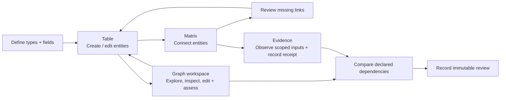

# Tracer developer reference

Commands run from the repository root. Start with the [README](../../README.md) and [walkthrough](../guides/getting-started.md); this reference owns API/CLI usage. [Architecture](../architecture.md) owns detailed invariants and [checkpoint](../checkpoint.md) owns verification.

## Shared browser workspace

```sh
npm start -- --db project.sqlite
```

Open the printed loopback URL (default `http://127.0.0.1:4317`; override with `--port NUMBER`). The default **Graph / Matrix / History** workbench shares one selected project across perspectives. The desktop sidebar and mobile navigation drawer open the shared tasks; **Project settings** holds exchange, evaluation records and the retained **Development map**. See the [walkthrough](../guides/getting-started.md) for navigation.

The complete native snapshot rejects beyond 10,000 records / 100,000 links; rendering bounds are separate. Named Matrix recipes persist in SQLite. Spatial/investigation recovery is browser/origin-local; unsaved drafts remain tab-local. Development-map organization/unnamed recipes are session-only. Project switching confirms draft disposal and reloads against an explicitly configured database. The local server has no organizational authentication.

Open an artifact's details to read **Recorded properties** below its statement and acceptance. This section shows other stored fields, including project-defined delivery, verification, validation and remaining-work context. It displays the selected historical state when browsing history. These values are recorded project assertions; inspect controlled assessment and verification conclusions for their actual evidence and scope. Text editing preserves these properties.

## CSV import planning

The public `parseCsv` and `previewCsvImport` helpers provide bounded, read-only parsing and create-only planning over a complete native project snapshot. The resulting explicit-ID operations use `applyChangeset` and its schema, key, endpoint and duplicate-link guards. Supply the preview's head as optional `expectedProjectRevision` to require the exact reviewed native project revision; a mismatch rejects before any write. See the [CSV import guide](../guides/csv-import.md#use-the-planner-from-a-script) for mappings and a script. There is no dedicated CSV CLI command.

## Next-work queries

`Tracer.getNextWork(query?)`, `next-work get [QUERY_JSON]` and typed `GET /api/next-work` share five read-only queues and one native/evidence snapshot. Optional `requirementType`, `statementField`, `allocationExpectationId` and `verificationExpectationId` select current schema fields/policies; empty strings explicitly leave choices unconfigured. Complete counts are separate from local UI paging. See the [next-work guide](../guides/next-work.md) for membership, bounds and review semantics.

## Deterministic project export

`Tracer.exportProject()` reads all current records/links, schema/history, changesets, evidence, captures and saved views in one repository transaction. `serializeProjectExport()` returns canonical JSON with one final LF. Browser download, `GET /api/project-export` (no filters) and `project export` CLI output use the same bytes. Native/evidence boundaries remain separate. See the [export guide](../guides/project-export.md) for scope, external-file preservation, format and budgets.

## Development fixtures

These launchers support development and regression work. For onboarding, use [Explore an example](../guides/getting-started.md#explore-an-example) or [Start your own project](../guides/getting-started.md#start-your-own-project). Domain datasets have their own [example reference](../guides/realistic-examples.md).

| Command                         | Purpose                                                             |
| ------------------------------- | ------------------------------------------------------------------- |
| `npm run demo:working`          | 1,000 synthetic items                                               |
| `npm run demo:large`            | 10,000 synthetic items; `workspace:large` is a compatibility alias  |
| `npm run demo:small`            | Local file and Git observations; requires Git                       |
| `npm run workspace`             | Older populated Software workspace fixture                          |
| `npm run workspace:engineering` | Older populated Engineering workspace fixture                       |
| `npm run workspace:empty`       | Fresh disposable empty database                                     |
| `npm run workbench`             | Isolated Aster/Gatherline review databases using production sources |

Seeded fixture launches create fresh databases and retain them after shutdown. Use the printed resume command to reopen saved edits. Synthetic counts are test inputs, not capacity guarantees. For an enduring empty project use `npm start -- --db project.sqlite`, rather than a fixture launcher. Existing scripts remain available for automation.

The [workbench review guide](../../test/workbench/README.md) owns its regression orchestration and desktop/680px screenshots. The [historical study archive](../development/archive.md) explains Git-history recovery, the retained regression harness and why new experiments stay local.

## Use the headless core

The public application entry point is [src/index.ts](../../src/index.ts), exposed as `@tracer-local/core`. It exports the typed `Tracer` facade, public contracts and `TracerError`. The SQLite adapter is exposed separately as `@tracer-local/core/sqlite` so importing the portable API does not load Node SQLite. It supports direct use without React, Vite or an HTTP server. `src/core/` contains domain types and validation; instantiate `Tracer` with a repository to run transactions and queries. The UI, CLI and local HTTP adapter call these same services.

The package export paths are the supported import surface; internal source paths may move. These are currently source-based exports for Node.js 24.15+ in this checkout or a local workspace dependency. The root package remains private: a published npm SDK, compiled distribution and generated OpenAPI documentation are not provided. Existing positional service calls remain supported; named command objects are recommended for new integrations.

### Choose an entry point

| Caller                             | Entry point                           | When to use it                                                                 |
| ---------------------------------- | ------------------------------------- | ------------------------------------------------------------------------------ |
| TypeScript/Node application        | `Tracer` + `SQLiteRepository`         | Embed the core in a script or application; no server needed                    |
| Shell, agent or another language   | `node src/interfaces/cli.ts`          | JSON commands with process exit codes; see [CLI quick start](#cli-quick-start) |
| Local browser or local HTTP client | Local server + `ReadApi` / `WriteApi` | Use the running application process and its configured databases               |

### Create and connect records directly

Run the complete [product-model example](../../examples/product-model.ts) from the repository root:

```sh
node examples/product-model.ts
```

It creates the [worked product model](../guides/custom-model.md), three records and two links, updates a requirement, verifies rejection of a stale edit, reads a trace, closes/reopens the database and checks the saved result. It uses a temporary directory and removes that database on completion; it does not create your persistent browser project.

To embed the same API, the following TypeScript can be saved as `core-quickstart.ts` at the repository root and run with `node core-quickstart.ts`. Choose a new database filename before running; this setup expects a new project and will conflict if the schema already exists.

```ts
import { Tracer } from "@tracer-local/core";
import { SQLiteRepository } from "@tracer-local/core/sqlite";
import { productModel } from "./examples/product-model-schema.ts";

const repository = new SQLiteRepository("desk-light-api.sqlite");
try {
  const tracer = new Tracer(repository);
  const provenance = { actor: "my-application", reason: "Create product model" };
  const schema = await tracer.setSchema({ schema: productModel, expectedVersion: 0, provenance });
  const context = { expectedSchemaVersion: schema.version, provenance };
  const product = await tracer.createEntity({
    type: "product",
    key: "PROD-001",
    fields: { title: "Desk light" },
    ...context,
  });
  const requirement = await tracer.createEntity({
    type: "requirement",
    key: "REQ-001",
    fields: { title: "Adjustable brightness", statement: "The user can adjust brightness." },
    ...context,
  });
  await tracer.createRelationship({
    type: "has_requirement",
    source: product.id,
    target: requirement.id,
    fields: {},
    expectedEndpoints: { sourceVersion: product.version, targetVersion: requirement.version },
    rejectExisting: true,
    ...context,
  });
  const outgoing = await tracer.queryRelationships({ source: product.id, limit: 25 });
  console.log(outgoing.items);
} finally {
  repository.close();
}
```

Open the resulting file in the shared UI with `npm start -- --db desk-light-api.sqlite`. That short snippet creates two items and one link; the complete executable example also adds the component, tests a stale edit and checks persistence.

One SQLite repository represents one project. Its parent directory must exist. Reuse the repository/service for that project's lifetime, await outstanding operations before closing it, and close it in `finally`. The adapter serializes its transactions; SQLite's synchronous driver still blocks the Node event loop. For an alternate backend, implement the application-owned [Repository contract](../../src/application/ports/repository.ts) and register a fresh-project factory with `repositoryContract` in `test/repository-contract.ts`. This initial shared suite supplements the existing SQLite tests; full transaction/history and cross-connection parity still require verification. SQLite is the implemented adapter.

Use `Tracer.applyChangeset` for an atomic group of application changes. Inside a low-level repository callback, call the supplied transaction handle rather than another `Tracer` or repository transaction on that same instance; a nested call now rejects with `storage` instead of waiting for itself. Independent callers continue to queue. Drain operations before close; later calls reject with `storage`, and reopening requires a new repository instance. The shared adapter suite checks rollback, transaction lifetime, command outcomes, queue recovery and closed-handle behavior. These contracts keep adapter changes separate from engineering semantics; they do not establish another backend's parity or multi-user throughput.

Evidence reads infer their payload type from the kind: `tx.getEvidence("receipt", id)` returns `Receipt | undefined`, and `tx.evidence("review", query)` returns `Page<Review>`. Appends keep the existing three arguments but require a correlated kind/payload tuple; independently union-typed kind and payload variables are insufficient. Use a correlated `EvidenceAppend` value when forwarding heterogeneous entries. This is a trusted TypeScript boundary; public request decoders and capture/review service guards still validate runtime input.

Every adapter registration through `repositoryContract` also runs the portable evidence suite. Its fixture supplies a fresh persisted project, a `reopen()` method returning a new repository for that same project, and cleanup. Shared checks cover immutable/duplicate captures, read/input alias protection, exact capture/history/schema after edits and deletion, scoped review applicability, kind/subject paging and native/evidence/index/command rollback. See [guarantee ownership and checks](../architecture.md). SQLite currently supplies the executed registration; another provider must run these checks before parity is claimed.

### API map

| Task                                               | Service entry point                                                                                         | Contract/source                                                                                                    |
| -------------------------------------------------- | ----------------------------------------------------------------------------------------------------------- | ------------------------------------------------------------------------------------------------------------------ |
| Read or replace model                              | `getSchema()`, `setSchema({schema, expectedVersion, provenance})`                                           | [Schema, fields and versions](../../src/core/model.ts)                                                             |
| Create/edit/remove records                         | `getEntity(id)`, `createEntity`, `updateEntity`, `replaceEntityFields`, `removeEntity`                      | [Command inputs](../../src/application/commands.ts)                                                                |
| Create/edit/remove links                           | `getRelationship(id)`, `createRelationship`, `updateRelationship`, `removeRelationship`                     | [Command inputs](../../src/application/commands.ts)                                                                |
| Atomic multi-record write                          | `applyChangeset({expectedSchemaVersion, operations, provenance})`                                           | [Atomic changesets](#atomic-changesets)                                                                            |
| Paged raw records/links                            | `queryEntities(query)`, `queryRelationships(query)`                                                         | `EntityQuery`, `RelationshipQuery`, `Page<T>` in [model.ts](../../src/core/model.ts)                               |
| Bounded views and traces                           | `getWorkingSet`, `getTable`, `getGraph`, `getMatrix`, `getFamily`, `getChain`, `getConnections`, `traverse` | [View contracts](../../src/application/views.ts), [service signatures](../../src/application/service.ts)           |
| Complete native map snapshot                       | `getProjectSnapshot()`                                                                                      | [Snapshot contract](../../src/core/project-snapshot.ts); explicit 10,000-item / 100,000-link bound                 |
| History and exact native versions                  | `history`, `changesets`, `timeline`, `getNativePin`                                                         | [Queries and history](#queries-and-automation) and [service signatures](../../src/application/service.ts)          |
| External inputs, receipts, comparisons and reviews | `tracer.evidence`                                                                                           | [Offline evaluation workflow](#offline-evaluation-workflow), [evidence service](../../src/application/evidence.ts) |
| Selected immutable captures                        | `tracer.configurations`                                                                                     | [Configurations](#native-configuration-capture), [service](../../src/application/configurations.ts)                |
| Native baselines                                   | `tracer.baselines`                                                                                          | [Baseline API](../../src/application/baselines.ts)                                                                 |
| Structural expectations                            | `tracer.coverage`                                                                                           | [Coverage contract](#project-defined-structural-coverage)                                                          |
| Change investigation / authored context            | `getChangeImpact`, `getWorkingContext`                                                                      | [Impact](../../src/core/impact.ts), [working context](#working-context-query)                                      |
| Persisted headless view definitions                | `tracer.savedViews`                                                                                         | [Saved-view service](../../src/application/saved-views.ts); separate from session-only map recipes                 |

Use the linked signatures for full parameter/result types. UUIDs identify native objects; optional keys are human labels. Fields are JSON values checked against the project's declared string, number, boolean or JSON definitions. Relationship source/target arrays constrain permitted types: an omitted array allows any declared type; `[]` allows none. Optional `workflow` paths control presentation and do not reverse stored endpoints.

### Headless HTTP operation

Start an API process without building or serving the frontend:

```sh
npm run serve:api -- --db my-project.sqlite --port 4317
```

This opens the same SQLite project and application services as the browser launcher. It binds to `127.0.0.1`, retains Host/origin/session guards, and returns 404 for static pages. The printed resume command retains headless mode. The CLI remains another direct headless interface; use `npm run tracer -- --help` for commands.

Use the shared client from a TypeScript script in this source checkout:

```ts
import { createClient } from "@tracer-local/core/client";

const client = createClient({ baseUrl: "http://127.0.0.1:4317", project: "default" });
await client.connect();
const snapshot = await client.read("/api/project-snapshot", {});
console.log(snapshot.projectRevision, snapshot.entities.length);
const history = await client.read("/api/history", { limit: 25 });
console.log(history.items);
```

`connect()` obtains this local server's mutation token. The client supplies the matching origin on writes; raw HTTP callers must supply both `Origin` and `X-Tracer-Token`. Reads and writes use endpoint-specific `ReadApi`/`WriteApi` types, paired query codecs and runtime response validation. Client configuration accepts an injected `fetch` and headers; individual calls accept `{ signal }`. Each instance fixes its server/project and privately owns its token. The browser uses this same implementation through its existing guarded mutation controller.

Query fields are declared by the endpoint definition. Required parameters, enum choices and nested JSON shapes validate before the service runs; unknown and duplicate parameters reject. Numeric query values must use canonical decimal safe-integer notation: blank/whitespace, fractions, exponent or hexadecimal forms, padded numbers and unsafe values reject. Business-specific ranges and cursor/snapshot rules remain application validations. Existing route paths and query encodings are unchanged.

Use `client.write(path, input)` with the named endpoint's input contract. Server-side request decoders reject unsupported fields and malformed structure, then application services enforce schema, version, scope and transaction rules. `/api/schema` and `/api/session` now reject query parameters. Caller-supplied actor/provenance fields are rejected rather than silently ignored. The launcher records `local-api` / `Headless operation`; embedded hosts can import `startHeadlessServer` from `@tracer-local/core/server` and configure trusted `provenance`, `port` and allowlisted `projects`. Supply a `Tracer` with an explicit observer when external content observation is needed; an unavailable source remains unknown.

There are no automatic retries. `ApiError.code` preserves structured server failures and conflict details. Failed or malformed reads return `read_failed`. A lost, cancelled or malformed write response returns `outcome_unknown`: the write may have committed. Inspect current state/history before deciding what to do; do not blindly replay. A pre-send serialization failure returns `validation`. Headless programs own their concurrency and recovery policy; the client does not silently serialize commands or provide the browser's draft/write lock.

Embedded hosts borrow the supplied `Tracer` and repositories: always `await server.close()` before closing repositories yourself. Concurrent and repeated `close()` calls return the same promise and drain active requests rather than cancelling an in-flight mutation. The process launcher owns its repositories, releases them on startup failure and drains requests on SIGINT/SIGTERM. Ports and guide files validate before databases are opened; demo seed modules load only with explicit `--seed-demo`.

These are local process interfaces, not authenticated organizational hosting. Direct embedding through `Tracer`, the CLI, the headless HTTP server and the browser share application behavior. SQLite remains the only backend.

### Discover capabilities and check compatibility

`GET /api/capabilities` accepts no query parameters and reads no project storage. It returns API identity `tracer-http`, `contractVersion`, registered `{method,path}` operations, supported feature IDs and enforced limits (`maxChangesetOperations`, `maxCommandIdCharacters`, `maxRequestBodyBytes`). The advertised limits are a supported subset; query-specific bounds remain in their owning guides. Discovery keeps the normal Host/origin, project-selection and no-cache protections. The API contract version is independent of logical project schemas, physical database formats and package versions.

Contract version 2 allows additive routes, features and response fields. Incompatible request/response or behavioral changes require a new contract version. The client currently supports exactly version 2. Unknown feature IDs and extra response fields do not cause incompatibility by themselves; malformed discovery is a failed read, not proof of compatibility. Features are compatibility promises, not authentication permissions or backend certifications. The generated [endpoint reference](api-reference.md) lists current feature IDs.

```ts
const client = createClient({
  baseUrl: "http://127.0.0.1:4317",
  require: {
    features: ["changeset-command-recovery"],
    operations: [{ method: "POST", path: "/api/changesets" }],
    minimumLimits: { maxChangesetOperations: 1000 },
  },
});
await client.connect(); // Checks discovery before obtaining a session or allowing writes.
```

Alternatively, call `await client.checkCompatibility(requirements, {signal})` explicitly; it returns the validated capabilities. Requirements are captured before IO. Every explicit check also enforces configured requirements, so it cannot weaken them. Unsupported versions, required features/operations, insufficient limits or a missing discovery route produce client-only `ApiError.code === "incompatible_api"`. Malformed/unavailable/cancelled reads preserve their read/server error. Failed or pending checks block new writes locally; an older successful check cannot authorize writes after a newer check. A later successful check restores compatibility readiness. This does not cancel a write already sent.

Checks are uncached snapshots, not reservations or automatic retries. Reconnect/check after changing the server; configured `require` runs again on each `connect()`. Existing clients without `require` retain their connection behavior until they explicitly invoke a check. All callers still need a session for writes, and the server remains authoritative for limits and guards.

The [generated endpoint reference](api-reference.md) lists every registered GET/POST, query encoding/requiredness and accepted top-level JSON key. Run `npm run api:reference` after endpoint changes; the unit suite rejects stale generated content. Nested request/response types derive through `ReadApi`/`WriteApi`; the generated index does not claim to be a complete semantic schema.

### Versions, errors and paging

`getSchema()` returns `undefined` for a new direct-service project. Initial `setSchema` expects version `0`; later calls use the actual version returned by `getSchema()`. Schema replacement validates all live records and relationships. It does not rename or backfill existing data.

Native writes require the captured schema version. Edits/removals also require the captured object's version. Named commands put these guards alongside the intended values. `updateEntity({id, expectedVersion, expectedSchemaVersion, fields, provenance})` replaces the entire fields object: spread the captured fields if keeping existing values. `replaceEntityFields` is an explicit name for this same replacement behavior. No partial-merge/patch behavior is inferred. Both return the new object/version; legacy positional calls keep their existing behavior. `applyChangeset` commits 1–1000 ordered operations atomically; a failed operation rolls back the entire batch. Remove incident links first or explicitly request the entity command's cascade behavior.

Use `try`/`catch` around awaited service calls. `TracerError`, exported from `@tracer-local/core`, carries a stable `code`: `validation`, `conflict`, `schema_conflict`, `not_found`, `referential_integrity`, `busy`, `storage`, `unsupported_storage` or `usage`. Errors can also carry `details`: object `kind`/`id`, `expectedVersion`/`actualVersion`, or a validation `path` such as `["fields", "title"]`. These details are optional and are preserved in CLI/HTTP error JSON and the browser's `ApiError`; clients should inspect the code/details rather than parse message text. Preserve attempted values on conflicts, reread deliberately, and let the caller decide whether to adopt/retry. Retry a `busy` result as a complete command. Do not silently replace expected versions with current ones. Local `actor`/`reason` values record provenance; they do not authenticate a user.

Paged record queries return `{items, nextAfter?}`. Consume all required pages with the same filters and pass the opaque `nextAfter` as `after`; an absent cursor ends the result. Specialized projections have their own bounds and, where applicable, revision-bound cursors. A page or bounded trace is not the whole project. Calls capture payloads at invocation, but database version checks still apply when the transaction executes.

### Retry and read contracts

`getEntity(id)` and `getRelationship(id)` return one current active object or reject with `not_found`; they do not return deleted records or historical versions. Use history/native-pin/baseline APIs for historical reads. `EntityQuery` permits type/key/search and paging; `RelationshipQuery` permits type/source/target/incident and paging. `WorkingSetQuery` owns the richer field/gap filters. Unexpected filters still fail validation at runtime, even when callers bypass TypeScript.

For a create that might lose its response, generate and retain a lowercase UUID before calling `createEntity({...input, id, expectedSchemaVersion, provenance})` or `createRelationship({...input, id, ...})`. After an uncertain result, use the exact-ID getter and history to compare what was actually saved. Reusing an existing ID conflicts rather than creating another record or silently treating different input as a successful replay. A missing current record is not proof that a previous creation never committed: it may have been deleted; consult its history before deciding what to do next. Identities cannot be reused after deletion.

Relationship commands may include `expectedEndpoints:{sourceVersion,targetVersion}` and `rejectExisting:true`; both are checked atomically with creation. Duplicate endpoint/type links remain permitted when that explicit policy is omitted. These conveniences use the existing batch-operation path; failed guards roll back the whole transaction. Durable command recovery is available for explicitly identified changesets as described below; other write types do not share a general command ledger. There are no automatic write retries.

### Recover an identified changeset

Retain a caller-generated `commandId` and the complete request before submitting `applyChangeset` or `POST /api/changesets`. IDs are project-scoped, case-sensitive text of 1–200 characters without surrounding whitespace; a UUID is suitable. Omitting the ID preserves ordinary write behavior without deduplication.

```ts
// Persist this ID and request in the caller before sending; reuse both for recovery.
const input = {
  commandId: crypto.randomUUID(),
  expectedSchemaVersion: 1,
  operations: [{ op: "entity.create" as const, input: { type: "item", fields: {} } }],
};
await client.write("/api/changesets", input);
// After outcome_unknown or a process restart:
const outcome = await client.read("/api/changeset-outcome", { commandId: input.commandId });
// An explicit repeat of the original input safely returns the original result.
const confirmed = outcome ?? (await client.write("/api/changesets", input));
```

`Tracer.getChangesetOutcome(commandId)` and `changeset outcome COMMAND_ID` return the same original committed `{changeset, results}` or `null` when no successful outcome is visible. `null` does not prove that an in-flight command failed. A lookup failure likewise establishes nothing about the write. Retrying the exact identified request is safe; the client never does so automatically.

The application checks a recorded ID before current schema/head/object guards. The same payload and trusted actor/reason return the original result, including generated IDs, intermediate operation results and deletion tombstones, even after subsequent edits, deletion, schema changes or restart. Changing guards, operations, order, caller IDs or provenance under a successful ID rejects with `conflict` and `details.path:["commandId"]`. Object-key order and omitted versus undefined optional object fields are equivalent. Retain the same trusted host provenance when repeating over HTTP; caller-supplied provenance remains forbidden. An identified command is not a request to adopt current versions.

Only successes are recorded, atomically with native changes/history/revision allocation. Rejected or rolled-back commands reserve no ID. Concurrent transactions cannot commit the same ID twice; a competing SQLite connection may return `busy`, after which the caller can explicitly repeat the same request. Outcomes are immutable and retained without expiry in the database. They are operational recovery records excluded from project JSON export; preserve the SQLite backup for recovery across database moves. Schema, evidence, metadata and convenience single-object writes do not acquire command IDs in this slice.

### Preview a model change

Call `previewSchema({schema: proposedSchema, expectedVersion: capturedSchema.version, limit: 100})` before saving. The read-only transaction returns current schema/project revisions, added/removed/changed definitions, counts of checked entities/relationships, bounded `issues`, `totalIssues`, `truncated` and `valid`. The issue limit defaults to 100, with a maximum of 1000; the scan still checks all active records. Each incompatible record contributes its first validation failure, not every possible field failure. Malformed definitions, stale schema versions and storage failures reject instead of producing a successful report.

A preview allocates no revisions and migrates no data. It can identify required fields, deleted types and endpoint rules incompatible with current records; it does not assess engineering completeness. A valid result is not a reservation: data/schema may change afterward, and `setSchema` always checks again inside its own transaction.

Equivalent CLI commands:

```sh
node src/interfaces/cli.ts --db project.sqlite schema preview '{"schema":{"entityTypes":{},"relationshipTypes":{}},"expectedVersion":1,"limit":25}'
node src/interfaces/cli.ts --db project.sqlite entity get ENTITY_UUID
node src/interfaces/cli.ts --db project.sqlite relationship get RELATIONSHIP_UUID
```

The empty proposed schema above illustrates checking removal of the current model; it only previews and never saves it. Use your complete proposed schema for a real change. Preview and exact getters are exposed through the service/CLI; a dedicated preview UI/HTTP route is not implemented. Existing HTTP query/mutation routes retain their contracts.

### Local HTTP API

The authoritative typed wire contract is [ReadApi / WriteApi](../../src/interfaces/api-contract.ts). The browser's [api.ts](../../ui/api.ts) and [HTTP transport](../../ui/http-transport.ts) are adapters over it. Successful responses are the declared JSON objects directly. Errors are `{error, message, details?}` with a non-success HTTP status; clients must check the status.

Start a persistent project with `npm start -- --db desk-light.sqlite` and use its exact printed origin. GET `/api/session` returns `{token}`. POST requires `Content-Type: application/json`, `Origin` equal to the server's printed origin and `X-Tracer-Token` from that session. `X-Tracer-Project` selects a configured project ID (`default` if omitted; GET `/api/projects` lists choices). It never accepts a filesystem path as the project ID. These same-origin controls are local protections, not organizational authentication or a hosted API.

See the [generated endpoint reference](api-reference.md) for all registered GET/POST routes and their wire inputs.

For example, after saving the tutorial model, this JavaScript runs in the application's browser console and creates one component in the selected project:

```js
const project = new URLSearchParams(location.search).get("project") ?? "default";
const headers = { "X-Tracer-Project": project };
const sessionResponse = await fetch("/api/session", { headers });
if (!sessionResponse.ok) throw new Error(await sessionResponse.text());
const { token } = await sessionResponse.json();
const schemaResponse = await fetch("/api/schema", { headers });
if (!schemaResponse.ok) throw new Error(await schemaResponse.text());
const schema = await schemaResponse.json();
if (!schema) throw new Error("Save the product model first.");
const response = await fetch("/api/changesets", {
  method: "POST",
  headers: { ...headers, "Content-Type": "application/json", "X-Tracer-Token": token },
  body: JSON.stringify({
    expectedSchemaVersion: schema.version,
    operations: [
      {
        op: "entity.create",
        input: { type: "component", fields: { title: "API-created module" } },
      },
    ],
  }),
});
if (!response.ok) throw new Error(await response.text());
console.log(await response.json());
```

The browser supplies its same-origin `Origin` header for this POST; a Node/other-language HTTP client must provide it explicitly. Refresh the map to load an externally created item. A connection failure after a write can leave the outcome unknown: inspect saved state before resending. Validation/usage normally return 400, missing records/routes 404, version conflicts 409 and busy/storage errors 503; session/origin failures return 403. Unexpected server errors return 500. See [the server adapter](../../src/interfaces/local-server.ts) for the exact route/status behavior.

## Historical query controllers

These CLI/API components run in the test-only `test/legacy-ui/` harness. Controls and drawing limits below describe that harness, not additional shipped product interfaces. Detailed query contracts remain in [architecture](../architecture.md).

### Earlier working views

The harness retains Project, Work, Evaluations, Configurations and Model, plus direct editor and Graph/Trace/Matrix query tools. Visited owners stay mounted to retain drafts; invalid Visual/Text model drafts share one captured schema state.



| Surface                   | Controls and scope                                                                                                                                                                                                                                                                                                  |
| ------------------------- | ------------------------------------------------------------------------------------------------------------------------------------------------------------------------------------------------------------------------------------------------------------------------------------------------------------------- |
| Direct editor             | Paged text/type/field/gap search, captured field edits, compatible-target search and incident links. Gap checks count ordinary links.                                                                                                                                                                               |
| Graph query               | Background pan, scroll/+− zoom, node dragging, Fit, Expand/Focus selected and inspector. Manual scope: 60 nodes/200 links/20 expansions; depth 1–6: 200 nodes/600 links. Both allow 50 evaluations/200 inputs and reject overflow. Root browser pages 50 with page-local filtering.                                 |
| Graph keyboard            | Tab/Enter/Space inspects nodes/links; arrows move focused nodes. Canvas focus enables arrow pan and +− zoom. Touch drags. Positions/camera reset on focus/reload and never create native revisions.                                                                                                                 |
| Evaluation overlay        | Solid native arrows and selected receipt's dashed input arrows remain distinct. Inspect paths/versions, observe local source again, or record Evidence still applies/Reevaluate/Acknowledge only with rationale. Badges count visible evaluations, not project-wide impact. Deleted inputs remain evidence context. |
| Native timeline           | Native revision/Earlier revisions and Compare from select complete native commits. Relinks show both routes; positions/camera persist within a focus. Historical graphs exclude evidence/freshness and disable UI writes until Return to current; supporting views remain current.                                  |
| Relationship-column Table | Up to eight directed columns; 20 roots, 300 paths, 1,000 examined links. Parents span prefixes; shared appearances retain one identity. Show siblings counts distinct identities in the loaded root page; Show all chains restores context. Reset columns adopts current schema.                                    |
| Editable rows             | 50 entities/page with page-local filtering. Enter saves; Escape discards and adopts current object/schema values. Selected-row bulk edits are atomic; layout switches retain drafts.                                                                                                                                |
| Matrix query              | 20 items/axis. Click or Tab+Space toggles links; JSON attributes supply required link fields. Gap checks include off-page targets.                                                                                                                                                                                  |

Shared selection reveals off-page Table/Matrix items through indexed anchors. Bulk selection stays independent. Dirty drafts defer navigation; refresh retains original object/schema guards. Failed reads retain the view and pause writes. Review drafts pin comparison tokens and require explicit adoption after relevant drift; acceptance leaves drift visible. Successful edits refresh views.

Family/chain recipes persist as presentation metadata; controller layouts are session-local. Undo/restoration and whole-project historical Table/Matrix are absent. The loopback interface uses the printed origin and no organizational authentication.

## Local resources and contextual references

Read [primitives and how to use them](../guides/workspace-guide.md#primitives-what-to-create-and-when) for modeling choices and a worked engineering example. This section specifies the schema, commands and capture semantics.

The local resource/reference slice shares native UUIDs, versions and commands. Use the current client/server together (HTTP contract 2). Resources are not a mandatory project-defined Source type. Define a reference family through Model → Text (the resource/reference permission checkboxes) or schema JSON, for example:

```json
{
  "cites": {
    "source": ["need"],
    "target": [],
    "resourceTarget": true,
    "reference": true,
    "fields": {}
  }
}
```

Here `need` is an existing configured source type. Empty `target` permits no managed classification through the type list; `resourceTarget:true` explicitly permits resource-capable targets. `resourceSource:true` can separately permit resource-capable sources. Ordinary relationships are not automatically references.

Select a record in the shared workbench, open **References and supporting material**, and add a new local resource or choose an existing one. Author a role, section/passage label and explanation, plus any configured relationship fields. Save creates/reuses the identity and reference in one guarded command. Enter the local file path and choose **Observe file**. Edit the saved reference to pin the displayed observed state; retaining a previous pin and adopting a newer observation are deliberate choices. Section labels and unknown selector kinds are preserved, but passage comparison remains unknown. Returning to the map retains drafts; source/version conflicts keep proposals for correction.

In **Assess evidence**, choose an input to compare its captured state with the latest recorded observation. Resource names use their captured label when no engineering key/title exists. **Native record** versions identify Tracer annotations; the **Observed content** panels identify external hashes, locations, times, availability and Git commits where recorded. Equal native versions can accompany changed external content. Observations retain metadata rather than source text, so passage relevance remains unknown. Expand a declared relationship to read its role, scope, explanation and source selection. A pin's metadata appears only when that exact observation is a declared content input in this evaluation; captured endpoint context alone does not create a content dependency. Browsing these views does not change the original result or record an applicability decision.

Headless authoring uses the same operation inside `applyChangeset` or CLI `changeset apply`:

```ts
const result = await tracer.applyChangeset(
  {
    commandId: "reference-proposal-unique-id",
    expectedSchemaVersion: schema.version,
    operations: [
      {
        op: "reference.create",
        input: {
          type: "cites",
          source: subject.id,
          sourceVersion: subject.version,
          resource: {
            label: "User-needs document",
            source: { system: "file", externalId: "project:document:user-needs" },
          },
          fields: {},
          reference: {
            role: "definition",
            explanation: "Defines the intended outcome",
            selector: { kind: "section", value: "PN-01" },
            state: { mode: "current" },
          },
        },
      },
    ],
  },
  provenance,
);
```

`schema`, `subject`, `tracer` and `provenance` are captured caller context. An existing target uses `target` and `targetVersion` instead of `resource`. Reusing an external identity returns its active object; a removed/conflicting owner rejects. Native resource-only objects carry the internal `@resource` discriminator and optional JSON fields; add a configured `type` through guarded `entity.update` to manage that same UUID as a record. Promotion must satisfy its fields and every incident link permission. Source IDs should be stable opaque/namespaced identities, not inferred from titles/hashes; choose an existing identity after a move. The app generates local opaque IDs rather than automatically merging similar files.

Use the local server/CLI observer or inject the bounded local observer as in the offline evaluation walkthrough. `evidence.observe` records file/Git state and mutable location; it does not store file bytes. Pin external content with `{mode:"pinned",observationId}` or native content with `{mode:"pinned",revision}`. `getReference(id)` / GET `/api/reference` explains selected versus latest state, retention and passage uncertainty. A pin is not automatically retargeted or invalidated when a later source differs.

An evaluation explicitly declares content and references independently:

```ts
await tracer.evidence.recordReceipt(
  {
    outputId: output.id,
    expectedOutputVersion: output.version,
    outcome: "Simulated assessment under the stated conditions; no product verification claimed",
    inputs: [
      { entityId: subject.id, expectedVersion: subject.version, role: "criteria subject" },
      { entityId: resource.id, observationId: observation.id, role: "definition source" },
    ],
    relationshipInputs: [
      {
        id: reference.id,
        expectedVersion: reference.version,
        role: "specific supporting assertion",
      },
    ],
  },
  provenance,
);
```

A relationship input may instead select `revision` for an exact historical snapshot; it does not require a path from `output`. Its endpoints are captured context, not inferred content dependencies. Use `facet:"native"` with optional field scope for native annotations on an external object, separately from its observed content. Different explicit roles/facets/states can coexist for one resource. Relationship-only receipts use `inputs:[]` and nonempty `relationshipInputs`; total declarations are bounded to 100. Captured content retention and the original outcome remain inspectable after current changes/removal. The existing impact and review owners include explicitly declared relationship drift.

For actual verification, declare the product candidate, requirement/criteria, check and conditions used; merely citing a report proves no pass. The reference task offers explicit additional native inputs and records outcome/conditions without changing requirement status. Native history, JSON export and backups retain these primitives; external bytes, rich passage reanchoring, document-system integrations and standards interchange remain outside this slice. Do not bulk-merge historical source-claim records into resources.

## Offline evaluation workflow

Receipts and applicability reviews are specialized immutable capture protocols, not separate peer primitives. `recordReceipt` captures an execution/analysis against declared native/content/relationship inputs; `review` captures a judgment about a receipt comparison and checks its token atomically. The existing receipt API cannot target a comparison in place of `review`. See the [primitive reducibility audit](../development/archive.md#engineering-history) for the conceptual reduction and preserved contracts.

Open **Evaluations** after creating your native requirement, artifact and output entities and links. Bind each artifact to a stable external ID (`git` or `file`, external ownership), then explicitly observe its local content. Create a receipt with an outcome and declared native/entity or external/observation inputs. Change an input, record a new observation for external sources, and compare the affected receipt. Record an accepted, acknowledged or needs-reevaluation decision with rationale.

- Git reads **one committed file**, resolving a local ref to a commit; uncommitted working-tree edits are not observed. Local files use SHA-256. Paths are locators, not identity.
- **Only declared inputs propagate review.** References/mentions alone do not. Native inputs default to exact entity revisions; optional field scopes ignore unrelated annotations. An explicit forward relationship path also pins those link snapshots.
- Comparison means **last observed**, not “verified live now.” Both observation times, hashes/commits, native versions, dependency paths and the affected receipt are retained/displayed. Observe explicitly to establish a newer source state; there is no background sync.
- Freshness (`current/changed/unknown`) and review applicability are separate. Acceptance never clears drift. Unknown recorded input states are never backfilled; acceptance is blocked while unknowns remain. A relevant later change retires the applicability of an earlier review, without modifying it.
- New evaluations may explicitly supersede a prior receipt for the same output. The old receipt remains readable and comparable. For repeated verification, use a stable assessment output and declare each run/conditions, article revision, procedure, criteria and material explicitly. A different run identity does not by itself authorize superseding a result for another output.
- Evidence lists support up to 1000 records, with explicit overflow errors. Above 1000 native entities, creation/binding pickers are explicitly disabled; existing receipt comparison and review remain available. Large-project evidence creation still requires the CLI. Work is paginated separately. CLI evidence queries are paginated. Observations are bounded to 16 MiB and Git reads to five seconds; unresolved states are unknown, never guessed. Git must support `--no-lazy-fetch`; older Git fails safely to unknown instead of fetching missing objects.

Run the non-requirements example: `node examples/research-receipt.ts`. It records a research conclusion supported by a dataset and analysis script, changes the dataset, explains the dependency and requests reevaluation—entirely offline in a cleaned-up fixture.

<details>
<summary>Same evidence commands through the CLI</summary>

Use existing entity UUIDs (any schema/domain). Replace placeholders with returned IDs:

```sh
npm run tracer -- --db project.sqlite external bind '{"entityId":"ARTIFACT_UUID","system":"git","externalId":"module-03","ownership":"external"}'
npm run tracer -- --db project.sqlite observation record '{"entityId":"ARTIFACT_UUID","locator":{"system":"git","repository":"/absolute/local/repo","path":"src/motor.ts","ref":"HEAD"}}'
npm run tracer -- --db project.sqlite receipt record '{"outputId":"OUTPUT_UUID","outcome":"PASS","inputs":[{"entityId":"REQ_UUID","expectedVersion":1},{"entityId":"ARTIFACT_UUID","observationId":"OBSERVATION_UUID"}]}'
npm run tracer -- --db project.sqlite receipt compare RECEIPT_UUID
npm run tracer -- --db project.sqlite evidence list receipt '{"limit":100}'
npm run tracer -- --db project.sqlite evidence list review '{"subject":"RECEIPT_UUID"}'
```

For local files, bind `system:"file"` and use `locator:{system:"file",path:"/absolute/report.txt"}`. Native input `fields:["title"]` declares a field scope; `path:["LINK_UUID",...]` declares a forward dependency path from output to input. Optional `expectedVersion` / `expectedOutputVersion` prevent capture after a concurrent native edit; omitted versions capture current state atomically. The UI supplies displayed versions.

`review record` takes `{receiptId,decision:"accepted"|"acknowledged"|"needs_reevaluation",rationale,expectedComparison}`. Copy the `token` string returned by comparison into `expectedComparison`; relevant intervening changes reject the review with `conflict`. Tokens describe declared dependency state, excluding unrelated commits, timestamps, annotations and unselected fields. The review itself retains the exact full comparison snapshot.

All these commands call `tracer.evidence`, using the same transactional repository as native editing. Evidence queries use `subject` (entity UUID for identity/observations/receipts; receipt UUID for reviews), sequence cursors and the existing page envelope. No network, source write-back, connector framework or AI is involved.

</details>

## Development tools

```sh
npm run format          # Prettier writes source/config/docs formatting
npm run format:check    # Prettier check only
npm run quality         # Fallow dead code, dependency/cycle hygiene, duplication, health
npm run quality:health  # Detailed complexity/maintainability report
npm run check           # Formatting, types, hooks, unit/browser tests and Fallow
npx playwright install chromium
npm run test:ui         # Build and run real Chromium interaction tests
```

Fallow has explicit runtime, UI, example, and test entry points. Dead-code/dependency/cycle findings retain error severity; complexity/estimated-coverage gates also enforce the established thresholds. No baseline or broad source exclusion hides them. Prettier covers authored source/configuration/docs and excludes generated build/test/cache output. No Git hooks were installed.

<details>
<summary><strong>CLI examples and data contracts</strong></summary>

## CLI quick start

```sh
node src/interfaces/cli.ts --db project.sqlite schema set '{"entityTypes":{"requirement":{"fields":{"title":{"type":"string","required":true}}},"test":{"fields":{"title":{"type":"string","required":true}}}},"relationshipTypes":{"verified_by":{"source":["requirement"],"target":["test"],"fields":{}}}}' 0
node src/interfaces/cli.ts --db project.sqlite schema get
node src/interfaces/cli.ts --db project.sqlite --schema-version 1 entity create '{"type":"requirement","key":"REQ-001","fields":{"title":"Authenticate users"}}'
node src/interfaces/cli.ts --db project.sqlite --schema-version 1 entity create '{"type":"test","key":"TEST-001","fields":{"title":"Reject invalid credentials"}}'
```

Replace the placeholder UUIDs below with returned IDs:

```sh
node src/interfaces/cli.ts --db project.sqlite --schema-version 1 --actor engineer --reason 'Add coverage' relationship create '{"type":"verified_by","source":"REQUIREMENT_UUID","target":"TEST_UUID","fields":{}}'
node src/interfaces/cli.ts --db project.sqlite trace REQUIREMENT_UUID forward
node src/interfaces/cli.ts --db project.sqlite trace TEST_UUID reverse
node src/interfaces/cli.ts --db project.sqlite --schema-version 1 entity update REQUIREMENT_UUID 1 '{"fields":{"title":"Authenticate every user"}}'
node src/interfaces/cli.ts --db project.sqlite history '{"kind":"entity","id":"REQUIREMENT_UUID"}'
node src/interfaces/cli.ts --db project.sqlite changeset list
node src/interfaces/cli.ts --db project.sqlite relationship list '{"source":"REQUIREMENT_UUID","limit":100}'
node src/interfaces/cli.ts --db project.sqlite --schema-version 1 relationship remove RELATIONSHIP_UUID 1
```

Individual native writes require the observed `--schema-version`; edits also require object versions. Updates replace fields, retaining entity type/key unless a new key is supplied. Relationship updates provide type, endpoints and fields. See [versions/errors](#versions-errors-and-paging).

Keys are unique across active project entities, case-sensitive. Lowercase UUID identity is permanent, even after deletion. Entity removal rejects active links unless the optional `cascade` argument is explicitly supplied; cascade records every incident link and entity tombstone together.

## Pinned application models

Schema defines permitted records, fields and relationships. A versioned application-model definition binds them to the roles of a particular application service. Store the definition in a normal native record's JSON field and retain its `{entityId, version, field}` selection.

```ts
const model = await tracer.applicationModels.resolve({
  entityId: profile.id,
  version: profile.version,
  field: "definition",
});
console.log(model.definition, model.compatibility, model.requiredFields);
```

CLI uses `application-model resolve '{"entityId":"PROFILE_UUID","version":1,"field":"definition"}'`. Typed HTTP is GET `/api/application-model` with the same three required query fields; require `pinned-application-models` through capability discovery. Replace placeholder identities with the actual record UUID. The read returns native/evidence/schema context, pinned schema version, current profile version/deletion and current-schema compatibility without creating a revision or capture.

The implemented contract is `change_assessment`, version 1. It binds assessment/disposition record fields, membership, state/decision values and the explicit unknown-state policy. The [Tracer installation template](models/change-assessment-model.json) is a complete example. `changeAssessmentSchema(definition)` from the root package generates its two record definitions and membership relationship. Explicitly combine that fresh fragment with your schema after checking for name collisions, then create the chosen model record with a schema-declared JSON descriptor field. Model carrier classification and field names are project choices.

A selected definition is validated against its original governing schema and is retained through later profile edits/deletion. Current compatibility is reported separately; additional required record fields are surfaced. `requiredFields` is `null` when complete metadata is unavailable, and incompatible bindings cannot be treated as write-ready. Resolution uses native annotations and performs no external source IO. Limits are 64 KiB per definition, 128 KiB per serialized resolution, 1,000 fields per bound type/membership and 50 additional required fields per role. Reads reject malformed or unsupported rules/versions and never choose a newer model silently.

This read service prepares shared application configuration. Headless scope, disposition/action operations and controlled completion use the services below; a writable compatibility result alone establishes no engineering conclusion.

## Verification model and criterion-basis preparation

The selected requirement-verification capability currently exposes model resolution and native basis preparation. These reads do not create cases, executions, result selections or verified conclusions. Existing authored status and receipt outcome strings retain their meanings.

`tracer.verification.resolveModel({entityId, version, field})` resolves an exact native JSON descriptor with contract `requirement_verification`, version `1`. CLI is `verification resolve-model JSON`; typed HTTP is GET `/api/verification-model` with those three query fields and feature `verification-models`. Inspect `compatibility.writable`, issues and complete extra-required-field metadata separately from the definition's original-schema validity. The [project template](models/requirement-verification-model.json) and [architecture](../architecture.md) define role fields and bounds. Schema installation is deliberate and model versions stay pinned through later edits/deletion.

`tracer.verification.prepareBasis(input)` and CLI `verification prepare-basis JSON` accept:

- `model`: the exact descriptor pin above.
- `requirement`: `{entityId, version}` for an explicit native requirement revision.
- `coverage`: `{kind: "complete" | "partial", rationale}`.
- `criteria`: up to 25 `{id, field, start, end, quote}` selections. Offsets use JavaScript UTF-16 units, the quote must match exactly, and ranges in each configured acceptance field cannot overlap. A complete declaration must cover all non-whitespace text in every configured acceptance field.
- `methods`: up to ten `{entityId, version, relationship: {id, version}, criterionIds}` selections, with at most 100 total assignments. Each exact link must connect this requirement to that method under the configured relationship. Unknown/duplicate criteria or duplicate method identities reject.

Preparation returns the selected historical source text, exact method/link states, current native/schema/evidence read clocks, declared/source completeness and unassigned criterion IDs. A complete source selection with unassigned criteria is still unplanned work; a deliberate partial declaration remains partial even when all text happens to be covered. Selection/output must each fit 64 KiB. No source observation, capture, native revision or engineering approval is created. Preparation can inspect historical basis even after current source or schema changes; current applicability uses the lifecycle contract below. There is no JSON-in-URL HTTP basis authoring route; controlled opening uses a bounded mutation body.

## Compare receipt inputs with a captured candidate

Call `tracer.configurations.compareReceipt({configurationId, receiptId})`, GET `/api/configuration-receipt-comparison?configurationId=...&receiptId=...`, or `configuration compare-receipt CONFIG RECEIPT`. Feature discovery advertises `configuration-input-comparison`. Select a controlled capture; legacy capture omissions cannot supply a known target state.

Inspect `basis`, `scope`, `comparison` and `completeness` together. The existing comparison shape's `current` values refer to the explicitly identified target configuration. Native field scopes, observed content, paths and direct relationship declarations use their captured dependencies. Missing target selections stay unknown even when the objects exist live. A later live observation cannot update this target; explicitly capture/select another configuration. A `current` comparison means its declared inputs match, while the original outcome and engineering applicability remain separate. This read does not create a target-bound verification case or apply a current-head review.

The read covers all declared dependencies or refuses: 100 total declarations, 1,000 path-link uses, 1 MiB per complete configuration/receipt digest, 4 MiB aggregate selected reads and 4 MiB output. Partial configuration scope and absent legacy direct-input metadata remain visible. The typed client correlates the exact requested context and rejects an incomplete returned dependency population. Existing `evidence.compareReceipt(id)` continues to compare with current-head state.

## Discover dependencies across a configuration pair

Use `tracer.configurations.compareDependencies({beforeId, afterId, limit: 5})`, GET `/api/configuration-impact?beforeId=...&afterId=...&limit=5`, or `configuration impact BEFORE AFTER '{"limit":5}'`. Discover feature `configuration-impact` first. Both captures must have controlled scope/content declarations.

Inspect `pair.comparability` before interpreting the result. Each `evaluations.items` row explains its inclusion, retains the original outcome, and compares all declared inputs with both selected configurations. `dependencyChange` is `changed`, `unchanged` or `unknown`. Even an unchanged dependency state does not establish a passing outcome, unchanged passage, controlled verification or no impact outside the declarations. Independent pinned references resolve their own selected states; the resource default remains available separately. Missing selections and absent legacy relationship metadata stay unknown. Application control dependencies outside the pair are also visible as unknown; this operation does not silently discard them or interpret application receipts as verification authority.

Continue with `after: result.evaluations.nextAfter`. Keep both configuration IDs unchanged. The cursor binds that pair and the evidence watermark; new evidence or another pair rejects continuation. Explicitly restart from the first page to adopt a new evidence population. Optional `expectedEvidenceRevision` also guards a first-page read. A page is partial discovery until exhausted; callers must not close an assessment or declare complete impact accounting from one page.

Page size is 1–25, default five. Receipt population, selected-read and response budgets can refuse even a valid row count; explicitly choose a smaller page instead of silently narrowing the engineering scope. The operation creates no receipts, judgments, observations or native changes. Pair-bound assessment authoring and the shared configuration-change workspace remain under development.

## Compare two fixed configurations

Call `tracer.configurations.compare({beforeId, afterId})`, GET `/api/configuration-comparison?beforeId=...&afterId=...`, or `configuration compare BEFORE AFTER`. Discover `configuration-comparison` before using the endpoint. Both IDs select immutable local captures; the read creates no receipt and never adopts newer native revisions or observations.

The result includes the complete before/after pins, sorted member/relationship differences, changed property values, content fingerprints and an ordered pair/policy digest. `versionOnly` distinguishes an edited revision with unchanged compared properties. Missing JSON properties differ from null; array order remains significant. Inspect `comparability.issues` and `completeness`: legacy omitted topology/content is unknown, scope/schema differences require interpretation, and incompatible subjects do not establish a common engineering comparison. A removed member may still exist in the project. Equal fingerprints retain separate resource/observation identities and establish neither passage relevance nor retained source bytes.

Inspect `contextChanges` for captured subject/scope/schema changes, including a subject deliberately outside the selected membership. The typed client checks that every difference and completeness statement matches the returned captured states; a truncated population is an invalid response.

The read covers the full selected population or refuses: at most 100 members/200 links/100 content selections per controlled capture, 1 MiB canonical JSON per side and 4 MiB complete output. Larger captures need an explicitly narrower comparison scope through new captures; nothing is silently truncated. This is structural comparison. Pair-bound impact judgments, assessment/verification follow-through and the shared authoring workspace remain under development.

## Capture exact configurations with observed content

Use `tracer.configurations.captureContext()` to obtain the current schema/native/evidence clocks, then explicitly prepare `captureExact(input, provenance)`. The equivalent interfaces are GET `/api/configuration-capture-context`, POST `/api/configuration-captures`, and CLI `configuration context` / `configuration capture-exact JSON`. Feature discovery advertises `exact-configuration-captures`.

Supply a stable `id`, `name`, `subjectId`, `expectedSubjectVersion`, exact `members: [{entityId, version}]`, explicit `relationships: [{relationshipId, version}]`, `content: [{entityId, observationId, reason?}]`, `scope: {purpose, coverage, rationale}`, and `expectedSchemaVersion`, `expectedProjectRevision`, `expectedEvidenceRevision`. Coverage is `complete` or `partial` for the declared scope; it is not an inferred completeness or verification verdict. Content must belong to captured members. Every known external member needs an explicit observation selection, or `observationId: null` with a reason. Null remains unknown; an available observation identifies previously observed bytes and does not store those bytes or perform a live source check.

Read the committed result with `configurations.get(id)`, GET `/api/configuration?id=...` or CLI `configuration get ID`. The same exact request and trusted provenance under the same identity recovers the original capture before stale guards; changing names, order, selections, guards or provenance conflicts. Do not retry an unknown write automatically. Inspect the original ID and its retained intent; absence during an in-flight write is not proof of failure. A new capture uses a new identity and deliberately prepared guards. Existing legacy captures do not gain content or completeness metadata automatically.

To capture a receipt against this configuration, supply `configurationId` and explicit `facet: "native"` for its annotation pins or `facet: "content"` for selected observed material. A content declaration uses the configuration's exact observation; an optional `observationId` must match it, and annotation field selectors are invalid for content. Null/undeclared content cannot become an observed input. Direct relationship inputs resolve to the selected configuration topology; optional explicit revisions must match, and current guards or undeclared links reject. Resource-capable schema endpoint permissions apply to captured topology just as they do to native writes. This preserves the selected state even after later observations or relationship edits; ordinary receipt comparison still reports drift against current inputs.

The operation accepts at most 100 members, 200 links, 100 content selections and 128 KiB input; a complete result exceeding 2 MiB rolls back before publication. Comparisons/assessments against a fixed pair are still under implementation; existing receipt comparison and verification continue to evaluate current inputs under their existing contracts.

## Use the configuration workspace

Open **Configurations → Capture configuration**. Choose a subject, exact native member versions, a purpose and complete/partial scope rationale. Record selection searches show up to 50 matching records from the bounded project snapshot. For external members, choose an existing observation or explain an unknown content state; native annotations do not stand in for bytes. Include relationships explicitly after selecting both endpoints, and use their recorded-revision chooser when needed. No graph expansion automatically adds membership.

**Prepare capture** retains the exact proposal and guards. Refresh keeps the draft; changed context or selections require explicit preparation again. **Capture configuration** uses one stable identity. Returning to the map retains the in-session draft. After an unknown outcome, use shared saved-record inspection against the original identity before acknowledging; no retry occurs automatically. **Start new capture** deliberately creates another identity and confirms disposal of a pending draft.

Use **Compare configurations** to choose before/after captures, then **Compare selected pair** to apply those choices. Changing a picker alone does not replace the displayed comparison. Inspect native, topology/reference and observed-content differences separately, with exact identities and unchanged context available in disclosures. Unknown content, qualified scope and legacy captures remain explicit. Failed exact reads retain the previously read pair rather than substitute current state.

**Discover declared dependencies** reads a bounded page of evaluations against the displayed pair. Each row separates the original outcome, dependency change, full input correspondence and supersession. A page is not complete engineering impact. Continuations bind the evidence watermark; drift requires **Restart dependency discovery**, while **Retry exact dependency page** retains the requested context. Select a smaller page after a payload refusal. Native/evidence state is not modified by comparison or discovery.

When recording a native-input receipt against a controlled capture, choose **Configuration input facet** for each input. Native annotations retain the exact native pin; observed content uses that configuration's exact observation and cannot select a latest replacement. A null/unselected content state has no selectable observed-content facet; a recorded unavailable observation retains its unavailable meaning. Changing the facet resets field scope, and content inputs do not carry native field selectors. Legacy native-only capture bases retain their original meaning.

To follow through, select an **Investigation root** under the displayed comparison and choose **Assess displayed pair**. This passes the displayed pair, even if you have changed a picker without applying it. **Start assessment for displayed pair** explicitly opens another assessment draft; an existing draft is retained until you confirm replacing it. Select the assessment model and traversal, then prepare and open the assessment. The **Exact configuration pair** source can also be chosen directly in New assessment.

From that assessment, **Verify after configuration** offers a new case targeting its exact after capture. Explicitly start the case, select the captured verification model and requirement, prepare the basis, assign exact criteria to captured methods, and explain coverage. The requirement, methods and mappings resolve from the target rather than later live edits. A target change requires explicit basis revision; it cannot silently return an existing targeted case to current-head semantics.

Record activity results and supporting inputs separately. Target input choices distinguish native annotations, observed content and selected direct connections. Under the V2 target policy, choose each **Supporting contextual reference** independently; B/C/B uses of one resource retain separate states and selectors. Selecting a reference also declares its exact qualified connection. Passage relevance remains unknown unless separately established. In activity inspection, **Target support layer** judgments use the selected configuration namespace; generic live-head reviews cannot establish target applicability.

Return to the assessment to retain its pending judgment. Under an action's support, use **After-target verification conclusion** to select the genuine controlled conclusion for the exact target. The service validates coverage and related engineering scope; a generic passing report cannot discharge reverification. Explicitly refresh selected scope to discover new evaluations, retain earlier obligations, and account for newly discovered candidates before completing.

These shared authoring paths are implemented and verified locally. The original real-change controlled conclusion and completed assessment are recorded in the register and the full acceptance audit; representative-human evaluation remains unrun. A [fresh-agent synthetic walkthrough](../development/register.md#historical-evidence) completed scoped follow-through and records its findings and limits.

For explicit historical annotation reads, use `getNativePin(id, version, "annotations")`, GET `/api/native-pin?facet=annotations&id=...&version=...`, or `native-pin annotations ID VERSION`. Discover `native-annotation-pins`. Default native-pin reads still refuse external members, and neither form observes or retains bytes.

## Assess an exact configuration pair

Discover feature `configuration-pair-assessments`. Use the existing `changeAssessments.open` operation, POST `/api/change-assessments/open` or CLI `assessment open JSON`, with normal model selection, stable command/assessment identities, purpose, additional fields and exact schema/native/evidence guards. Replace the baseline query with:

```json
{
  "source": "configuration_pair",
  "beforeId": "BEFORE_CONFIGURATION_ID",
  "afterId": "AFTER_CONFIGURATION_ID",
  "policy": "scoped-reference-dependencies-v1",
  "rootId": "ENGINEERING_RECORD_ID",
  "direction": "outgoing",
  "relationshipTypes": [],
  "depth": 1
}
```

An empty relationship selection examines the root only. Select configured relationship types to expand the bounded traversal. Inspect returned `scope.version`, `scope.basis.pair`, discovery qualifications and candidate basis before authoring a disposition. Pair facts remain fixed when live product state changes; discovery can still require explicit refresh after new evidence. Refresh retains earlier obligations. A different pair/policy requires a new assessment identity and new judgments.

To complete re-verification, perform the existing controlled verification task against the exact after configuration. Use its genuine passing conclusion receipt as an action's support:

```json
{
  "kind": "receipt",
  "id": "CONTROLLED_CONCLUSION_RECEIPT_ID",
  "mode": "configuration",
  "configurationId": "AFTER_CONFIGURATION_ID"
}
```

The shared engine checks authenticated origin, selected target, complete passing coverage and the candidate's actual declared inputs. A generic passing report or a different configuration with similar contents is insufficient. Read support `applicability` separately from captured basis uncertainty and original outcomes. New work for the same target can require reassessment; work for another target does not silently rebase this assessment.

Use existing guarded disposition/action and close operations. Unknown scope cannot establish no impact, and closure accounts only for declared scope. Candidate/population/work limits refuse overflow; narrow the investigation explicitly rather than assuming a partial list is complete. After a lost response, inspect `evaluation outcome COMMAND_ID` and retain the original request. Exact repeat recovery preserves original intent; changed input under the same identity conflicts. Do not automatically retry an uncertain write.

Pair assessment is exposed through the shared workspace and headless operations. The register and criterion-level acceptance audit retain the actual task results and current scoped acceptance status. Existing baseline queries and historical/current support modes retain their meanings.

## Controlled verification cases and execution capture

Use `tracer.verification.open(input, provenance)`, POST `/api/verifications/open` or CLI `verification open JSON` with `commandId`, `caseId`, `membershipId`, `title`, `purpose`, the `basis` selection described above, explicit `additionalFields`, and exact `expectedSchemaVersion`, `expectedProjectRevision`, `expectedEvidenceRevision`. A successful command creates the case/membership and one immutable opening receipt atomically. Recover through `evaluation outcome COMMAND_ID`; exact repeats return the original result before current guards, while changed intent conflicts. No result or verified conclusion is inferred by opening.

To bind a case to a captured candidate, discover `configuration-bound-verification` and include `targetConfigurationId` at opening. The capture must contain the exact model/requirement/method versions and method mappings in the prepared basis. Inspect `view.scope.target` before interpreting analysis: the configuration ID/digest/policy stays fixed for the selected basis while execution accounting and command guards remain live. Without this field, existing cases compare against current-head engineering inputs. A new candidate requires an explicit guarded basis revision with `targetConfigurationId`, reason and criterion mapping; omission retains the existing target. The revision clears current selection/conclusion and preserves the earlier context in history. A query cannot change a case's context. Source availability and criterion coverage remain separate from the configuration's declared coverage.

Read a controlled case with `verification.get({caseId, openingCommandId})`, GET `/api/verification-case` or CLI `verification get JSON`. `verification.locate(caseId)`, GET `/api/verification-case-locate` and CLI `verification locate ID` resolve its original opening. The view validates controlled history and exposes its complete bounded execution registry; a type/status/JSON field alone is insufficient.

`verification.recordExecution`, POST `/api/verifications/execute` and CLI `verification record-execution JSON` use those selection/guard fields plus `expectedCaseVersion`, stable `executionId`/`membershipId`, `title`, `methodId`, `source`, explicit JSON `conditions`, `results`, `inputs`, `relationshipInputs`, and `additionalFields`. Every assigned criterion appears exactly once in `results` as `{criterionId, outcome, actual, rationale}`. `outcome` is one of `passed`, `failed`, `blocked`, `not_run`; observations/rationale remain explicit even when work was blocked or not run. Supporting uses follow the existing receipt-input contracts. The activity, case registry, membership, exact receipt and recovery outcome commit or roll back together.

For a newly attested activity use `source: {kind: "performed"}`. To interpret an already recorded activity use `{kind: "prior_receipt", receiptId, rationale}`; its original receipt must explicitly capture matching requirement/method semantic inputs. The original actor/time and captured revisions remain historical facts. This does not automatically infer typed results from a report, claim a new execution or erase original input drift. Inspect `verification.execution(selection, executionId)`, GET `/api/verification-execution` or CLI `verification execution JSON`: `comparison.record` covers the new interpretation's captured inputs, while `comparison.source` separately covers the original activity. Unknown/drift/supersession and recorded outcome retain separate meanings.

If the source is an authenticated controlled execution, passing reinterpretation also requires matching requirement/method/mapping semantics and complete original passing criterion coverage. Failed, blocked, unexecuted and uncovered scope needs a performed replacement. Passing criteria can be explicitly regrouped; whitespace gaps do not create missing obligations. Nested controlled sources retain original dependencies and refuse beyond 25 inspected receipts. Raw report interpretation remains explicit and does not parse an outcome string into authority. For target cases, case analysis reports selected-candidate applicability; the generic execution-detail comparison continues to show live-head input drift. Target execution detail also includes `targetSupport` with the exact target, governing basis digest and complete projected support source chain. Each layer exposes its recorded/selected inputs, next-source identity and context fingerprint. This uses the same support projection as case analysis, without treating later live inputs as selected state. Inspection is read-only; fingerprints confer no review authority. Core, typed HTTP/client and `verification execution JSON` return the same information, bounded by the existing 256 KiB execution-view limit with explicit refusal rather than partial chains. Qualified target reviews are available headlessly as described below; workspace authoring remains under development. Current-head reviews do not override unknown or changed target support.

Require features `verification-cases` / `verification-executions` when depending on these operations. Use the normal uncertain-save inspection flow; no retry is automatic. Scope/registry, command/response and supporting-material bounds are documented in [the owning contract](../architecture.md). Over-budget responses and failed post-capture reads reject atomically. The shared verification workspace supports both current-head cases and explicit configuration-target authoring, input reference choices, target-qualified support inspection/review and controlled conclusion selection. See the configuration workspace task above for the shared handoffs. All recorded results can still be inspected through the native evidence/history interfaces.

## Associate an evaluated input with a contextual reference

Use an ordinary direct input for a resource dependency. When its meaning depends on a specific reference's role, selector and selected state, add `referenceId` and explicitly capture that relationship in `relationshipInputs`:

```ts
const support = {
  inputs: [
    {
      entityId: documentId,
      facet: "content",
      referenceId: referenceBId,
      observationId: observationBId,
    },
    {
      entityId: documentId,
      facet: "content",
      referenceId: referenceCId,
      observationId: observationCId,
    },
  ],
  relationshipInputs: [
    { id: referenceBId, revision: referenceBVersion },
    { id: referenceCId, revision: referenceCVersion },
  ],
};
```

Discover `reference-evaluation-inputs` before depending on this extension in receipt, atomic evaluation-command or verification-execution authoring. The reference must target the same resource and be explicitly declared in that receipt. Its source can be the requirement or other engineering object that uses the material; it need not be the newly created execution. This is an input association with an existing relationship, not an attachment record or inferred path. Use an explicit `facet: "native"` for native resource content, with optional `revision` and `fields` selecting the used state. A native input cannot stand in for observed external content. Input paths and current-version guards are separate declarations.

A pinned reference selects its exact native revision or observation, independently of the resource default. Conflicting explicit revision/observation guards reject. A current reference may record the explicitly declared historical state actually used; later applicability remains a separate comparison. With `configurationId`, selection is controlled by that configuration's exact topology/default and reference pins. Unknown/undeclared defaults do not erase independently pinned material, and no live head or observer is substituted. Repeated uses remain distinct by reference identity, including identical bytes with different selectors.

When selected material no longer has an active native identity, an explicit `facet: "content"`, native `revision` and `observationId` can retain both its historical identity/annotation snapshot and the bytes actually observed. Discover `historical-content-inputs` before depending on this direct capture extension. The native revision is not an external content version; the observation remains required, field selectors are invalid for content and current availability is still independently unknown. Selected-target verification uses these exact declarations when composing result-selection/conclusion evidence with live application-control facts. It does not add the activity to product membership or replace deleted material with a live default. An older explicit reference pin can also retain its known endpoint identity; a current reference without an explicitly used state cannot infer a default from a deleted identity.

To use contextual correspondence in a verification case, discover `contextual-input-correspondence` and explicitly set `targetPolicy: "target-reference-uses-v2"` alongside `targetConfigurationId` at opening, or on guarded basis revision. Omission at opening retains V1; omission on revision retains the case's current policy. A policy requires a selected configuration. Changing policy clears selection/conclusion and retains prior history/reviews; old judgments do not gain authority in the new context.

V2 resolves the explicitly associated reference, or an older receipt's explicitly declared terminal qualified-reference path, against the selected target. Inspect each comparison's `referenceUse` beside its `current` used state. `referenceUse.resourceDefault` retains the separate resource selection; missing selected references remain unknown even if they exist live. `passage: "unknown"` means a selector has not been resolved or assessed, even when whole bytes match. The existing raw current-head and `selected-dependencies-v1` comparisons still describe their original resource/default dependencies; they do not become contextual-use assessments. Existing current-head cases retain that meaning. The shared Configurations and Verification tasks author exact target configurations and explicit reference uses; target-qualified support and controlled conclusion selection remain separate guarded actions.

## Review support for a captured verification target

Discover `qualified-target-reviews`, inspect `verification.execution(selection, executionId).targetSupport` and deliberately prepare a fresh `verification.analyze(selection)`. Each support layer has a receipt identity, recorded/selected inputs, qualification, token and applicable/previous review. Read the complete source chain; an interpretation layer does not replace its original dependencies.

Call `verification.reviewSupport(input, provenance)`, POST `/api/verifications/review-support` or CLI `verification review-support JSON`. Supply the normal lifecycle guards and selection (`commandId`, `caseId`, `openingCommandId`, `expectedSchemaVersion`, `expectedProjectRevision`, `expectedEvidenceRevision`, `expectedCaseVersion`, `expectedAnalysisDigest`), plus:

- `executionId`: the controlled execution being assessed.
- `receiptId`: the specific inspected support layer, including an original source when relevant.
- `expectedComparison`: that layer's exact target-bound `token`.
- `decision`: `accepted`, `acknowledged` or `needs_reevaluation`.
- `reason`: the engineering rationale for this judgment.

Use the analysis proposal/context guards and inspected token from deliberate preparation. A conflict requires inspection and explicit adoption of new state, not automatic refresh/retry. The Review, receipt and durable command outcome commit atomically without a native case edit. For an uncertain response, inspect `evaluation outcome COMMAND_ID`; exact original-intent replay can recover the original success, but clients never retry automatically.

Only an open target-bound case with a writable pinned model can author this judgment. Unknown support cannot be accepted. Acceptance counts for changed support only when the pinned model permits it; recorded failures, unexecuted work, governing criteria, prior-source coverage, supersession and accounting retain independent authority. Review each changed source layer. Re-read analysis and explicitly select results again if the judgment retired the previous selection's evidence digest.

Qualification isolates the case opening, chosen execution, target and governing semantic basis. A current-head judgment or another execution/case/target's judgment cannot substitute. Selection/conclusion writes alone preserve the review's context. New target or semantic basis revisions retain older reviews historically while requiring judgments in the new context. Source labels, copied payloads and status strings cannot create authenticated review authority. The generic `/api/reviews` operation retains its original unqualified current-head meaning.

## Select verification results and record a conclusion

Read `tracer.verification.analyze({caseId, openingCommandId})`, GET `/api/verification-analysis` or CLI `verification analyze JSON`. Inspect `basis`, `obligations`, `executions`, `selection`, `blockers` and `completion` separately. `ready` means a controlled conclusion can be requested; an open ready case is still open. A closed case can retain its historical passing conclusion while current applicability needs reassessment. Request feature `verification-results` for these headless operations.

Each lifecycle write takes the case/opening selection plus `commandId`, `reason`, exact `expectedSchemaVersion`, `expectedProjectRevision`, `expectedEvidenceRevision`, `expectedCaseVersion`, and `expectedAnalysisDigest: analysis.proposalDigest`. Capture those values from one deliberate preparation; conflicts require inspection and a new proposal, never an automatic rebase. Save exact intent before sending and use the existing evaluation-outcome recovery flow for uncertain responses.

- `verification.selectResults(input, provenance)`, POST `/api/verifications/select`, CLI `verification select JSON`: add `selections: [{criterionId, methodId, executionId}]` and `accounting: [{executionId, decision, rationale, replacementId?}]`. Account for every registered execution once. Decisions are `selected`, `historical`, `superseded`; only supersession names a replacement. Selected decisions must match actual choices. A replacement must itself be selected and cover the same method/mapped criterion scope. All failures remain inspectable. Selection records exact current-state references and does not itself conclude verification.
- `verification.conclude(input, provenance)`, POST `/api/verifications/conclude`, CLI `verification conclude JSON`: no additional fields. The service requires complete current selection, complete source/method coverage and an applicable pass for every obligation. It captures a controlled conclusion atomically. Read the returned receipt and derived analysis; do not write a verified string to imitate this operation.
- `verification.reopen(input, provenance)`, POST `/api/verifications/reopen`, CLI `verification reopen JSON`: explicitly reopen a concluded case with a reason. Its former conclusion remains in native history and the original command outcome; current selection is retained for deliberate reassessment.
- `verification.reviseBasis(input, provenance)`, POST `/api/verifications/revise`, CLI `verification revise-basis JSON`: add `basis` using the preparation contract and `mapping: [{fromId, toId}]`, with `toId: null` for retirement. Map every old criterion once to a distinct current criterion or retirement. Same requirement identity/model pin and current governing semantics are required. Revision retains all executions and clears selection. Unchanged mapped obligations may reuse their original activity; changed criteria, requirement statement, method or mapping relationship require new execution for affected obligations.

New executions make accounting incomplete. Changed selected support makes selection stale; reselect only after inspecting the change and obtaining applicable evidence or an explicitly allowed exact review. A review cannot override a failed result, unknown support or changed governing criteria/methods. Unselected historical support drift alone does not retire a chosen current result. Full captured snapshots remain conservative; use explicit field scopes when that is the intended dependency. [Architecture](../architecture.md) owns these distinctions and bounds. The [shared verification workspace](../guides/workspace-guide.md#requirement-verification) uses these same services for basis/activity authoring, result selection, controlled conclusions, exact input review and uncertain-save recovery. The [complete acceptance audit](../development/register.md#historical-evidence) retains exact source/procedure/results; the development register owns current delivery/verification status.

## Open a scoped change assessment

Use `tracer.changeAssessments.open(request, provenance)`, POST `/api/change-assessments/open`, or CLI `assessment open JSON`. Opening, explicit scope refresh, dispositions/actions and closure/reopen are implemented headlessly. The shared assessment task uses these same services; the completed local real-case proof and acceptance audit are recorded in the development register.

A request contains:

- `commandId` and `assessmentId`: stable identities captured before sending. Use a new command ID for deliberately changed intent.
- `title`, `purpose`, and `model: {entityId, version, field}`: explicit engineering purpose and exact resolved model selection.
- `query: {baselineId, rootId, direction, relationshipTypes, depth?}`: the selected impact traversal. An empty type list selects only the root. Pages/cursors are not accepted as a complete population.
- `additionalFields`: explicit project fields outside the controlled role bindings, commonly `{}`.
- `expectedSchemaVersion`, `expectedProjectRevision`, `expectedEvidenceRevision`: all required. Resolve the model to obtain a consistent preparation context; a conflict requires deliberate re-preparation.

The result is the same native-plus-receipt shape as an evaluation command. The assessment's configured scope field retains its exact population, reasons/reachability and read basis. The opening receipt captures that assessment output and the native model version, and establishes no engineering conclusion. Discovery rejects above 25 candidates, 25 examined receipt rows or 64 KiB, retaining the existing impact traversal bounds. Narrow the declared investigation explicitly rather than treating a truncated page as complete.

After an uncertain response, read `/api/evaluation-outcome?commandId=...` or run `evaluation outcome COMMAND_ID`. `null` means no visible success and does not prove an in-flight request failed. A deliberate exact repeat recovers the original result before current guards; clients never retry automatically. Never use an ordinary edited closed status as proof that the controlled closure contract has been executed.

## Read and refresh an assessment

Select `{assessmentId, openingCommandId}` using the identities retained when opening. New scope control metadata also retains the opening command ID. An older opening without that metadata still resolves using its original command ID. `tracer.changeAssessments.get(selection)`, GET `/api/change-assessment` and CLI `assessment get JSON` return the same bounded view and current preparation context.

```ts
const view = await tracer.changeAssessments.get(selection);
const result = await tracer.changeAssessments.refresh(
  {
    ...selection,
    commandId: crypto.randomUUID(),
    expectedSchemaVersion: view.model.context.schemaVersion,
    expectedProjectRevision: view.model.context.projectRevision,
    expectedEvidenceRevision: view.model.context.evidenceRevision,
    expectedAssessmentVersion: view.assessment.version,
    reason: "Include newly recorded verification results and retain earlier obligations",
  },
  provenance,
);
```

POST `/api/change-assessments/refresh` and CLI `assessment refresh JSON` use the same input. Refresh uses the original purpose/query; it adds new candidates and keeps prior candidates that no longer appear, with their earlier basis explicitly retained. It never clears obligations merely because a link was removed. The combined population remains limited to 25 candidates/64 KiB, and discovery examines at most 25 receipt rows after repository exclusion of this assessment’s own-output results. Overflow leaves the original assessment unchanged. Scope refresh records no dispositions or controlled completion.

The read service validates model/scope/state/closure against captured application-command outputs. A raw closed value, changed model pointer or authored scope cannot establish controlled state. Native title/project-field edits are preserved. Current model incompatibility is readable but blocks refresh. Reads return compact presentation/provenance and complete recorded scope, bounded to 256 KiB. They do not rediscover scope automatically or claim that the stored discovery basis is current merely because the read succeeded.

After a conflict, obtain a new view and deliberately re-prepare. After an uncertain response, use the existing evaluation outcome lookup. Exact repeats recover the original result even after later refreshes or reopen. A refresh receipt captures the prior scope as an historical input; its generic drift must not be mistaken for a failed refresh or an engineering applicability conclusion.

### Resolve an assessment from its record identity

`tracer.changeAssessments.locate(assessmentId)`, GET `/api/assessment-locate?assessmentId=...` and CLI `assessment locate ID` return the controlled view without requiring the caller to remember its opening command. The service reads the first receipt for that output, resolves its successful command through the existing receipt-identity index, and runs the same original-command/genesis/model/current-control checks as `get`. Ordinary records, raw evaluation commands or authored scope metadata cannot establish an opening. Older openings without `scope.control` still resolve; no history scan, migration or write is needed. The returned opening selection can then be used for analysis and guarded mutations.

The shared UI exposes these services through **Change assessments**. [The workspace guide](../guides/workspace-guide.md#scoped-change-assessments) owns authoring and recovery instructions. Catalogue hints identify records to inspect; `locate`, model resolution and analysis remain authoritative.

## Judge candidates and manage completion

Use `tracer.changeAssessments.analyze(selection)`, GET `/api/assessment-analysis`, or CLI `assessment analyze JSON` before preparing judgments or closure. Basic `get` returns controlled recorded state; `analyze` checks effective applicability, discovery and each obligation. A stored closed state can therefore coexist with `completion.state === "needs_reassessment"`.

```ts
const analysis = await tracer.changeAssessments.analyze(selection);
const obligation = analysis.obligations[0];
const view = analysis.view;
await tracer.changeAssessments.setDisposition(
  {
    ...selection,
    commandId: crypto.randomUUID(),
    expectedSchemaVersion: view.model.context.schemaVersion,
    expectedProjectRevision: view.model.context.projectRevision,
    expectedEvidenceRevision: view.model.context.evidenceRevision,
    expectedAssessmentVersion: view.assessment.version,
    subject: obligation.subject,
    dispositionId: crypto.randomUUID(),
    membershipId: crypto.randomUUID(),
    expectedDispositionVersion: 0,
    expectedBasisDigest: obligation.currentDigest,
    title: "Retain historical result",
    decision: "no_action",
    rationale:
      "This result remains a historical claim; no current-input applicability is asserted.",
    actions: [],
    support: [],
    additionalFields: {},
  },
  provenance,
);
```

This example is a proposal for a known candidate, not a recommendation to mark every candidate no-action. Unknown facts require resolution or explicit model-authorized acknowledgment. Always prepare from a fresh analysis; expected digests and version guards reject stale proposals. For an existing judgment, reuse its disposition/membership IDs and current version, obtained through `changeAssessments.disposition(selection, subject)` (GET `/api/assessment-disposition`, CLI `assessment disposition JSON` with `{...selection, subject}`). New records use expected version zero. Each candidate has one controlled judgment, represented by an ordinary native record and membership link.

POST `/api/change-assessments/disposition` or CLI `assessment set-disposition JSON` accepts the same proposal. Decision tokens are `no_action`, `revise`, `reverify`, `investigate` and `acknowledge_unknown`; the service maps these fixed meanings to the pinned model's configured native aliases. Actions contain stable `id`, `kind` (`revise`, `reverify`, `investigate`), `title`, `state` (`open`, `done`, `waived`), `resolution` and `support`. Keep prior action IDs/kinds on updates. Required decision actions cannot be omitted, and no-action cannot hide open work.

Support selects `{kind:"entity"|"relationship", id, version, mode}` or `{kind:"receipt"|"observation", id, mode}`. Choose `mode:"historical"` to retain that exact recorded fact, or `mode:"current"` when the judgment depends on its continued applicability. Current means current recorded state, not a new filesystem/provider observation. Done actions require a resolution and known support including at least one current selection. Done reverification additionally requires a current receipt explicitly declaring the candidate (or appropriate same/superseding result). Merely naming it as output or supplying a native-only report for unavailable external content is insufficient. Historical results remain readable after supersession; current support rejects superseded results. Waiver requires explicit `allowActionWaiver:true` in the selected model; omission denies it. Unknown acknowledgment requires `allowUnknown:true` and does not silently resolve unknown bytes.

Analysis reports each obligation as `undisposed`, `open_actions`, `stale_basis`, `unknown` or `accounted`. Discovery is separately `current`, `changed` or `unknown`. A new verification receipt may add a candidate: refresh explicitly and judge the expanded population before closing. Removed candidates retain obligations. Known native absence is captured explicitly; repeated observations of unchanged bytes and unrelated counters do not themselves stale semantic basis. Stored inputs retain exact versions/observations even when those bookkeeping identities are excluded from semantic comparison.

Call `changeAssessments.close(request, provenance)` or `reopen` with `{...selection, commandId, expectedSchemaVersion, expectedProjectRevision, expectedEvidenceRevision, expectedAssessmentVersion, reason}` from a fresh analysis/view. HTTP uses POST `/api/change-assessments/close` or `/reopen`; CLI uses `assessment close JSON` or `assessment reopen JSON`. Closure requires current discovery and complete accounting. It records an immutable certificate and receipt, and rejects self-invalidating current support atomically. Reopening records a reason and retains historical completion; it does not rewrite the old result. A conflict requires deliberate preparation; an uncertain response uses the same evaluation outcome lookup/exact-repeat recovery as opening.

Require features `change-assessment-dispositions` and `change-assessment-closure` when depending on these routes. Limits are five actions, ten support selections per use/twenty aggregate uses, 32 KiB proposal, 48 KiB captured judgment, 64 KiB detail and 256 KiB analysis. Basis captures allow 80 input/link/absence facts and 16 KiB declaration metadata; fingerprint facts are bounded to 1 MiB. See [the architecture contract](../architecture.md) for ownership, evidence semantics and explicit scope limits.

## Atomic evaluation operations

Use `tracer.evaluations.commit(command, provenance)` when native project updates and one execution/analysis receipt must succeed together. Separate `applyChangeset` and `evidence.recordReceipt` calls remain separate transactions. Project schema and captured roles define engineering meaning; the operation does not execute tests or infer verification status.

```ts
const result = await tracer.evaluations.commit(
  {
    commandId: "power-analysis-001",
    expectedSchemaVersion: schema.version,
    expectedProjectRevision: capturedHead,
    operations: [],
    receipt: {
      outputId: existingAnalysisId,
      outcome: "Measured power meets the stated criterion under the recorded conditions",
      inputs: [
        {
          entityId: requirementId,
          facet: "native",
          revision: criterionRevision,
          fields: ["statement"],
          role: "acceptance criterion",
        },
        {
          entityId: reportId,
          facet: "content",
          observationId: reportObservation.id,
          role: "measured result",
        },
      ],
    },
  },
  provenance,
);
```

Identifiers/versions in this fragment are captured by the caller. Observe external material beforehand with the normal observer; commit performs no file/Git IO. For new objects, supply unused UUIDs in native create operations and reference those UUIDs in the receipt. Zero operations produce `native: null` and allocate no native revision. Up to 1,000 operations plus the receipt commit together, using existing native guards and receipt limits (100 declarations). Invalid edits, guards or capture state roll back the whole operation, including indexes and the successful-command identity.

For a proposal derived from an evidence catalogue or comparison, optionally supply `expectedEvidenceRevision` from that read snapshot as well as `expectedProjectRevision`. For example, `/api/impact` returns both values in `context`. The committed evidence watermark is independent of the native head: observations and reviews can advance it without a native change. A nonnegative safe-integer guard is checked inside the evaluation transaction before writes; drift conflicts and invalid values reject. Omission preserves existing explicit-capture behavior. Exact successful repeats still recover before either live guard. Require the additive `evidence-revision-guards` capability before relying on this field; it does not infer dependencies or make old captures invalid.

Persist the command ID and exact request. `evaluations.getOutcome(commandId)` returns the original `{ commandId, native, receipt }` or null. An exact repeat, including trusted provenance, returns the original result before current guards even after restart or later edits/deletion. Reusing the ID with changed intent conflicts. A rejection reserves no success. Null means no visible committed success; an in-flight request may still commit. Inspect explicitly after an unknown transport outcome and never automatically retry with a new ID. Native changeset and evaluation command IDs have separate project-scoped namespaces.

CLI uses the same service: `evaluation commit JSON` and `evaluation outcome COMMAND_ID`. HTTP uses `POST /api/evaluation-commands` and `GET /api/evaluation-outcome?commandId=...`. Check `atomic-evaluation-commands` through capabilities and call `client.connect()` for a local session before writes. Typed client `write`/`read` use these same route names and validate response identity; malformed or interrupted write responses remain `outcome_unknown`. Trusted host configuration supplies provenance, so HTTP bodies cannot supply actors.

The immutable outcome ledger is operational data excluded from recorded-project JSON; SQLite backup retains both native and evaluation command recovery. Physical format 11 adds this ledger without rewriting earlier payloads. Existing receipt/native APIs remain available. [Application-model contracts](../architecture.md) and the cross-domain executable tests define guarantees and current exclusions; a receipt outcome, structural coverage, freshness and applicability review remain independent.

## Atomic changesets

Single-object commands use the same changeset path as batches:

```sh
node src/interfaces/cli.ts --db project.sqlite --actor agent changeset apply '{"expectedSchemaVersion":1,"operations":[{"op":"entity.update","id":"REQUIREMENT_UUID","expectedVersion":2,"input":{"fields":{"title":"Reviewed title"}}},{"op":"relationship.create","input":{"type":"verified_by","source":"REQUIREMENT_UUID","target":"TEST_UUID","fields":{}}}]}'
```

Either every ordered operation commits or none do. Each changeset has one project revision, UTC timestamp, actor, and optional reason; its object revisions have independent object versions, revision UUIDs, and within-changeset ordinals. Create operations may provide unused lowercase UUIDs so a batch can connect newly created entities. Batches accept 1–1000 operations. Schema replacement is a separate version-checked changeset and checks all live data; mixed schema/data migration batches are deferred.

## Queries and automation

Object/history queries return `{items, nextAfter?}`. Pass `nextAfter` as `after` for the next page. Default page limit is 100, maximum 1000. Entity filters are exact `type`/`key`, plus literal case-insensitive substring `search` across keys and text attribute values; relationship filters are exact `type`/`source`/`target`/`incident`. Filters combine with AND. Object order is binary stable ID; history order is project revision then ordinal. Each page is consistent, but separate page requests do not pin a historical snapshot. Traversal supports direction, type, depth, and a programmatic result cap; exceeding the cap errors rather than truncating silently.

Options precede commands. Results use stdout JSON; errors use stderr JSON and nonzero exit (Node warnings may also use stderr). See [versions/errors](#versions-errors-and-paging) for codes/recovery. Actor labels are local provenance.

## Working-context query

The native service `tracer.getWorkingContext(query)` reads one current native/evidence snapshot. The local API accepts exactly one URL-encoded JSON parameter at `GET /api/working-context?query=...`; the typed browser transport serializes it. CLI parity:

```sh
node src/interfaces/cli.ts --db project.sqlite working-context get '{"focusId":"REQUIREMENT_UUID","recipe":{"routes":[{"key":"verification","label":"Verification","steps":[{"relationshipType":"verified_by","direction":"outgoing","type":"test"}],"receipts":true}]}}'
```

Use the project's actual names and permitted endpoints. Omitted `recipe.members` makes the focus the sole row. To read a branch, supply `members:{relationshipType,direction,type}`. Routes are explicit presentation scope, not inferred engineering implications. Empty routes are valid; a zero-step named route refers to the row itself.

`rows.page`, each `traces[].page` and `receipts.page` have independent cursors. Pass a row cursor as top-level `after`, a trace cursor as `trace:{rowId,routeKey,stage,after,limit}`, or a receipt cursor as `receipts:{after,limit}`. Preserve the exact focus/recipe and relevant loaded row page. Stage is one-based; omit it for the terminal stage, or use zero for an empty self route. `stageCounts` counts distinct identities at each stage. Each endpoint includes one deterministic path, not every path to it.

Receipt totals cover the focus and loaded rows, including all selected receipt-route terminals and actual captured dependencies. A route match does not imply that its row or focus was declared by the receipt. Full comparison, focused input facts, immutable outcome and review applicability remain separate. `comparisonUnavailable:"input_budget"` means the comparison was not loaded; it is neither current nor unknown. Use the exact receipt reader for full inspection and the existing comparison token to guard a review.

The [architecture contract](../architecture.md) lists limits and revision guards. Any native/schema/evidence append invalidates continuation; refresh and restart rather than combining snapshots. Existing saved Family/Chain views and their UI remain unchanged; this command does not persist a richer recipe or create task/draft/navigation state.

## Saved working views

Work and Trace query expose **Saved view** and **Save view…** for current-data scope recipes in the project database; Project home lists saved scopes. The [architecture contract](../architecture.md) covers limits, version guards, migration and recovery. This mutable metadata is separate from native engineering history and immutable evidence. The CLI exposes `saved-view save/list/remove`; the local UI/API share `Tracer.savedViews`.

## Direct application input ownership

Commands/queries capture plain data at invocation; later caller edits cannot change fields, paths, guards or scope. Execution-time database checks still apply. Use ordinary objects/dense arrays; accessors, cycles, symbols, custom prototypes, functions/bigints, nonfinite numbers, unpaired Unicode and nesting beyond 256 reject. Optional undefined query properties remain present; stored JSON validation still applies. Provenance uses own enumerable actor/reason data; observer arguments/results are separately copied. See [call-time ownership](../architecture.md).

Malformed coverage/impact cursors fail validation before stale checks. Valid stale cursors conflict before removed policy/type lookup; restart rather than merging snapshots.

## Storage and migration

Identity/type/key/version and link endpoints are indexed relational columns; configurable fields and immutable snapshots use JSON. Permanent identities prevent reuse; foreign keys prevent dangling active links.

Physical format **11** is independent of user-schema version. Supported formats 1–10 migrate transactionally on open, preserving native/evidence history, configurations, baselines and saved views. Unknown formats reject; failures roll back. Older builds cannot reopen unsupported upgraded formats. See [operational boundaries](../development/archive.md#engineering-history) and the feature-specific migration contracts.

Back up a closed database or use SQLite-aware tooling; copying only a live WAL main file is unsafe. Await outstanding work before closing. Transactions serialize per repository; competing connections may return `busy`, and the synchronous driver blocks the event loop.

</details>

## Performance and next slices

```sh
npm run benchmark
```

This disposable workload creates 10,000 entities and 100,000 links, measures ingestion, entity/incident pages, a depth-2 traversal, and file size, then cleans up. Results are observations on one machine, not portable guarantees or arbitrary release gates. See [verification checkpoint](../checkpoint.md).

Historical neighborhood graphs, exact historical receipt inputs, named native baselines and deterministic recorded-project JSON export are implemented. Whole-project diffs, selected-baseline review packages, baseline-backed working-view selection, restoration/undo, a readiness policy engine, authenticated collaboration, PostgreSQL and standalone packaging remain future capabilities. See [the capability audit](../development/archive.md) for the distinctions between stored annotations and guaranteed semantics.

See the repository README for the current distribution and license status.

## Native configuration capture

Use `tracer.configurations.capture({name, subjectId, expectedSubjectVersion, members: [{entityId, version}]}, provenance)` for an immutable selected input set. `get(id)` resolves a capture; `list({subject, after, limit})` pages up to 100. The local API exposes GET/POST `/api/configurations`; the CLI exposes `configuration capture JSON`, `configuration get ID` and `configuration list [QUERY_JSON]`. Optional `relationships:[{relationshipId,version}]` captures up to 200 exact native links with both endpoints in the selected member set. Each pin retains its historical schema/provenance. Omitted links remain members-only; an explicit empty array records no selected links. Mixed pins preserve selected topology, not necessarily a single consistent project state. They do not automatically become evaluation dependencies.

For a standalone historical receipt input, use `{entityId, revision: 1}` instead of `expectedVersion`. For a build-backed receipt, supply `configurationId` and declare member identities without overriding versions. Both modes preserve actual historical schemas/revision provenance. Current comparison still reports drift against today's records. See the [architecture contract](../architecture.md) for bounds, exclusive selectors and limits.

## Headless engineering tasks

Run `node src/interfaces/cli.ts --help` for the complete grammar. Direct Node invocation emits one JSON result on stdout; command errors emit one `{error,message}` JSON record on stderr with exit 1. Help prints text and does not open a database. Use `npm run --silent tracer -- ...` if invoking through npm in an automation. Individual native writes retain `--schema-version`; capture/review commands use their own explicit guards and shared service validation. `--actor` and optional `--reason` provide local provenance, not authenticated identity.

Existing headless tasks now include exact captures/revisions/receipts, saved-view management and bounded projections:

| Task                                                     | Commands                                                                                                                                                            |
| -------------------------------------------------------- | ------------------------------------------------------------------------------------------------------------------------------------------------------------------- |
| Capture selected hardware/software and topology          | `configuration capture JSON`, `configuration get ID`, `configuration list [QUERY_JSON]`                                                                             |
| Read exact historical native input                       | `native-pin get ID VERSION`                                                                                                                                         |
| Read an immutable result independently of current output | `receipt get ID`                                                                                                                                                    |
| Reuse current working scopes                             | `saved-view save JSON`, `saved-view list`, `saved-view remove ID VERSION`                                                                                           |
| Query scoped engineering records                         | `graph get JSON`, `family get JSON`, `chain get JSON`, `connections get JSON`, `model-connections get JSON`, `work get [JSON]`, `table get JSON`, `matrix get JSON` |
| Inspect committed history                                | `timeline get [BEFORE_REVISION]`, existing `history` and `trace` commands                                                                                           |
| Reproduce one committed native project state             | `baseline capture JSON`, `baseline get ID`, `baseline list [QUERY_JSON]`, `baseline contents JSON`                                                                  |

These commands call the same application services as HTTP and the UI; there is no separate CLI interpretation of engineering relationships. Projection-specific limits and failure semantics remain. Passing a relationship query does not establish physical implementation, impact or readiness.

### Capture and read a reproducible baseline

First inspect `timeline get` and use its actual `head` as `expectedProjectRevision`. The following number 42 is illustrative; replace it with that observed head. A target `projectRevision` may select an earlier actual committed boundary.

```sh
node src/interfaces/cli.ts --db project.sqlite timeline get
node src/interfaces/cli.ts --db project.sqlite --actor engineer baseline capture '{"id":"design-review-1","name":"Design review 1","expectedProjectRevision":42}'
node src/interfaces/cli.ts --db project.sqlite baseline get design-review-1
node src/interfaces/cli.ts --db project.sqlite baseline contents '{"baselineId":"design-review-1","kind":"entity","limit":100}'
node src/interfaces/cli.ts --db project.sqlite baseline contents '{"baselineId":"design-review-1","kind":"relationship","limit":100}'
```

Capture returns immutable metadata. Contents return `{baseline,schema,objects:{items,nextAfter?}}`, resolving final snapshots at the complete native commit. Continue each kind with its exact `objects.nextAfter`; cursors are versioned and bound to the baseline ID and kind. Later writes do not change its pages. Catalogue `baseline list` uses a separate sequence cursor and default 25/max100 records; contents default 100/max1000 objects. No full-state export, current engineering write, automatic evidence reconstruction or readiness judgment occurs.

A supplied stable capture ID supports safe retries after a lost response. Repeat the same normalized name, target, original expected head, actor and reason; it returns the original capture even after the live head advances. Reusing the identity for a different intent returns `conflict`. Names may repeat and do not deduplicate requests. When omitting an ID, inspect the catalogue after an uncertain outcome rather than blindly retrying. A baseline pins one consistent native project revision; a configuration may intentionally select member/link revisions that never coexisted at one revision.

Typed HTTP equivalents are POST/GET `/api/baselines`, GET `/api/baseline?id=...` and GET `/api/baseline-contents?baselineId=...&kind=entity|relationship&limit=...&after=...`. Writes use the existing local session token, JSON content-type and same-origin checks. Invalid/unknown/duplicate fields reject; validation is 400, stale guards/reused-ID conflicts 409, missing identities/boundaries 404. The local server is not an authenticated organizational API.

## Project-defined structural coverage

The three realistic seeds include three explicit fictional policies each. `coverage list` discovers the project-specific IDs and definitions; no industry semantics are inferred from names. For example, in the medical seed:

```sh
node src/interfaces/cli.ts --db project.sqlite coverage list
node src/interfaces/cli.ts --db project.sqlite coverage evaluate '{"expectationId":"product-verification","limit":25}'
node src/interfaces/cli.ts --db project.sqlite coverage evaluate '{"expectationId":"product-verification","baselineId":"design-review-1","limit":25}'
```

A baseline must already contain the definition being evaluated. Its captured rules/data are authoritative; later policies are not retrofitted. Set a complete policy map with a guarded native schema update:

```sh
node src/interfaces/cli.ts --db project.sqlite --actor engineer coverage set '{"expectedSchemaVersion":1,"expectations":{"product-verification":{"name":"Product requirements have verification definitions","subject":{"type":"product_requirement"},"relationshipType":"verified_by","direction":"outgoing","related":{"type":"verification_protocol"},"minimumDistinctTargets":1}}}'
```

This **replaces all expectations**, increments schema/native head and retains structural definitions. Use the actual schema version from `schema get`; `{}` deliberately clears the map. Whole-schema replacement likewise must include policies it intends to retain. A subject or related population may add `filter:{field:"status",equals:"approved"}` if the declared field is a string; numbers/booleans require matching native types. This checks an authored record value, not approval evidence.

Evaluation returns `{context,expectationId,expectation,rows:{items,nextAfter?},summary}`. Every row has the native subject, distinct qualifying target count, matching connection count, up to three target/connection samples, `samplesComplete`, unresolved count, state and reason. Parallel links do not multiply targets. Missing links mean `missing`; unresolved native endpoints mean `unknown` with null exact counts. These are structural verdicts only. The summary's `scope:"page"` does not represent a whole-project total.

Continue with the exact `rows.nextAfter` and unchanged expectation/baseline scope; default 25, maximum 100 subjects. Current native edits invalidate continuation with `conflict`; restart from the first page. Optional current-only `expectedProjectRevision` rejects a stale initial read and cannot be combined with a baseline. Reads preserve engineering history.

Service methods are `tracer.coverage.set/list/evaluate`. Typed local HTTP equivalents are POST/GET `/api/coverage-expectations` and GET `/api/coverage?expectationId=...&baselineId=...&after=...&limit=...&expectedProjectRevision=...` (choose baseline or current guard). Existing same-origin session mutation controls apply. Unknown/duplicate parameters reject, stale guards return 409, absent rules/baselines 404 and invalid definitions 400. These routes are headless capabilities; the existing Workspace Coverage screen still shows relationship permissions/loaded links rather than this policy evaluator.

## Investigate a recorded change

First capture a native baseline (or choose an existing one), make a deliberate version-guarded native revision, then inspect a selected native scope:

```sh
node src/interfaces/cli.ts --db project.sqlite impact get '{"baselineId":"design-review-1","rootId":"ENTITY_UUID","direction":"incoming","relationshipTypes":["depends_on"],"depth":2,"limit":10}'
```

Use the project's actual relationship names. Incoming follows native sources into the current node; outgoing follows native targets. `both` follows either stored endpoint. Workflow display arrows do not change these meanings. `relationshipTypes:[]` investigates only the root's captures; one to twelve distinct names selects native traces. Names must be declared in the baseline or current schema. Root is an entity identity, including a removed current entity that existed at the baseline. There is no implicit 'all relationships' default.

The result contains `context` (baseline, both native schemas, current native/evidence revisions), normalized `scope`, native before/after deltas and reachability, `evaluations:{items,nextAfter?}`, and a page-only summary. Each reached identity has one deterministic shortest selected path; shared/parallel connections retain their actual identities. The before/current neighborhoods are traversed separately. A record that moved outside one neighborhood can still exist unchanged; snapshots resolve both sides before classifying it as added/removed/modified/unchanged. `frontierIds` means reached but unexpanded at the chosen depth, not proof of extra edges or missing work.

Native depth defaults to 2, accepts 1–6, and the union is bounded to 200 entities/600 connections with 200 selected incident links per expanded node. Overflow explicitly rejects and asks you to narrow the selected context. Missing native endpoints are integrity errors. Evaluation pages default 10, maximum 25 and permit at most 200 total captured inputs per page; reduce `limit` for dense captures. No whole-project completeness or readiness claim follows from a small/empty evaluation page.

Evaluations are discovered by actual captured input identities and captured path links, including direct historical/configuration pins. Their outputs may be outside the native graph. Each result includes a full capture-versus-current input comparison and a separate selected scope. `scope.inputIds` identifies matching declarations, including a terminal outside the graph if its captured link matched. Only selected entity content and selected captured links affect scoped flags. An unselected terminal, unrelated input or unselected path link may make the full comparison changed while scoped state stays current. Both `hasChanged` and `hasUnknown` are preserved; supersession is an exact count plus up to three IDs. Use `receipt compare ID` for the full review token and existing guarded review command.

The native baseline does not contain evidence. These evaluations use current evidence and each receipt's own captures; drift can predate the baseline. The query does not establish that a particular native change caused every observed drift, invalidate a design, create a review or perform reevaluation.

Continue with exact `evaluations.nextAfter` and the same baseline/root/direction/type-set/depth. Page size may change. Any native write or evidence append—including observation/review writes without a native revision—invalidates continuation with `conflict`; restart from the first page. Optional `expectedProjectRevision` guards the initial native head. The query reads all context in one transaction and creates no engineering/evidence history.

The service is `tracer.getChangeImpact(query)`. Typed local HTTP is GET `/api/impact?baselineId=...&rootId=...&direction=incoming&relationshipTypes=%5B%22depends_on%22%5D&depth=2&limit=10`; encode relationship types as a JSON string array using `URLSearchParams`, and include opaque `after` unchanged when continuing. Unknown/duplicate parameters reject; malformed/bounds/type errors 400, stale contexts 409 and missing baseline/root 404. A dedicated UI for this baseline-scoped impact query remains unimplemented.

The disposable benchmark also measures five bounded impact reads before and after 5,000 unrelated receipts, using public commands and asserting that only the relevant receipt is returned. It reports individual samples, median and maximum on the running host. This measures a local synthetic workload, not concurrency, a service target or arbitrary-scale readiness.

### Concurrent local reads and writes

Application read entry points use the repository's declared read-only transaction
mode. Each callback gets one committed native/evidence snapshot; SQLite readers
can coexist with an independent active writer. Writes attempted through that mode
reject without modifying state. Read-only is an adapter contract, not an
organizational permission or authentication mechanism.

Write transactions retain their existing schema/object/project/evidence guards.
Independent writers may return `busy`; no callback is automatically replayed.
A missing outcome means no success was visible in that read snapshot and does
not prove an in-flight command failed. Inspect the original command identity
following an uncertain response, and preserve the original intent. A subsequent
request reads a new snapshot: ordinary pagination does not acquire a session-wide
snapshot. Existing captured configuration and guarded continuation contracts
remain authoritative.

The [local concurrency specification](../development/specifications/concurrent-local-specification.json)
and [workload budgets](../development/specifications/concurrent-local-budgets.json) state the
selected proof and its limits. Read availability assumes an already-open SQLite
repository; startup migration/index checks still need a writer reservation.
