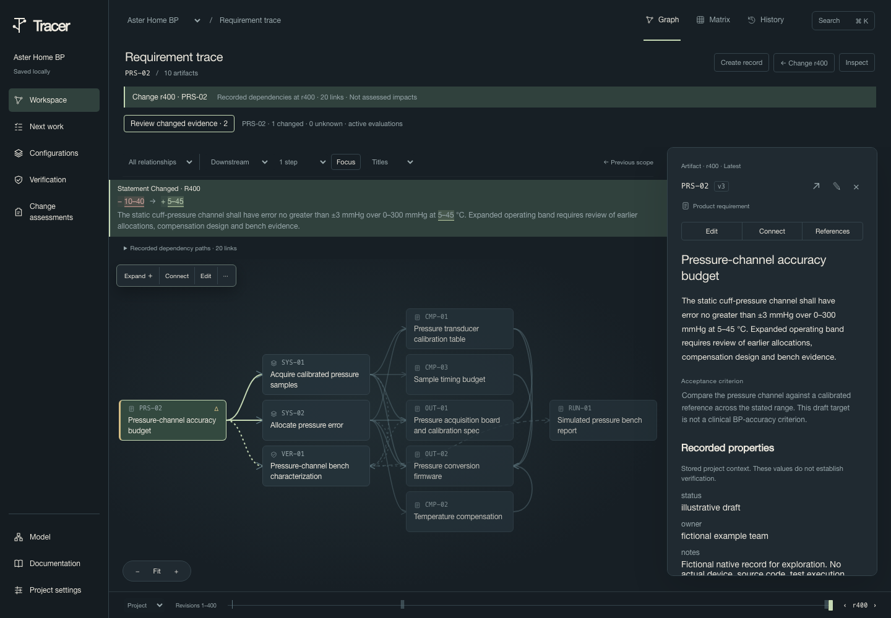
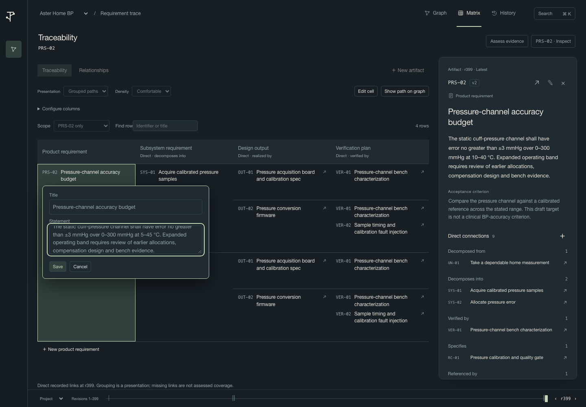
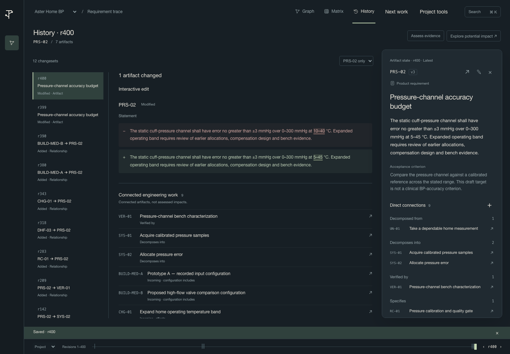
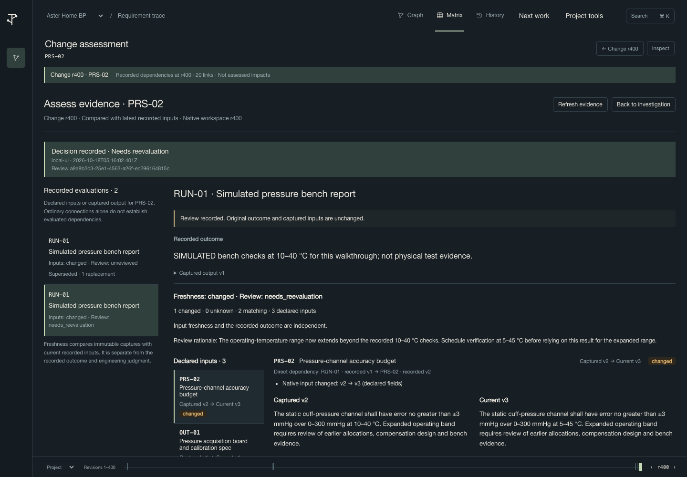
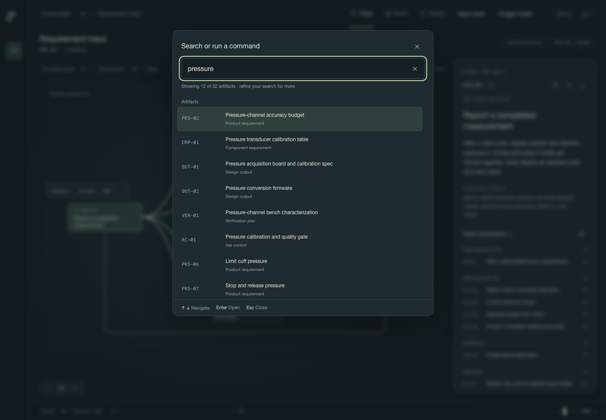
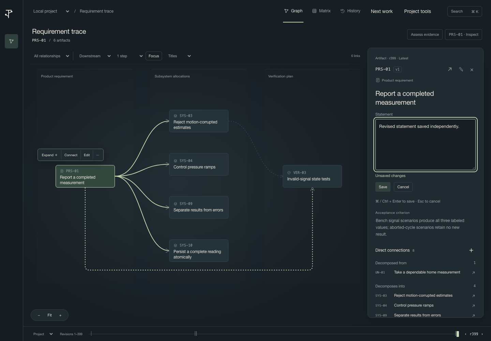
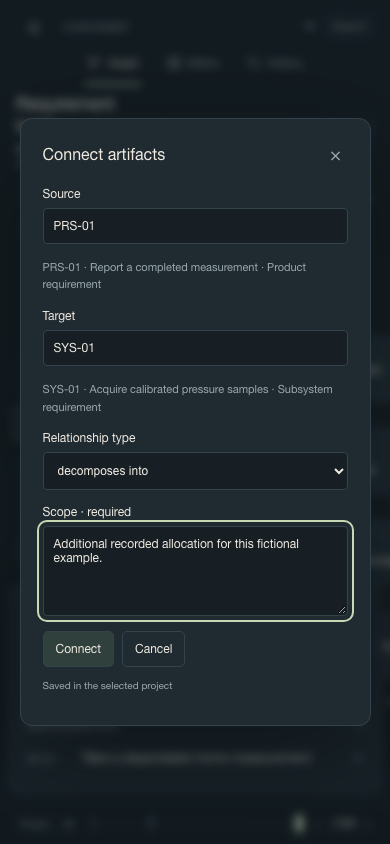

# Workspace reference

Start with [Explore an example](getting-started.md#explore-an-example) or [Start your own project](getting-started.md#start-your-own-project). This reference covers additional editing, evidence, configurations and the retained Development map.

## Primitives: what to create and when

Tracer uses one model for engineering information and its supporting context. **Model what you need to manage independently. Reference supporting material. Capture exactly what a conclusion used.** Your project chooses its vocabulary; requirements, components, risks and test plans are examples, not mandatory built-in types.

The concepts below are not all independent primitives. Entities, directed relationships and their identified native states form the structural foundation, governed by the schema and history. A **resource** is an entity capability; a **reference** specializes a relationship. Observations, evaluation receipts and reviews are specialized immutable capture operations. In particular, a **review is an assessment of a captured result's applicability**, not another basic engineering object you must add to your project model. Its dedicated operation preserves the comparison and enforces the review rules. See the [reducibility audit](architecture.md#primitive-reducibility-audit) for the design reasoning and alternatives.

| Concept                  | What it means                                                                                                                                             | Use it for                                                                                                                                                                                  |
| ------------------------ | --------------------------------------------------------------------------------------------------------------------------------------------------------- | ------------------------------------------------------------------------------------------------------------------------------------------------------------------------------------------- |
| **Model / schema**       | The project's record types, fields and allowed relationship types/directions.                                                                             | Define what a requirement contains and which types it may connect to. Permissions describe allowed data; they do not prove completeness or success.                                         |
| **Engineering record**   | A managed item with stable identity, typed fields and native history. The API calls it an entity; screens also call it an item or artifact.               | A requirement, component, decision, test plan or assessment you need to find, revise and connect independently. Renaming it does not create a new identity.                                 |
| **Resource**             | A reusable information identity with a label and optional stable external source identity. It need not have a project engineering type.                   | A specification, interview, repository file or test report referenced by several records. A resource capability can also belong to a managed record; these are not competing copies.        |
| **Relationship**         | A typed, directed connection with its own identity, fields and history.                                                                                   | “Requirement allocated to component” or “requirement checked by plan.” Your schema defines the vocabulary and allowed endpoints. A link does not prove satisfaction.                        |
| **Contextual reference** | A relationship qualified with the material's role, an optional selector/explanation and current or pinned state.                                          | “This requirement uses section 4.2 of this specification as its definition source.” Two passages may have separate reference identities pointing to the same resource.                      |
| **Captured state**       | The exact native version or external observation selected for a use. An observation records availability, location, time and hash/commit where available. | Explain which requirement revision or report content was used. A hash identifies observed bytes; it does not store those bytes or establish their meaning.                                  |
| **Evaluation receipt**   | An immutable recorded outcome with captured output, explicitly declared inputs, schema and provenance.                                                    | Record a test, analysis or engineering conclusion against identified criteria, article, procedure and supporting material. A test plan or cited report alone is not an executed evaluation. |
| **Review decision**      | A reasoned judgment tied to a particular comparison of a receipt's inputs.                                                                                | Record Accepted, Acknowledged or Needs reevaluation without rewriting the original result or clearing detected changes.                                                                     |

Records/resources and relationships/references share native identity and history; observations, receipts and reviews have identified append-only capture history. A reference is a qualified relationship, not a second citation database. A resource can later become a managed record under the same identity if the project's fields and link permissions allow it. There is no need to create a universal “Evidence” type or one managed record per excerpt.

### Decide where information belongs

- **Put text in a field** when it is part of the record's own definition: a requirement statement, rationale or acceptance criterion. Use the project's declared fields; there are no mandatory universal field names.
- **Create a separate record** when the thing needs its own identity, edits, ownership context or relationships: a component, decision, reusable test plan or independently tracked document.
- **Add a resource and reference** when material explains or defines something but does not need a separate engineering lifecycle. Reuse the existing resource for another passage or another record; explain why each use matters.
- **Record an evaluation** when you have an actual outcome to preserve. Declare what was used; citing material, linking a plan or reaching a record through the graph does not automatically make it an evaluation input.
- **Record a review** when deciding whether a captured result still applies. Keep that judgment separate from both the original outcome and the detected changes.

For example, copy the engineering requirement you intend to manage into its statement field, then reference the authoritative source section. An interview passage can support a user need without becoming another requirement. If the specification itself needs controlled ownership and links, manage it as a record with resource capability rather than creating a duplicate document identity.

### Example: a power requirement and its verification

This is a modeling example with simulated results, not product verification. Type and relationship names are illustrative and must be defined in your project model.

| Information                                                                       | Representation                                                                                                | Why                                                                                                                                                                        |
| --------------------------------------------------------------------------------- | ------------------------------------------------------------------------------------------------------------- | -------------------------------------------------------------------------------------------------------------------------------------------------------------------------- |
| “The product shall consume no more than 20 W in normal operation.”                | Requirement record `REQ-POWER`, with statement, acceptance criterion and rationale.                           | Engineers manage and revise the obligation.                                                                                                                                |
| Customer specification, revision C, section 4.2                                   | One resource plus a **definition** reference from the requirement, pinned to the observed revision C content. | Retain the authoritative source and the reason for this use without duplicating the document.                                                                              |
| Product revision A                                                                | Component/article record with the tested revision explicitly declared.                                        | Identify the candidate that was assessed.                                                                                                                                  |
| Power measurement procedure P1                                                    | Verification-plan record linked to the requirement and article as appropriate.                                | Preserve the planned method separately from an execution.                                                                                                                  |
| Run A at 23 °C in normal mode                                                     | A test-run record with conditions, if runs need independent management.                                       | Conditions and activities can differ between executions.                                                                                                                   |
| Report showing a measured peak of 19 W                                            | Resource plus a **supporting result** reference from the run.                                                 | Preserve the reported material and its interpretation.                                                                                                                     |
| “SIMULATED PASS: 19 W ≤ 20 W for article A under P1 and the recorded conditions.” | Evaluation receipt for a managed power-assessment record.                                                     | Preserve the conclusion with explicit inputs: criterion, article revision, procedure, run/conditions, source/report observations and any relevant reference relationships. |

Keep a stable assessment output if a later receipt will explicitly supersede this one. A repeat run can have its own record and conditions as inputs. Supersession requires the same output identity and retains the original receipt; unrelated run identities do not automatically replace each other. These project record types are optional modeling choices, not extra core primitives. For controlled criterion results and case-level replacement accounting, use the [requirement verification capability](#requirement-verification); generic receipt supersession and explicit verification-result selection are different operations.

### Use the primitives in the application

1. Open **Model** to inspect the project's types, fields and allowed connections. Create the requirement, article and plan using those definitions. Use **Add relationship** to connect independently managed records.
2. To cite material, first configure a relationship family that explicitly permits references and resource targets. See the [reference-family example](developer-reference.md#local-resources-and-contextual-references); the Engineering starter does not automatically supply every reference family. Select the subject and open **References and supporting material**. Choose an existing resource or create one, give the use a role and explanation, and identify the section or passage.
3. For a local file, enter its path and choose **Observe file**. Choose current or deliberately pin an observed state. Location is separate from identity: after a move, keep the resource identity and observe its new location. Similar titles, paths or hashes do not automatically merge resources.
4. When recording an evaluation, select its output and explicitly declare the actual inputs and their state/field scope. **Project tools → Evaluations → Record native-input receipt** handles native inputs; the reference task and [headless reference/evaluation API](developer-reference.md#local-resources-and-contextual-references) also support captured content and direct relationship inputs. Record a real outcome, or clearly label a simulated one.
5. After changing a native input or explicitly observing changed external content, open **Assess evidence** on an affected item. Inspect captured/current inputs, then **Review receipt** and record a reasoned decision. Returning to the graph or opening another view does not itself record a judgment.

Saving creates guarded native changes; rejected/conflicting saves retain proposals for deliberate correction. Finish or discard drafts before reloading. File/Git observations are explicit local operations, not continuous synchronization or a general cloud-document integration. See the [developer reference](developer-reference.md#offline-evaluation-workflow) for exact API/CLI selectors, guards and limits.

### Understand versions, change and uncertainty

**Identity answers “which thing?”; captured state answers “which version or content?”** A resource's native version covers its Tracer annotations. Its external content can change while that native version stays the same.

| Selection or result    | Meaning                                                                                              | What to do                                                                                                                        |
| ---------------------- | ---------------------------------------------------------------------------------------------------- | --------------------------------------------------------------------------------------------------------------------------------- |
| **Current reference**  | Uses the latest recorded/observed state. It does not promise a live source check.                    | Observe external content explicitly when you need a newer state.                                                                  |
| **Pinned reference**   | Selects an exact native revision or external observation; later changes do not silently retarget it. | Inspect selected versus latest state and deliberately adopt a different pin if appropriate.                                       |
| **Evaluation capture** | Freezes the declared inputs/output and outcome used for that conclusion.                             | Capture a new receipt for a new execution; preserve the old one.                                                                  |
| **Freshness: changed** | Declared input scope differs from what the receipt captured.                                         | Assess relevance. Change is not an automatic failed test or invalid historical result.                                            |
| **Freshness: unknown** | Available recorded information cannot establish the comparison. Known changes may also be present.   | Resolve missing information or record Needs reevaluation; unknown input state cannot be accepted as known.                        |
| **Review: accepted**   | A reviewer accepted the explained comparison context.                                                | Read the rationale and scope. Acceptance does not erase drift, change the outcome or automatically mark the requirement verified. |

In the power example, changing the criterion from 20 W to 18 W leaves the original “19 W ≤ 20 W” outcome intact and makes the relevant input comparison changed. That receipt still explains the original assessment; applicability to the new criterion needs review or another execution. An unrelated rationale edit can leave a field-scoped comparison unchanged. A later relevant change requires renewed assessment even if an earlier comparison was accepted.

A different whole-file hash does not prove that section 4.2 changed, and an unchanged native annotation does not prove external content is current. Passage resolution remains unknown in the local slice. Observations retain metadata, not external file bytes: preserve the source content separately when reproducibility requires it. Pinning a hash is not a document archive.

### Reuse information across views and milestones

Graph, Matrix, History and evidence views project the same identities and links. A different presentation does not create another engineering model or infer an evidence dependency. Structural coverage means qualifying connections exist; it does not mean the requirement passed a test.

A **configuration** captures explicitly selected native member and relationship revisions, observed-content selections and declared scope/context. Older native-only captures retain their original omissions; omitted topology or content stays unknown. A **baseline** captures a committed native project state, including schema and topology. Neither retains external file bytes or proves release readiness. A named **Matrix configuration** is instead a saved presentation recipe for row/path/search choices. It does not pin the engineering versions shown.

For implementation contracts, see [primitive contracts for extension](architecture.md#primitive-contracts-for-extension). For exact source/state selectors, receipt inputs and commands, use the [developer reference](developer-reference.md#local-resources-and-contextual-references).

## Workspace navigation

The left rail returns to the **Workspace**, opens **Model**, and opens
**Documentation** directly. Graph, Matrix and History remain perspectives on the
same selected record and revision.

**Project tools** groups the available tasks into **Engineering work**, **Records
and evidence**, **Project setup and exchange**, and **Help**. Use **Project task**
in an open task or model-page header to switch directly to another task. The
selected task is shown in the selector. **Return to workspace** returns to the
perspective, selection and revision you left.

Switching tasks keeps their in-session drafts. It does not save them, adopt a new
basis or acknowledge an uncertain mutation. Unsaved drafts still do not survive
reload or closing the tab. Tasks that require a selected record are disabled when
no record is selected. The task selector supports normal keyboard selection;
Escape closes a task dialog and returns to the workspace.

## Configuration changes

Open **Project tools → Configurations** to work with a named engineering change.

1. Use **Capture configuration** to prepare explicit native members,
   relationships and observed resource content. Inspect scope and omitted/unknown
   states before capturing; a capture does not establish complete project coverage.
2. Use **Compare configurations** to select the exact before/after pair. Apply
   that pair deliberately; refreshing live evidence does not replace its states.
3. Inspect record, relationship/reference and observed-content differences.
   Whole-document change does not establish that a referenced passage changed.
4. Use **Assess displayed pair** for a reasoned scope and follow-up actions.
   Verification can target the selected after configuration; only an actual
   controlled conclusion can account for required re-verification.

The same **Project task** selector moves between Configurations, Change
assessments and Verification while their drafts remain mounted. Existing guarded
handoff controls carry the exact selected pair/target; manually switching tasks
alone does not invent a handoff or change an already selected candidate. See the
[configuration workspace reference](developer-reference.md#use-the-configuration-workspace)
for detailed authoring and service bounds.

## Requirement verification

Open **Project tools → Verification** to manage an explicit requirement-to-verification case. **Change assessments** and **Assess evidence** judge evidence applicability; Verification records the criterion outcomes and controlled conclusion. Neither a plan link nor an accepted evidence review establishes a passing result.

A project must supply a native `requirement_verification` application-model descriptor and permitted requirement, method, case and activity types. The descriptor binds project field names, relationship roles, state/outcome labels and the policy for assessed design changes. Existing schemas are not upgraded automatically. See the [model installation and headless contracts](developer-reference.md#controlled-verification-cases-and-execution-capture).

1. Choose **New verification**, select the model and requirement, and prepare the current basis. Highlight exact acceptance passages or choose an entire acceptance field; give each criterion a stable identity. Assign methods through the declared requirement-to-method connections. Declare complete or partial source coverage and explain the scope. Complete coverage must account for all acceptance text, and every declared criterion needs its method obligations before verification can conclude.
2. **Record activity** with a declared method, actual conditions and explicit observations, rationale and outcome for each assigned criterion. Outcomes are passed, failed, blocked or not run, with project-configured labels. Recording `not_run` does not claim the method executed. Choose an earlier recorded activity only when deliberately interpreting its exact original requirement/method inputs; retain the original receipt and explain the interpretation.
3. Add relevant supporting native fields, observed content or direct connections. The model, governing basis and owned activity membership are captured automatically. Selecting an external record's native annotations does not capture its file bytes. Inspect saved activities to see their exact input versions and any separate original-activity comparison.
4. **Choose results** explicitly for each criterion/method obligation. Account for every activity as selected, historical or superseded, with rationale and an appropriate replacement where required. A later failure or partial activity cannot silently disappear behind an older pass. Failed results remain failed even when superseded.
5. Read the outstanding-work explanation, then give a reason and **Conclude verification** when all declared obligations have applicable passing results, complete source coverage and current accounting. The conclusion applies to this case's scope; it does not rewrite a global requirement status or establish release approval or user validation.
6. After a relevant change, refresh and inspect the affected activity. **Compare and review activity inputs** opens the shared exact comparison and review controls. A review cannot override changed governing criteria/methods or turn a failed result into a pass. Where the pinned policy permits assessed design changes, explicitly reselect results after review. Otherwise reopen, revise the basis if needed, record new activity, account for the retained history and conclude again.

Drafts survive returning to the map within the tab. Refresh retains draft text, but changed preparation requires explicit adoption before saving. A failed read pauses writes. An uncertain save uses **Save recovery** to inspect the original command outcome; it never automatically replays the proposal. Reload retains saved engineering work but discards unsaved drafts after the existing warning; reopen Verification and select the saved case. Input-review drafts also remain mounted when returning to activity inspection; save or discard them before authoring or concluding.

The UI searches the complete bounded project snapshot and shows up to 50 matching record choices. Supporting material has explicit 25-item pages. Basis preparation currently offers the first 100 requirement-to-method connections and discloses any additional population; use the headless exact-selection contract for methods beyond that authoring limit. The application limits a basis to 25 criteria, 10 methods and 100 assignments, a case to 100 activities, and an activity to 20 additional support uses. These are explicit scope limits, not arbitrary-scale readiness.

## Scoped change assessments

For an exact captured change, start in **Configurations → Compare configurations**, apply the pair and choose **Assess displayed pair** with an explicit investigation root. Explicitly start the offered assessment, choose its model/traversal and prepare it. Pair candidate context reads the selected before/after states; later project edits do not replace them. The baseline/current workflow below remains available.

Within a pair assessment, **Verify after configuration** offers a case bound to the after capture. Prepare criteria and methods from that target, record actual results, select/account for activities and conclude. Supporting inputs distinguish selected resource defaults from independent contextual reference uses. Inspect target-qualified support judgments separately from live-head drift. Return to the assessment and attach the controlled conclusion under an action's **After-target verification conclusion**. Refresh scope and account for new candidates before completion. A raw passing report, review or link does not establish controlled verification.

Use **Project tools → Change assessments** when a change needs an independently tracked scope, candidate judgments and unfinished actions. This is different from reviewing one captured receipt's applicability. The project must already contain a versioned change-assessment application model; [application-model setup](developer-reference.md#pinned-application-models) explains installation without silently changing existing projects.

1. Choose **New assessment**, select the application model/version, and enter a title and purpose. Select the changed record and a named native baseline. Choose direction, relationship kinds and depth deliberately. No relationship kinds means the root record and its declared captured uses. If there are no baselines, name and capture the current native state first.
2. Choose **Prepare assessment**, then **Open assessment**. Preparation captures the current native/model/evidence context. A competing change rejects the save and retains the proposal; refresh, inspect and explicitly adopt refreshed context. Opening freezes a complete selected traversal within the 25-candidate limit, not every possible engineering consequence. An oversized scope must be narrowed explicitly.
3. Select a candidate. Read why it was included, the recorded discovery basis and current context. Evaluation candidates retain their original outcome; the full captured-input comparison may be broader than this assessment's selected scope.
4. Choose a decision and explain the rationale. Supporting selections distinguish **Historical context** from **Must remain current**. Native record selections capture annotations; observations select external content state. A historical result does not assert that its inputs still apply today.
5. Record actions for required revision, investigation or reverification. Saved actions retain their identity. Done actions need a resolution and known support including current evidence; reverification needs a related current evaluation with explicit candidate inputs. Record the actual execution separately through Evaluations or the headless interface. A report title or output name alone does not establish verification. Waiver and unknown acknowledgment are available only under the pinned model's explicit policy.
6. Save candidate judgments. **Refresh selected scope**, with a reason, includes newly discovered results while retaining earlier obligations. A new verification receipt may itself add a candidate that needs a judgment. Complete counts and outstanding states come from the shared application service.
7. Enter a reason and choose **Complete assessment** once discovery is current and every candidate is accounted for. **Scope accounted** means that declared scope has a controlled conclusion; it is not release approval. Later changes can show **Needs reassessment** while preserving historical completion. **Reopen for reassessment** records a reason and starts explicit reassessment.

Returning to the map retains the task and its tab-local drafts. Reload preserves saved records, not unsaved forms. A refreshed candidate or project cannot silently replace a judgment's assessed basis: inspect it and choose **Adopt current assessed basis**. Failed reads retain the view/draft but pause saves. An uncertain save pauses all writes; **Refresh saved records**, inspect the exact command result, then deliberately continue. Continuing never replays the write. For an uncertain opening, inspect the recorded assessment list before deciding to prepare another creation.

Assessment names and candidates are discovered from the loaded project snapshot; searches disclose their display bounds. Server validation establishes controlled opening, judgment ownership and completion. The UI does not infer those guarantees from a record type, JSON field, graph link or authored status. See [application contracts](architecture.md#candidate-judgments-actions-and-supporting-basis) for exact semantics and limits.

## Graph, Matrix and History

The normal launch opens **Graph**. Search for an artifact, use **Matrix** for title-first creation and direct connections, then edit a statement and open **History** to read its saved diff. **Explore potential impact** follows exact recorded paths; connectivity alone does not establish an assessed effect.

For a project without seeded evidence, open **Project tools → Evaluations → Record native-input receipt**. Choose the output, write the actual outcome and declare the exact input items and field scope. Historical native versions and configuration pins are available when needed. Record the receipt before changing an input, then return to that input and choose **Assess evidence**. Compare the captured and current values, select **Review receipt**, choose a decision and record its rationale. The receipt, freshness comparison and review remain separate facts.

**Project tools** also opens **Configure model**, **New item**, complete **Edit item and connections**, **Configurations**, and **Documentation**. The **Project task** selector switches directly between these tasks; **Return to workspace** retains the in-session draft and original perspective. These tools use the selected database and existing version guards.

Reload recovers selection, graph positions, Matrix settings, revision and investigation scope in the same browser and origin. Use **Save Matrix configuration** for a named database-backed row-type/path/search recipe; loading one applies it across the project. Unsaved edits and review rationales are not recovered after reload or close: the browser warns, and reopening explains that policy. An unconfirmed save requires inspection and acknowledgment before new writes; it is never automatically resubmitted.

**Graph — investigate a change through its recorded dependency paths.**



**Matrix — edit engineering information without leaving the traceability context.**



**History — inspect the saved change and connected engineering work.**



**Assessments — compare captured inputs and record an engineering decision.**



_Native-backed workbench at 1440×1000 using fictional Aster data. The walkthrough saves an edit at r400 and an immutable review; evaluation outcomes are explicitly simulated._

## Search, edit and connect

Open **Search** or press **Command/Control-K** to find an artifact by identifier, title or statement, or run a workspace command. Use Up/Down to move through suggestions and Enter to choose one; Escape closes search. Counts disclose matches beyond the displayed results.



Click a declared text field to edit it in the inspector. **Command/Control-Enter** saves the active editor; **Escape** cancels it. Saving or cancelling one inline field retains other unsaved field proposals in the same tab. **Unsaved changes** describes the proposal; a saved revision is confirmed only after the guarded write succeeds. Pending saves lock their controls, and conflicts retain the proposal for deliberate review.



Choose **Add relationship** in the inspector or **Connect** on the graph. The source uses an existing identifier. Search the target by identifier or title, then choose a compatible suggestion to supply its exact identifier. Review the selected target, relationship type and any required scope before **Connect**. **Cancel** closes the dialog without creating a relationship. Returning from relationship inspection or a dismissed dialog restores a usable focus target, including after resize.



_These additional captures use a fresh fictional Aster project at r399. The statement is an unsaved proposal; the connection is prepared but has not been submitted. The phone capture is 390×844; desktop captures are 1440×1000._

## Use the retained Development map

The following map walkthrough uses **Project tools → Development map**. It retains the overview, Items table and guided connection controls; **Graph / Matrix / History** returns to the main workspace. Finish or deliberately discard unsaved drafts before changing workspaces.

## Follow a shared design

Choose **Orbit R1**, search `DES-01`, and open the matching result. The map follows the actual recorded relationships around the blower-control firmware design. Use **Levels** and **Trace direction** to adjust context, or **Follow connections** to walk one native link at a time. **← Data model** returns to the overview. **Frame all** changes the camera; it does not change scope or evidence.

Choose **Items table** to read the same scope as rows. Select an item for its full statement and immediate connections. **Graph** returns to the map. A shared item retains one native identity, even when several requirements refer to it.

In Aster, search `PRS-01` to follow a product requirement into its subsystem allocations and verification plan. Allowed schema routes and recorded links remain distinct; a plan is not an executed test result.

## Make and retain an edit

Select an item and choose **Edit item and connections**. Click a displayed field or choose **Edit item** for the complete form. **Save item** checks the captured version. **Cancel** discards that editor's local proposal; rejected saves retain it. Review current versions deliberately after a conflict.

**Return to map** or Escape hides the task while keeping its in-session draft. Open the same task to resume. Choosing another item with a dirty editor requires an explicit discard decision. Reloading the browser does not preserve an unsaved draft.

The task's connection controls create native typed directed links with captured endpoint/schema guards. A saved connection is trace information, not approval or proof of satisfaction.

## Create records and configure the model

Use **Configure model** to define item types, typed fields and allowed relationships. The [custom model exercise](custom-model.md) walks through defining a vocabulary from scratch. The existing Visual/Text proposal editor retains its schema-version checks and conflict recovery. On a new project, choose a starter or define your own model. **New item** creates a native record using that project's actual fields; optional keys remain optional. A model change retains a creation proposal and requires explicit adoption before saving.

## Import existing CSV data

Use **Project tools → Import CSV** after saving a model. Map record fields and key-based links, inspect errors and ignored columns, then commit the entire file together. See the [CSV import guide](csv-import.md) for record/link modes, formats, limits and concurrency behavior.

## Export project records and evidence references

Use **Project tools → Export project** to prepare and download one consistent snapshot with exact current/historical versions, original provenance, recorded evidence and captures. The prepared file stays fixed until you prepare again. External content must be preserved separately. See the [export guide](project-export.md) for the format, CLI/API access and bounds.

## Choose the next piece of work

Open **Next work** from the workspace header or Project tools. Statement, allocation, verification-plan, evidence-drift and review queues have separate counts and direct actions. Return from editing/review refreshes the list while retaining in-session drafts. The [next-work guide](next-work.md) explains queue definitions, model choices and why a review decision does not clear input changes.

## Review evidence and change

Open **Evaluations**, choose a receipt, and compare its captured/current declared inputs. Orbit's `EVAL-R02` predates a change to `DES-01`. The recorded outcome stays unchanged while input freshness shows the difference. Freshness, technical outcome and missing execution evidence are different questions.

Record a native-input receipt, observe an external artifact or record a scoped review through the existing evidence controls. Unknown save outcomes pause further saves and offer **Refresh saved records**; inspect the result before explicitly continuing. A lost response is not evidence that nothing saved.

## Inspect a build

Open **Configurations** to read or capture exact native member revisions. Orbit includes `BUILD-R01 · selected native inputs`, which captures older firmware while the current design identity has moved forward. Captures are immutable selected sets, not proof of a complete BOM or release readiness.

## Organize and return

Expand a type on the **Development map**, open a folder where one has been explicitly authored in this session, or use **Browse folders**. Categories narrow records across types. Unassigned records remain directly discoverable; no folder hierarchy is inferred from an engineering trace.

Folder/category edits, their Undo operation and map **Save view** recipes are session-only. They do not change native engineering identities/links and are discarded on reload or project switching. The headless API/CLI's existing saved-view contracts are separate from these map recipes. Durable map organization is not delivered by this integration.

## Open multiple projects

Supply the databases explicitly to add a second project to the picker:

```sh
npm start -- --db first/project.sqlite --secondary-db second/project.sqlite
```

Optional `--guide` and `--secondary-guide` arguments attach example guides. The databases must be different. Switching projects confirms draft disposal and reloads against the selected database; records and browser recovery stay project-specific. Use the printed **Resume saved setup** command to reopen the configured projects. See [realistic examples](realistic-examples.md) for seeding and resuming example databases.
